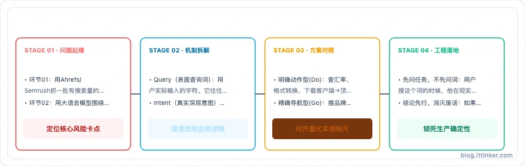
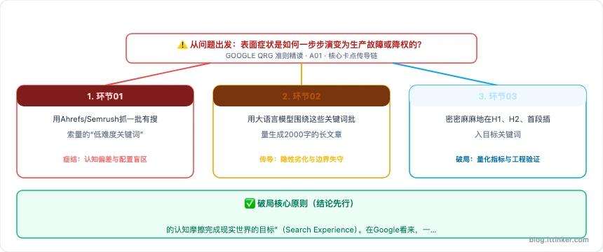
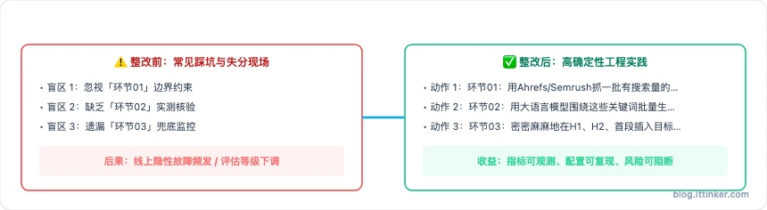
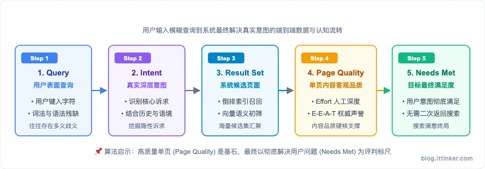
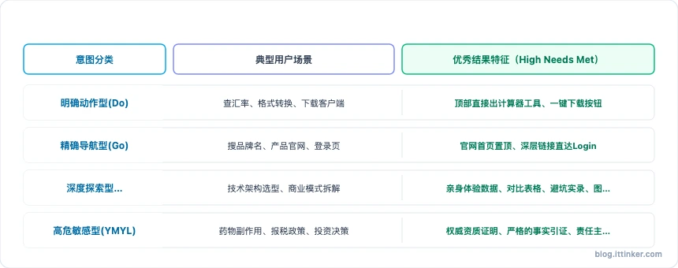
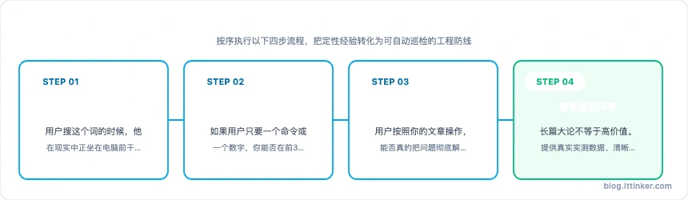

# “堆砌关键词就能拿排名”？向爬虫妥协的古董思维，为什么正在让你的站点沦为数字垃圾？从 Search Experience 读懂搜索质量总模型 | 读懂 Google Search 基础认知 系列 001

> 🌐 **在线阅读与互动版**：[“堆砌关键词就能拿排名”？向爬虫妥协的古董思维，为什么正在让你的站点沦为数字垃圾？从 Search Experience 读懂搜索质量总模型 | 读懂 Google Search 基础认知 系列 001](https://blog.ittinker.com/posts/google-搜索到底想解决什么问题/)
> 📚 **所属专栏**：[《读懂 Google Search：110篇搜索质量与SEO实战指南》](../README.md)

---

### 📌 结论先行（TL;DR）
> **Google 搜索的底层目标不是“帮关键词找到匹配的网页”，而是**“帮人类以最低的认知摩擦完成现实世界的目标”**（Search Experience）。**
> **在我们的系列置顶总览（[读懂 Google Search：110 篇搜索质量与 SEO 实战指南](/posts/google-search-guide/)）中，我们确立了这套专题的根本原则：**不把 QRG 当作玄学猜想，也不将其当成生硬的算法逆向工程，而是将其作为观察 Google 搜索演进终局的北极星窗口。**
> **作为「系列 A：逐章读懂 Google Search Quality Guidelines」的开篇，我们必须先回到最原始、却被 90% 的 SEO 从业者忽视的问题：**Google 搜索到底想解决什么问题？**
>
> - **在 Google 看来**：一次完整的搜索体验涵盖了从模糊 Query 到意图识别，再到结果交付与需求满足的完整流程。
> - **基于 QRG 0.0**：我们为整个系列确立唯一的分析总模型：**Query（查询） → Intent（意图） → Result（候选集） → Page Quality（单页品质） → Needs Met（需求满足）**。
> - **理解了这个链路**：你就会明白为什么纯靠关键词堆砌的传统 SEO 在现代搜索系统中彻底失效。

---

### 🚨 2026 → 2024 官方最新风向预警：Google 对Google 搜索质量核心理念从词频匹配向任务交付闭环的演进的策略演进

#### 🕒 2026 → 2024 Google 官方对Google 搜索质量核心理念从词频匹配向任务交付闭环的演进的策略演进

- **2026 · 端到端任务完成度（Task Completion）成为最高排名因子**
  Google 搜索全面转向生成式与交互式交付。算法不再孤立评估单页内容，而是通过多模态视距与实时用户交互信号，追踪用户是否在当前页面彻底完成了目标任务，未解决任务并导致二次搜索的页面排名被加速降档。

- **2025 · 交互信号与满意度闭环（NavBoost & CrUX 联动深化）**
  Google 将真实 Chrome 访客留存深度、滚动深度与跳出回退（Pogo-sticking）比率纳入核心满意度打分。针对纯靠关键词堆叠的空洞页面，系统自动施加意图不匹配（Intent Mismatch）负向修正。

- **2024 · 核心更新确立用户体验导向（Helpful Content 融入核心排名）**
  Google 历次核心更新彻底将有用内容系统整合进通用排名算法，正式宣告传统‘为了搜索引擎写内容’的技术终结，确立‘以人为本、顺畅交付页面目的’为唯一质量基石。

---

## 1. 传统 SEO 的认知错位：匹配词，还是交付任务？

很多做出海独立开发或内容站的朋友，在做 SEO 时往往遵循一套机械的流水线：
1. 用 Ahrefs / Semrush 抓一批有搜索量的“低难度关键词”；
2. 用大语言模型围绕这些关键词批量生成 2000 字的长文章；
3. 密密麻麻地在 H1、H2、首段插入目标关键词；
4. 等待收录，然后困惑为什么排名只有短暂的波动，随后迅速沉底。

这种打法的根本误区在于：**把搜索引擎当成了字符串倒排索引数据库**。

在 Google 的官方评估指南 QRG 第 0.0 节《The Search Experience》中，开篇就指出了搜索的本质：

> *"The World Wide Web is a vast collection of billions of webpages, containing an incredible amount of information. However, the web is also full of unhelpful, misleading, and low quality information. A search engine must help users find high quality, helpful results from all over the web."*

用户敲下搜索框的那一刻，从来不是为了“欣赏一段包含特定关键词的文字”，而是因为**他们在现实生活中遇到了某种卡点、某种疑问或某种行动冲动**：
- 他可能想下载某个开源工具的安装包（Action / Do）
- 他可能正面临服务器 CPU 100% 崩溃的紧急故障（Crisis / Urgent Problem）
- 他可能在对比两款出海支付网关的费率与结算周期（Comparison / Know Simple）
- 他可能在深夜搜索某种突发的心绞痛症状（YMYL / High Risk）

如果一个页面精确包含了用户搜索的每个字，但通篇废话、没有下载链接、没有排错命令、或者给出了过时的错误医疗建议，那么对于用户来说，这次“搜索体验（Search Experience）”就是彻底失败的。

**Google 的终极商业护城河，正是让全球用户在遇到问题时，第一时间相信“搜一下就能解决”，而不是搜出一堆 AI 废话。**

---

## 2. 搜索质量总模型：五步核心链路

为了在后续 110 篇实战分析中拥有统一的思考语言，我们根据 Google QRG 的核心逻辑，提炼出贯穿全系列的**搜索质量评估总模型**：

### 拆解模型的五个核心环节：

1. **Query（表面查询词）**：
   用户实际输入的字符。它往往是模糊、简短甚至带有错别字的（例如用户搜 `vps ssh timeout`）。
2. **Intent（真实深层意图）**：
   用户输入这个词背后究竟想达成什么？他是要找排查步骤？要查客户端配置？还是要了解是否被防火墙阻断？Google 通过 RankBrain、BERT、MUM 及大模型语义理解，试图将 Query 还原为多维意图。
3. **Result（候选结果集）**：
   搜索引擎从数百亿网页中检索出语义相关、具备基础信誉的候选网页。
4. **Page Quality（页面客观质量，简称 PQ）**：
   脱离具体的查询词，**单看这个网页本身是不是一个好网页**？内容是不是原创、有没有专业度、作者是谁、排版是否清晰、有没有恶意欺诈（详见后续 A05~A18）。
5. **Needs Met（需求满足度，简称 NM）**：
   把这个网页放回用户的特定 Query 和特定场景下，**它到底有没有把用户的事情给办妥**？（详见后续 A23~A28）。

**致命的区别就在于：很多独立站的内容 Page Quality 看起来并不低（文字通顺、篇幅很长），但它的 Needs Met 极差——用户看完依然不知道怎么操作，只得点击返回重新搜别家。在 Google 看来，这种内容就叫“无用内容”（Unhelpful Content）。**

---

## 3. 为什么“不同 Query 需要完全不同的结果类型”？

QRG 0.0 明确指出：多样化的用户诉求，决定了不可能存在一套放之四海而皆准的“万能排版格式”。

我们可以将搜索场景划分为四种典型形态：

| 意图分类 | 典型用户场景 | 优秀结果特征（High Needs Met） | 劣质垃圾特征（Low/Fails） |
|---|---|---|---|
| **明确动作型 (Do)** | 查汇率、格式转换、下载客户端 | 顶部直接出计算器工具、一键下载按钮 | 2000字废话讲汇率历史，最后才给个无效链接 |
| **精确导航型 (Go)** | 搜品牌名、产品官网、登录页 | 官网首页置顶、深层链接直达 Login | 假冒仿冒站、重定向联盟推广站 |
| **深度探索型 (Know/Research)** | 技术架构选型、商业模式拆解 | 亲身体验数据、对比表格、避坑实录、图表解析 | 泛泛而谈的理论堆砌、AI 生成的三段论八股 |
| **高危敏感型 (YMYL)** | 药物副作用、报税政策、投资决策 | 权威资质证明、严格的事实引证、责任主体清晰 | 匿名博主随意给出的金融理财“必赚秘籍” |

这就是为什么很多做独立站的朋友感到困惑：“为什么有的工具站只有一行代码一个输入框，排名常年第一；而我辛辛苦苦写了三万字教程，排名却上不去？”

因为那个工具站以**秒级**满足了用户的“Do 意图”，而你的三万字长文给想马上干活的用户制造了巨大的认知摩擦。

---

## 4. 独立开发者与出海站长的核心行动清单

理解了 Google 搜索想要解决的终极问题后，你在规划每一篇内容、每一个功能页面时，必须先完成以下灵魂拷问：

- [ ] **先问任务，不先问词**：用户搜这个词的时候，他在现实中正坐在电脑前干什么？他手里卡在哪一步？
- [ ] **结论先行，消灭废话**：如果用户只要一个命令或一个数字，你能否在前 3 行就交给他？不要为了“凑字数 SEO”把核心答案藏在最后一段。
- [ ] **全流程彻底解决**：用户按照你的文章操作，能否真的把问题彻底解决？是否附带了必要的容错排障说明？
- [ ] **警惕虚假深度**：长篇大论不等于高价值。提供真实实测数据、清晰架构图与直接可用的代码，远比多码 2000 个文字更有力量。

---

## 下一篇预告

既然 Google 搜索的目标是精准理解人类复杂意图并交付最优结果，而现代深度学习算法与 LLM 已经如此强大，**为什么 Google 每年还要雇佣上万名人工质量评估员（Quality Raters）？这些 Rater 的评分到底会不会直接改变某个网站的排名？**

下一篇，我们将深入拆解 QRG 0.1：**[“QRG 打分就是排名算法”？被无数站长误读的致命迷思：Google 为什么在 AI 时代依然雇佣上万人做人工质量评估？（A02）](/posts/google-为什么还需要人工-quality-rater/)**。

---

_这是「读懂 Google Search」系列第 1 篇，系统拆解 Google 官方质量指南，帮你建立长期抗算法波动的出海 SEO 护城河。_

---

## 读懂 Google Search 专栏导航

> 📚 **专栏收录**：本文为 [《读懂 Google Search：110篇搜索质量与SEO实战指南》](/posts/google-search-guide/) 第 **A01** 篇。

* **专栏主页**：[《读懂 Google Search：110篇搜索质量与SEO实战指南》全景地图与路线图](/posts/google-search-guide/)
