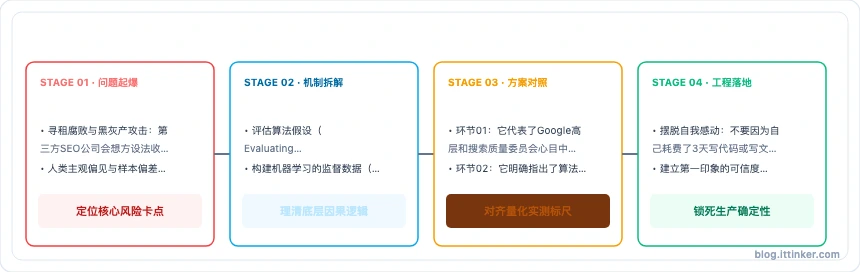
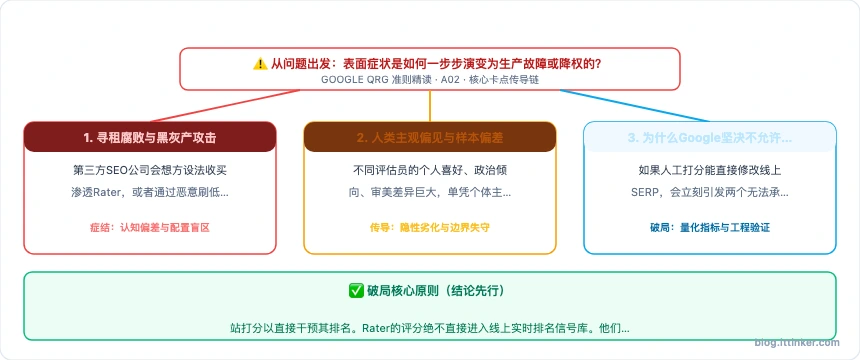
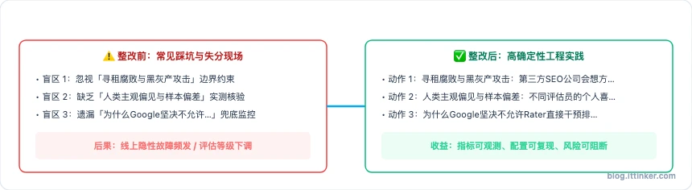
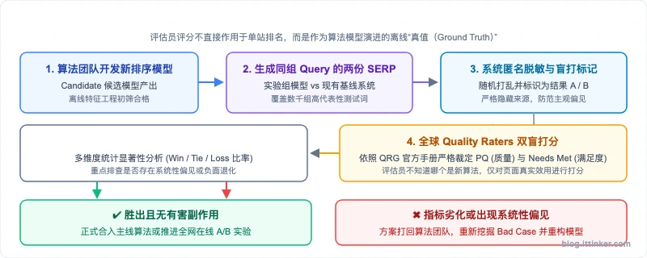
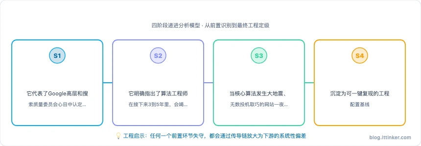
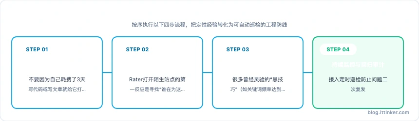

# “QRG 打分就是排名算法”？被无数站长误读的致命迷思：Google 为什么在 AI 时代依然雇佣上万人做人工质量评估？ | 读懂 Google Search 基础认知 系列 002

> 🌐 **在线阅读与互动版**：[“QRG 打分就是排名算法”？被无数站长误读的致命迷思：Google 为什么在 AI 时代依然雇佣上万人做人工质量评估？ | 读懂 Google Search 基础认知 系列 002](https://blog.ittinker.com/posts/google-为什么还需要人工-quality-rater/)
> 📚 **所属专栏**：[《读懂 Google Search：110篇搜索质量与SEO实战指南》](../README.md)

---

### 📌 结论先行（TL;DR）
> **Google 雇佣人工 Quality Rater（质量评估员）的目的，**从来不是给某个具体网站打分以直接干预其排名**。**
> **在上一篇（[“堆砌关键词就能拿排名”？向爬虫妥协的古董思维，为什么正在让你的站点沦为数字垃圾？从 Search Experience 读懂搜索质量总模型（A01）](/posts/google-搜索到底想解决什么问题/)）中，我们建立了全系列的总模型：从 Query、Intent 到 PQ 和 Needs Met。我们知道 Google 的终极追求是让用户以最低的认知摩擦达成目标。**
> **这就引出了一个长久困扰技术圈和 SEO 圈的尖锐疑问：**
> **Google 拥有全球首屈一指的人工智能与深度学习技术栈，大模型和机器学习系统无时无刻不在处理数十亿级查询，为什么还要每年耗费数千万美元，在全球雇佣上万名肉身凡胎的人工评估员（Search Quality Raters）？**
>
> - Rater 的评分绝不直接进入线上实时排名信号库。
> - 他们的真正职责是作为算法迭代的**“离线金标对照组”**：在 Google 工程师测试新算法或调整权重时，由遍布全球的上万名 Rater 在无感知盲测中对比实验组与对照组结果，以此度量算法是在变得“更聪明”还是“更糟糕”。
> - **对于独立开发者而言**：研究 QRG 的价值不是为了讨好某个具体的评估员，而是**为了摸清 Google 整个搜索生态想要进化的方向**。

---

### 🚨 2026 → 2024 官方最新风向预警：Google 对Google 人工质量评估员（Quality Raters）与自动化排名算法关系的官方界定的策略演进

#### 🕒 2026 → 2024 Google 官方对Google 人工质量评估员（Quality Raters）与自动化排名算法关系的官方界定的策略演进

- **2026 · 多模态评估体系确立：评估员指引指导 AI 审查模型迭代**
  Google 进一步公布 QRG 指引在训练其多模态反垃圾与内容审核模型中的基准地位。人工评估数据作为核心对齐语料（RLHF），专门用于纠正自动化算法在细微事实、品牌可信度上的盲区。

- **2025 · 官方重申评估员独立性：评估员不直接操纵个站排名**
  Search Liaison 团队多轮公开发文澄清：人工评估员的分数绝不直接作用于单个网站的日常排名，而是用于对比算法调整前后的宏观质量差异，破除站长‘讨好评估员就能上首页’的臆想。

- **2024 · 评估指引重大更新：弱化机械指标，强化‘真实可信度’**
  Google 在 2024 年更新的 QRG 规范中，全面要求评估员抛弃字数、排版等机械指标，将审查重心彻底转移至‘内容是否具备第一手经验’与‘责任主体是否真实可查’。

---

## 1. 澄清行业第一大迷思：Rater 会直接搞死我的网站吗？

在很多草根站长群里，常常能听到这样的阴谋论：
*“我的站昨天流量断崖下跌，肯定是遇到了人工 Rater 巡查，被他们随手打了个 Lowest 差评给降权了！”*

这是对搜索工业体系最经典的误解。

在 QRG 第 0.1 节《The Purpose of Search Quality Rating》以及 Google 官方技术文档中，Google 多次明确作出制度层面的隔离澄清：

> *"Ratings from raters do not directly affect the ranking of any individual website or webpage. A single rater rating a page as Low Quality will not cause that page to drop in Google Search results."*

### 为什么 Google 坚决不允许 Rater 直接干预排名？

如果人工打分能直接修改线上 SERP，会立刻引发两个无法承受的系统灾难：
1. **寻租腐败与黑灰产攻击**：第三方 SEO 公司会想方设法收买渗透 Rater，或者通过恶意刷低竞争对手网页的评分实施精准打击；
2. **人类主观偏见与样本偏差**：不同评估员的个人喜好、政治倾向、审美差异巨大，单凭个体主观判断直接决定数亿用户的搜索结果，系统的公正性与一致性将荡然无存。

---

## 2. 人工 Rater 的真正工作流程：盲测与算法度量衡

如果 Rater 的打分不直接影响站点，那他们整天在干什么？

Google 每年在搜索算法上进行数十万次实验，最终上线数千项改进。每次重大的核心更新（Core Update）上线前，必须通过严格的**双盲侧向评测（Side-by-Side Experiments）**。

### 核心对照：Quality Raters 评测机制 vs 线上算法直接排名

| 维度 | Quality Raters 人工评测体系 | 线上实时搜索排名算法 |
|:---|:---|:---|
| **评测性质** | 离线实验双盲度量（Ground Truth） | 在线实时特征打分与结果排序 |
| **对单站影响** | ❌ **绝无**针对单一站点的直接干预或升降权 | ✅ 依据全网信号实时动态计算排位 |
| **评测对象** | 匿名实验组（A/B）系统脱敏结果集 | 真实互联网已抓取索引网页 |
| **评判依据** | 严格依照 170+ 页 QRG 官方质量评估手册 | 数千项算法排序特征与机器学习模型 |
| **数据用途** | 指导算法团队验证增益、清洗训练集 | 响应全球数十亿次实时搜索请求 |

### Rater 的三大核心职责：

1. **评估算法假设（Evaluating Hypotheses）**：
   工程师认为“将原创首发信息源的权重提升 10% 能改善科技类搜索结果”，这只是一个假设。只有通过大样本 Rater 盲测比对，才能证实或证伪这一算法改动是否真正带来了人类体验上的提升。
2. **构建机器学习的监督数据（Ground Truth Data）**：
   在训练现代质量分类器（Quality Classifiers）时，无监督数据只能发现模式，而不能定义“什么是好”。上百万次严格基于 QRG 给出的高质量评分，成为了训练反垃圾（Spam）、低质内容（Low Quality）和 E-E-A-T 分类器极其宝贵的监督学习标签。
3. **监控极端高危边缘案例（Edge Cases）**：
   机器算法很容易在特定政治事件、突发灾难、新型骗局或复杂医学长尾词上出现“幻觉”或被黑帽针对性投毒。人类评估员能够以最敏锐的常识嗅觉捕获这些异常，迫使系统升级防护逻辑。

---

## 3. 为什么 QRG 规则依然是独立开发者的最高宝典？

既然 Rater 不来直接改你网站的排名，那我们花时间研读这本厚达 170 页的 QRG 手册，意义究竟何在？

**因为 QRG 不是一部《执法记录仪》，而是一部《系统设计规格说明书》。**

- 它代表了 Google 高层和搜索质量委员会**心目中认定的“理想结果”到底长什么样**；
- 它明确指出了算法工程师在接下来 3 到 5 年里，会竭尽全力通过代码和模型去无限逼近的标准；
- 当核心算法发生大地震、无数投机取巧的网站一夜消失时，能够在暴风雨中屹立不倒甚至流量逆势上涨的，恰恰是那些从第一天起就符合 QRG 规范的站点。

**做 SEO 的最高境界，不是跟现在的算法漏洞抢时间差，而是走在算法的前面，在未来的终点等它。**

---

## 4. 给独立开发者的可执行思考框架

当你面对自己的出海产品站、技术博客或 SaaS 落地页时，不要问“这个页面能不能骗过 Google 爬虫”，而是尝试扮演一个挑剔的 Quality Rater：

- [ ] **摆脱自我感动**：不要因为自己耗费了 3 天写代码或写文章就给它打高分。以 Rater 毫无情感倾向的冷酷眼光审视：如果用户看了这个页面，他是在 10 秒内找到了解法，还是被困在了废话里？
- [ ] **建立第一印象的可信度**：Rater 打开陌生站点的第一反应是寻找“谁在为这个内容负责”。你的页面有清晰的项目背景、开发者身份或团队联系方式吗？
- [ ] **关注算法演进的代际差**：很多曾经灵验的“黑技巧”（如关键词频率达到 3%、隐藏锚文本、聚合采集），在 QRG 的分类中早已被明确打上 Lowest 标签。算法识别这些只是时间问题。

---

## 下一篇预告

既然 Google 在全球雇佣了上万名评估员，那么在具体的评测过程中，**位于美国加州的 Rater 和位于日本东京、德国柏林的 Rater，面对同样的查询词，评判标准会一样吗？在 Google 眼中，搜索质量到底有没有放之四海而皆准的“全球统一度量衡”？**

下一篇，我们将深入拆解 QRG 0.2：**[“一套英文站全球通吃”？出海开发者的本土化盲区：为什么忽略 Locale 差异会让你的全球流量暴跌 80%？（A03）](/posts/搜索质量有没有-全球统一答案/)**。

---

_这是「读懂 Google Search」系列第 2 篇，系统拆解 Google 官方质量指南，帮你建立长期抗算法波动的出海 SEO 护城河。_

---

## 读懂 Google Search 专栏导航

> 📚 **专栏收录**：本文为 [《读懂 Google Search：110篇搜索质量与SEO实战指南》](/posts/google-search-guide/) 第 **A02** 篇。

* **专栏主页**：[《读懂 Google Search：110篇搜索质量与SEO实战指南》全景地图与路线图](/posts/google-search-guide/)
