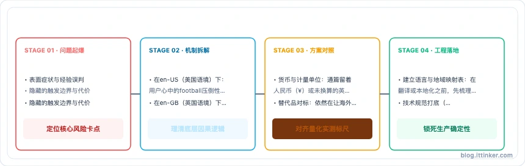
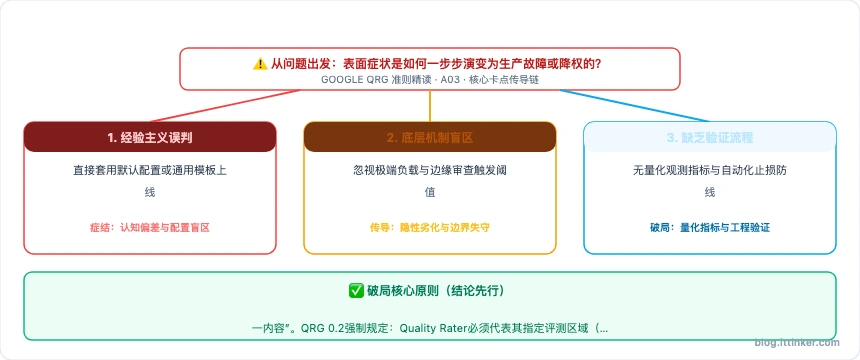
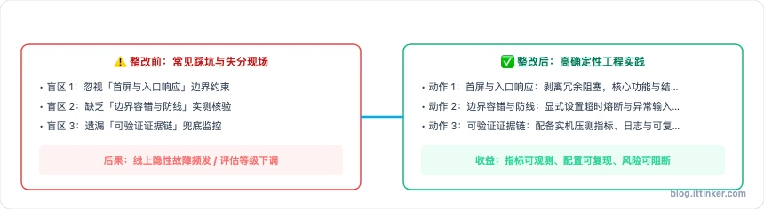
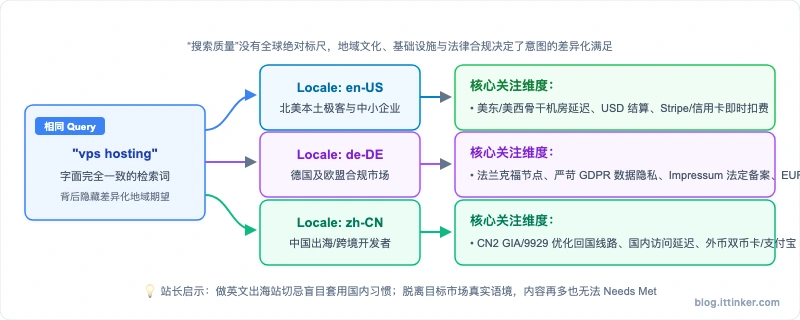
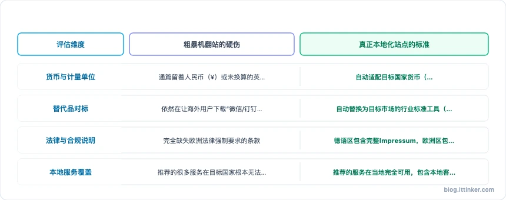
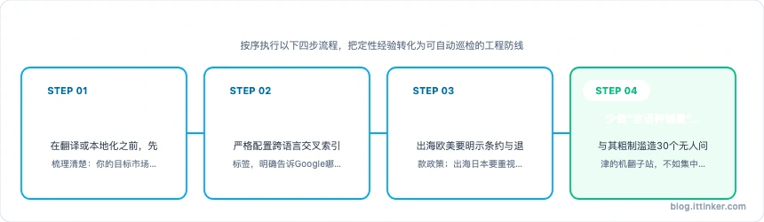

# 搜索质量有没有“全球统一答案”？从 Locale 差异看国际化 SEO 的本地化底线 | 读懂 Google Search 基础认知 系列 003

> 🌐 **在线阅读与互动版**：[搜索质量有没有“全球统一答案”？从 Locale 差异看国际化 SEO 的本地化底线 | 读懂 Google Search 基础认知 系列 003](https://blog.ittinker.com/posts/搜索质量有没有-全球统一答案/)
> 📚 **所属专栏**：[《读懂 Google Search：110篇搜索质量与SEO实战指南》](../README.md)

---

### 📌 结论先行（TL;DR）
**在 Google 搜索的评估哲学中，**绝对不存在放之四海而皆准的“全球统一定价或统一内容”**。**

1. QRG 0.2 强制规定：Quality Rater 必须代表其指定评测区域（Rating Locale）的真实群体，熟悉当地独特的语言习惯、文化常识、商业规则和地理上下文。
2. 一个在美区堪称完美的网页，直接搬到英区或日区可能会被判为“完全不满足需求（FailsM）”。
3. 国际化 SEO 的本质不是“多语种翻译”，而是**“在目标市场的搜索语境下交付符合当地常识的解决方案”**。

在上一篇（[Google 为什么还需要人工 Quality Rater？破解搜索排名的最大迷思（A02）](/posts/google-为什么还需要人工-quality-rater/)）中，我们揭秘了人工评估员作为算法“离线金标对照组”的运转机制。

这紧接着引出了出海独立开发者最关心的问题：
**我们在做多语言独立站、跨境 SaaS 或海外内容站时，常常希望“一套好内容，机翻成 20 种语言就能通吃全球”。但 Google 官方到底是怎么看待不同国家和语种的“质量”标准的？搜索质量到底有没有统一的标准答案？**

答案非常干脆：**没有。离开具体的 Locale（语种与地域组合），谈论搜索质量毫无意义。**

---

## 1. 拆解 QRG 0.2：为什么必须由当地人代表当地人？

在 QRG 第 0.2 节《Raters Must Represent People in their Rating Locale》中，Google 给出了极其严格的人员资质限定：

> *"Raters must be deeply familiar with the language and culture of the people in the rating locale... You should be familiar with the local culture and current events of the locale."*

所谓 **Locale**，通常由“语言代号 + 地区代号”组成（例如 `en-US` 代表美国英语语境，`en-GB` 代表英国英语语境，`ja-JP` 代表日本日语语境）。

Google 坚决反对由硅谷总部的美国工程师通过翻译器去给全球搜索结果打分，原因在于：**搜索词的背后是活生生的人，而人类的思维方式永远嵌套在本土的语言与社会规则之中。**

---

## 2. 真实案例碰撞：同一个 Query，完全相反的“好结果”

为了直观体会 Locale 对评估尺度的颠覆性影响，我们来看三个经典的反差案例：

### 案例 1：同语种下的含义分歧（`football`）
- **在 `en-US`（美国语境）下**：用户心中的 `football` 压倒性指向美式橄榄球（NFL）。搜索结果顶部必须呈现超级碗日程、NFL 积分榜；
- **在 `en-GB`（英国语境）下**：`football` 100% 代表英式足球（英超、欧冠）。如果把超级碗新闻排在英国首位，英国用户会立刻判定这套搜索系统智商掉线。

### 案例 2：商业与现实维度的硬性脱节（`tax software`）
- 一款在美国本土备受赞誉的报税 SaaS 软件（如 TurboTax），其页面制作精良、E-E-A-T 极高；
- 但如果将该页面展示给德国或法国搜 `tax software` 的用户，即使全篇翻译成地道的德语或法语，对当地用户而言也是废纸一张——因为它的底层规则根本不符合当地税务局（Finanzamt）的报税规范。

### 案例 3：本地化生活常识与俗语
- 当日本用户搜索 `コンビ二 決済`（便利店支付）时，他们期望看到的是罗森（Lawson）、7-Eleven 的具体缴费代码操作流程；
- 如果一个跨国站点生搬硬套西方的信用卡流程，哪怕文字再优美，也无法解决用户的燃眉之急。

---

## 3. 为什么“批量机翻”在海外搜索中迅速溃败？

过去几年，很多出海站长利用翻译 API 或大模型批量把中文文章翻译成数十种语言，企图快速收割长尾流量。这种做法在早期或许能蹭到部分长尾收录，但一旦进入核心算法质量评估体系，往往迅速被降权清理。

根本原因就在于：**机翻只完成了“文字符号的对应”，却丢掉了“当地搜索语境的适配”**。

| 评估维度 | 粗暴机翻站的硬伤 | 真正本地化站点的标准 |
|---|---|---|
| **货币与计量单位** | 通篇留着人民币（¥）或未换算的英里/加仑 | 自动适配目标国家货币（USD/EUR/JPY）与度量衡 |
| **替代品对标** | 依然在让海外用户下载“微信/钉钉/百度网盘” | 自动替换为目标市场的行业标准工具（Slack/WhatsApp/Dropbox） |
| **法律与合规说明** | 完全缺失欧洲法律强制要求的条款 | 德语区包含完整 Impressum，欧洲区包含严格的 Cookie 授权与 GDPR 说明 |
| **本地服务覆盖** | 推荐的很多服务在目标国家根本无法访问或无法配送 | 推荐的服务在当地完全可用，包含本地客服时间与联络方式 |

当一个德国 Rater 看到一个声称面向欧洲用户的企业网站，但既没有注册地址、没有 Impressum 页面，结算币种还强行显示为非欧元时，按照 QRG 标准，这个页面的信誉评分（Trust）会直接被击穿。

---

## 4. 独立开发者出海 SEO 的五条落地铁律

理解了搜索质量没有全球统一答案后，出海开发者在构建多语言产品或技术内容时，应当严格执行以下工作流：

- [ ] **建立语言与地域映射表**：在翻译或本地化之前，先梳理清楚：你的目标市场到底使用什么工具生态？（参考我们开源的 `localization-map.json`，把国内工具精准替换为目标市场的同等工具）。
- [ ] **技术规范打底（`hreflang`）**：严格配置跨语言交叉索引标签，明确告诉 Google 哪一个版本属于哪个具体 Locale，防止跨语种页面被误判为同质重复内容。
- [ ] **尊重当地商业常识**：出海欧美要明示条约与退款政策；出海日本要重视严谨的排版与公司主体说明；出海中东要尊重文化禁忌与文字排版习惯（RTL 布局）。
- [ ] **少做“全语种铺量”，多做“单语种打透”**：与其粗制滥造 30 个无人问津的机翻子站，不如集中精力在 1 到 2 个核心海外主力市场（如美国或日本），把每个交互细节和实际问题做到真正契合当地用户的搜索意图。

---

## 下一篇预告

既然 QRG 中包含了如此详尽的评估准则和海量示例，很多开发者便开始拿着放大镜研究每一个示例：“Google 示例里的博客有作者简介头像，那我是不是所有页面都必须加作者卡片？”“Google 示例说这个网站有 5 个外链，我是不是也得去买 5 个？”

**为什么把 QRG 里的案例当成算法死规矩来套，是无数 SEO 从业者摔得最惨的大坑？**

下一篇，我们将深入剖析 QRG 0.6：**[为什么读 QRG 时不能把示例当成排名规则？原则驱动 vs 机械抄作业（A04）](/posts/为什么读-qrg-时不能把示例当成排名规则/)**。

---

_这是「读懂 Google Search」系列第 3 篇，系统拆解 Google 官方质量指南，帮你建立长期抗算法波动的出海 SEO 护城河。_

---

## 读懂 Google Search 专栏导航

> 📚 **专栏收录**：本文为 [《读懂 Google Search：110篇搜索质量与SEO实战指南》](/posts/google-search-guide/) 第 **A03** 篇。

* **专栏主页**：[《读懂 Google Search：110篇搜索质量与SEO实战指南》全景地图与路线图](/posts/google-search-guide/)
