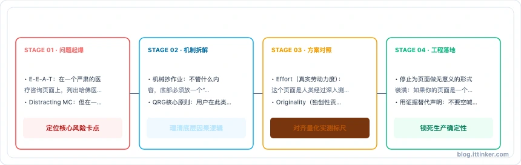
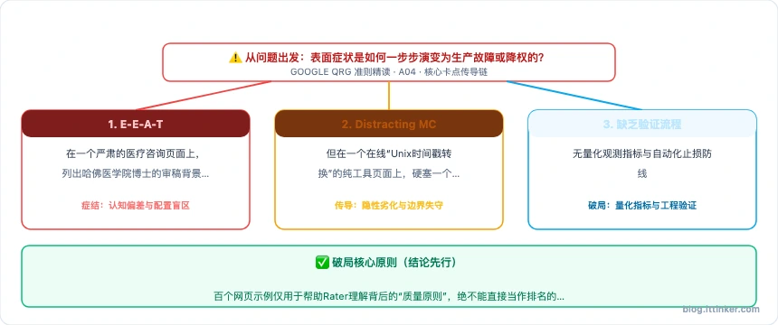
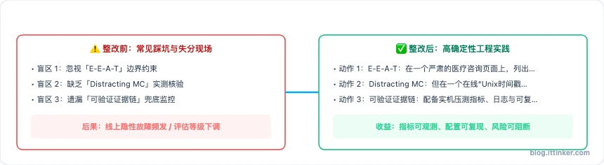
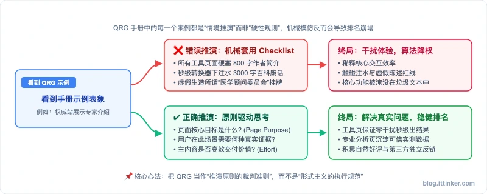
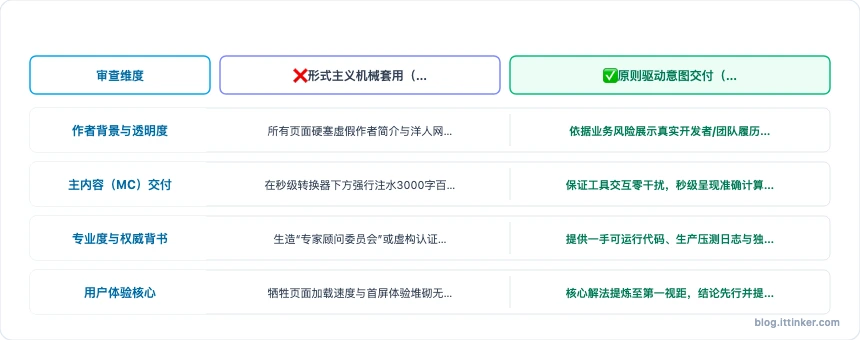
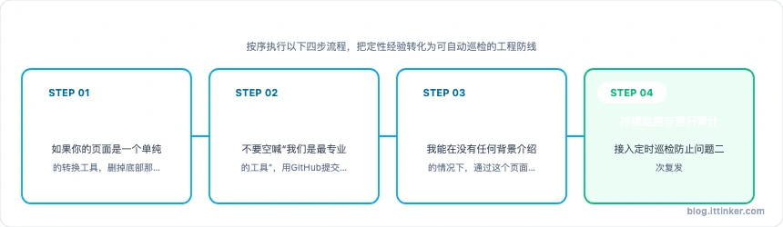

# 为什么读 QRG 时不能把示例当成排名规则？原则驱动 vs 机械抄作业 | 读懂 Google Search 基础认知 系列 004

> 🌐 **在线阅读与互动版**：[为什么读 QRG 时不能把示例当成排名规则？原则驱动 vs 机械抄作业 | 读懂 Google Search 基础认知 系列 004](https://blog.ittinker.com/posts/为什么读-qrg-时不能把示例当成排名规则/)
> 📚 **所属专栏**：[《读懂 Google Search：110篇搜索质量与SEO实战指南》](../README.md)

---

### 📌 结论先行（TL;DR）
**Google 在 QRG 0.6 中给所有阅读者立下了一条最醒目的免责与警示：**手册中的上百个网页示例仅用于帮助 Rater 理解背后的“质量原则”，绝不能直接当作排名的硬性指标或 Checkbox 规则。**

1. 很多网站把 QRG 示例当成机械清单来抄（比如盲目给工具页硬塞作者简介、给查询词注水几千字长文），结果不但没拿到排名，反而破坏了真实的搜索体验。
2. 做 SEO 的最高危险是“把特定场景下的示范动作，当成了放之四海而皆准的算法公式”。
3. 

在前面的篇章中，我们梳理了搜索体验的完整链路（[A01](/posts/google-搜索到底想解决什么问题/)）、Rater 的离线评测角色（[A02](/posts/google-为什么还需要人工-quality-rater/)）以及地域语境对质量的决定性影响（[A03](/posts/搜索质量有没有-全球统一答案/)）。

当你第一次翻开长达 170 页的 Google 官方 QRG 手册时，最吸引眼球的往往不是抽象的定义，而是里面穿插的数百个真实的网页截图、评级打分与官方评语。

很多站长立刻如获至宝，开启了疯狂的“对照抄作业”模式：
- *“看！这个被评为 Highest 的菜谱网页底部有厨师履历，我们所有 SaaS 工具页赶紧也加上一个作者履历框！”*
- *“看！这个被评为 Low 的页面只有 200 字，看来文章必须写到 3000 字以上才能拿高分！”*

这种看似勤奋的跟风，在 Google 的算法工程师眼中却是典型的一叶障目。

---

## 1. 拆解 QRG 0.6：官方对“抄示例”的预先警告

在 QRG 第 0.6 节《The Role of Examples in these Guidelines》中，官方开门见山写道：

> *"The examples are included in these guidelines to illustrate specific points and should not be thought of as rules... You must consider the specific webpage and query in question, rather than mechanically matching it to an example."*

Google 为什么如此害怕从业者把示例当规则？

因为搜索世界里的网站千差万别，**没有任何单一特征能跨越所有品类定义“优质”**：
- 在一个严肃的医疗咨询页面上，列出哈佛医学院博士的审稿背景是极其重要的信任背书（E-E-A-T）；
- 但在一个在线“Unix 时间戳转换”的纯工具页面上，硬塞一个 500 字的“作者生平与照片”，对用户来说不仅毫无价值，反而阻挡了核心输入框，甚至会被判定为恶意干扰主内容（Distracting MC）。

---

## 2. 经典误区解剖：SEO 圈的三大“机械抄作业”悲剧

### 误区一：把“责任主体”窄化为“作者头像框”
- **机械抄作业**：不管什么内容，底部必须放一个“Written by John Doe”的头像和一段个人简介，哪怕 John Doe 是个完全编造的虚拟人物。
- **QRG 核心原则**：用户在此类情境下需要向谁追责？如果是个人经验博客，博主的真实经历是核心；如果是电商或付费 SaaS，用户需要的是**清晰的公司注册名称、售后支持渠道与退款政策**。硬塞一个虚拟个人作者，对解决交易安全毫无助益。

### 误区二：把“充分的主内容（MC）”等同于“字数注水”
- **机械抄作业**：以为字数越长越好，把一个本可以通过一张表格说清楚的“免签国家名单”，强行拆成 5000 字的历史背景与空话铺垫。
- **QRG 核心原则**：**Effort（投入程度）与 Added Value（附加价值）**。字数多如果全是低价值同义反复，在 Helpful Content 体系下会被直接打入“无用内容”池；相反，一份经过人工核实、格式规整、过滤了垃圾信息的速查表格，字数虽少，却凝聚了极高的整理成本，Needs Met 远高于万字水文。

### 误区三：形式主义的假背书
- **机械抄作业**：很多内容站为了假装专业，在文章顶部写上“本文经医学专家/法律顾问审核”，却无法提供任何可查证的独立凭证。
- **QRG 核心原则**：**独立声誉与可查证性（Independent Reputation）**。Google 的评估体系看重的是第三方共识与真实可信的证据链条，自吹自擂的虚假标签在面对惩罚机制时不堪一击。

---

## 3. 原则驱动（Principle-Driven）的评估框架

### 形式主义机械套用 vs 原则驱动意图交付对比表

| 审查维度 | ❌ 形式主义机械套用（Form-mimicking） | ✅ 原则驱动意图交付（Principle-driven） |
|:---|:---|:---|
| **作者背景与透明度** | 所有页面硬塞虚假作者简介与洋人网图 | 依据业务风险展示真实开发者/团队履历与开源互链 |
| **主内容（MC）交付** | 在秒级转换器下方强行注水 3000 字百科废话 | 保证工具交互零干扰，秒级呈现准确计算结果 |
| **专业度与权威背书** | 生造“专家顾问委员会”或虚构认证挂牌 | 提供一手可运行代码、生产压测日志与独家复盘 |
| **用户体验核心** | 牺牲页面加载速度与首屏体验堆砌无用文本 | 核心解法提炼至第一视距，结论先行并提供工具资产 |

要想不被成百上千个具体案例带偏，独立开发者在审视自己网页时，必须跳出形式细节，牢牢咬住 QRG 贯穿始终的**五项元原则**：

1. **Effort（真实劳动力度）**：
   这个页面是人类经过深入测试、采集、对比、编码后交付的产物，还是用 Prompt 一秒钟吐出来的廉价文本？
2. **Originality（独创性贡献）**：
   如果把网上现有的前 10 名文章全部删掉，你的页面是否提供了别人没有提到的实操细节、测试数据或排障陷阱？
3. **Talent & Skill（专业技艺）**：
   页面的代码结构、信息架构、逻辑推导是否展现出了该领域从业者应有的行家里手风范？
4. **Accuracy（事实准确度）**：
   所给出的命令、版本号、配置文件、参数范围，是否经过最新环境的严谨验证？（不能出现过时命令或凭空捏造）。
5. **Added Value（真实增量价值）**：
   用户访问你的网站，是否相比直接看官方文档或竞品获得了更快的速度、更低的认知成本或更直观的决策依据？

---

## 4. 独立开发者的行动建议：丢掉 Checklist，回归真实意图

- [ ] **停止为页面做无意义的形式装潢**：如果你的页面是一个单纯的转换工具，删掉底部那些为了 SEO 硬塞的 1000 字无意义百科解释，把工具的核心交互体验做到极致。
- [ ] **用证据替代声明**：不要空喊“我们是最专业的工具”，用 GitHub 提交记录、真实测试数据跑分截图、详细的代码示例和完整的开源协议来证明你的专业度。
- [ ] **换位思考：如果我是挑刺的 Rater**：我能在没有任何背景介绍的情况下，通过这个页面的主内容快速完成我的现实任务吗？

---

## 下一篇预告

既然我们不能机械地对照别人的案例来抄作业，那当我们打开一个全新的网页、准备评估它的质量高低时，**第一件必须做的事情到底是什么？**

在 Google QRG 的设计中，所有评估动作都必须从同一个原点出发——**Page Purpose（网页目的）**。

下一篇，我们将正式进入 QRG 的核心章节：**[评价网页之前，为什么必须先搞清楚页面目的？Page Purpose 是质量评级的唯一起点（A05）](/posts/评价网页之前-为什么必须先搞清楚页面目的/)**。

---

_这是「读懂 Google Search」系列第 4 篇，系统拆解 Google 官方质量指南，帮你建立长期抗算法波动的出海 SEO 护城河。_

---

## 读懂 Google Search 专栏导航

> 📚 **专栏收录**：本文为 [《读懂 Google Search：110篇搜索质量与SEO实战指南》](/posts/google-search-guide/) 第 **A04** 篇。

* **专栏主页**：[《读懂 Google Search：110篇搜索质量与SEO实战指南》全景地图与路线图](/posts/google-search-guide/)
