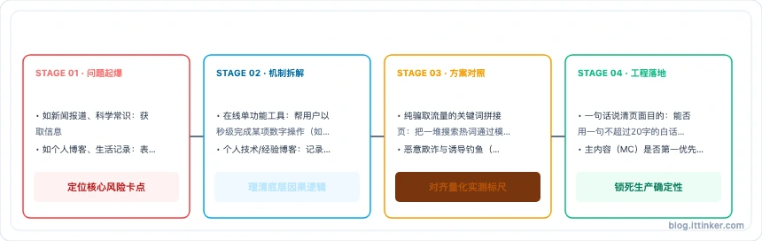
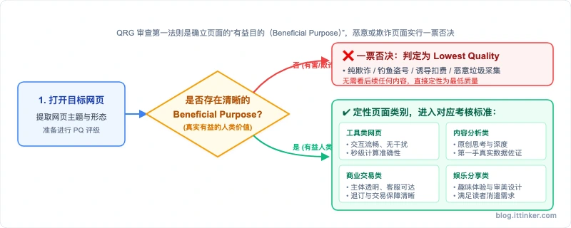
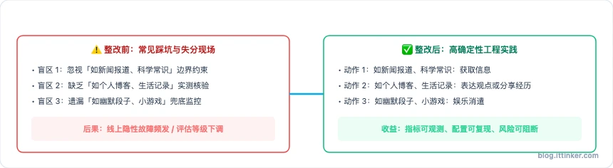
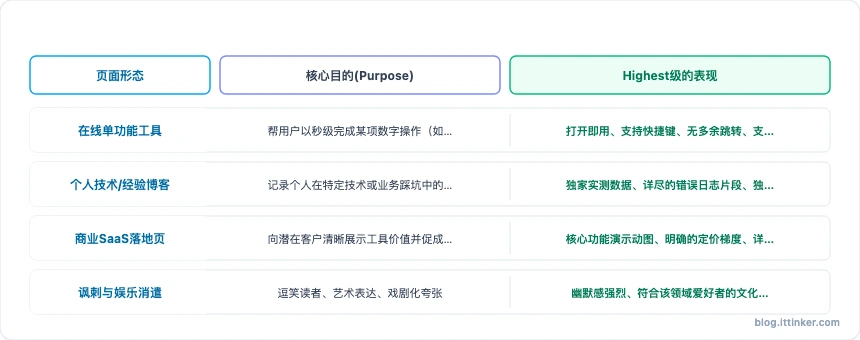
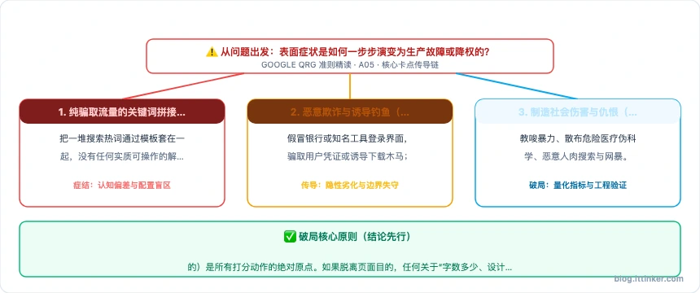
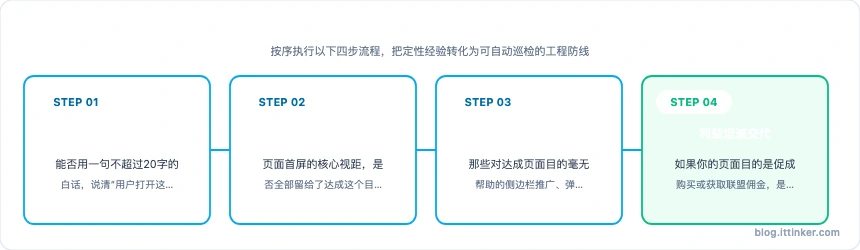

# 评价网页之前，为什么必须先搞清楚页面目的？Page Purpose 是质量评级的唯一起点 | 读懂 Google Search 基础认知 系列 005

> 🌐 **在线阅读与互动版**：[评价网页之前，为什么必须先搞清楚页面目的？Page Purpose 是质量评级的唯一起点 | 读懂 Google Search 基础认知 系列 005](https://blog.ittinker.com/posts/评价网页之前-为什么必须先搞清楚页面目的/)
> 📚 **所属专栏**：[《读懂 Google Search：110篇搜索质量与SEO实战指南》](../README.md)

---

### 📌 结论先行（TL;DR）
**在 Google 的 Page Quality（页面质量）评估体系中，**Page Purpose（页面目的）是所有打分动作的绝对原点**。**

1. 如果脱离页面目的，任何关于“字数多少、设计美丑、作者资质”的讨论都是空中楼阁。
2. 一个只有 50 行代码且零废话的“时间戳转换器”，和一个 5000 字的深度行业研究报告，完全可以双双被评为最高等级（Highest）。
3. 评估的第一步永远是确认：**这个页面旨在为用户带来什么真实益处（Beneficial Purpose）？
4. 它是否诚实、高效地达成了这个目的？

在前面的章节中，我们完成了方法论的准备：建立了搜索质量五步总模型（[A01](/posts/google-搜索到底想解决什么问题/)）、厘清了 Rater 评估机制（[A02](/posts/google-为什么还需要人工-quality-rater/)）、探讨了 Locale 的文化上下文（[A03](/posts/搜索质量有没有-全球统一答案/)），并明确了拒绝机械抄作业、坚持原则驱动的思考习惯（[A04](/posts/为什么读-qrg-时不能把示例当成排名规则/)）。

从本篇开始，我们将正式步入 Google QRG 的第一核心支柱：**Page Quality（页面客观质量评估）**。

当你打开一个陌生的网页，准备评价它的质量高低时，很多人的本能反应是看排版漂不漂亮、文字多不多、代码规不规范。

然而在 Google 官方指南 QRG 第 2.2 节中，Google 给出了极其严厉的操作规范：**在看任何细节之前，必须先回答一个问题——这个网页到底为什么而存在？**

---

## 1. 拆解 QRG 2.2：页面存在的根本理由（Beneficial Purpose）

QRG 第 2.2 节《Understanding the Purpose of a Webpage》开宗明义地写道：

> *"The purpose of a webpage is the reason or reasons why the page was created. Most webpages are created to be helpful for people, which means they have a beneficial purpose."*

Google 强调，绝大多数正常的网页，被创造出来都应该具备**“有益目的（Beneficial Purpose）”**。

用户来到互联网不是为了被算法收割，而是为了获得某种价值：
- 获取信息（如新闻报道、科学常识）
- 表达观点或分享经历（如个人博客、生活记录）
- 娱乐消遣（如幽默段子、小游戏）
- 解决技术任务（如正则表达式测试、格式转换工具）
- 购买商品或租赁服务（如电商、在线订票、SaaS）

**只有当你搞清楚了这个页面想要达成什么，你才能建立一把客观公正的尺子去衡量它完成得如何。**

---

## 2. 目的不同，及格线完全不同：五种典型形态对照

很多出海开发者最大的认知卡点，就是用“写长文章的及格线”去硬套所有产品页面。

一旦你理解了 Page Purpose，就会发现不同形态页面的优秀标准有着天壤之别：

| 页面形态 | 核心目的 (Purpose) | Highest 级的表现 | 致命的劣质扣分项 |
|---|---|---|---|
| **在线单功能工具** | 帮用户以秒级完成某项数字操作（如 `json formatter`） | 打开即用、支持快捷键、无多余跳转、支持离线或隐私处理 | 顶部硬塞 2000 字百科历史，把输入框挤到第二屏 |
| **个人技术/经验博客** | 记录个人在特定技术或业务踩坑中的第一手心路 | 独家实测数据、详尽的错误日志片段、独到反思、真实配图 | 伪装成个人的 AI 批量重写洗稿、通篇正确的废话 |
| **商业 SaaS 落地页** | 向潜在客户清晰展示工具价值并促成试用/购买 | 核心功能演示动图、明确的定价梯度、详细的退款条款与客服联系方式 | 隐藏真实价格、虚构用户好评、找不到任何运营公司主体信息 |
| **讽刺与娱乐消遣** | 逗笑读者、艺术表达、戏剧化夸张 | 幽默感强烈、符合该领域爱好者的文化梗、阅读体验舒适 | 伪装成严肃新闻制造社会恐慌、恶意造谣诽谤 |
| **专业技术规范与文档** | 严谨、准确、无歧义地定义 API 或配置参数 | 代码高亮完整、覆盖异常状态码、版本更新日志清晰透明 | 包含已废弃的危险参数且未标明、关键步骤缺失 |

这就是为什么 Google 官方反复警告：**不能把“工具站没有长文字”当成低质量，也不能把“讽刺网站的事实不准确”当成欺诈。脱离目的谈质量，完全是南辕北辙。**

---

## 3. 最危险的红线：什么是“No Beneficial Purpose”？

在 QRG 体系中，有一类页面在第一步就会被宣判死刑，连进入后续打分的资格都没有：**没有有益目的的页面（Pages with No Beneficial Purpose）**。

这类页面包括：
1. **纯骗取流量的关键词拼接页**：把一堆搜索热词通过模板套在一起，没有任何实质可操作的解法；
2. **恶意欺诈与诱导钓鱼（Deceptive/Malicious）**：假冒银行或知名工具登录界面，骗取用户凭证或诱导下载木马；
3. **制造社会伤害与仇恨（Harmful Pages）**：教唆暴力、散布危险医疗伪科学、恶意人肉搜索与网暴。

在 Google 的自动化反垃圾系统和 Rater 评估中，**只要认定一个页面没有真实的人类益处，该页面及其所属站点就会被直接打入 Lowest**。

---

## 4. 独立开发者上线每个页面前的“目的审计”

在部署任何新的出海页面、博客文章或产品功能时，请花两分钟做一次**“Page Purpose 目的审计”**：

- [ ] **一句话说清页面目的**：能否用一句不超过 20 字的白话，说清“用户打开这个页面到底是来干什么的”？如果连你自己都要支支吾吾解释半天，这个页面大概率定位混乱。
- [ ] **主内容（MC）是否第一优先级呈现**：页面首屏的核心视距，是否全部留给了达成这个目的所需的关键要素？（如果是工具，输入框在不在首屏？如果是排错，核心命令在不在顶部？）
- [ ] **消灭干扰性噪音**：那些对达成页面目的毫无帮助的侧边栏推广、弹窗、强行注水的长文本，能否坚决砍掉？
- [ ] **利益坦诚交代**：如果你的页面目的是促成购买或获取联盟佣金，是否在显眼位置作出了清晰诚实的利益披露（Affiliate Disclosure）？

---

## 下一篇预告

搞清楚了单个页面的目的（Page Purpose）之后，很多开发者又会产生新的困惑：**“既然单页目的清楚了，为什么同一个页面，放在大厂域名下能拿第一，放在我的新域名下就迟迟排不上来？Google 到底是怎么区分一个单独的网页（Webpage）和它背后的整个网站（Website）的？”**

下一篇，我们将深入拆解 QRG 2.0 与 2.1：**[Google 眼中的 Webpage 和 Website 到底有什么区别？单页质量与整站信誉的边界（A06）](/posts/google-眼中的-webpage-和-website-到底有什么区别/)**。

---

_这是「读懂 Google Search」系列第 5 篇，系统拆解 Google 官方质量指南，帮你建立长期抗算法波动的出海 SEO 护城河。_

---

## 读懂 Google Search 专栏导航

> 📚 **专栏收录**：本文为 [《读懂 Google Search：110篇搜索质量与SEO实战指南》](/posts/google-search-guide/) 第 **A05** 篇。

* **专栏主页**：[《读懂 Google Search：110篇搜索质量与SEO实战指南》全景地图与路线图](/posts/google-search-guide/)
