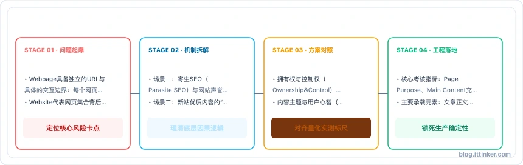
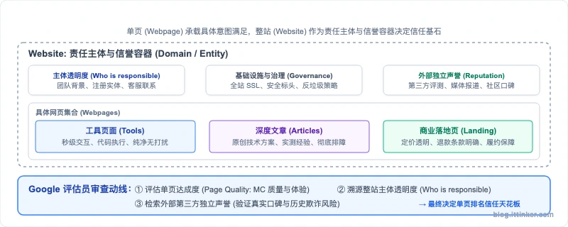
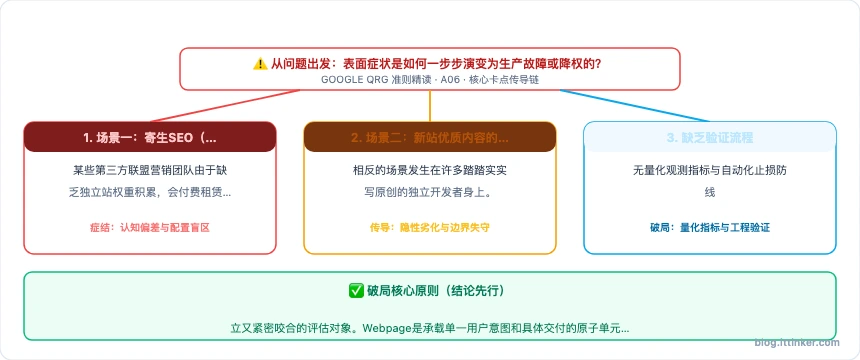
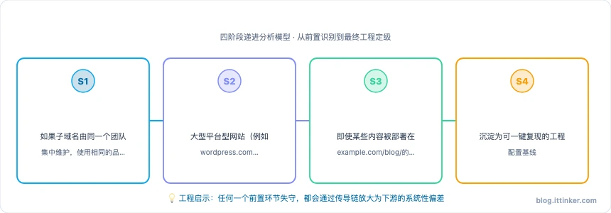
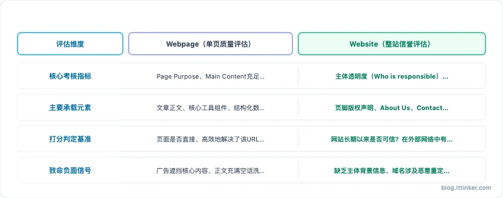
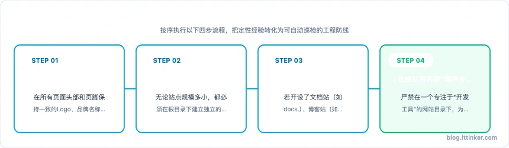

# “单页满分整站稳了”？Webpage 与 Website 有何不同？ | 读懂 Google Search 基础认知 系列 006

> 🌐 **在线阅读与互动版**：[“单页满分整站稳了”？Webpage 与 Website 有何不同？ | 读懂 Google Search 基础认知 系列 006](https://blog.ittinker.com/posts/google-眼中的-webpage-和-website-到底有什么区别/)
> 📚 **所属专栏**：[《读懂 Google Search：110篇搜索质量与SEO实战指南》](../README.md)

---

### 📌 结论先行（TL;DR）
> **在 Google 的评估逻辑中，**Webpage（网页）与 Website（网站）是两套既相互独立又紧密咬合的评估对象**。**
> **出海开发者在做 SEO 时，经常陷入两个认知误区：**
> **一种误区是“单页原子论”。这类开发者把所有精力都花在单篇文章的代码标签、关键词密度与排版美化上，却长期把网站的 About 页空置、让 Contact 表单沦为摆设，甚至把隐私条款当成复制粘贴的纯摆设。当页面长期没有排名时，他们百思不得其解。**
> **另一种误区是“域名万能论”。某些团队花高价购买过期老域名，或者通过反向代理将低质量内容挂靠在权威媒体的子目录中，企图借助“整站权重”强行保送垃圾单页上首页。在 2024 年 5 月 Google 正式执行“网站声誉滥用（Site Reputation Abuse）”算法惩罚后，成千上万依靠寄生 SEO 谋利的内容一夜之间从搜索结果中被彻底抹除。**
> **要从根本上看清这两类操作的死穴，我们必须回到 Google 官方质量指南 QRG 的第 2.0 与 2.1 节，看清楚评估员是如何界定单个网页与整个网站的边界的。**
>
> - Webpage 是承载单一用户意图和具体交付的原子单元，其质量取决于该页面是否高效达成了自身的页面目的（Page Purpose）；
> - Website 则是一个法律主体或运营团队所拥有的整体资产集合，承载着主体透明度、安全防护与长期累积的声誉（Reputation）。
> - **单页内容再扎实**：只要背靠一个充满欺诈、缺乏主体信息的劣质域名，其信任分就会被整站下拉；
> - **反过来**：哪怕根域名权重极高，若放任第三方在子目录寄生发布无关劣质内容，也会触发 Google 的整站滥用算法惩罚。

---

### 🚨 2026 → 2024 官方最新风向预警：Google 对Google 站点级信誉（Site-level Signals）与单页质量权重的协同演进的策略演进

#### 🕒 2026 → 2024 Google 官方对Google 站点级信誉（Site-level Signals）与单页质量权重的协同演进的策略演进

- **2026 · 整站声誉穿透与单页风险隔离（Site-level Domain Gravity）**
  Google 强化了整站声誉对单页排名的重力牵引效应。一个高权重域名下若包含大量劣质子目录，将直接拖垮核心页面的收录；反之，单页质量再好，若所属站点主体模糊、充满死链，排名上限被严格锁死。

- **2025 · 寄生与子目录滥用清算（Site Reputation Abuse 实施）**
  Google 正式对‘大站租借二级目录/二级域名发布第三方内容’实施严厉人工与算法双重处罚，彻底打破‘靠大站母域名庇护保送单页排名’的作弊捷径。

- **2024 · 核心更新深化整站综合健康度（Sitewide Quality Signal）**
  更新明确：单一高质量页面无法抵消全站海量低质页面的负向影响，爬虫系统会在全站级别聚合计算质量指纹，促使站长必须具备系统化架构思维。

---

## 1. 拆解 QRG 2.0 与 2.1：网页与网站的官方定义

在 QRG 第 2.0 节《Understanding Webpages and Websites》与第 2.1 节《Important Definitions》中，Google 给出了极为严谨的技术与业务定义：

> *"A webpage is a document connected to the World Wide Web, which can be viewed or visited by using a web browser... A website or site is a collection of webpages and related content (such as images, videos, or other digital assets) that is typically identified with a common domain name and published on at least one web server."*

在这段看似基础的技术定义中，包含了两层深刻的评估推论：

1. **Webpage 具备独立的 URL 与具体的交互边界**：
   每个网页都是为了满足用户的特定意图而生的。用户通过搜索点击进入一个具体的 URL，期待的是该页面能否马上回答他的疑问、能否立即执行他的计算任务、能否安全地展示目标商品。因此，**页面质量（Page Quality）评分直接锚定在目标 URL 上**。

2. **Website 代表网页集合背后的统一责任主体**：
   分散在同一个域名下的成百上千个页面，不是漂浮在空中的孤岛。它们共享同一套网站基础设施、受制于同一个运营团队的价值观，并接受同一套网站政策（服务条款、退款流程、安全协议）的约束。因此，**声誉评级（Reputation Rating）必然锚定在整个网站及其背后的主体上**。

Google 评估员在审查任何一个页面时，绝不会把眼睛只贴在当前屏幕上。他们会立刻点击页脚的关于页面、调阅整站的根域名信息，并在 Google 搜索框中使用 `site:`、负向关键词排除指令来调查整个网站在业界的真实口碑。

---

## 2. 单页与整站的互动：两类经典失衡场景

为了让这种双层评估机制更加具象化，我们通过两个在出海实战中极其普遍的失衡案例，拆解单页表现与整站信誉之间的张力。

### 场景一：寄生 SEO（Parasite SEO）与网站声誉滥用

某些第三方联盟营销团队由于缺乏独立站权重积累，会付费租赁大型新闻门户（如某些知名报业网站）的子目录或子域名，并在该目录下大量批量发布减肥药、高杠杆博彩或借贷评测。

这些寄生单页的制作可能非常华丽，排版精良，字数充足。然而，由于这些内容完全脱离了宿主网站原本的核心业务定位，宿主网站的新闻编辑团队根本不参与内容审核，其本质是在出借域名声誉来操纵搜索排名。

Google 在最新的垃圾内容防范政策中专门增设了“Site Reputation Abuse（网站声誉滥用）”条款，明确规定：**当第三方页面在没有宿主网站严密监督与深度参与的情况下发布，且主要目的是利用宿主站点的排名信号操纵搜索结果时，即使宿主网站本身是顶级媒体，这类单页也会被直接视为主观作弊，遭受批量降权或下架处理。**

### 场景二：新站优质内容的“信任冷启动困境”

相反的场景发生在许多踏踏实实写原创的独立开发者身上。

一个开发者写了一篇深度剖析某开源底层架构的技术长文，不仅包含详尽的测试用例、清晰的复现步骤，还自绘了精美的架构流程图。如果单论 Main Content（主内容）的质量，这篇文章完全有资格拿到 Highest。

然而，这篇文章发布在一个刚刚注册两周、连 HTTPS 证书都偶尔报错、About 页面写着“Lorem Ipsum”、没有任何真实作者介绍的裸域名上。在 Google 的评估体系中，算法无法判断这个新域名的背后是一个技术极客，还是一个随时准备跑路的钓鱼团伙。结果就是：**该页面的单页评估虽然很高，但因为缺乏整站信誉的加持，在初期竞争激烈的核心词排位中仍然举步维艰。**

---

## 3. Google 是如何界定“整站”边界的？

对于出海多产品矩阵的开发者来说，另一个关键技术问题是：子域名（subdomain）、子目录（subdirectory）、独立域名之间，Google 到底是把它们当成一个网站，还是分开看待？

QRG 2.1 提供了清晰的标准：

> *"A website is typically identified with a common domain name... In some cases, a subdomain or even a specific directory may be considered an independent website if it has a completely distinct topic, purpose, or ownership."*

在评估员实操和算法处理中，整站边界遵循以下三条判定规则：

1. **拥有权与控制权（Ownership & Control）**：
   如果子域名由同一个团队集中维护，使用相同的品牌标识、共享相同的账号认证系统与法律条款（如 `docs.ittinker.com` 与 `ittinker.com`），Google 会将其视为同一个 Website 的有机组成部分。

2. **内容主题与用户心智（Topic & Brand Identity）**：
   大型平台型网站（例如 `wordpress.com`、`github.io`、`medium.com`）拥有海量子域名。Google 绝对不会将每一个用户的个人主页与平台母站视为同一个 Website。在这种情况下，每一个独立开发者的 `username.github.io` 都会被当作一个独立的微型网站去单独评估其责任人与信誉。

3. **反向代理与目录隔离**：
   即使某些内容被部署在 `example.com/blog/` 的主目录结构下，如果该目录下的所有文章作者、业务模式、外链网络与根域名毫无关联，Google 的反垃圾模型仍能通过文本语义与站外实体图谱，识别出这是被寄生租用的外来异物。

---

## 4. 单页质量（PQ）与整站声誉（Reputation）的评估维度全景对照

在实际优化过程中，开发者需要建立双层雷达，既不能遗漏单页维度的体验打磨，也不能忽略整站维度的信任基建：

| 评估维度 | Webpage（单页质量评估） | Website（整站信誉评估） |
|---|---|---|
| **核心考核指标** | Page Purpose、Main Content 充足度、原创度、加载交互性能 | 主体透明度（Who is responsible）、客服保障、外部行业声誉 |
| **主要承载元素** | 文章正文、核心工具组件、结构化数据、首屏视距分配 | 页脚版权声明、About Us、Contact Us、隐私条款与退款机制 |
| **打分判定基准** | 页面是否直接、高效地解决了该 URL 对应的搜索意图 | 网站长期以来是否可信？在外部网络中有无大量未解决的欺诈投诉？ |
| **致命负面信号** | 广告遮挡核心内容、正文充满空话洗稿、关键可执行代码报错 | 缺乏主体背景信息、域名涉及恶意重定向、被监管机构或信用机构列入黑名单 |
| **算法影响周期** | 页面被重新抓取渲染后，质量评级可快速动态刷新 | 信誉累积周期漫长，一旦被贴上垃圾或欺诈标签，恢复周期以月或年计 |
| **典型诊断工具** | Search Console 单页性能报告、Lighthouse、Rich Results Test | 站外品牌搜索、Trustpilot / Reddit 真实评价、Site-wide Manual Actions |

从上表可以看出：**单页质量决定了单个关键词竞争的爆发力，而整站信誉决定了整个域名排名的稳定下限。**

---

## 5. 独立开发者整站信誉筑基清单

许多独立开发者习惯了做“单兵作战”式的微型工具页，往往忽视了整站信誉资产的建立。在搭建新产品站时，建议对照以下清单逐项落实基础配置：

- [ ] **统一全站身份标识（Brand Consistency）**：在所有页面头部和页脚保持一致的 Logo、品牌名称与公司/个人工作室简称，杜绝各个页面排版风格、品牌名称各不相同的拼凑感。
- [ ] **配置标准的整站底层合规页面**：无论站点规模多小，都必须在根目录下建立独立的 `/about/`、`/contact/`、`/privacy-policy/` 与 `/terms/`。
- [ ] **清晰界定子域名的业务关系**：若开设了文档站（如 `docs.`）、博客站（如 `blog.`）或 API 控制台（如 `app.`），在各站点页头保持互通的导航链接，让爬虫和用户明确感知这是同一主体控制的完整产品体系。
- [ ] **杜绝站内内容“精神分裂”**：严禁在一个专注于“开发工具”的网站目录下，为了蹭搜索流量而突然更新数十篇与主营业务毫无关联的高佣金金融借贷或娱乐八卦内容。保持整站主题的一致性（Topical Authority）。
- [ ] **主动布署站外实体信号**：在 GitHub、Twitter (X)、LinkedIn 等平台建立与网站域名一致的官方档案，并在网站关于页挂出对应的双向验证链接，帮助 Google 将你的网站与真实的开发者实体完成知识图谱绑定。

---

## 下一篇预告

搞清楚了网页与网站的边界后，你可能会好奇：**“为什么有些工具站随便写写就能拿到高排名，而有些涉及投资建议、健康食谱或移民指南的网站，付出十倍努力却依然被 Google 严格卡审？”**

答案就在于 Google 对不同内容类型所设定的风险防火墙。

下一篇，我们将进入 QRG 极为核心的风险分级机制：**[“我的工具站怎么会是 YMYL”？冷冰冰的合规铁拳：为什么沾上金钱与健康的内容在 Google 眼里必须接受最残酷的审查？（A07）](/posts/什么是-ymyl/)**。

---

_这是「读懂 Google Search」系列第 6 篇，系统拆解 Google 官方质量指南，帮你建立长期抗算法波动的出海 SEO 护城河。_

---

## 读懂 Google Search 专栏导航

> 📚 **专栏收录**：本文为 [《读懂 Google Search：110篇搜索质量与SEO实战指南》](/posts/google-search-guide/) 第 **A06** 篇。

* **专栏主页**：[《读懂 Google Search：110篇搜索质量与SEO实战指南》全景地图与路线图](/posts/google-search-guide/)
