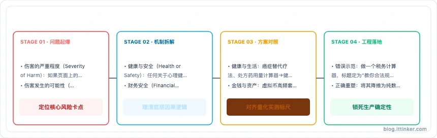
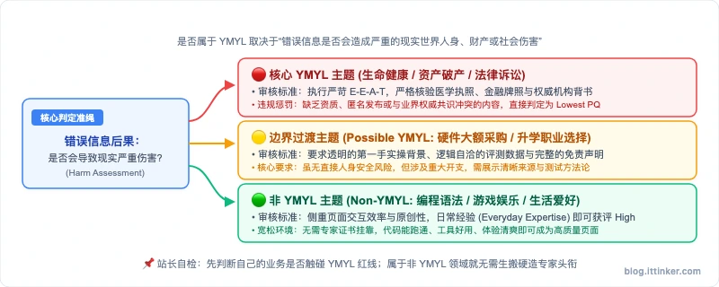
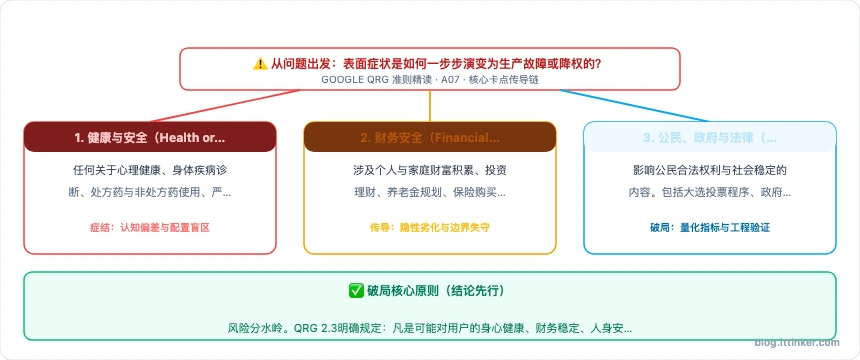
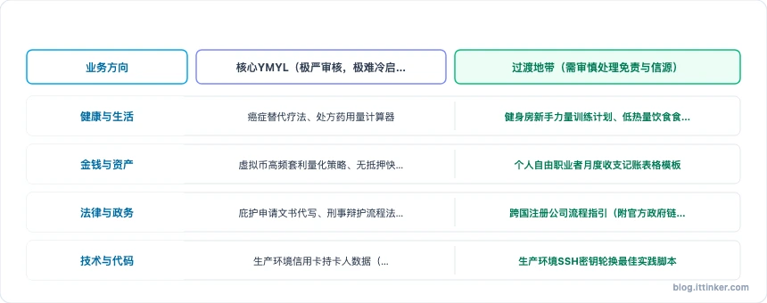
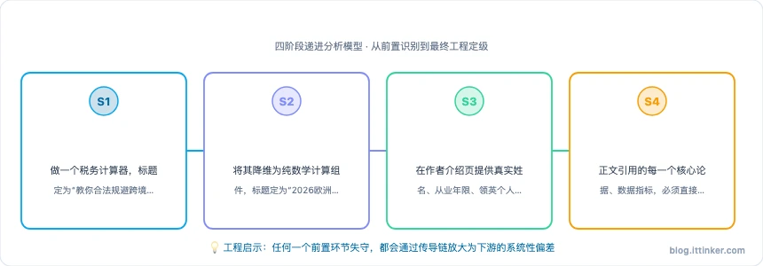
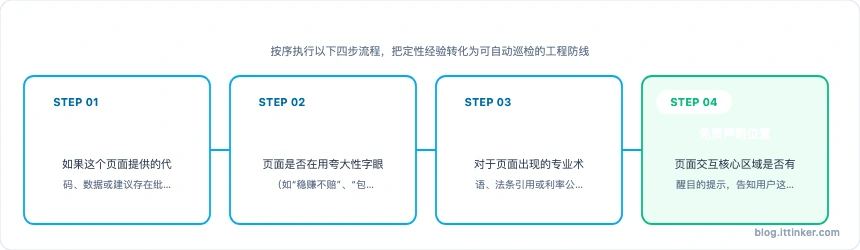

# 什么是 YMYL？为什么不同内容的质量门槛在 Google 眼里天差地别？ | 读懂 Google Search 基础认知 系列 007

> 🌐 **在线阅读与互动版**：[什么是 YMYL？为什么不同内容的质量门槛在 Google 眼里天差地别？ | 读懂 Google Search 基础认知 系列 007](https://blog.ittinker.com/posts/什么是-ymyl/)
> 📚 **所属专栏**：[《读懂 Google Search：110篇搜索质量与SEO实战指南》](../README.md)

---

### 📌 结论先行（TL;DR）
**在 Google 的搜索质量算法中，**YMYL（Your Money or Your Life）是一道硬性的风险分水岭**。**

1. QRG 2.3 明确规定：凡是可能对用户的身心健康、财务稳定、人身安全，或是社会公序良俗产生直接且重大现实伤害（Real-World Harm）的主题，均属于 YMYL 范畴。
2. 面对 YMYL 页面，Google 会执行最严苛的质量审核标准，要求内容背后具备绝对权威的主体资质、可核验的专业履历以及行业共识背书。
3. 如果你的出海项目属于通用技术工具或日常兴趣分享，质量及格线相对宽松；
4. 如果涉及金融、税务、医药或法律，任何没有专业背书的页面都会被算法快速边缘化。

在独立开发者的出海交流中，经常能听到这样的困惑：

“我做了一个个人生活爱好博客，随手写的几个露营技巧很快拿到了几十个点击；可我朋友精心写了一套个人股票定投收益分析工具和系列教程，文字详实、公式齐全，几个月下来在 Google 里却连前五页都挤不进去。”

很多开发者误以为这是外链数量的差距，或是域名年龄的问题。

真实的原因隐藏在 Google 的质量防火墙中：**前者是普通的非 YMYL 兴趣内容，而后者直接撞上了金融领域的最高警戒线——YMYL。**

---

## 1. 拆解 QRG 2.3：什么是真正意义上的 YMYL？

Google 在 QRG 第 2.3 节《Your Money or Your Life (YMYL) Topics》中给出了明确定义：

> *"YMYL topics are those that could directly and significantly impact people’s health, financial stability or safety, or the welfare or well-being of society... We have very high Page Quality rating standards for YMYL pages because low quality YMYL pages could negatively impact a person’s health, financial stability, or safety, or the welfare or well-being of society."*

很多站长把 YMYL 机械地理解为“行业分类”，认为只要做医疗或者做金融就是 YMYL，做其他就不是。这种理解停留在表面。

**Google 评判 YMYL 的核心尺度只有一条：现实潜在伤害（Potential Real-World Harm）。**

评估员在判定一个页面是否属于 YMYL 时，重点考察两个维度：
1. **伤害的严重程度（Severity of Harm）**：如果页面上的信息完全错误或充满误导，读者会不会面临生命危险？财产会不会遭受重大损失？人身安全会不会受到威胁？
2. **伤害发生的可能性（Likelihood of Harm）**：普通用户按照该页面的指示去操作，导致悲剧或财产损失的概率有多高？

---

## 2. 官方界定的五大 YMYL 核心领域

QRG 2.3 详细列举了触发极高审核标准的五大核心主题：

### 1. 健康与安全（Health or Safety）
任何关于心理健康、身体疾病诊断、处方药与非处方药使用、严重伤情急救、毒物鉴别或水电气安全维修的内容。例如：“心脏剧痛时如何自救”、“抑郁症药物停药指南”。如果这类页面给出错误信息，可能直接导致人员伤亡。

### 2. 财务安全（Financial Security）
涉及个人与家庭财富积累、投资理财、养老金规划、保险购买、个人报税、信贷抵押以及跨境汇款的建议或工具。例如：“如何把退休金全部投进高风险杠杆 ETF”、“小型企业跨境避税方案”。错误的指导足以让一个普通家庭陷入破产困境。

### 3. 公民、政府与法律（Civics, Government, and Law）
影响公民合法权利与社会稳定的内容。包括大选投票程序、政府公共福利申请流程、移民与签证合规、刑事或民事诉讼应对策略。任何虚假信息都会剥夺用户的法律救济途径或导致驱逐出境等严重后果。

### 4. 特定群体福祉（Groups of People）
涉及种族、民族、宗教、残障状况、年龄、国籍、性取向或性别认同等特定人群的基本权益保护。任何含有仇恨言论、歧视煽动或剥夺弱势群体权利的内容都会被系统一票否决。

### 5. 重大人生决策（Other Major Life Decisions）
涉及用户人生关键转折点的建议。例如挑选大学与专业、大额房产购置、跨国就业定居等。这类决策沉没成本极高，用户一旦受骗将付出数年时间与金钱代价。

---

## 3. 对照表：高危 YMYL、过渡地带与安全非 YMYL

出海开发者最常犯的错误，是在不自知的情况下把原本安全的产品推入了 YMYL 审查深水区。下面通过详细对照，厘清各业务维度的分水岭：

| 业务方向 | 核心 YMYL（极严审核，极难冷启动） | 过渡地带（需审慎处理免责与信源） | 非 YMYL（普通标准，独立站极佳赛道） |
|---|---|---|---|
| **健康与生活** | 癌症替代疗法、处方药用量计算器 | 健身房新手力量训练计划、低热量饮食食谱 | 露营装备选购心得、家庭室内绿植养护技巧 |
| **金钱与资产** | 虚拟币高频套利量化策略、无抵押快速贷款推荐 | 个人自由职业者月度收支记账表格模板 | 常见开源电子发票格式生成器、汇率历史波动换算小工具 |
| **法律与政务** | 庇护申请文书代写、刑事辩护流程法务咨询 | 跨国注册公司流程指引（附官方政府链接） | 网站通用隐私政策生成器（附标配免责声明） |
| **技术与代码** | 生产环境信用卡持卡人数据（PCI-DSS）加密架构 | 生产环境 SSH 密钥轮换最佳实践脚本 | CSS 阴影调色盘、正则表达式在线测试工具 |
| **职业与成长** | 保证高薪入职的虚假证书挂靠中介 | 程序员技术面试 LeetCode 刷题方法论分享 | 机械键盘轴体手感对比评测、桌面收纳改造方案 |

从对比中可以得出一条清晰规律：**只要内容不直接指导他人做人身安全、法律维权与真金白银的高风险抉择，Google 就不会调动 YMYL 级别的重型审核装甲。**

---

## 4. 独立开发者的出海破局策略：避开或战胜 YMYL

面对这套规则，独立开发者在规划自己的出海站点或工具矩阵时，应当采取明确的应对策略。

### 策略一：战术重塑——主动剥离 YMYL 风险触发点

如果你做的是开发类、数据类或效率类工具，最明智的选择是把产品聚焦在“工具交付本身”，坚决不跨界下达财务或法律结论。

- **错误示范**：做一个税务计算器，标题定为“教你合法规避跨境公司企业所得税的终极避税指南”。此时你的页面瞬间被系统标记为高危税务法律 YMYL，因为任何公式错误都会给用户带来税务局罚款风险。
- **正确重塑**：将其降维为纯数学计算组件，标题定为“2026 欧洲增值税（VAT）标准税率速查与反向计税器”。在页面显著位置标注纯数学算法公式、官方税务局税率公示链接，并附带一行免责提示：“本工具仅按官方公开税率做数学换算，不构成专业税务建议”。

这样一来，页面目的变成了单纯的数学运算与公开数据索引，直接解除了 YMYL 的严苛资质封锁。

### 策略二：正面对决——构建坚不可摧的信任防御线

如果你开发的产品本身就深扎在出海财税、跨境合规或医疗辅助领域，避无可避，你就必须按照最高规格的 E-E-A-T 要求来搭建全站信誉体系：

1. **亮出真实的专业人员背景**：
   在作者介绍页提供真实姓名、从业年限、领英个人主页以及专业认证编号。Google 评估员会真实检索这些专业资质的真实性。
2. **强制依托行业金标参考（Consensus）**：
   正文引用的每一个核心论据、数据指标，必须直接超链接到政府官网（如 IRS、FTC）、世界卫生组织（WHO）或公认的学术研究机构。杜绝引用无名小站的二手转述。
3. **建立全流程的免责与纠纷保障**：
   在所有页面底部配置显著的专业免责声明（Professional Disclaimer），并提供完善的企业营业主体注册号、实体办公地址与售后支持响应时限。

---

## 5. 独立开发者 YMYL 风险自查清单

在上线任何涉及用户生活抉择的页面前，请对照以下清单逐一排查：

- [ ] **伤害性推演**：如果这个页面提供的代码、数据或建议存在纰漏，用户照着做会不会出现财产损失、账号被封禁或健康风险？
- [ ] **定位脱敏**：页面是否在用夸大性字眼（如“稳赚不赔”、“包治百病”、“保过签证”）做虚假许诺？立即删减，将措辞收敛至客观技术实现或事实呈现。
- [ ] **权威信源引用**：对于页面出现的专业术语、法条引用或利率公式，是否给出了官方源头出处的外链？
- [ ] **免责声明位置**：页面交互核心区域是否有醒目的提示，告知用户这只是辅助参考，重大业务仍建议咨询当地持牌专业人员？
- [ ] **主体身份透明**：如果站点必须涉足 YMYL 领域，About 页是否交代了背后的技术团队、顾问名单及真实可查的资质背景？

---

## 下一篇预告

理清了页面的目的和风险分级之后，我们终于要切入最具体的页面代码排布：

**当你打开一个具体的网页时，Google 的抓取渲染与评估体系到底是怎样把它一片片切开的？为什么有时候你辛苦写在底部的优质文字，算法却根本视而不见？**

下一篇，我们将进入网页结构的底层切片逻辑：**[一个网页到底由什么组成？深度拆解 Main Content (MC)、SC 与 Ads 的质量权重（A08）](/posts/一个网页到底由什么组成/)**。

---

_这是「读懂 Google Search」系列第 7 篇，系统拆解 Google 官方质量指南，帮你建立长期抗算法波动的出海 SEO 护城河。_

---

## 读懂 Google Search 专栏导航

> 📚 **专栏收录**：本文为 [《读懂 Google Search：110篇搜索质量与SEO实战指南》](/posts/google-search-guide/) 第 **A07** 篇。

* **专栏主页**：[《读懂 Google Search：110篇搜索质量与SEO实战指南》全景地图与路线图](/posts/google-search-guide/)
