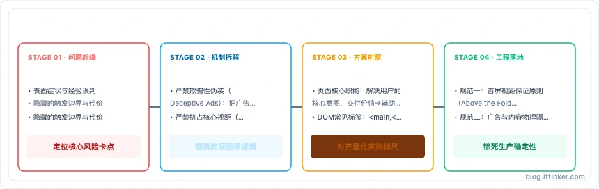
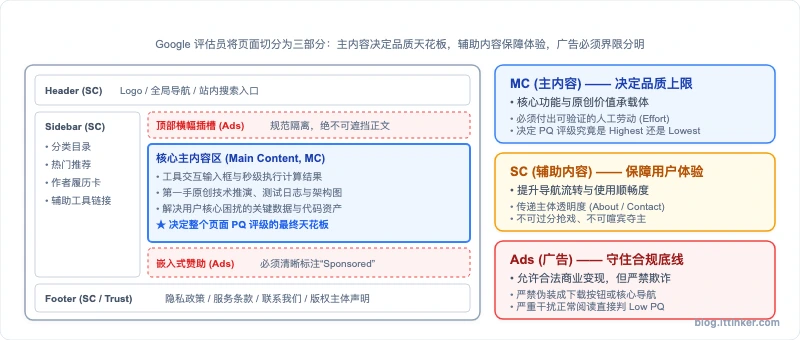
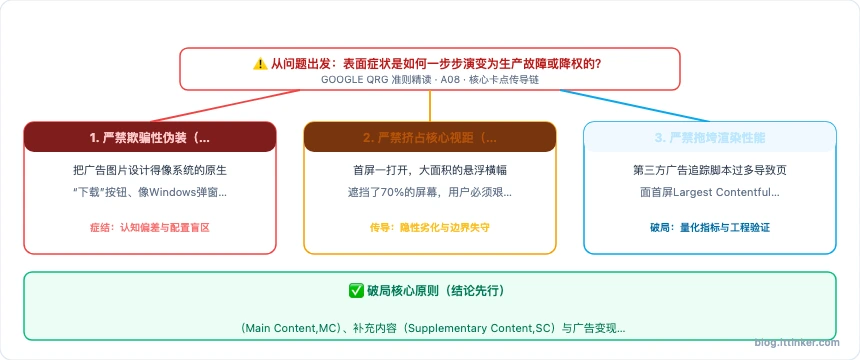
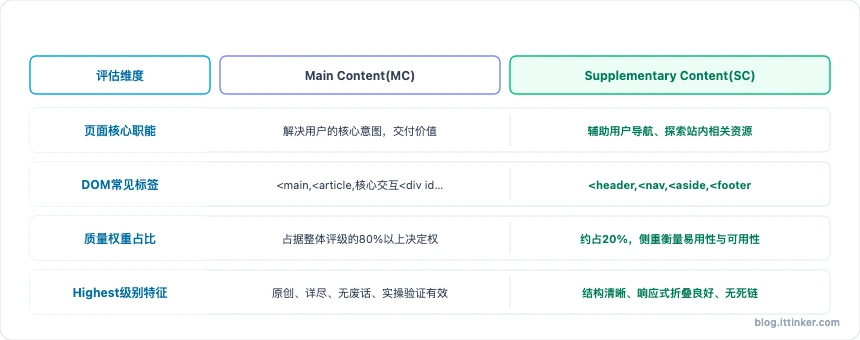
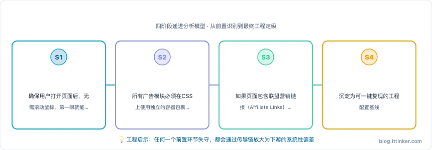
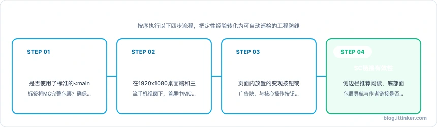

# “页面塞满广告不影响内容”？自欺欺人的变现幻觉：深度拆解 Main Content (MC)、SC 与 Ads 的质量生死线 | 读懂 Google Search 基础认知 系列 008

> 🌐 **在线阅读与互动版**：[“页面塞满广告不影响内容”？自欺欺人的变现幻觉：深度拆解 Main Content (MC)、SC 与 Ads 的质量生死线 | 读懂 Google Search 基础认知 系列 008](https://blog.ittinker.com/posts/一个网页到底由什么组成/)
> 📚 **所属专栏**：[《读懂 Google Search：110篇搜索质量与SEO实战指南》](../README.md)

---

### 📌 结论先行（TL;DR）
> **在 Google 的页面质量评估架构中，**任何网页都会被严格解构成三类组件：主内容（Main Content, MC）、补充内容（Supplementary Content, SC）与广告变现内容（Advertisements/Monetization, Ads）**。**
> **很多独立开发者在设计产品落地页或博客时，往往凭直觉编排元素：头部放一个巨大的宣传海报，正文上方塞两组广告联盟横幅，右侧堆砌一长串外部友情链接，最后才把真正有用的代码片段或输入框挤到第二屏。**
> **在用户眼中，这样的页面杂乱不堪；而在 Google 评估员与排版解析算法（Page Layout Algorithm）眼中，这样的页面直接触发了严重的质量扣分点。**
> **要让页面既能赢得 Google 的高评级，又能自然获得高转化，我们必须深入 QRG 第 2.4 节，看透搜索引擎拆解网页的“解剖刀”。**
>
> - **MC 是直接达成页面目的的唯一核心**：决定了页面质量（PQ）评级的上限；
> - SC 则提供周边辅助与上下文引导（如全局导航、相关文章推荐、站内搜索框），SC 的好坏影响整体浏览体验，但再华丽的 SC 也无法挽救空洞劣质的 MC；
> - **Ads 是站长维系商业运营的正当手段**：Google 官方完全包容合理的商业变现，但对遮挡视距、诱导误触或伪装成正文内容的侵入式广告实施严厉打击。





---


### 🚨 2026 → 2024 官方最新风向预警：Google 对Google 对网页主内容（MC）识别与广告干扰度（Disruptive Ads）的算法演进的策略演进

#### 🕒 2026 → 2024 Google 官方对Google 对网页主内容（MC）识别与广告干扰度（Disruptive Ads）的算法演进的策略演进

- **2026 · 多模态视觉视口比率审核（Visual Viewport MC Ratio）**
  Google 视觉爬虫直接在视口中测量主内容（MC）的垂直像素占比。若顶部及第一屏内辅助内容（SC）和广告占比超过 40%，系统直接判定为布局降权，严厉打击‘夹缝中看正文’的糟糕体验。

- **2025 · 伪装成主内容的广告与推广清算（Deceptive SC/Ads Enforcement）**
  算法深度学习识别伪装成正文段落、推荐阅读或系统操作按钮的推广链接，将其认定为欺骗性设计（Dark Patterns），直接削减页面 Quality Rating。

- **2024 · QRG 2.4 节对 MC、SC、Ads 三者边界的判例规范化**
  指南明确建立判定基准：高质量页面的核心标志是让用户能够毫不费力地定位并消费 Main Content，任何遮挡、阻碍或冲淡 MC 的广告均招致断崖式降级。


---


## 1. 拆解 QRG 2.4：网页的三大组成板块

在 QRG 第 2.4 节《Understanding Webpage Content》中，Google 确立了一套标准切片模型：

> *"All web content can be categorized as one of the following: Main Content (MC), Supplementary Content (SC), or Advertisements/Monetization (Ads)."*

评估员拿到任何一个页面，第一步就是用这三把尺子将 DOM 结构切分清楚：





---

## 2. 深度拆解三类内容的核心标准

### 1. Main Content (MC)：决定质量的绝对核心

QRG 2.4.1 给出了主内容的权威界定：

> *"Main Content is any part of the page that directly helps the page achieve its purpose... MC can be text, images, videos, or page features (e.g., calculators, games, interactive media), and it can be user-generated content."*

评判 MC 的关键原则是：**直接为页面目的服务**。
- 如果是一个 JSON 格式化工具，MC 就是那个接收输入并高亮排版的代码交互容器，外加最简要的操作说明。
- 如果是一篇技术故障排查博客，MC 就是重现 Bug 的最小复现用例、错误日志以及切实有效的修复命令。
- 如果是一个出海电商单品页，MC 就是真实的商品实拍多角度图、详尽的技术规格表、准确的库存状态与明确的价格说明。

在评估 MC 时，Google 重点考察四个维度：**Effort（投入的人力心智）、Originality（原创度与独特性）、Talent/Skill（专业技术造诣）、Accuracy（事实与执行准确度）**。MC 的扎实程度直接锁定了这个页面的最高评分区间。

### 2. Supplementary Content (SC)：锦上添花的体验润滑剂

QRG 2.4.2 详细定义了补充内容：

> *"Supplementary Content contributes to a good user experience on the page, but does not directly help the page achieve its purpose... It allows users to take full advantage of the website."*

SC 不直接回答搜索词本身，但能帮助用户在完成目标后探索站内的其他相关价值：
- 全局主导航栏让用户随时切换业务线；
- 面包屑导航（Breadcrumbs）清晰指引用户在站内目录树所处的位置；
- 侧边栏的“相关工具推荐”或“系列上一篇/下一篇”引导深度浏览；
- 文档右侧的浮动目录（Table of Contents, TOC）帮助读者在长文中精确定位锚点。

**SC 的评估铁律是：绝不能喧宾夺主。**
如果一个页面的侧边栏推荐了大量毫无关联的垃圾链接，或者面包屑导航层级错乱，评估员就会在“用户体验”层面下调对该页面的印象。

### 3. Advertisements / Monetization (Ads)：合规变现与体验红线

QRG 2.4.3 阐明了 Google 对商业变现的客观态度：

> *"Advertisements/Monetization (Ads) is content and/or links that are displayed for the purpose of monetizing the webpage... The presence or absence of Ads is not by itself a reason for a High or Low quality rating."*

这破除了不少开发者的迷信：**Google 从来不排斥网站接入广告赚钱。有广告不等于低质量，全站零广告也不代表天然高质量。**

但是，Google 为变现内容划定了三条极其严格的高压线：
1. **严禁欺骗性伪装（Deceptive Ads）**：把广告图片设计得像系统的原生“下载”按钮、像 Windows 弹窗报错，诱导用户误点。
2. **严禁挤占核心视距（Disruptive Ads）**：首屏一打开，大面积的悬浮横幅遮挡了 70% 的屏幕，用户必须艰难寻找微小的“X”关闭按钮才能看到真正的工具或文章。
3. **严禁拖垮渲染性能**：第三方广告追踪脚本过多导致页面首屏 Largest Contentful Paint (LCP) 严重延迟，直接触发 Core Web Vitals 性能降级。





---

## 3. 三大板块的对比与违规典型

为了让开发者在实际编码与排版布局时具备清晰参照，我们将三者的职能边界与踩坑点整理如下：

| 评估维度 | Main Content (MC) | Supplementary Content (SC) | Ads / Monetization |
|---|---|---|---|
| **页面核心职能** | 解决用户的核心意图，交付价值 | 辅助用户导航、探索站内相关资源 | 维持站长运营成本与商业回报 |
| **DOM 常见标签** | `<main>`, `<article>`, 核心交互 `<div id="tool">` | `<header>`, `<nav>`, `<aside>`, `<footer>` | `<ins>`, `<iframe>`, 包含 `rel="sponsored"` 的外链 |
| **质量权重占比** | 占据整体评级的 80% 以上决定权 | 约占 20%，侧重衡量易用性与可用性 | 中性指标，违规时具备一票否决权 |
| **Highest 级别特征** | 原创、详尽、无废话、实操验证有效 | 结构清晰、响应式折叠良好、无死链 | 标签明确、视觉边界清晰、零误触可能 |
| **常见违规反面教材** | 机器大批量洗稿拼凑的空洞长文 | 侧栏推荐已失效的 404 页面或跨领域垃圾 | 伪装成正文内容的伪赞助链接、浮动遮挡弹窗 |
| **开发者设计原则** | **“首屏立即可达”**，核心功能不后置 | **“按需低调呈现”**，不干扰主内容阅读 | **“明确利益交代”**，依法标注 Sponsored 属性 |





---

## 4. 独立开发者页面架构与排布实战规程

根据 Google 对 MC、SC、Ads 的划分逻辑，独立开发者在搭建技术博客、工具箱或 SaaS 官网时，应当坚决执行以下工程规范：

### 规范一：首屏视距保证原则（Above the Fold Priority）
确保用户打开页面后，无需滚动鼠标，第一眼就能看到 MC 的核心组成部分。如果是转换工具，输入框与上传组件必须在首屏展示 100%；如果是技术教程，核心命令与结论必须在首屏完成呈现。严禁用全屏大图（Hero Image）将主内容推挤到下一屏。

### 规范二：广告与内容物理隔离原则
所有广告模块必须在 CSS 上使用独立的容器包裹，并明确设置固定的长宽尺寸（`min-height`），防止异步加载广告导致的累积布局偏移（Cumulative Layout Shift, CLS）。
在广告容器周边，必须保留充足的内外边距，并显式标注小号浅色的 `Sponsored` 或 `Ad` 标签，绝不与正文段落混合排版。

### 规范三：外链属性标准化标注
如果页面包含联盟营销链接（Affiliate Links）或商业合作链接，必须在 HTML 的 `<a>` 标签中严格配置属性：
```html
<!-- 商业合作推广链接必须标注 sponsored -->
<a href="https://partner.example.com/deal" rel="sponsored nofollow" target="_blank">
  查看推荐托管服务
</a>
```
根据 Google 搜索中心规范，隐藏或故意漏标商业推广外链，会被判定为操纵链接图谱，可能招致全站人工介入惩罚（Manual Action）。





---

## 5. 页面结构自查 Checklist

在代码合并部署前，用这套清单快速审视你的页面结构：

- [ ] **DOM 语义化排查**：是否使用了标准的 `<main>` 标签将 MC 完整包裹？确保搜索引擎抓取脚本能准确定位核心内容。
- [ ] **首屏视距占比**：在 1920x1080 桌面端和主流手机视窗下，首屏中 MC 的面积是否稳定超过 60%？
- [ ] **广告防误触间距**：页面内放置的变现按钮或广告块，与核心操作按钮（如“提交”、“下载”、“复制代码”）之间是否有至少 32px 的安全间隔？
- [ ] **SC 链接有效性**：侧边栏推荐阅读、底部面包屑导航与作者链接是否全部为可访问的有效链接（零 404）？
- [ ] **UGC 评论区防垃圾机制**：如果页面开放了用户留言并作为内容呈现，是否配置了防垃圾验证或 `rel="ugc"` 属性，防止黑产利用你的评论区群发灰色外链？





---

## 下一篇预告

划分清楚了网页的内容结构，新的问题随之而来：

**当 Google 评估员仔细审查一个页面的 MC 时，他们如何判断这个内容背后的专业度？当页面出现技术错误、欺诈投诉或内容争议时，这笔账到底该算在谁的头上？**

下一篇，我们将深入责任溯源体系：**[“匿名建站谁也查不到我”？隐匿身份的自杀式打法：网站主体、真实作者与 UGC 的责任边界到底在哪里？（A09）](/posts/谁应该为一个网页负责/)**。

---

_这是「读懂 Google Search」系列第 8 篇，系统拆解 Google 官方质量指南，帮你建立长期抗算法波动的出海 SEO 护城河。_


---

## 读懂 Google Search 专栏导航

> 📚 **专栏收录**：本文为 [《读懂 Google Search：110篇搜索质量与SEO实战指南》](/posts/google-search-guide/) 第 **A08** 篇。

* **专栏主页**：[《读懂 Google Search：110篇搜索质量与SEO实战指南》全景地图与路线图](/posts/google-search-guide/)
