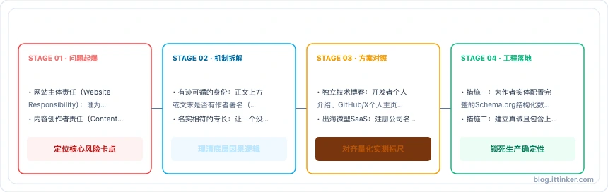
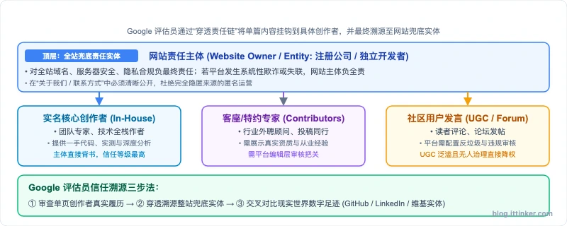
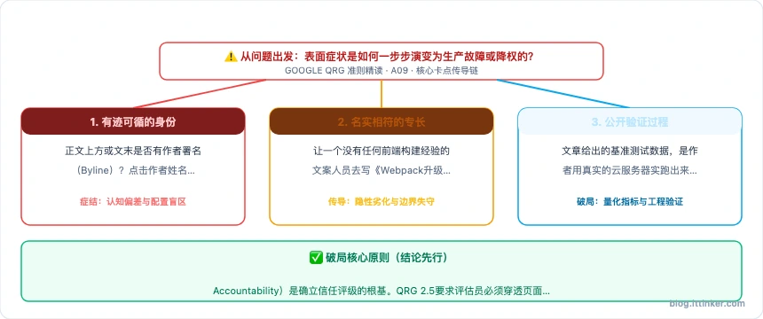
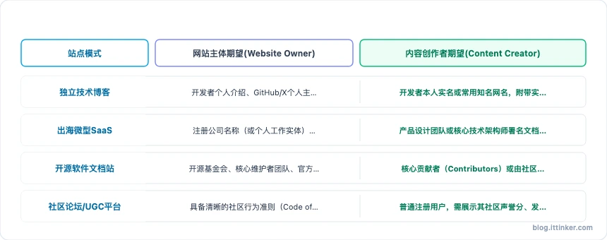
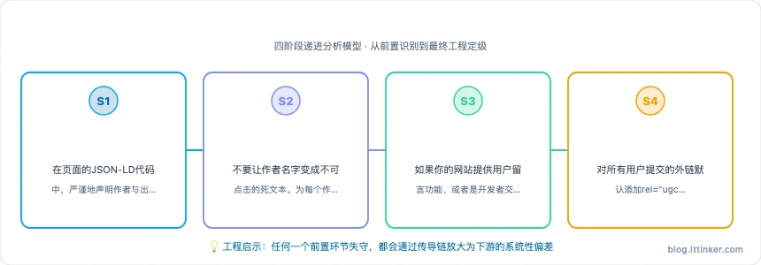
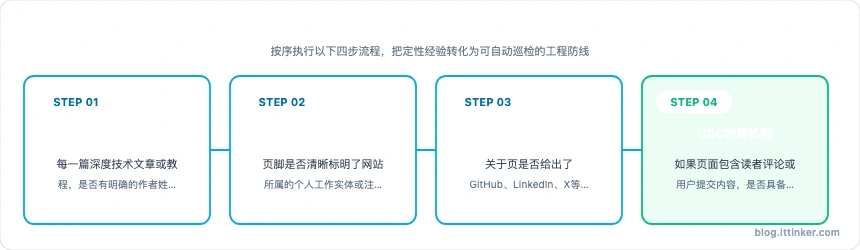

# 谁应该为一个网页负责？网站主体、作者与 UGC 创作者的责任边界 | 读懂 Google Search 基础认知 系列 009

> 🌐 **在线阅读与互动版**：[谁应该为一个网页负责？网站主体、作者与 UGC 创作者的责任边界 | 读懂 Google Search 基础认知 系列 009](https://blog.ittinker.com/posts/谁应该为一个网页负责/)
> 📚 **所属专栏**：[《读懂 Google Search：110篇搜索质量与SEO实战指南》](../README.md)

---

### 📌 结论先行（TL;DR）
**在 Google 的质量评估准则中，**“内容到底出自谁手、平台由谁监管”（Accountability）是确立信任评级的根基**。**

1. QRG 2.5 要求评估员必须穿透页面，厘清双层责任结构：第一层是**谁拥有并运营这个网站（Website Owner）**，第二层是**谁实际创作了该页面的主内容（Content Creator）**。
2. 对于个人独立博客或小型 SaaS，真实的开发者个人身份与实操记录远比虚构的企业头衔更有信誉；
3. 而对于带有论坛、评论或多作者投稿的平台型产品，网站所有者必须承担内容治理与审核责任，放任 UGC 垃圾蔓延会被视为站长失职并直接拖累整站。
4. Google 官方倡导的“Who / How / Why”自审框架，正是衡量创作者真实担当的标尺。

很多出海站长在做网站时喜欢玩“捉迷藏”：
页面上找不到作者署名，页脚只有一个版权年份，关于页面写着语焉不详的口号，甚至为了显得规模庞大，直接在网上随机抓取人脸生成几个虚构的高管头像。

站在用户的角度，当你看到一段充满风险的终端配置脚本、或者准备在一个新上线的工具里输入 API Key 时，如果连背后的站长是谁都查不到，你敢不敢运行？

在 Google 看来，**缺乏明确责任主体的网页，天然处于信任的最低位**。

要建立长期抗算法波动的搜索声誉，我们必须深入理解 QRG 2.5 中关于“网页责任边界”的铁律。





---

## 1. 拆解 QRG 2.5 与 2.5.1：双层责任溯源体系

Google 在 QRG 第 2.5 节《Understanding the Website》与第 2.5.1 节中明确写道：

> *"Every website has someone or an organization responsible for it... There are two parts to understanding who is responsible for a website and who created the content on the page: 1. Who is responsible for the website as a whole. 2. Who created the content on the page you are evaluating."*

在评估员实操手册中，责任被严格拆解为两个相互关联的层面：

1. **网站主体责任（Website Responsibility）**：
   谁为整个域名的存在买单？谁制定了网站的使用条款？一旦发生法律纠纷、数据泄露或恶意欺诈，监管机构和受害者该起诉谁？这通常对应一个公司法人、非营利组织，或者独立开发者个人。

2. **内容创作者责任（Content Creator Responsibility）**：
   具体这一篇文章、这一段代码、这一组产品评测是谁敲出来的？作者是该领域的资深工程师、持牌医生，还是一个兼职学生？亦或是社区匿名用户？





评估员在审查时会逐层推导：如果单页找不到独立创作者，那么该页面的全部内容责任就会直接自动归属到网站运营主体头上。如果连网站运营主体都藏头露尾，整个页面的信任评级就会直接跌入低估值区间。

---

## 2. 深度解读 Google 官方框架：Who、How 与 Why

为了帮助创作者走出盲目追逐算法的泥潭，Google 在 Helpful Content 指南中推出了三大自审维度：**Who（谁做的）、How（怎么做的）与 Why（为什么做）**。这三大维度是对 QRG 责任边界的现代工程化注解。

### 1. Who（明确身份与担当）
- **有迹可循的身份**：正文上方或文末是否有作者署名（Byline）？点击作者姓名，能否跳转至包含该作者真实从业背景、项目成果与社交凭证的专属档案页？
- **名实相符的专长**：让一个没有任何前端构建经验的文案人员去写《Webpack 升级 Vite 迁移踩坑记》，读者和算法都能轻易嗅出破绽。作者是否具备写下这些判断的真实经验？

### 2. How（公开生产与验证机制）
- **公开验证过程**：文章给出的基准测试数据，是作者用真实的云服务器实跑出来的，还是凭空编造的？
- **透明的辅助声明**：如果页面在编写代码或整理数据时使用了生成式 AI 辅助，是否在文末给予了客观诚实的披露？Google 明确表示不反对使用 AI 工具辅助提升效率，但极度反感用 AI 伪造一手经验。

### 3. Why（回归人类价值原点）
- **读者第一还是流量第一**：创作这篇内容的初衷，是为了切实解决开发者在某个报错上的耗时，还是只是在 SEO 关键词挖掘工具里看到这个词搜索量大，强行拼凑页面收割点击？为了搜索引擎而生产的空洞内容，正是 Helpful Content 系统的主要打击靶标。





---

## 3. 不同站点形态下的责任要求对照

不同的产品模式，Google 评估员对主体责任的期待完全不同。以下是常见出海站点的对照标准：

| 站点模式 | 网站主体期望 (Website Owner) | 内容创作者期望 (Content Creator) | 常见信任失分点 |
|---|---|---|---|
| **独立技术博客** | 开发者个人介绍、GitHub/X 个人主页、开源贡献记录 | 开发者本人实名或常用知名网名，附带实操踩坑背景 | 伪装成国际大咨询机构，虚构作者名单与头像 |
| **出海微型 SaaS** | 注册公司名称（或个人工作实体）、合规条款、客服渠道 | 产品设计团队或核心技术架构师署名文档与指引 | 只有收款按钮，没有任何团队介绍与售后责任人 |
| **开源软件文档站** | 开源基金会、核心维护者团队、官方代码仓库对应关系 | 核心贡献者（Contributors）或由社区共建并附 PR 记录 | 盗用官方文档镜像做外链引流，缺乏版本更新说明 |
| **社区论坛 / UGC 平台** | 具备清晰的社区行为准则（Code of Conduct）、举报入口 | 普通注册用户，需展示其社区声誉分、发言历史 | 评论区与发帖区充斥大量菠菜博彩暗链，平台毫无审核 |
| **垂直评测与科技媒体** | 拥有独立编辑部的媒体实体、明确的评测资助披露 | 专业测评编辑、硬件测试工程师，展示实机操作照片 | 通篇好评却从不披露商业赞助关系（Affiliate Disclosure） |





---

## 4. 独立开发者的轻量化“责任透明度”工程

许多独立开发者没有大公司的法务与公关团队，担心自己的个人站无法达到严苛的审核标准。这种担忧是不必要的。

**在 Google 评估员眼里，一个坦诚、真实的个人独立开发者，信誉度远远高于一个假模假样的皮包公司网站。**

独立开发者只需落实以下三项工程化措施，即可建立坚固的主体信任度：

### 措施一：为作者实体配置完整的 Schema.org 结构化数据
在页面的 JSON-LD 代码中，严谨地声明作者与出版者实体，把你的网站与站外权威凭证链接起来：

```html
<script type="application/ld+json">
{
  "@context": "https://schema.org",
  "@type": "TechArticle",
  "headline": "深入拆解 Linux 网络性能调优与丢包排查",
  "author": {
    "@type": "Person",
    "name": "Richardson",
    "jobTitle": "Full-Stack Engineer",
    "url": "https://ittinker.com/about/",
    "sameAs": [
      "https://github.com/richardson",
      "https://x.com/richardson_dev"
    ]
  },
  "publisher": {
    "@type": "Organization",
    "name": "ITTinker",
    "url": "https://ittinker.com",
    "logo": {
      "@type": "ImageObject",
      "url": "https://assets.ittinker.com/logo.png"
    }
  }
}
</script>
```

### 措施二：建立真诚且包含上下文的个人作者档案页（Author Bio）
不要让作者名字变成不可点击的死文本。为每个作者配置独立的 `/author/xxx/` 路由，写清楚他的技术栈、从事该领域的时间、曾经开源过哪些工具、解决过什么棘手问题。真实的个人叙事是最难被 AI 复制的核心壁垒。

### 措施三：对 UGC 内容实施严格的隔离治理
如果你的网站提供用户留言功能、或者是开发者交流社区，必须坚决执行防御策略：
1. 对所有用户提交的外链默认添加 `rel="ugc nofollow"` 属性；
2. 接入自动化垃圾拦截机制，对包含高风险关键词的留言进入人工待审队列；
3. 为页面提供显眼的“举报此内容”通道，证明平台主体始终对页面生态负责。





---

## 5. 网页责任边界自查 Checklist

在代码部署前，请用这套清单检验网站的责任透明度：

- [ ] **署名可溯源**：每一篇深度技术文章或教程，是否有明确的作者姓名与作者主页链接？
- [ ] **主体可对应**：页脚是否清晰标明了网站所属的个人工作实体或注册组织名称？
- [ ] **站外实体绑定**：关于页是否给出了 GitHub、LinkedIn、X 等可以互相交叉印证的主体主页？
- [ ] **UGC 治理机制**：如果页面包含读者评论或用户提交内容，是否具备反垃圾审核机制并添加了 `rel="ugc"` 属性？
- [ ] **AI 辅助披露**：如果有使用生成式工具整理素材，是否在合适的位置诚实注明了创作机制与人工复核流程？





---

## 下一篇预告

确立了责任主体之后，评估员下一步会调阅你网站上最基础、也最容易被站长敷衍的几个特定页面：

**为什么一个简单的 About 页面、一个能够正常收信的 Contact 邮箱、以及明确的退款与客服承诺，会成为 Google 判断一个网站是不是骗子站的核心指标？**

下一篇，我们将深入解构信任基石：**[About、Contact、Customer Service 为什么不是“SEO 装饰”？透明度如何决定信任评级（A10）](/posts/about-contact-customer-service-为什么不是-seo-装饰/)**。

---

_这是「读懂 Google Search」系列第 9 篇，系统拆解 Google 官方质量指南，帮你建立长期抗算法波动的出海 SEO 护城河。_


---

## 读懂 Google Search 专栏导航

> 📚 **专栏收录**：本文为 [《读懂 Google Search：110篇搜索质量与SEO实战指南》](/posts/google-search-guide/) 第 **A09** 篇。

* **专栏主页**：[《读懂 Google Search：110篇搜索质量与SEO实战指南》全景地图与路线图](/posts/google-search-guide/)
