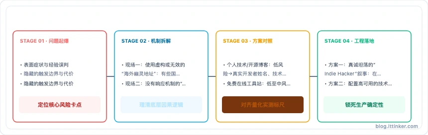
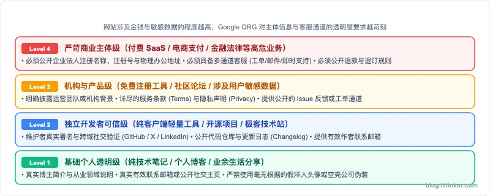
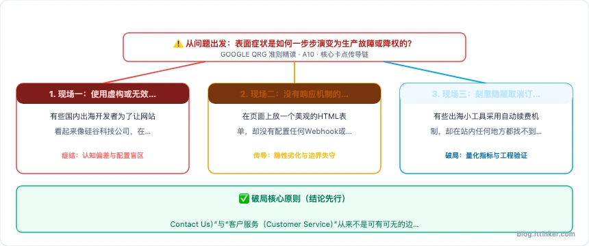
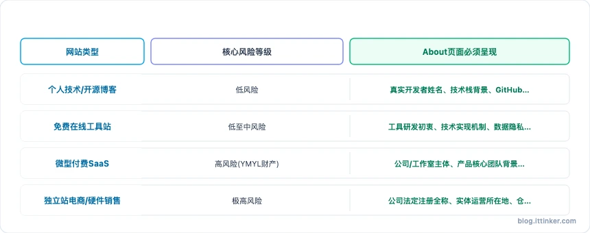
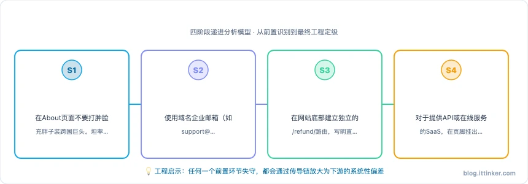
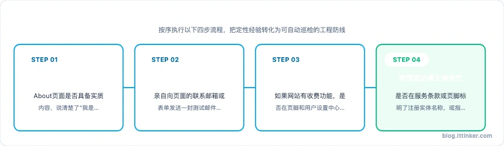

# “About 和 Contact 只是摆设”？被当成装饰品的致命信用底盘：为什么缺乏真实联系方式会让你的网站评级直接腰斩？ | 读懂 Google Search 基础认知 系列 010

> 🌐 **在线阅读与互动版**：[“About 和 Contact 只是摆设”？被当成装饰品的致命信用底盘：为什么缺乏真实联系方式会让你的网站评级直接腰斩？ | 读懂 Google Search 基础认知 系列 010](https://blog.ittinker.com/posts/about-contact-customer-service-为什么不是-seo-装饰/)
> 📚 **所属专栏**：[《读懂 Google Search：110篇搜索质量与SEO实战指南》](../README.md)

---

### 📌 结论先行（TL;DR）
> **在 Google 的页面质量评估标准中，**“关于我们（About Us）”、“联系我们（Contact Us）”与“客户服务（Customer Service）”从来不是可有可无的边角料，而是衡量网站主体信誉与防欺诈维度的核心硬指标**。**
> **许多出海开发者在搭建网站时，往往把 99% 的精力投入在产品主界面和核心功能代码上。当项目临近上线、需要完善页脚链接时，他们通常随手套用一个现成的模板：**
> **这种做法在开发者眼中是“节省时间、先测 MVP”，但在 Google 评估员和搜索反欺诈算法眼里，这是典型的**高风险网站特征**。**
> **当用户在你的网站上刷了信用卡，遇到扣错款、系统故障或无法登录时，如果满屏找不到一个可以讲理的活人，这就是最恶劣的用户体验。**
> **要跨过搜索排名的信任门槛，我们必须搞懂 QRG 第 2.5.3 节的透明度规则。**
>
> - **QRG 2.5.3 明确规定**：一个合格的网站必须让用户能轻松找到“谁对网站负责”以及“如何取得有效联络”。
> - **Google 采用阶梯式透明度要求**：纯个人技术博客提供真实的作者背景与邮箱即可达标；
> - 涉及金钱交易的微型 SaaS、独立电商或提供严肃建议的工具，必须提供注册企业主体、多渠道可响应的客服支持、透明的退款协议与实体联络地址。
> - 凡是涉及金钱交易却故意隐匿联系方式的网站，会被评估员直接降至 Lowest。
> - About 页面留着两段空洞的“改变世界”口号；
> - Contact 页面挂着一个没有接入任何邮件推送服务的前端静态 Form 表单；
> - 至于 Customer Service 和 Refund Policy，干脆直接留空或彻底隐藏。

---

### 🚨 2026 → 2024 官方最新风向预警：Google 对Google 对商业站点主体信息透明度（Transparency & Contact）的强制要求的策略演进

#### 🕒 2026 → 2024 Google 官方对Google 对商业站点主体信息透明度（Transparency & Contact）的强制要求的策略演进

- **2026 · 履约可达性核验（Reachability & Resolution Verification）**
  Google 针对出海 SaaS 与交易型工具站，开始检测客服入口的真实有效性。仅留一个冷冰冰的 Web 表单而无真实物理地址、企业邮箱或明确退款通道的站点，在商业意图词上遭遇严重限流。

- **2025 · 合规披露与消费者信任信号深度绑定（Merchant Trust & Scam Defense）**
  随着对钓鱼和虚假独立站打击力度的加码，About 页面与条款透明度直接与 Chrome 安全浏览及搜索信任分联动，缺少主体公开信息的网站无法获得高质量认证。

- **2024 · QRG 2.5.2 & 2.5.3 条款对联系信息门槛的量化**
  指南明确规定：涉及金钱交易或个人信息的商业站点，必须提供极高水准的主体信息与客户服务通道，这是区分合法经营与高风险欺诈的核心分水岭。

---

## 1. 拆解 QRG 2.5.3：透明度的官方阶梯

Google 在 QRG 第 2.5.3 节《Finding About Us, Contact Information, and Customer Service Information》中详细阐释了信息透明度的评判基准：

> *"Most websites want users to know who is responsible for the site and how to contact them... The type and amount of contact information needed depends on the type of website. Contact information and customer service information are extremely important for websites that handle money transactions, such as stores, banks, credit card bill pay, etc."*

在这段论述中，Google 确立了一项核心逻辑：**透明度要求与潜在交易风险成正比**。

在 QRG 指南中，评估员被特别指示：如果一个涉及在线支付的网站，仅提供一个语焉不详的匿名电子邮箱，或者表单提交后没有任何回执，普通消费者在遇到支付纠纷时根本无法维权。**这类缺乏客服支撑的商业网站，属于极高安全风险页面，很难获得高质量评级。**

---

## 2. 独立开发者常见的四大翻车现场

为了图省事，不少站长在配置信任页面时踩中了反作弊系统的雷区：

### 现场一：使用虚构或无效的“海外幽灵地址”
有些国内出海开发者为了让网站看起来像硅谷科技公司，在 Contact 页面随便写一个美国加州的虚构地址，或者直接套用公开的转运仓库。Google 的实体知识图谱具备成熟的地理编码校验能力，一旦发现该地址对应的是空地、废弃厂房或臭名昭著的离岸外壳地址，网站的主体可信度会瞬间归零。

### 现场二：没有响应机制的“黑洞表单”
在页面上放一个美观的 HTML 表单，却没有配置任何 Webhook 或邮件转发逻辑（如 Resend、Formspree），用户输入咨询后点击发送，控制台直接报 500 错误，或者没有任何确认邮件。这不仅会让潜在付费客户流失，更会被人工评估员直接标记为“功能损坏（Broken Functionality）”。

### 现场三：刻意隐藏取消订阅与退款入口
有些出海小工具采用自动续费机制，却在站内任何地方都找不到“如何申请退款”或“如何解除绑卡”。用户必须跑到 Stripe 或 PayPal 提请争议投诉（Dispute）。当外部维权投诉累积到一定量级时，Google 的声誉检索算法就会抓取到这些负面记录，给整站打上惩罚标签。

### 现场四：虚假团队头像与编造的履历
在 About 页面放四张 AI 跑出来的欧美人像，起名“John Smith 架构师”、“Emily 运营总监”，而这些人在 LinkedIn 上查无此人。这种弄虚作假被人工评估员识破后，会被判定为具备欺骗性意图（Deceptive Purpose），后果极为严重。

---

## 3. 不同站点形态透明度配置对照表

针对不同类型的出海产品，必须达标的信任基准如下表所示：

| 网站类型 | 核心风险等级 | About 页面必须呈现 | Contact 页面必须呈现 | 客服与争议保障要求 |
|---|---|---|---|---|
| **个人技术/开源博客** | 低风险 | 真实开发者姓名、技术栈背景、GitHub 主页 | 有效的个人工作邮箱、X (Twitter) 链接 | 保证邮件定期查看即可，无硬性响应时效考核 |
| **免费在线工具站** | 低至中风险 | 工具研发初衷、技术实现机制、数据隐私说明 | 反馈建议邮箱、GitHub Issue 提交入口 | 提供 Bug 报错通道，声明数据是否在本地浏览器处理 |
| **微型付费 SaaS** | **高风险 (YMYL 财产)** | 公司/工作室主体、产品核心团队背景、产品版本历史 | 专属支持邮箱（如 `support@`）、工单提交入口 | **必须公开退款政策（如 14 天退款机制）与订阅取消指引** |
| **独立站电商 / 硬件销售** | **极高风险** | 公司法定注册全称、实体运营所在地、仓储发货说明 | 电话支持通道、在线客服工单、服务工作时间 | **明确的国际物流追踪、退换货运费承担与争议解决条款** |

---

## 4. 独立开发者低成本搭建“高信任基建”方案

作为资源有限的独立开发者，如何用最低的运维成本满足 Google 严苛的透明度标准？以下是一套经过实战检验的标准工程方案：

### 方案一：真诚坦荡的“Indie Hacker”叙事
在 About 页面不要打肿脸充胖子装跨国巨头。坦率告诉读者：“这是一个由独立工程师维护的产品，旨在解决 XX 具体卡点与效率问题”。在页面附上真实的开发手记、产品更新路线图（Roadmap）以及个人的公开社交账号。这种真诚与透明度在海外极受欢迎，评估员也会给予正面的高分判定。

### 方案二：配置高可用的技术支持邮箱转发
使用域名企业邮箱（如 `support@yourdomain.com`），借助 Cloudflare Email Routing 或 Resend 将所有来信免费无缝转发至你的日常主力邮箱。在前端 Contact 页面明确标注响应预期，例如：“我们通常在工作日 24 小时内回复所有技术工单”，并提供自动回复确认邮件。

### 方案三：建立清晰透明的退款与隐私公约
在网站底部建立独立的 `/refund/` 路由，写明直白、无套路的规则：
> “如果您在购买后 7 天内对产品有任何不满意，只需发送邮件至 support@yourdomain.com，提供您的账单号，我们将在 2 个工作日内无条件为您全额原路退款。”

这条规则不仅能让 Google 评估员放心，还能大幅降低潜在用户的付费顾虑，直接提升付款转化率。

### 方案四：接入第三方公开服务状态页（Status Page）
对于提供 API 或在线服务的 SaaS，在页脚挂出 Status 链接，接入 BetterStack 或 UptimeRobot 的公开监控页。实时透明的服务运行状态是技术实力与运营责任最强有力的外部证明。

---

## 5. 网站透明度自查 Checklist

在产品面向海外市场推广前，逐项核对你的信任基建：

- [ ] **About 页非空检查**：About 页面是否具备实质内容，说清楚了“我是谁”、“这个网站为何而建”？
- [ ] **Contact 邮箱可用性测试**：亲自向页面的联系邮箱或表单发送一封测试邮件，确认能在主力邮箱中顺利收到且回信顺畅。
- [ ] **退款与取消订阅条款**：如果网站有收费功能，是否在页脚和用户设置中心提供了显眼的取消订阅入口与退款政策？
- [ ] **物理或法律主体交代**：是否在服务条款或页脚标明了注册实体名称，或指明了受管辖的司法地区？
- [ ] **页脚核心合规链接完整性**：页脚是否清晰陈列了 About、Contact、Privacy Policy、Terms of Service 的直达链接，且全部为 200 正常状态码？

---

## 下一篇预告

至此，我们完成了 QRG 第一大核心模块《网站与页面的基础认知（A1 模块）》的全部梳理：
从页面目的（A05）、单页与整站边界（A06）、YMYL 风险分级（A07）、MC/SC/Ads 切片（A08），到责任主体（A09）与透明度基建（A10）。

在筑牢了这套底层骨架之后，我们将正式跨入 QRG 最硬核的打分内核——**A2 模块：Page Quality 到底怎么判断**。

下一篇，我们将建立一套完整的质量评估全景模型：**[“改好这三个标签就能拿高分”？碎片化 SEO 的彻底破产：一张图建立 Google 页面质量（Page Quality）审核总框架（A11）](/posts/page-quality-到底在评什么/)**。

---

_这是「读懂 Google Search」系列第 10 篇，系统拆解 Google 官方质量指南，帮你建立长期抗算法波动的出海 SEO 护城河。_

---

## 读懂 Google Search 专栏导航

> 📚 **专栏收录**：本文为 [《读懂 Google Search：110篇搜索质量与SEO实战指南》](/posts/google-search-guide/) 第 **A10** 篇。

* **专栏主页**：[《读懂 Google Search：110篇搜索质量与SEO实战指南》全景地图与路线图](/posts/google-search-guide/)
