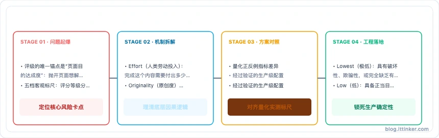
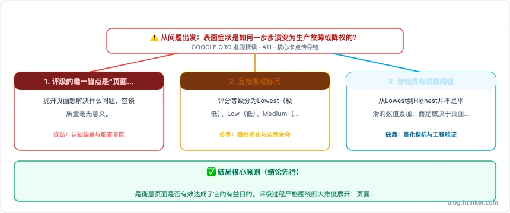
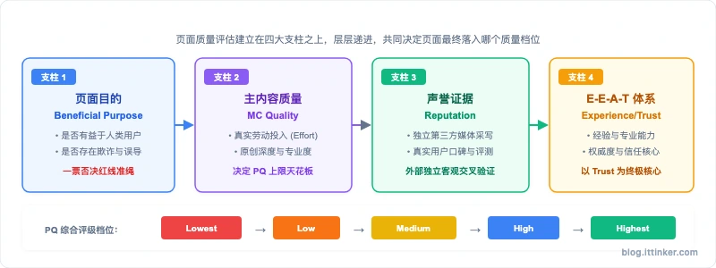
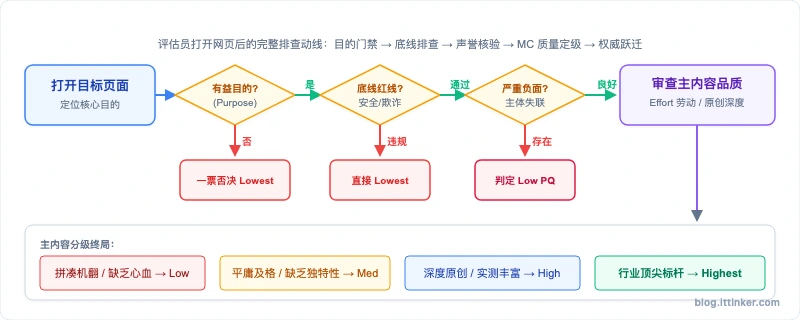
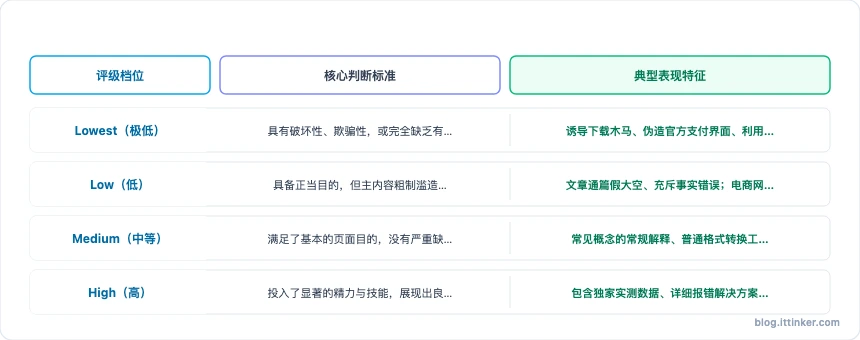
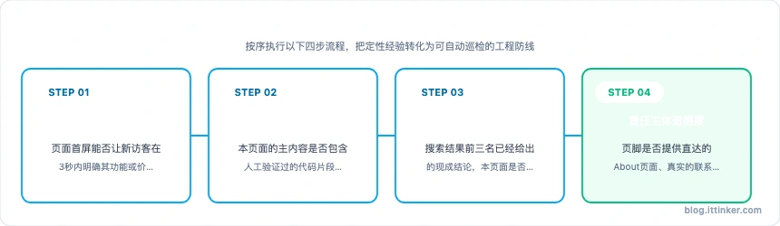

# Page Quality 到底在评什么？一张图建立 Google 页面质量审核总框架 | 读懂 Google Search 基础认知 系列 011

> 🌐 **在线阅读与互动版**：[Page Quality 到底在评什么？一张图建立 Google 页面质量审核总框架 | 读懂 Google Search 基础认知 系列 011](https://blog.ittinker.com/posts/page-quality-到底在评什么/)
> 📚 **所属专栏**：[《读懂 Google Search：110篇搜索质量与SEO实战指南》](../README.md)

---

### 📌 结论先行（TL;DR）
**Google 的 Page Quality（PQ）评级是一套高度结构化的质量裁判体系，核心目标是衡量页面是否有效达成了它的有益目的。**

1. 评级过程严格围绕四大维度展开：**页面目的（Purpose）**、**主内容质量（MC Quality）**、**网站与创作者声誉（Reputation）**，以及以信任度为底座的 **E-E-A-T**。
2. 它不看排版特效，不数文章字数，更不等于外链权重。
3. 页面若缺乏信任底座或主内容敷衍，即便技术架构完美也会被归入 Low 或 Lowest。

在前面的章节中，我们已经拆解了页面目的的定义（[A05](/posts/评价网页之前-为什么必须先搞清楚页面目的/)）、单页与网站的区别（[A06](/posts/google-眼中的-webpage-和-website-到底有什么区别/)）、YMYL 的现实危害标准（[A07](/posts/什么是-ymyl/)），以及页面的三大物理构成（[A08](/posts/一个网页到底由什么组成/)）。

很多出海独立开发者在做网站优化时，最常问的一个问题就是：“Google 到底凭什么判定一个页面是优质还是低质？”

网络上充斥着大量碎片的经验谈：有人说字数必须超过 2500 字，有人说必须做全套 Schema 标记，还有人说必须挂上作者头像和社交媒体链接。把这些琐碎要求像打补丁一样拼凑起来，往往只会得到一个表面光鲜、内部空洞的杂合体。

在 Google 官方评审指南 QRG（Search Quality Rater Guidelines）第 3 部分中，Google 详细公开了 **Page Quality Rating（页面质量评级）** 的底层逻辑。这套标准不是黑箱算法的玄学猜想，而是一套可以直接落地执行的审核框架。

---

## 1. 拆解 QRG 3.0：PQ 评级的核心定义与五档标尺

QRG 第 3.0 节《Overall Page Quality Rating》开篇给出了明确定义：

> *"The first step in Page Quality (PQ) rating is to understand the purpose of the page... The Page Quality rating assesses how well the page achieves its purpose using the standards described in these guidelines."*
>
> *"PQ rating scale consists of Lowest, Low, Medium, High, and Highest. You can also use in-between ratings to be more specific: Lowest+, Low+, Medium+, High+."*

这段话揭示了评级机制的三个硬核事实：

1. **评级的唯一锚点是“页面目的达成度”**：抛开页面想解决什么问题，空谈质量毫无意义。
2. **五档客观标尺**：评分等级分为 Lowest（极低）、Low（低）、Medium（中等）、High（高）、Highest（极高）。中间档位（如 Low+、High+）允许评估员给出精细调节。
3. **分档具有明确阈值**：从 Lowest 到 Highest 并不是平滑的数值累加，而是取决于页面是否突破了特定红线，或者是否具备独家价值。

对于独立开发者而言，我们的目标非常明确：**确保日常生产的工具页、文档和核心落地页稳定处于 High 以上，坚决阻断任何可能导致页面滑落至 Low 或 Lowest 的负面因素。**

---

## 2. 拆解 QRG 3.1：决定 PQ 等级的四大考量维度

QRG 第 3.1 节《Page Quality Rating Considerations》系统归纳了评估员在评判一个页面时必须综合考量的核心输入：

> *"The Page Quality rating of a webpage is based on how well the page achieves its purpose. In order to understand how well a page achieves its purpose, you must assess:*
> - *The purpose of the page*
> - *The quality of the Main Content (MC)*
> - *The reputation of the website and the content creator*
> - *The level of Experience, Expertise, Authoritativeness, and Trust (E-E-A-T)"*

我们可以将这四大维度拆解为具体的审核要点：

### 维度一：页面目的（Purpose）
评估起点永远是：这个页面为人类用户提供了什么价值？
如果一个页面本身充斥着点击诱导、恶意代码、伪装下载，或者纯粹是为了欺骗搜索引擎而自动生成的垃圾，它在第一步就会被判定为 **No Beneficial Purpose**，直接落入 Lowest。

### 维度二：主内容质量（Main Content Quality）
主内容（MC）是页面达成其目的的载体。Google 在考察 MC 时，关注的不是单纯的字符长度，而是四大质量因子：
- **Effort（人类劳动投入）**：完成这个内容需要付出多少实际劳动？
- **Originality（原创度）**：内容是否包含第一手调研、独立测试或独特见解？
- **Talent / Skill（专业技巧）**：呈现方式是否清晰、严谨、符合行业专业水准？
- **Accuracy & Added Value（准确度与增量价值）**：事实是否准确？给搜索用户带来了多少全新增量？

### 维度三：站方与创作者声誉（Reputation）
谁在运营这个站点？谁写了这篇文章？更重要的是：**外部独立第三方如何评价他们？**
自夸没有效力，Google 评估员会主动在外部搜索独立的媒体报道、用户投诉、行业奖项以及同行评议。

### 维度四：E-E-A-T 信任体系
在 Experience（亲身体验）、Expertise（专业资质）、Authoritativeness（权威度）与 Trust（信任度）构成的四面体中，**Trust 是处于核心地位的天平**。即使一个作者文笔再好、自称经验丰富，如果网站缺乏透明退款渠道、存在财务欺诈嫌疑，Trust 归零的同时整个页面的评级也会彻底崩塌。

---

## 3. Google 页面质量审核全流程决策树

评估员在审查一个具体页面时，并不是随机打分，而是遵循一套从严到宽的排查流水线：

---

## 4. 质量五档评级横向对照表

理解各个档位之间的界限，有助于我们在开发出海产品或撰写深度技术内容时找准及格线与发力点：

| 评级档位 | 核心判断标准 | 典型表现特征 | 独立开发者避坑提示 |
|---|---|---|---|
| **Lowest（极低）** | 具有破坏性、欺骗性，或完全缺乏有益人类目的 | 诱导下载木马、伪造官方支付界面、利用程序大量拼接搜索热词、散布有害言论 | 绝不使用黑帽重定向；绝不在没有人工校对的情况下批量发布原始模型生成物。 |
| **Low（低）** | 具备正当目的，但主内容粗制滥造，或存在明显信任缺陷 | 文章通篇假大空、充斥事实错误；电商网站找不到客服与退款通道；标题党骗取点击 | 避免为了 SEO 强行注水；补齐清晰的 About、Contact 与条款页面。 |
| **Medium（中等）** | 满足了基本的页面目的，没有严重缺陷，但也缺乏突出亮点 | 常见概念的常规解释、普通格式转换工具、无功无过的日常新闻转载 | 绝大多数合格网站的默认起步档；中规中矩，但在竞争激烈的关键词下难以突围。 |
| **High（高）** | 投入了显著的精力与技能，展现出良好的 E-E-A-T 与主内容质量 | 包含独家实测数据、详细报错解决方案、流畅易用的交互设计、透明的创作者履历 | 出海团队应当争取的核心档位；靠真实测试、独立思考与专业表达赢取信任。 |
| **Highest（极高）** | 该主题下的标杆级呈现，具备无可争议的权威性或独家人类劳动价值 | 独家一手深度调查、同行公认的行业标准库、体验极致的开源工具主页 | 针对核心高转化词打造旗舰级内容，积累权威引用与真实行业口碑。 |

---

## 5. 出海开发者常见的三大认知陷阱

在实际操作中，很多站长容易将精力耗费在错误的指标上：

### 陷阱一：把文本字数等同于主内容质量
很多出海教程宣扬“文章字数越多越好”。但在 QRG 3.2 中，Google 明确指出：**字数绝不等于质量**。
如果一个在线 JSON 验证工具能够在 50 毫秒内帮用户找出语法错误并一键格式化，它的主内容就是最高质量（Highest）。若在输入框上方强行插入 2000 字的“JSON 发展史与语法普及”，反而破坏了用户体验，稀释了页面目的。

### 陷阱二：把页面自述当成外部声誉
在自建博客的“关于我们”页面写上“行业领先的技术团队”，在 Google 评估员眼里仅仅是一句声明（Claim）。声誉调查的核心原则是：**听其言，观其行，更要查其外**。只有当第三方媒体、社区开发者、真实客户在讨论你的工具时给出了正向反馈，声誉维度才能获得真实加分。

### 陷阱三：孤立看待 E-E-A-T，忽视核心 Trust
有些团队把 E-E-A-T 机械拆成四个清单：挂一个博主头像算“经验”，加一句行业介绍算“专业”，买几个新闻通稿算“权威”。然而在 QRG 体系里，**Trust 是另外三个要素的检验天平**。如果一个金融或医疗工具无法保护用户隐私、收款主体遮遮掩掩，前面堆砌的所有假象都会瞬间归零。

---

## 6. 独立开发者上线页面前的 PQ 审核自查清单

在任何新页面上线或进行 SEO 改版前，可以使用以下清单进行全方位体检：

- [ ] **目的明确性**：页面首屏能否让新访客在 3 秒内明确其功能或价值？
- [ ] **内容真实付出（Effort）**：本页面的主内容是否包含人工验证过的代码片段、实测截图、真实踩坑记录，而非纯模型生成的空话？
- [ ] **增量价值（Added Value）**：搜索结果前三名已经给出的现成结论，本页面是否提供了补充视角、反直觉发现或更高效的交互方式？
- [ ] **责任主体透明度**：页脚是否提供直达的 About 页面、真实的联系方式、隐私政策与服务条款？
- [ ] **消除欺骗性元素**：是否存在伪装成下载按钮的广告？文章标题与正文结论是否存在断章取义的标题党嫌疑？
- [ ] **商业利益披露**：如果页面包含联盟分销链接（Affiliate Links）或赞助推广，是否在显著位置给出了坦诚的免责披露？

---

## 下一篇预告

建立了 Page Quality 的宏观审核框架后，决定一个页面能否冲上 High 乃至 Highest 的核心战场，依然在于 **Main Content（主内容）**。

Google QRG 3.2 提出了一套极其严格的 MC 评估标准：**Effort（劳动量）、Originality（原创度）、Talent/Skill（专业技能）与 Added Value（增量价值）**。

为什么你的深度长文依然被判为平庸？为什么仅仅把维基百科的内容重新改写一遍根本过不了质量关？

下一篇，我们将深入拆解 QRG 3.2：**[什么才叫高质量 Main Content？Effort、Originality、Skill 与 Added Value 全解（A12）](/posts/什么才叫高质量-main-content/)**。

---

_这是「读懂 Google Search」系列第 11 篇，系统拆解 Google 官方质量指南，帮你建立长期抗算法波动的出海 SEO 护城河。_

---

## 读懂 Google Search 专栏导航

> 📚 **专栏收录**：本文为 [《读懂 Google Search：110篇搜索质量与SEO实战指南》](/posts/google-search-guide/) 第 **A11** 篇。

* **专栏主页**：[《读懂 Google Search：110篇搜索质量与SEO实战指南》全景地图与路线图](/posts/google-search-guide/)
