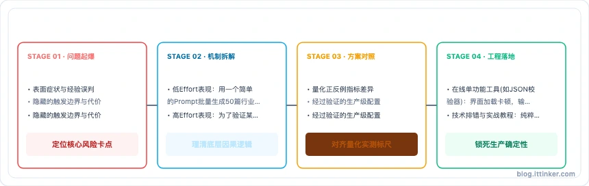
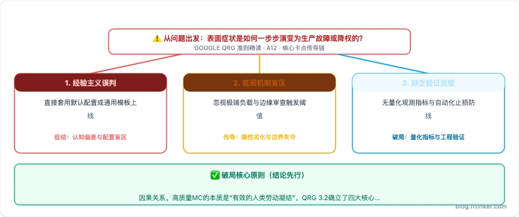
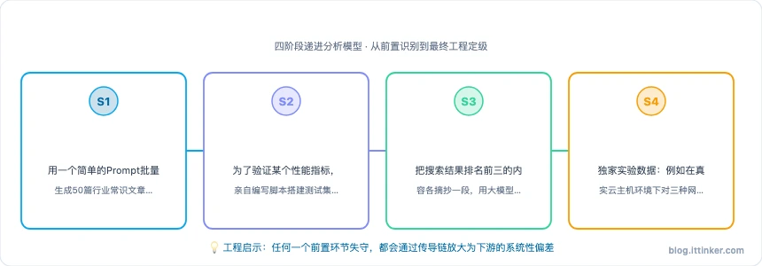
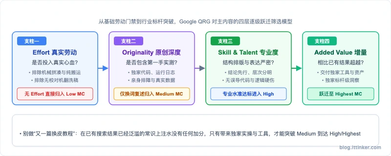
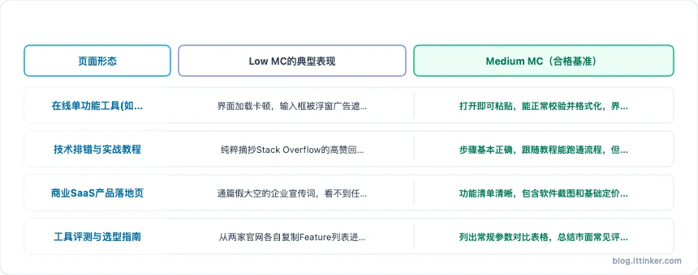
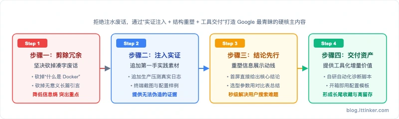
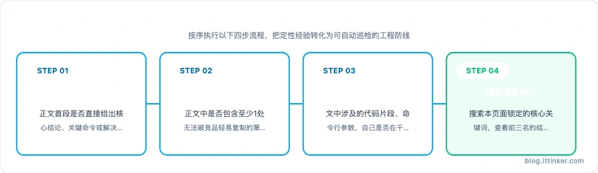

# 什么才叫高质量 Main Content？Effort、Originality、Skill 与 Added Value 全解 | 读懂 Google Search 基础认知 系列 012

> 🌐 **在线阅读与互动版**：[什么才叫高质量 Main Content？Effort、Originality、Skill 与 Added Value 全解 | 读懂 Google Search 基础认知 系列 012](https://blog.ittinker.com/posts/什么才叫高质量-main-content/)
> 📚 **所属专栏**：[《读懂 Google Search：110篇搜索质量与SEO实战指南》](../README.md)

---

### 📌 结论先行（TL;DR）
**在 Google 的评估体系中，**主内容（Main Content）质量与文章字数没有任何直接因果关系**。**

1. 高质量 MC 的本质是**“有效的人类劳动凝结”**。
2. QRG 3.2 确立了四大核心检验标尺：**投入程度（Effort）**、**原创深度（Originality）**、**专业技巧（Talent/Skill）** 与 **增量价值（Added Value）**。
3. 一个 200 行代码即开即用的转换脚本，其 MC 质量可以远超一篇由大模型批量拼凑的 5000 字泛泛长文。
4. 缺乏新增信息量与真实人类心血的文本，在现代搜索引擎眼里只是低信噪比的噪声。

在建立起 Page Quality 的总框架之后（[A11](/posts/page-quality-到底在评什么/)），很多开发者最常陷入的误区就是将精力投入到字符数量上。

过去十年间，大量 SEO 培训课程给从业者灌输了一种机械的公式：要想排进前三名，文章字数必须达到 3000 字以上；核心关键词必须出现 5 次；每一个小标题下面都要塞入长段落。

这种操作方式在算法演进到今天早已失效。如果你仔细研读 Google 官方的评估指南 QRG 3.2 节以及 Google Search Central 发布的《Creating helpful, reliable, people-first content》，你会发现官方对高质量主内容（Main Content）的定义与字数毫无关联。

Google 究竟用什么标准来衡量一份主内容是否优秀？

---

## 1. 拆解 QRG 3.2：Google 对 MC 质量的官方定义

QRG 第 3.2 节《Quality of the Main Content》给出了关于主内容评估的底层原则：

> *"The quality of the MC is one of the most important considerations in Page Quality rating... High quality MC may be created with effort, originality, and talent or skill."*
>
> *"For all types of content, the quality of the MC is largely determined by the amount of effort, originality, and talent or skill that went into its creation."*
>
> *"A page can have High quality MC if it accomplishes its purpose well, even if it is short or simple."*

最后一句结论彻底终结了“字数决定论”：**只要页面能够出色地达成其目的，即便主内容十分简短纯粹，它依然完全可以被评为 High 甚至 Highest。**

反过来，即使一篇文章长达上万字，但如果这些文字纯粹是从其他网站洗稿改写而成、充斥着车轱辘话和事实错误，评估员会毫不犹豫地判定其为 Low 级别。

---

## 2. 深入四大基石：Effort、Originality、Skill 与 Added Value

QRG 3.2 明确指出了高质量内容得以成立的四根支柱。理解了这四根支柱，你在规划任何技术博客、出海工具或产品落地页时，就拥有了明确的行动方向。

### 基石一：Effort（可验证的人类精力与劳动投入）
Effort 指的是创造这份内容所耗费的真实心血与精力。
- **低 Effort 表现**：用一个简单的 Prompt 批量生成 50 篇行业常识文章，没有任何人工校验；写技术排错只贴三行通用的重启命令；做工具对比直接复制竞品官网的 Feature 列表。
- **高 Effort 表现**：为了验证某个性能指标，亲自编写脚本搭建测试集群并记录压测曲线；针对开源组件的一个边缘 Bug，详细附上复现步骤、抓包数据和补丁代码；制作清晰的技术架构图与参数决策矩阵。

Google 评估员被训练去识别“容易伪造的表面长文”与“凝结了真实劳动的心血之作”。高 Effort 带来的信息颗粒度是机器难以凭空编造的。

### 基石二：Originality（第一手原创性）
Originality 绝非使用同义词替换工具改写他人的段落，而是指内容是否包含独家来源的增量信息。
- **伪原创**：把搜索结果排名前三的内容各摘抄一段，用大模型重新润色后发布。这种内容在算法库里被称为“信息冗余（Information Redundancy）”。
- **真原创**：
  - 独家实验数据：例如在真实云主机环境下对三种网络方案进行延迟对比；
  - 独到反思与踩坑经历：记录自己在部署生产环境时遇到的未公开异常；
  - 专有工具与脚本：例如在文章中嵌入自己在 GitHub 开源并维护的自动化运维脚本；
  - 深度案例分析：针对具体的业务场景给出第一手解决路径。

### 基石三：Talent or Skill（专业技巧与表达素养）
Talent / Skill 衡量的是创作者呈现信息时的专业素养。
- **缺乏 Skill 的表现**：排版错乱、逻辑跳跃、术语混用；代码缺少高亮与注释；配图模糊且没有标注文档；行文充斥着口水话和情绪化宣泄。
- **具备高 Skill 的表现**：
  - 严谨的专业度：术语使用规范，代码遵循安全规范；
  - 卓越的呈现技巧：复杂的系统交互能够用规范的 Mermaid 流程图或内联 SVG 表达得一目了然；
  - 结构化阅读体验：核心结论置顶，长篇技术细节采用清晰的编号或折叠区域，尊重读者的时间。

### 基石四：Added Value（搜索结果的增量价值）
在 Google 的 Reviews System 和 Helpful Content 指南中，Added Value 被反复强调。评估员在审视页面时，会将其与互联网上现存的海量信息进行对照：
- **零增量**：用户搜“如何配置 Nginx 反向代理”，前五篇已经讲透了基础语法，你的文章依然只复述一遍这五行配置，没有提供任何新认知。
- **高增量价值**：同样是讲配置反向代理，你的页面不仅给出了基础配置，还给出了应对高并发连接泄露的优化参数，并指出了官方文档中未提示的 Buffer 陷阱。

---

## 3. 主内容质量的多级判定路径

我们可以将 QRG 3.2 的审核逻辑归纳为一套逐级递进的漏斗模型：

---

## 4. 不同页面形态下的 MC 质量横向对比

很多开发者误以为 MC 质量只适用于技术博客，其实它涵盖了互联网上所有类型的数字产品：

| 页面形态 | Low MC 的典型表现 | Medium MC（合格基准） | High / Highest MC（优秀标杆） |
|---|---|---|---|
| **在线单功能工具** (如 JSON 校验器) | 界面加载卡顿，输入框被浮窗广告遮挡；顶部强行塞入 1500 字历史百科；报错提示毫无指导意义。 | 打开即可粘贴，能正常校验并格式化，界面简洁，无明显错误。 | 格式化速度极快；高亮显示出错字符并给出修复建议；支持快捷键与离线运行；提供一键导出为各类语言结构体。 |
| **技术排错与实战教程** | 纯粹摘抄 Stack Overflow 的高赞回答，没有环境说明；代码存在废弃语法，直接跑会报错。 | 步骤基本正确，跟随教程能跑通流程，但缺少原理解释和常见踩坑说明。 | 明确标出操作系统与依赖版本；提供完整的排错日志抓包；附带自研开源脚本一键部署，并解释底层原理。 |
| **商业 SaaS 产品落地页** | 通篇假大空的企业宣传词，看不到任何真实软件截图，找不到明确的价格表，无退款规则说明。 | 功能清单清晰，包含软件截图和基础定价表，表单提交后有正常反馈。 | 首屏提供交互式产品演练或 30 秒动图；定价梯度清晰无隐形消费；提供沙盒试用账号并详列退款条款。 |
| **工具评测与选型指南** | 从两家官网各自复制 Feature 列表进行比对，作者显然从未安装或运行过任何一款产品。 | 列出常规参数对比表格，总结市面常见评价，优缺点描述基本中立。 | 搭建相同基准环境实测耗电、延迟与内存占用；结合真实生产事故分析两者在边缘场景下的稳定性差异。 |

---

## 5. 出海开发者重构低质 MC 的四步 SOP

如果你手头已有部分自然排名停滞不前的旧页面，可以按照以下标准作业程序进行重构，将主内容提升至 High 等级：

### 第一步：果断砍掉凑字数的背景噪音
打开文章，直接审视前两个段落：如果文章通篇充斥着“某某技术在互联网领域扮演着极其重要的角色”这类正确的废话，直接将整段删除。
技术用户和评估员打开页面的目的不是为了温习概念，而是为了解决实际问题。开门见山展示结论，才是尊重用户的最高表现。

### 第二步：注入可核验的第一手实证（Effort 具象化）
用真实的实操痕迹取代泛泛的文字描述：
- 贴出带有时间戳的终端命令行输入与输出日志；
- 贴出实际网络抓包的 Wireshark 或 cURL 输出；
- 提供经过个人脱敏处理的生产配置文件。

### 第三步：重塑信息结构（Skill 体现）
把冗长的排比叙述，重构为结构化的 Markdown 对比表格或清晰的 Mermaid 逻辑决策图。读者在 10 秒内能够通过视觉锚点抓住核心差异，这种排版技巧本身就是高 Skill 的直接证据。

### 第四步：交付即用型增量资产（Added Value 锁定）
不要让读者的行动停留在阅读层面。如果可能，为读者提供可以直接执行的自动化脚本或配置文件模板。例如在介绍服务器安全加固时，直接附上已在 GitHub 开源并持续维护的基准检查脚本，读者一键运行即可完成检测。

---

## 6. 独立开发者 MC 质量自测清单

在点击发布按钮前，对照以下 6 条规则完成最终自检：

- [ ] **拒绝废话开头**：正文首段是否直接给出核心结论、关键命令或解决方案，而非空洞的背景铺垫？
- [ ] **具备独家劳动痕迹**：正文中是否包含至少 1 处无法被竞品轻易复制的第一手元素（如实测数据、踩坑日志、原创架构图）？
- [ ] **事实与代码精准**：文中涉及的代码片段、命令行参数，自己是否在干净的虚拟化环境中从头到尾完整执行并验证过？
- [ ] **搜索增量确认**：搜索本页面锁定的核心关键词，查看前三名的结果。本页面是否在深度、效率或解决方案完整性上提供了明显的增量？
- [ ] **视觉信噪比优化**：是否用清晰的 Markdown 表格、编号清单或流程图替代了密密麻麻的文字块？
- [ ] **移除占位符号**：检查全文是否遗留未填写的测试链接、空泛的通稿套话或无意义的模板段落。

---

## 下一篇预告

当你把单个页面打磨得足够扎实、主内容也具备了极高的 Effort 与 Originality 之后，你可能会发现一个新现象：

**有些小众新站的内容质量极高，但在竞争激烈的词条下，排名依然被一些知名大站稳稳压制。**

除了单页的主内容（MC），Google 评估员还会跳出页面本身，去调查你背后的整座大厦：**网站声誉（Website Reputation）与创作者声誉（Content Creator Reputation）**。

Google 怎么调查一个站点的外部口碑？自夸的 About 页面为什么在评估员眼里毫无用处？

下一篇，我们将深入拆解 QRG 3.3：**[Google 怎么看一个网站的 Reputation？网站自述与第三方独立声誉的黄金分割（A13）](/posts/google-怎么看一个网站的-reputation/)**。

---

_这是「读懂 Google Search」系列第 12 篇，系统拆解 Google 官方质量指南，帮你建立长期抗算法波动的出海 SEO 护城河。_

---

## 读懂 Google Search 专栏导航

> 📚 **专栏收录**：本文为 [《读懂 Google Search：110篇搜索质量与SEO实战指南》](/posts/google-search-guide/) 第 **A12** 篇。

* **专栏主页**：[《读懂 Google Search：110篇搜索质量与SEO实战指南》全景地图与路线图](/posts/google-search-guide/)
