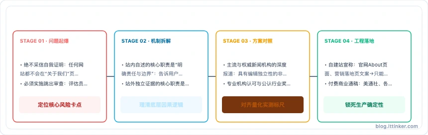
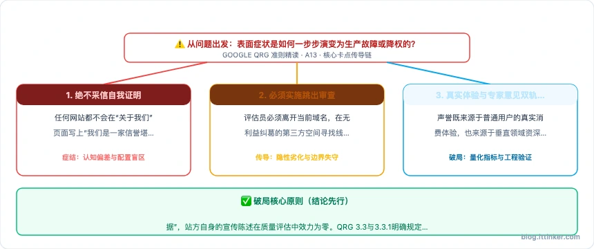
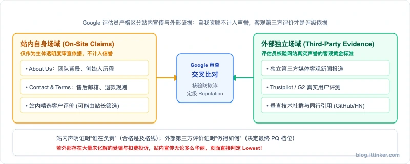
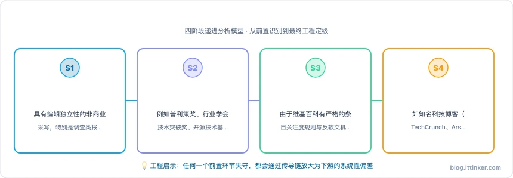
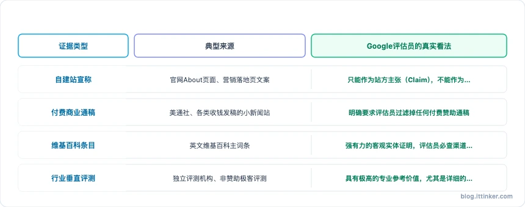
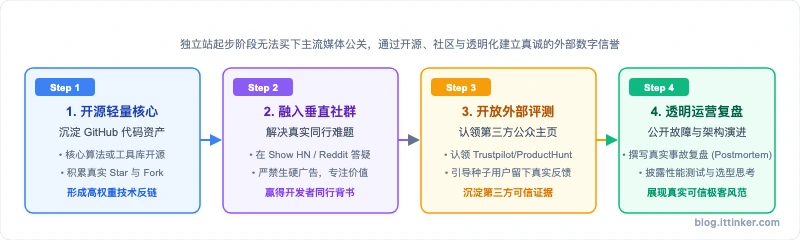
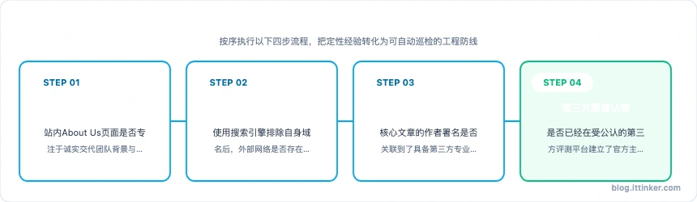

# Google 怎么看一个网站的 Reputation？网站自述与第三方独立声誉的黄金分割 | 读懂 Google Search 基础认知 系列 013

> 🌐 **在线阅读与互动版**：[Google 怎么看一个网站的 Reputation？网站自述与第三方独立声誉的黄金分割 | 读懂 Google Search 基础认知 系列 013](https://blog.ittinker.com/posts/google-怎么看一个网站的-reputation/)
> 📚 **所属专栏**：[《读懂 Google Search：110篇搜索质量与SEO实战指南》](../README.md)

---

### 📌 结论先行（TL;DR）
**在 Google 的评估逻辑中，**网站声誉（Reputation）的基石是“第三方独立证据”，站方自身的宣传陈述在质量评估中效力为零**。**

1. QRG 3.3 与 3.3.1 明确规定，评估员必须跳出目标网站，在外部寻找新闻报道、行业权威评测、专业奖项与公认的独立用户口碑。
2. 一个在 About 页面自封“全球领先”的站点，若在全网找不到任何可信第三方的正向讨论，其声誉分只能处于中立空白；
3. 若存在大量欺诈投诉，更会直接被判定为 Low 或 Lowest。

在前面两篇中，我们解析了页面质量评级总框架（[A11](/posts/page-quality-到底在评什么/)）与主内容质量的四大基石（[A12](/posts/什么才叫高质量-main-content/)）。

很多出海站长在实践中会遇到一种困境：自己花了两周时间把一篇技术排错或产品选型文章写得极其详尽，排版与代码也经过了严格校对，但在 Google 搜索中，排在第一页的往往是那些权威媒体或老牌社区的一句话快讯。

造成这种现象的关键变量，就是 **Website Reputation（网站声誉）**。

在 Google 的质量评估员指南 QRG 3.3 节中，Google 用了极长的篇幅来规训评估员：**绝对不要轻信网站自己说了什么，必须跳出网站，去看外部独立世界怎么评价它。**

---

## 1. 拆解 QRG 3.3：为什么自吹自擂在 Google 眼里效力为零？

QRG 第 3.3 节《Reputation of the Website and Content Creators》一针见血地指出了自我陈述的虚妄：

> *"A website’s reputation is based on the experience of real people, as well as the opinion of people who are experts in whatever topic the website addresses."*
>
> *"Do not rely on the information on the website itself... Very few websites will admit to having a bad reputation! You must look for independent, third-party sources of information."*

Google 对评估员提出了铁律要求：
1. **绝不采信自我证明**：任何网站都不会在“关于我们”页面写上“我们是一家信誉堪忧、经常拖欠退款的皮包公司”。因此，站方自己撰写的获奖经历、媒体赞誉或客户好评，在声誉评估中一律只能视为“声明（Claim）”，不能作为“证据（Evidence）”。
2. **必须实施跳出审查**：评估员必须离开当前域名，在无利益纠葛的第三方空间寻找线索。
3. **真实体验与专家意见双轨并行**：声誉既来源于普通用户的真实消费体验，也来源于垂直领域资深专家的同行评价。

---

## 2. 网站自述与第三方独立声誉的黄金分割

很多独立开发者容易走向另一个极端：“既然站内的自我介绍不能当声誉证据，那我是不是根本不需要认真写 About Us 页面了？”

这种理解完全混淆了 **“主体透明度”** 与 **“第三方信誉”** 的分工。

我们可以将两者的黄金分割线界定为：
- **站内自述的核心职责是“明确责任与边界”**：告诉用户和搜索引擎“我是谁、我的公司注册在哪里、遇到问题可以通过什么渠道找到我”。这是安全基线（解决 Trust 的及格问题）。
- **站外独立证据的核心职责是“证明卓越与可靠”**：通过第三方未受资助的评价，确认你是否真正做到了宣称的服务水准（解决 Reputation 的加分问题）。

---

## 3. 拆解 QRG 3.3.1：Google 认可的第三方声誉证据梯队

在 QRG 3.3.1 节中，Google 列出了评估员在调查网站时应该优先采信的外部证据类型。根据其客观性与公信力，我们可以将其归纳为四个层级：

### 第一梯队：强公信力第三方证据（Tier 1）
- **主流与权威新闻机构的深度报道**：具有编辑独立性的非商业采写，特别是调查类报道。
- **专业机构认可与公认行业奖项**：例如普利策奖、行业学会技术突破奖、开源技术基金会官方推荐。
- **维基百科（Wikipedia）与 Wikidata 条目**：由于维基百科有严格的条目关注度规则与反软文机制，拥有独立维基百科条目通常意味着具备极高的社会关注度与实体认可度。

### 第二梯队：专业同行与垂直领域权威评价（Tier 2）
- **垂直行业媒体的深度测评**：如知名科技博客（TechCrunch、Ars Technica、The Verge）针对产品的深度横评。
- **学术文献、技术规范与行业白皮书的引用**：在技术领域，如果你的工具或研究被学术论文或官方开发文档列为参考，属于高权重专业声誉。
- **顶级开源项目与权威作者推荐**：在 GitHub 知名代码库的 README 或一线架构师的个人博客中被自然引用。

### 第三梯队：聚合型独立用户反馈（Tier 3）
- **第三方消费者评测与评分网站**：如 Trustpilot、G2、Capterra、Better Business Bureau（BBB）。
- **开发者与极客社区的真实讨论**：在 Hacker News、Reddit（如 r/programming, r/SaaS）、Stack Overflow 上的自然发帖与评论。

### 第四梯队：无效噪音与欺诈扣分项（Tier 4）
- **商业新闻通稿（PR Newswire / BusinessWire）**：花钱即可发布的宣传稿件，评估员受训将其完全剔除。
- **自建站点的客户好评轮播（Testimonials Slider）**：由于站长可以任意篡改头像和文案，缺乏可验证性。
- **刷单好评与水军模板回复**：如果评论充斥着高度同质化的格式化赞美，不仅不加分，一旦被识别还会直接引发作弊降权。

---

## 4. 声誉证据效力与风险对照表

为了帮助出海团队在品牌建设中有的放矢，以下表格梳理了各类信号的实际效力：

| 证据类型 | 典型来源 | Google 评估员的真实看法 | 对 Page Quality 的影响 |
|---|---|---|---|
| **自建站宣称** | 官网 About 页面、营销落地页文案 | 只能作为站方主张（Claim），不能作为事实依据 | 仅用于核验主体透明度，不提供声誉加分 |
| **付费商业通稿** | 美通社、各类收钱发稿的小新闻站 | 明确要求评估员过滤掉任何付费赞助通稿 | 效力为零；过度滥用可能被判定为企图操纵算法 |
| **维基百科条目** | 英文维基百科主词条 | 强有力的客观实体证明，评估员必查渠道之一 | 为站点提供极高的权威底座，助力冲刺 Highest |
| **行业垂直评测** | 独立评测机构、非赞助极客评测 | 具有极高的专业参考价值，尤其是详细的缺陷分析 | 强力支撑 E-E-A-T 中的 Expertise 与 Trust |
| **第三方聚合评分** | Trustpilot、BBB、G2、Google Play | 重点观察负面模式（是否有大量未解决的退费争议） | 良好评分助推 High；大量严重欺诈投诉一票否决打入 Lowest |
| **社区自然提及** | Reddit、Hacker News、GitHub Issues | 真实的开发者与用户口口相传，防伪能力极强 | 为新产品建立早期的正面信任足迹 |

---

## 5. 双轨声誉：网站声誉（Website）与作者声誉（Creator）

QRG 3.3 明确提出了“双轨声誉”机制：**评估员必须同时考察网站平台本身的声誉，以及具体内容创作者的个人声誉。**

这为出海独立开发者指明了一条逆袭路径：
- **作为新域名（Website）**：你的新站刚上线 3 个月，在互联网上几乎没有第三方权威媒体报道，网站声誉天然处于中立偏弱状态。
- **作为创作者（Creator）**：如果你在个人 GitHub 上维护过千星开源库，或者在 Twitter、技术专栏、学术会议上有长达数年的技术沉淀，**创作者个人的专业声誉完全可以弥补新域名的声誉劣势**。

在文章页署名真实的作者姓名，并链接到包含第三方可验证证据的个人介绍页（如个人 GitHub、学术主页、领英档案），能够有效帮助新站跨越初期的信任鸿沟。

---

## 6. 出海独立开发者积累第三方正向声誉的实战方案

没有大型公关团队和数万美元预算的小团队，如何一步一个脚印建立起符合 Google 标准的第三方声誉？

### 1. 开源高质量运维或辅助工具
与其在社交媒体自夸技术过硬，不如将产品周边的小工具开源到 GitHub。例如，发布一个帮助开发者自动化配置网络的脚本，或者一个一键体检云服务器健康的脚本。当外部开发者在自己的技术博客或仓库中引用你的 GitHub 仓库时，你就获得了最高质量的第三方专业声誉足迹。

### 2. 深入垂直社区提供增量解决方案
在 Reddit 的相关技术板块（如 r/devops, r/SaaS）或 Hacker News 上，不要机械地群发产品推广链接，而是针对同行提出的疑难技术问题撰写详尽的故障排查过程。当社区用户自发为你的专业解答点赞并在后续讨论中自发推荐你的产品时，这种未经商业干预的讨论正是评估员与搜索引擎极度看重的自然信誉。

### 3. 主动开通并运营受认可的第三方评论空间
尽早在 Trustpilot、G2 或 Product Hunt 上认领自己的官方企业档案。诚恳地邀请早期测试用户在第三方平台留下真实评价。当用户给出中肯批评时，以专业、克制的态度公开回复并给出修复计划。评估员在查看第三方评论时，非常看重商家面对负面反馈时的处理态度。

### 4. 坚持撰写透明的生产故障复盘（Postmortem）
敢于直面系统缺陷是高信任度团队的重要特征。当服务出现短暂故障时，公开撰写详细的技术复盘报告，列出故障时间线、根本原因分析（RCA）以及防止再犯的具体架构调整。这类内容往往能引发行业技术媒体的自然转载与技术探讨。

---

## 7. 独立开发者网站声誉自检清单

对照以下清单，全面审视自己站点的外部声誉健康度：

- [ ] **自述与证据分离**：站内 About Us 页面是否专注于诚实交代团队背景与运营实体，而非堆砌无法验证的自我赞美？
- [ ] **外部可检索性**：使用搜索引擎排除自身域名后，外部网络是否存在关于你或你的产品的客观讨论？
- [ ] **作者档案可信度**：核心文章的作者署名是否关联到了具备第三方专业足迹的真实履历（如 GitHub、学术论文、权威社交媒体）？
- [ ] **第三方渠道认领**：是否已经在受公认的第三方评测平台建立了官方主页，并定期跟进用户的真实反馈？
- [ ] **负面模式排查**：外部社区是否存在关于产品“扣费不给退款”、“伪装免费欺诈”的集中投诉？如果有，是否已从产品流程上彻底根除并公开跟进？

---

## 下一篇预告

在研究第三方独立声誉时，很多独立开发者最关心也最头疼的维度就是：**用户评论（Customer Reviews）**。

一个常见的问题是：**“新上线的产品收到了一两条一星差评，会不会直接被 Google 判为低质量站点？而在自建站刷几十个五星好评，究竟能不能骗过 Google 算法？”**

Google 究竟如何区分真实的口碑与刻意刷出来的噪音？差评在什么情况下会直接演变成致命的评级惩罚？

下一篇，我们将深入拆解 QRG 3.3.2：**[用户评论到底算不算“信誉”？Google 评估 Customer Reviews 的真实标尺（A14）](/posts/用户评论到底算不算-信誉/)**。

---

_这是「读懂 Google Search」系列第 13 篇，系统拆解 Google 官方质量指南，帮你建立长期抗算法波动的出海 SEO 护城河。_

---

## 读懂 Google Search 专栏导航

> 📚 **专栏收录**：本文为 [《读懂 Google Search：110篇搜索质量与SEO实战指南》](/posts/google-search-guide/) 第 **A13** 篇。

* **专栏主页**：[《读懂 Google Search：110篇搜索质量与SEO实战指南》全景地图与路线图](/posts/google-search-guide/)
