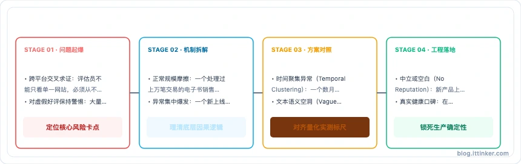
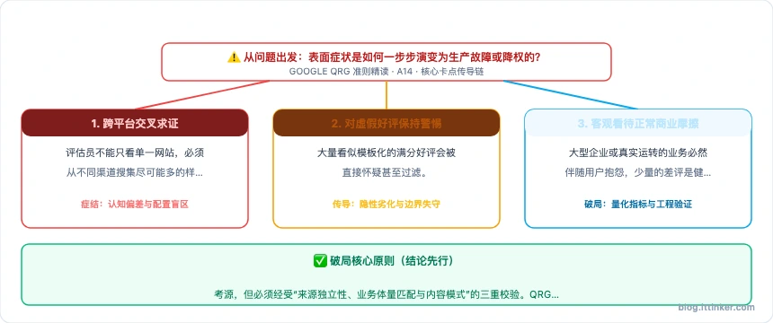
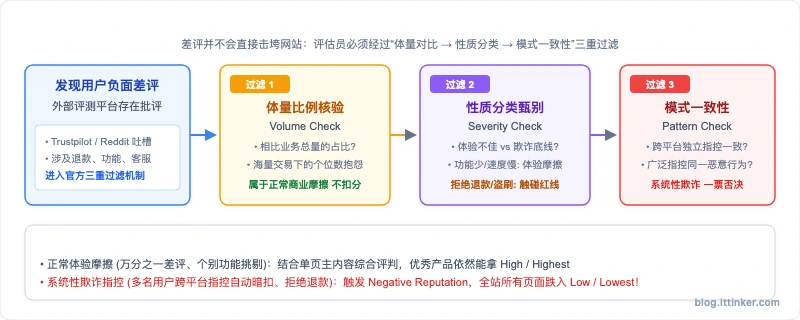
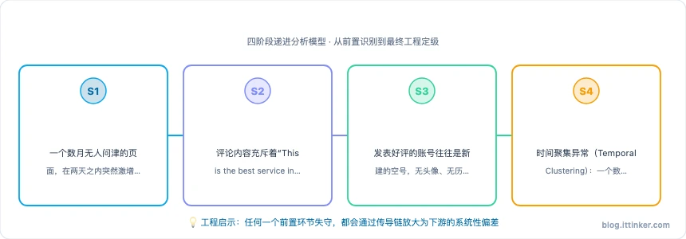
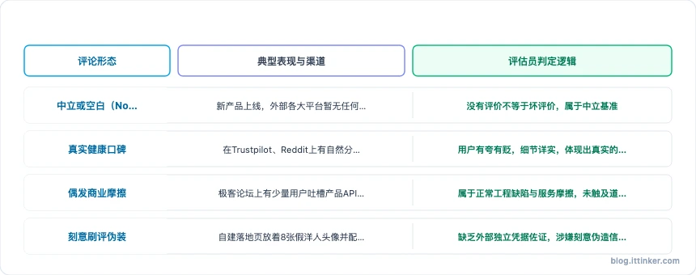
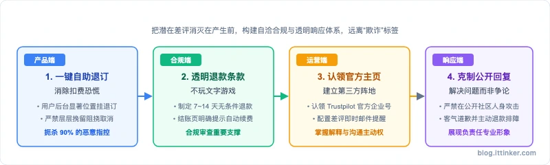
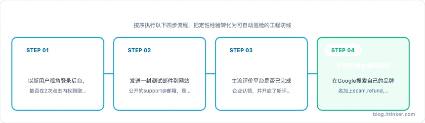

# 用户评论到底算不算“信誉”？Google 评估 Customer Reviews 的真实标尺 | 读懂 Google Search 基础认知 系列 014

> 🌐 **在线阅读与互动版**：[用户评论到底算不算“信誉”？Google 评估 Customer Reviews 的真实标尺 | 读懂 Google Search 基础认知 系列 014](https://blog.ittinker.com/posts/用户评论到底算不算-信誉/)
> 📚 **所属专栏**：[《读懂 Google Search：110篇搜索质量与SEO实战指南》](../README.md)

---

### 📌 结论先行（TL;DR）
**在 Google 的声誉评估框架中，**用户评论（Customer Reviews）是极具价值的参考源，但必须经受“来源独立性、业务体量匹配与内容模式”的三重校验**。**

1. QRG 3.3.2 明确指出，少量差评是真实商业运作的正常现象，并不等于负面声誉；
2. 反之，全网清一色的机械五星好评也无法直接证明高信誉。
3. 真正具有杀伤力的是“一致性的严重负面模式”——例如持续的拒不退款、未授权扣费和虚假发货。
4. 评估员关注的是评论背后的真实细节，而非单纯的星级数字。

理解了第三方独立声誉的基准原则后（[A13](/posts/google-怎么看一个网站的-reputation/)），出海团队最常面临的一个现实战场就是：**用户评论（Customer Reviews）**。

在许多独立开发者社群里，经常能看到两类极端的焦虑：
- 一类是刚刚上线了付费 SaaS 或工具产品的开发者，因为在 Trustpilot 或 Product Hunt 上收到了 2 条差评，就惊慌失措地认为自己的域名被 Google 打入了黑名单；
- 另一类开发者则走向了技术投机：通过黑产服务在各类外围评测网站上批量刷出几百条满分好评，试图以此快速堆积“权威信誉”。

在 Google 质量评估员指南 QRG 3.3.2 节中，官方针对这两种认知偏差给出了极为清醒、务实的判断准则。

---

## 1. 拆解 QRG 3.3.2：Google 眼中的 Customer Reviews

QRG 第 3.3.2 节《Customer Reviews as Reputation Information》详细规范了评估员处理用户评论的方式：

> *"Customer reviews can be helpful for assessing the reputation of a store or business. You should search for reviews, but try to find as many reviews as possible from different sources."*
>
> *"A large number of detailed, positive user reviews can be evidence of a positive reputation... However, be skeptical of both large numbers of positive reviews that seem fake, and a few negative reviews for a large business."*
>
> *"For large businesses, it is normal to find some negative reviews. It is important to consider the content and reasons for the negative reviews, not just the number."*

这段指南确立了三条硬性审计原则：
1. **跨平台交叉求证**：评估员不能只看单一网站，必须从不同渠道搜集尽可能多的样本。
2. **对虚假好评保持警惕**：大量看似模板化的满分好评会被直接怀疑甚至过滤。
3. **客观看待正常商业摩擦**：大型企业或真实运转的业务必然伴随用户抱怨，少量的差评是健康业务的常态，绝不能机械地将差评等同于 Low Reputation。

---

## 2. 评判差评的三重过滤器：体量、模式与性质

评估员在读到用户的负面吐槽时，是如何判定这到底是一次偶发的客户情绪，还是一场致命的信誉危机？

### 过滤器一：体量与比例（Volume & Ratio）
- **正常规模摩擦**：一个处理过上万笔交易的电子书销售站，在全网有 15 条一星差评，吐槽格式兼容性不好或客服周末回复不及时。评估员会结合其庞大的销量，认定这属于正常的商业损耗，不会因此判定该网站信誉败坏。
- **异常集中爆发**：一个新上线的在线修图工具，总共只有 50 条外部讨论，其中有 20 条都在痛斥“点了取消订阅依然在每个月静默扣款”。这种高密度的负面比例，足以触发负面声誉红线。

### 过滤器二：投诉性质（Severity of the Allegation）
QRG 将用户投诉清晰地划分为两类：
- **普通产品分歧**：例如“软件不支持 Linux 系统”、“导出的视频画质不如预期”。这类评价反映的是产品功能的局限性，属于正常的产品迭代范畴。
- **诚信与恶意欺诈**：例如“承诺 14 天无理由退款，申请后立刻封号拉黑”、“下载的客户端被 Windows Defender 报毒并捆绑挖矿程序”。这类投诉一旦被多名用户证实，直接触犯了安全与信任底线。

### 过滤器三：模式一致性（Consistent Pattern）
评估员被要求寻找的是**“模式（Pattern）”**而非“孤证”。
如果来自不同地区、不同时间的真实用户，在 Trustpilot、Reddit 和 Twitter 上不约而同地反映该工具存在“隐形自动续费且无法解绑信用卡”的问题，这种跨平台的一致性指控就是最确凿的负面声誉证据。

---

## 3. 为什么“刷出来的五星好评”毫无意义？

面对声誉要求，有些出海团队试图通过灰产批量刷评。然而在 Google 评估员的审查标准和 Google Reviews System 算法面前，这类操作极易露出马脚。

### 虚假评论的三大典型特征
1. **时间聚集异常（Temporal Clustering）**：一个数月无人问津的页面，在两天之内突然激增几十条五星长评，随后又陷入漫长的死寂。
2. **文本语义空洞（Vague Superlatives）**：评论内容充斥着“This is the best service in the world!”、“Amazing experience, recommend to everyone!”这类抽象夸赞，没有任何具体业务场景、没有提及具体功能细节，甚至将产品品类张冠李戴。
3. **账户画像单薄（Disposable Accounts）**：发表好评的账号往往是新建的空号，无头像、无历史评价记录，或者在同一天内为多个互不相关的灰产站点同时留下一模一样的赞美。

评估员在接受培训时，被明确要求：**对缺乏实质细节、风格雷同的海量好评保持高度怀疑（Be skeptical）。** 一旦认定网站存在伪造评价的行为，网站的 Trust 评分不仅不会上升，反而会被贴上“欺骗性（Deceptive）”的标签。

---

## 4. 用户评论状态与质量评级影响矩阵

以下表格系统梳理了不同形态的外部评价对页面质量评级（PQ）的实际影响：

| 评论形态 | 典型表现与渠道 | 评估员判定逻辑 | 对 Page Quality 的最终影响 |
|---|---|---|---|
| **中立或空白（No Reputation）** | 新产品上线，外部各大平台暂无任何评价信息 | 没有评价不等于坏评价，属于中立基准 | 依靠主内容质量与主体透明度评定（可正常达 Medium 或 High） |
| **真实健康口碑** | 在 Trustpilot、Reddit 上有自然分布的 4.2 星评价，包含具体踩坑与解法讨论 | 用户有夸有贬，细节详实，体现出真实的人性化服务互动 | 强力支撑 High 甚至 Highest 评级，显著提升 Trust 权重 |
| **偶发商业摩擦** | 极客论坛上有少量用户吐槽产品 API 偶尔超时，或文档更新不够及时 | 属于正常工程缺陷与服务摩擦，未触及道德与法律红线 | 不扣减信誉分，评估员视其为真实商业常态 |
| **刻意刷评伪装** | 自建落地页放着 8 张假洋人头像并配上满分好评，外部平台清一色模板水军 | 缺乏外部独立凭据佐证，涉嫌刻意伪造信任感 | 水军内容被完全过滤；自建站假好评被视为欺骗性行为，扣减 Trust |
| **致命负面模式** | 集中出现“退款无门”、“隐形扣款”、“植入流氓软件”的受害者控诉 | 存在系统性失信行为，对用户的财产或数字资产构成现实威胁 | 一票否决：网站整体被判定为 Low 或 Lowest Quality |

---

## 5. 出海独立开发者管理评价资产的避坑指南

对于资源有限的独立开发者和微型 SaaS 团队，维护海外用户口碑的最佳策略不是掩盖问题，而是从底层消除引发致命差评的根源：

### 1. 将“一键自助取消订阅”放在醒目位置
根据出海维权社区的真实数据，海外用户在 Trustpilot 和信用卡发卡行发起拒付（Chargeback）投诉的诉求，有超过 80% 仅仅是因为“在后台找不到取消自动续费的按钮”。
提供极简的自助解绑流程，甚至在扣费前 3 天发送邮件提醒，虽然短期内可能损失微小的被动续费，但能从根本上阻断系统性负面声誉的产生。

### 2. 制定并严格执行透明的退款条款（Refund Policy）
在购买页面下方明确标清退款窗口期与条件（如 7 天或 14 天无条件退款）。遇到态度激烈的争议客户，快速全额退款远比为了一笔 20 美元的订单在 Reddit 上引发一场品牌危机要明智得多。

### 3. 主动认领第三方评测空间，切勿任由舆论野蛮生长
在 Trustpilot、G2、Capterra 上完成企业所有权认领。完善官方介绍与客服邮箱。主动在产品内部合适的时间节点（例如用户刚刚顺利完成了一次复杂导出、体验极佳时），弹出友好提示，邀请用户在公信力平台上留下真实体验。

### 4. 面对差评：公开回复，克制而专业
当出现差评时，千万不要在公开平台上与客户展开情绪化争吵。
评估员在阅读评价时，会非常关注商家的公开回应。一条格式规范、语气诚恳的官方回复（“非常抱歉给您带来不便，我们已在 v1.2 版本修复了该导出 Bug，并已为您办理原路全额退款，客服工单号为 #xxxx”），不仅能化解负面影响，反而在评估员眼里展现出极高的商业担当与透明度。

---

## 6. 独立开发者用户信誉审计自查清单

在日常运营中，定期进行以下项目排查，确保产品信誉稳健：

- [ ] **退订流程顺畅度**：以新用户视角登录后台，能否在 2 次点击内找到取消自动扣费的入口？
- [ ] **客服渠道连通性**：发送一封测试邮件到网站公开的 `support@` 邮箱，是否能在 24 小时内收到响应？
- [ ] **第三方平台认领状态**：主流评价平台是否已完成企业认领，并开启了新评论邮件提醒？
- [ ] **外部负面关键词监控**：在 Google 搜索自己的品牌名加上 `scam`, `refund`, `fraud`，是否有未跟进的受损帖？
- [ ] **剔除虚假评价装饰**：全面清理自建网站上未获真实授权的虚构客户证言，用真实用户的公开 Tweet 截图或经授权的案例替代。

---

## 下一篇预告

既然知道了 Google 评估员如何看待网站声誉（Reputation）与用户评论（Customer Reviews），接下来的实战问题就是：

**当 Google 评估员拿到一个从未听过的陌生独立网站时，他们究竟是如何一步一步展开背景调查的？他们输入了哪些特殊的搜索指令？他们会去哪些你意想不到的隐秘角落排查？**

下一篇，我们将化身评估员，系统还原 QRG 3.3.3 中的标准调查作业程序：**[如何像 Google Rater 一样调查一个陌生网站？Reputation Research 实操SOP（A15）](/posts/如何像-google-rater-一样调查一个陌生网站/)**。

---

_这是「读懂 Google Search」系列第 14 篇，系统拆解 Google 官方质量指南，帮你建立长期抗算法波动的出海 SEO 护城河。_

---

## 读懂 Google Search 专栏导航

> 📚 **专栏收录**：本文为 [《读懂 Google Search：110篇搜索质量与SEO实战指南》](/posts/google-search-guide/) 第 **A14** 篇。

* **专栏主页**：[《读懂 Google Search：110篇搜索质量与SEO实战指南》全景地图与路线图](/posts/google-search-guide/)
