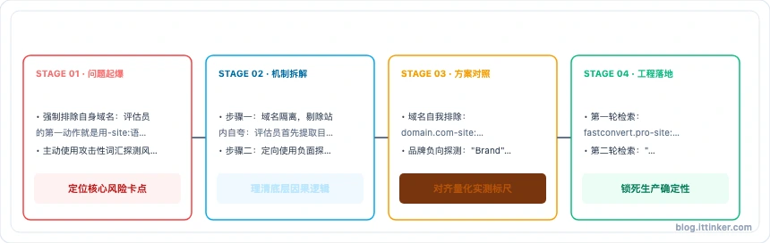
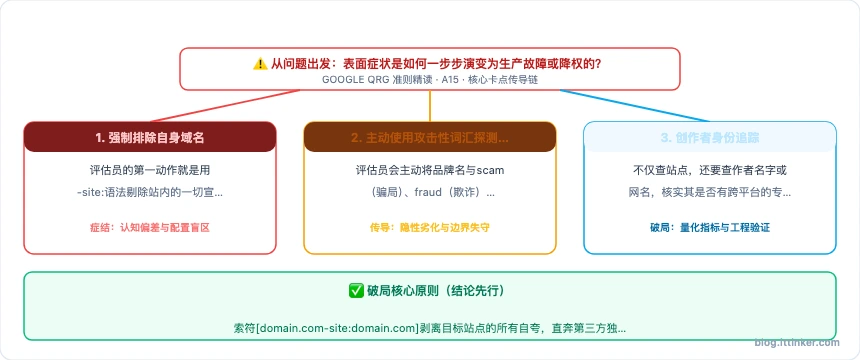
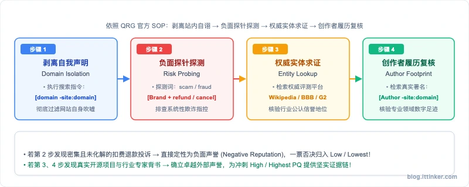
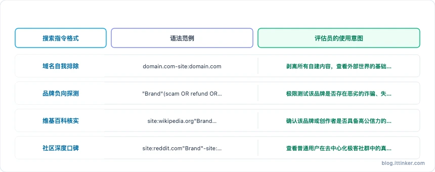
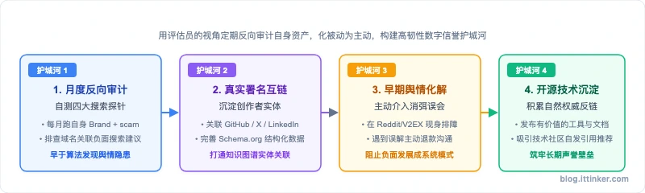
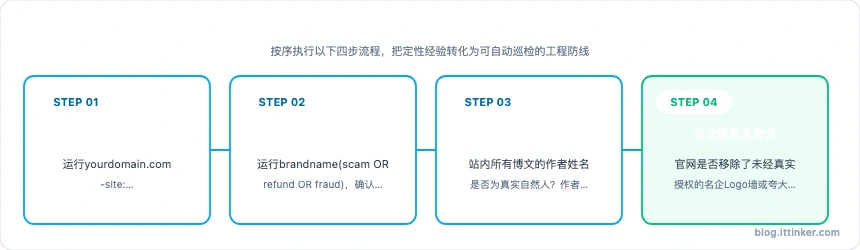

# “评估员到底怎么查我的底细”？脱去伪装的透视镜：如何像 Google Rater 一样调查一个陌生网站的真实信誉？ | 读懂 Google Search 基础认知 系列 015

> 🌐 **在线阅读与互动版**：[“评估员到底怎么查我的底细”？脱去伪装的透视镜：如何像 Google Rater 一样调查一个陌生网站的真实信誉？ | 读懂 Google Search 基础认知 系列 015](https://blog.ittinker.com/posts/如何像-google-rater-一样调查一个陌生网站/)
> 📚 **所属专栏**：[《读懂 Google Search：110篇搜索质量与SEO实战指南》](../README.md)

---

### 📌 结论先行（TL;DR）
> **Google 在 QRG 3.3.3 中公开了一套极具杀伤力的背景调查方法：**通过负向排除搜索符 `[domain.com -site:domain.com]` 剥离目标站点的所有自夸，直奔第三方独立评价**。**
> **在深入学习了网站声誉（[A13](/posts/google-怎么看一个网站的-reputation/)）与用户评论的评判原则（[A14](/posts/用户评论到底算不算-信誉/)）之后，许多开发者往往好奇：**
> **“当一个受雇于 Google 的评估员打开我的独立站，看到一个完全陌生的域名和作者名时，他们在 Google 搜索框里到底敲下了什么？”**
> **他们不会看你自吹自擂的文案，也不会被炫酷的网页动效所迷惑。在 Google 官方评审指南 QRG 第 3.3.3 节中，Google 直接向全世界公开了这套**“背景调查标准作业程序（Reputation Research SOP）”**。**
> **这套方法不仅适用于质量评估员，也是出海独立开发者、SEO 审计师了解自身品牌外部健康度的强力工具。**
>
> - **评估员的调查流水线包含四大动作**：**全网剔除自述**、**负面与安全词探测（scam/fraud/lawsuit）**、**中立权威渠道定向过滤（BBB/维基百科/行业垂直媒体）**，以及**创作者跨平台履历交叉求证**。
> - 出海团队应当主动以这套 SOP 定期审计自身品牌，在评估员与爬虫顺藤摸瓜之前消除信誉死角。





---


### 🚨 2026 → 2024 官方最新风向预警：Google 对Google Rater 外部声誉背调 SOP 与信息源权威度判定演进的策略演进

#### 🕒 2026 → 2024 Google 官方对Google Rater 外部声誉背调 SOP 与信息源权威度判定演进的策略演进

- **2026 · 自动化多源声誉背调管道全面落地**
  Google 爬虫在后台完整复刻了 Rater 的背调逻辑，自动化执行‘域名 + 投诉/骗局/真实评价’的交叉语法检索，并在数秒内完成整站信誉画像构建。

- **2025 · 权威信源层级化（Tiered Authority for Reputation Sources）**
  明确将同行专业媒体、政府监管数据库、知名开源基金会的背书列为一级信源，普通博客提及列为低级参考，严防公关软文污染声誉池。

- **2024 · QRG 3.3.1 节声誉调查 SOP 细化与公布**
  规范公布了完整的检索运算符与信息源排除指引，为全网站长提供了反求诸己、照镜子排查站外负面舆情的官方参照物。


---


## 1. 拆解 QRG 3.3.3：Google 官方给出的调查指令与方法论

QRG 第 3.3.3 节《How to Search for Reputation Information about a Website》详细记录了调查陌生站点的操作规范：

> *"Look for articles, reviews, forum discussions, or other independent information written about the website... Search for the name of the website or the company that operates it."*
>
> *"Use query modifications like: [ibm.com -site:ibm.com] to find pages on other websites that mention IBM, without finding pages on ibm.com itself."*
>
> *"Try searching for the name of the company along with words like 'review', 'scam', 'fraud', or 'complaint'."*
>
> *"For content creators, search for their name, their handle or pen name, along with topics they write about, to see what others say about them."*

这一节规范彻底击碎了侥幸心理：
1. **强制排除自身域名**：评估员的第一动作就是用 `-site:` 语法剔除站内的一切宣称。
2. **主动使用攻击性词汇探测风险**：评估员会主动将品牌名与 `scam`（骗局）、`fraud`（欺诈）、`complaints`（投诉）等负面词进行组合搜索。
3. **创作者身份追踪**：不仅查站点，还要查作者名字或网名，核实其是否有跨平台的专业积累。





---

## 2. 评估员调查陌生站点的标准四步 SOP

我们可以将 QRG 3.3.3 的调查逻辑转化为一套可工程化复现的流水线：





### 步骤一：域名隔离，剔除站内自夸
评估员首先提取目标网站的主域名（例如 `toolify.ai`），然后在 Google 搜索：
```text
toolify.ai -site:toolify.ai
```
这条指令的威力在于：它过滤掉了目标站长精心编织的所有落地页、博客和说明文档，只呈现互联网其他节点对该站点的真实记录。如果搜索结果空空如也，说明该站是一个缺乏外部足迹的新站点；如果出现大量技术博主的自然引用，初步的正向信任便建立了起来。

### 步骤二：定向使用负面探针，排查欺诈底线
为了确认该业务是否涉嫌诈骗或恶意扣费，评估员会继续执行组合检索：
```text
"BrandName" (scam OR fraud OR complaint OR boycott OR refund)
```
或者针对具体域名：
```text
domain.com (scam OR "not working" OR "fake")
```
如果发现多个独立论坛（如 Reddit、Quora、X）上大量用户在控诉“付了款没有发货”或“自动扣费且无法取消”，评估员会立即调取具体案例，判定其是否存在系统性负面声誉。

### 步骤三：定向检索中立公信力机构与垂直社群
对于商业、消费、金融类网站，评估员会主动在具备公信力的第三方数据库中进行核查：
- 查阅商业信用局：`site:bbb.org "Company Name"`
- 查阅消费者聚合口碑：`site:trustpilot.com/review/ "domain.com"`
- 查阅维基百科条目：`site:wikipedia.org "Brand Name"`
- 查阅垂直极客社区讨论：`site:reddit.com/r/SaaS "Brand Name"`

### 步骤四：创作者个人数字足迹审查
如果网页标注了具体作者（例如 "John Doe"），评估员会执行：
```text
"John Doe" "AI Engineering" -site:domain.com
```
评估员试图验证：此人是否真的在该领域发表过其他研究？是否有 GitHub 开源项目？是否有行业技术会议的演讲记录？还是仅仅是一个盗用网图捏造的虚假 AI 人偶？

---

## 3. Google 声誉调查高级搜索指令表

以下整理了评估员最常用的核心指令及其实际应用场景，建议出海团队将其作为月度审计的固定工具：

| 搜索指令格式 | 语法范例 | 评估员的使用意图 | 出海团队自测重点 |
|---|---|---|---|
| **域名自我排除** | `domain.com -site:domain.com` | 剥离所有自建内容，查看外部世界的基础讨论广度 | 检查外部有哪些真实媒体、博客或目录收录并讨论了你的产品。 |
| **品牌负向探测** | `"Brand" (scam OR refund OR fraud)` | 极限测试该品牌是否存在恶劣的诈骗、失信或纠纷记录 | 及时发现潜在的用户维权帖，查明是否有未妥善处理的退费危机。 |
| **维基百科核实** | `site:wikipedia.org "Brand / Person"` | 确认该品牌或创作者是否具备高公信力的实体认可度 | 顶级头部品牌测试；中小团队若无条目属于正常，不扣分。 |
| **社区深度口碑** | `site:reddit.com "Brand" -site:domain.com` | 查看普通用户在去中心化极客社群中的真实主观评价 | 排查是否存在被社区集体抵制或指责“抄袭、偷数据”的舆情。 |
| **第三方聚合评分** | `site:trustpilot.com/review/ domain.com` | 查看集中化消费者维权与服务满意度评分分布 | 关注评分是否低于 2.5，以及差评内容是否高度一致。 |
| **作者背景穿透** | `"Author Name" (github OR linkedin OR "paper")` | 校验文章署名作者是否为真实专业从业者 | 验证作者履历是否能在第三方专业平台相互印证。 |





---

## 4. 模拟审计推演：以一个出海工具站点为例

为了直观展现评估员的实操过程，我们以一个虚构的出海跨境工具站点 `FastConvert.pro` 进行端到端复盘：

### 背景设定
该网站宣称自己是“全球领先的文件极速转换工具”，首页挂着 5 个知名跨国公司的 Logo，并有一位署名为“Dr. Alan Walker, MIT 计算机博士”的作者撰写了大量深度技术文章。

### 评估员的真实调查过程
1. **第一轮检索：`fastconvert.pro -site:fastconvert.pro`**
   - **发现**：搜索结果前两页仅有 3 个自动抓取域名的聚合字典网站，没有任何科技媒体、极客博客或开发者论坛讨论该工具。全网声誉几乎处于真空状态。
2. **第二轮检索：`"FastConvert" (scam OR refund OR complaint)`**
   - **发现**：在 Reddit 的 `r/software` 板块发现一则帖子：“Warning: FastConvert.pro charged my card $49 after a $1 trial without notice”。跟帖中有 6 名用户表示遭遇了一模一样的扣费套路，且客服邮件始终退信。
3. **第三轮检索：作者身份调查 `"Dr. Alan Walker" "FastConvert" -site:fastconvert.pro`**
   - **发现**：全网没有任何关于该博士的技术论文或学术主页。评估员将作者头像在 Google Images 进行反向搜图，发现该头像取自一个免版权的 AI 人脸生成图库。
4. **最终审计裁决**：
   - 首页声称的跨国大客户合作属于虚假宣称；
   - 核心作者属于凭空捏造的虚假身份（Deceptive Creator）；
   - 外部存在确凿、高度一致的恶意扣费与虚假试用指控（Consistent Scam Pattern）。
   - **最终结论：直接判定为 Lowest Quality，整站被打上欺诈标签。**


---

## 5. 出海开发者建立“主动声誉防御工程”

被动等待评估员和算法来审查是危险的。成熟的出海开发者应当主动构建自己的信誉防线：





### 1. 建立月度“负向搜索”自查机制
每个月安排半小时，按照本文第 3 节的指令表，检索自己的域名与核心产品名称。
重点排查是否有海外客户在 Reddit、Twitter 或论坛发帖求助而未能获得官方响应。很多差评演变成声誉灾难，仅仅是因为用户联系不上官方客服，被迫在公共空间公开控诉。

### 2. 坚持真实的作者署名与跨域履历关联
切勿为了追求表面上的高大上，使用 AI 生成虚假专家头像或编造名校履历。
直接署名团队真实创始人或工程师的真实姓名，并在作者个人资料页中清晰链接到其个人的 GitHub 仓库、X 账号或 LinkedIn 页面。一个只有 500 个粉丝但真实可信的独立开发者，在现代搜索引擎眼里，其信任度远高于一个编造出来的哈佛名誉教授。

### 3. 主动化解潜在差评，展现商业担当
如果发现论坛上有关于自己产品的吐槽贴，用官方身份实名回复，说明发生问题的原因，并主动提供退款单号或补偿方案。
评估员在检索负面词时，如果看到站方在每一个争议下方都给出了妥善且专业的官方解决方案，不仅不会扣分，反而会认定该团队具备极高的可靠度与服务诚意。

### 4. 善用开源项目沉淀不可篡改的第三方技术声誉
如果你的产品涉及复杂的技术方案，可以考虑将其中边缘的排障脚本或脚手架开源至 GitHub。例如分享一个用于检查服务健康的开源脚本，并在 README 中以客观中立的态度说明其原理。当外部技术人员在自己的项目中引用该开源脚本时，你的域名和品牌就获得了真实且稳固的第三方专业背书。

---

## 6. 独立开发者品牌被动调查对抗自检清单

在产品推向海外市场前，对照以下项目完成背景调查模拟：

- [ ] **自测排除搜索**：运行 `yourdomain.com -site:yourdomain.com`，确认前两页是否包含正面或中立的技术讨论，有无异常违规镜像站？
- [ ] **运行负面词探针**：运行 `brandname (scam OR refund OR fraud)`，确认是否有一致性的未解决投诉？
- [ ] **作者身份可核验**：站内所有博文的作者姓名是否为真实自然人？作者个人主页是否提供了通往外部第三方权威平台的有效链接？
- [ ] **企业信息无夸大**：官网是否移除了未经真实授权的名企 Logo 墙或夸大的虚假奖项？
- [ ] **客服渠道实测**：网站上留下的所有联系邮箱、表单与社交媒体链接，是否均处于有效运转状态？





---

## 下一篇预告

经过前面几篇的拆解，我们掌握了 Google 对网站声誉的调查机制。这时很多刚刚扬帆出海的独立开发者往往会面临一个最现实的困惑：

**“我的产品上周刚刚上线，全网没有任何新闻报道，没有维基百科，也没有任何差评或好评。在 Google 评估员眼里，这种‘零声誉（No Reputation）’的新网站是不是天然就要被降权打压？”**

Google 究竟如何区分一个刚起步的无名好项目与一个粗制滥造的垃圾站？新站该如何打破声誉坚冰？

下一篇，我们将深入拆解 QRG 3.3.4 与 3.3.5：**[“新站没有声誉注定永无出头之日”？新手的自暴自弃：QRG 3.3.4 新站冷启动信任破局指南（A16）](/posts/新网站没有-reputation-是不是天然吃亏/)**。

---

_这是「读懂 Google Search」系列第 15 篇，系统拆解 Google 官方质量指南，帮你建立长期抗算法波动的出海 SEO 护城河。_


---

## 读懂 Google Search 专栏导航

> 📚 **专栏收录**：本文为 [《读懂 Google Search：110篇搜索质量与SEO实战指南》](/posts/google-search-guide/) 第 **A15** 篇。

* **专栏主页**：[《读懂 Google Search：110篇搜索质量与SEO实战指南》全景地图与路线图](/posts/google-search-guide/)
