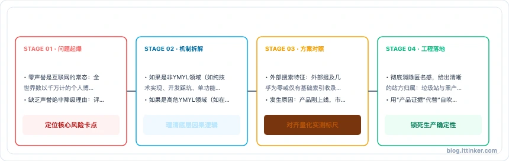
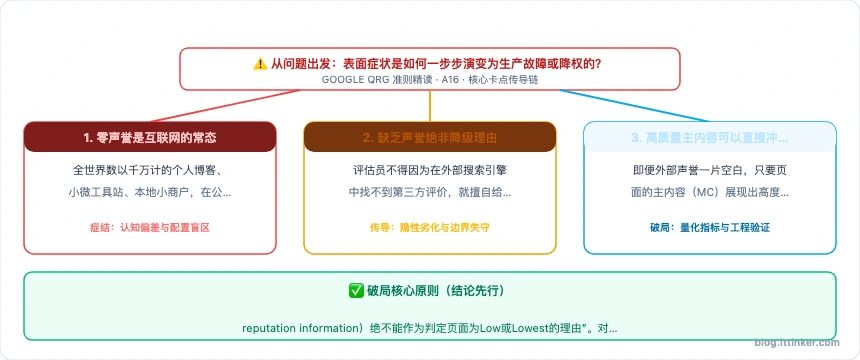
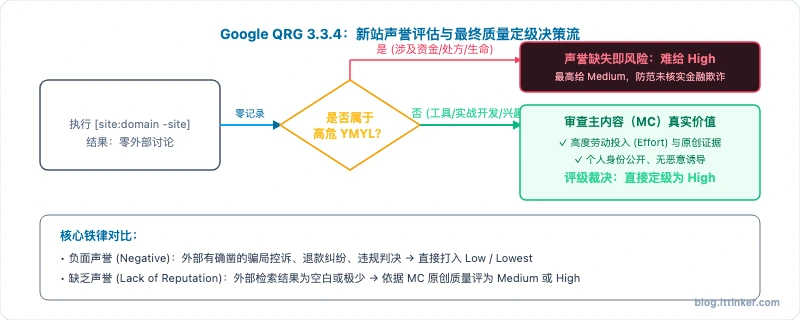
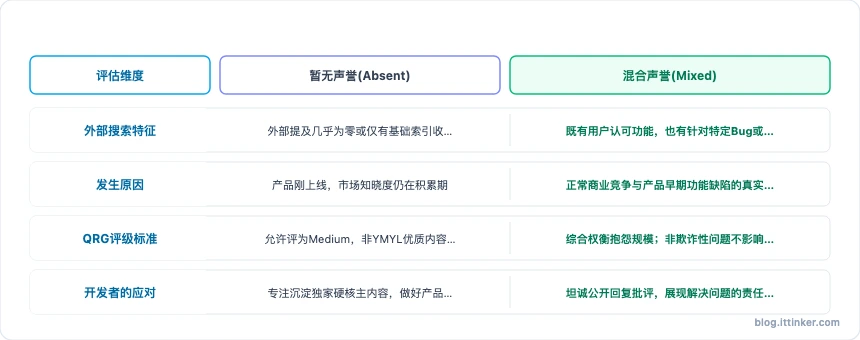
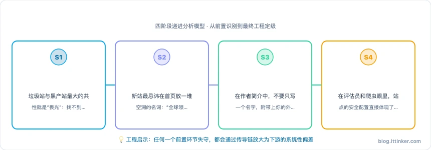
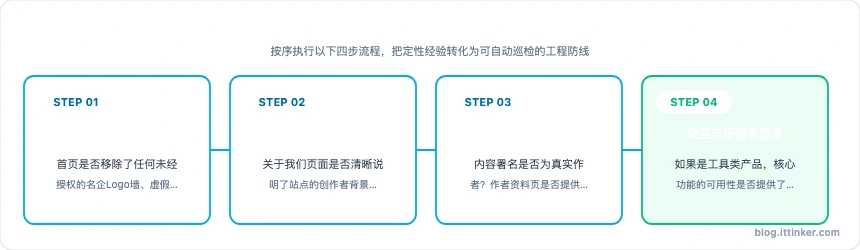

# “新站没有声誉注定永无出头之日”？新手的自暴自弃：QRG 3.3.4 新站冷启动信任破局指南 | 读懂 Google Search 基础认知 系列 016

> 🌐 **在线阅读与互动版**：[“新站没有声誉注定永无出头之日”？新手的自暴自弃：QRG 3.3.4 新站冷启动信任破局指南 | 读懂 Google Search 基础认知 系列 016](https://blog.ittinker.com/posts/新网站没有-reputation-是不是天然吃亏/)
> 📚 **所属专栏**：[《读懂 Google Search：110篇搜索质量与SEO实战指南》](../README.md)

---

### 📌 结论先行（TL;DR）
> **Google 在 QRG 3.3.4 中给出了白纸黑字的明确判定：**“缺乏声誉信息（Lack of reputation information）绝不能作为判定页面为 Low 或 Lowest 的理由”**。**
> **在上一篇 [“评估员到底怎么查我的底细”？脱去伪装的透视镜：如何像 Google Rater 一样调查一个陌生网站的真实信誉？（A15）](/posts/如何像-google-rater-一样调查一个陌生网站/) 中，我们拆解了评估员使用高级搜索指令挖掘外部声誉的四步 SOP。**
> **不少独立开发者看完后产生了深深的疑虑：**
> **“我的独立站才上线两周，Google 搜我的域名除了我自己什么都没有。没有维基百科，没有行业媒体报道，没有 Trustpilot 评分，甚至连一条论坛讨论都没有。在 Google 评估员眼里，我这种‘声誉白纸’是不是从起跑线就输了？新站是不是注定要在沙盒里被算法压制？”**
> **这种担忧在出海创业圈极为普遍。许多开发者误以为：没有权威背书，新站就不可能拿到高评级。**
> **事实真的如此吗？让我们回到 Google 评审指南的官方文本，看评估员在面对一个“查无此人”的新站时，接收到了怎样的判定指令。**
>
> - 对于绝大多数中小型独立站点与新上线项目，全网搜不到讨论属于完全正常的常态。
> - 只要主内容投入了扎实的原创劳动、提供了真实的增量价值，并且没有欺诈恶意，新站完全可以直接拿到 Medium 甚至 High 评级。
> - **出海团队无需为早期的声誉空白焦虑**：破局的核心在于用扎实的产品证据、透明的个人履历以及稳健的基础设施来建立早期信任底盘。





---


### 🚨 2026 → 2024 官方最新风向预警：Google 对Google 针对新站冷启动信任期（Sandbox & Initial Trust）的宽容与突破机制的策略演进

#### 🕒 2026 → 2024 Google 官方对Google 针对新站冷启动信任期（Sandbox & Initial Trust）的宽容与突破机制的策略演进

- **2026 · 新站中立评估窗口（Neutral Reputation Window）制度化**
  Google 算法对全新上线的独立站给予中立声誉保护，绝不因为‘外部评价为空’而直接判定为低质，只要页面目的明确且 MC 具备第一手交付力，依然能够快速突围长尾搜索。

- **2025 · 透明度与履约实证作为破冰第一抓手**
  新站通过完备的主体资质公示、清晰的作者真实履历与严谨的开源代码/实操证据，能够绕过漫长的外部反链积累，提前建立高初始 Trust 分数。

- **2024 · QRG 3.3.4 节‘新网站缺乏声誉不是低质量理由’条款的确立**
  官方白纸黑字保护创新与新站点，明确禁止评估员将‘缺少知名度’等同于‘质量低下’，给广大独立开发者指明了一条靠做实产品破局的正规道路。


---


## 1. 拆解 QRG 3.3.4：没有声誉，不等于负面声誉

在 QRG 第 3.3.4 节《When Available Information is Inconclusive or Absent》中，Google 对缺乏外部声誉的场景做出了清晰的指引：

> *"Many small or local websites have little or no reputation information available. This does not mean they have a poor reputation... A website with no reputation information should not automatically be rated Low or Lowest."*
>
> *"Lack of reputation information is acceptable for a High rating for some types of websites, such as small local businesses, personal websites, and hobby websites, if the page has High quality MC and is otherwise trustworthy."*

这段规则传达了三个事实：

1. **零声誉是互联网的常态**：全世界数以千万计的个人博客、小微工具站、本地小商户，在公共互联网上都不可能拥有铺天盖地的媒体报道。Google 的评估体系如果将“没有声誉”等同于“低质量”，整个搜索生态就会退化成只有跨国巨头垄断的死水。
2. **缺乏声誉绝非降级理由**：评估员不得因为在外部搜索引擎中找不到第三方评价，就擅自给目标网页打上 Low 或 Lowest。
3. **高质量主内容可以直接冲刺 High**：即便外部声誉一片空白，只要页面的主内容（MC）展现出高度的原创投入（Effort）、真实经验（Experience）或独特解决能力，且页面不存在欺诈与诱导风险，该页面依然有资格被评为 High。





---

## 2. 新站冷启动质量裁决状态机

评估员在面对一个新域名时，其决策逻辑可以通过下面的状态机清晰展现：





从上面的决策图中可以看出一个关键分水岭：**页面所处的领域是否属于高危 YMYL？**

- **如果是非 YMYL 领域（如纯技术实现、开发踩坑、单功能工具、生活爱好）**：声誉信息的缺失对评级几乎没有杀伤力。Google 评估员的全部注意力都会集中在“你的主内容解决问题干不干脆”、“你的代码和测试数据是否真实”上。
- **如果是高危 YMYL 领域（如在线投资交易、重大疾病诊疗、处方药销售）**：声誉缺失就会成为瓶颈。因为任何一个宣称能帮你理财或治病的新网站，如果全网没有任何合规资质与行业声誉，出于安全底线，评估员绝不敢轻易给出 High 评级。

---

## 3. 拆解 QRG 3.3.5：Mixed Reputation 与真实用户吐槽

除了“完全没有声誉”之外，新创项目在早期还经常遇到另一种情况：外部只有寥寥几条评价，而且有夸奖也有批评。

不少站长一看到网上出现了一两则用户吐槽，就吓得以为网站要被 Google 惩罚。

QRG 第 3.3.5 节《Mixed Reputation Information》给出了极为客观的平衡标准：

> *"Few websites or content creators have completely positive reputations. Many businesses have a mix of positive and negative reviews... A single negative review or complaint should not be taken as an indication of a poor reputation."*
>
> *"Look for patterns of negative information. For example, multiple reviews complaining about billing fraud, or consistent reports of malware."*

评估员寻找的是**“一致性的恶劣行为模式（Pattern of Malicious Behavior）”**，而不是零星的个人情绪化宣泄：

| 评估维度 | 暂无声誉 (Absent) | 混合声誉 (Mixed) | 致命负面声誉 (Negative) |
|---|---|---|---|
| **外部搜索特征** | 外部提及几乎为零或仅有基础索引收录 | 既有用户认可功能，也有针对特定 Bug 或响应慢的抱怨 | 密集出现 scam、fraud、chargeback、malware 等指控 |
| **发生原因** | 产品刚上线，市场知晓度仍在积累期 | 正常商业竞争与产品早期功能缺陷的真实反馈 | 系统性诱导扣费、虚假宣传、拒绝履约或钓鱼盗号 |
| **QRG 评级标准** | 允许评为 Medium，非 YMYL 优质内容可冲刺 High | 综合权衡抱怨规模；非欺诈性问题不影响整体及格 | 一票否决；直接定级为 Low 甚至 Lowest Quality |
| **开发者的应对** | 专注沉淀独家硬核主内容，做好产品实证 | 坦诚公开回复批评，展现解决问题的责任态度 | 立即停办欺诈业务，彻底清退违规诱导逻辑 |





---

## 4. 独立开发者新站破局：五大冷启动信任工程

既然 Google 不会惩罚“没有声誉”的新站，作为没有百万预算做公关的独立开发者，如何利用这套规则让自己的新站点在最短时间内打消算法与评估员的疑虑？

我们可以将其拆解为五个层层的落地工程：


### 1. 彻底消除匿名感，给出清晰的站方归属
垃圾站与黑产站最大的共性就是“畏光”：找不到运营主体是谁，关于我们页面充斥着网上抄来的假团队照片。

新网站要打破陌生感，第一步就是把关于我们页面（About Us）写扎实。说明你是一个独立开发者还是一个小微团队，为什么开发这款工具，服务器部署在哪里。真实，是反垃圾系统最容易核验的特征。

### 2. 用“产品证据”代替“自吹自擂”
新站最忌讳在首页放一堆空洞的名词：“全球领先”、“行业第一”、“数百万用户信赖”。这种自夸不仅逃不过评估员的 `-site:` 过滤指令，反而会触发审查警惕。

聪明的做法是提供客观透明的产品证据：
- 工具站：提供无需注册即可体验的交互演示（Live Demo）；
- 技术博客：提供实际终端运行的错误日志片段、重现步骤截图与性能对比压测图；
- 教程指南：提供经过真实环境测试的代码文件与运行环境说明。

### 3. 构建不可篡改的跨平台数字足迹
在作者简介中，不要只写一个名字，附带上你的外部真实链接：
- 个人独立 GitHub 账号（有持续的提交记录）；
- 真实的技术社交媒体账号；
- 曾发表过的开源项目或技术讨论。

当评估员运行 `"Author Name" -site:yourdomain.com` 时，只要能在 GitHub 或技术社区中找到这个人的长期存在证据，作者的初始专业度（Experience / Expertise）就得到了第三方印证。

### 4. 筑牢基础设施安全信任底盘
在评估员和爬虫眼里，站点的安全配置直接体现了运维团队的技术素养。一个证书过期、缺少基本安全标头、甚至明文传输密码的站点，哪怕内容写得再好，也会被标记为不安全。

对于出海新站，建议在部署第一时间完成域名安全与 DNS 基准配置。我们可以直接运行 `ittinker-scripts` 开源套件中的配置脚本进行自动化检查：

```bash
# 克隆基线检查工具并验证域名配置
git clone https://github.com/ittinker-org/ittinker-scripts.git
cd ittinker-scripts/cloudflare-domain-baseline
./domain-baseline-check.sh yourdomain.com
```

该工具会自动检查你的 DNSSEC 解析状态、HSTS 强制跳转策略、Content-Security-Policy 标头以及 SSL 证书链是否完整，确保新站点在第一天就建立起符合现代 Web 安全标准的基础设施。

### 5. 建立公开的演进痕迹（Changelog）
垃圾站点往往一次性生成上千篇低质内容后就不再维护。而一个充满生命力的新站，必然伴随着高频的功能迭代与问题修复。

在网站建立一个清晰的更新日志页面（Changelog），哪怕每次更新只有两三行：
- `2026-10-12: 修复了 Safari 浏览器下导出 JSON 乱码的问题；`
- `2026-10-18: 优化了移动端虚拟键盘遮挡输入框的样式异常。`

这一份公开透明的迭代记录，向评估员传递了一个极其强烈的信号：**这个产品背后有一群真实的人在持续维护它，这是一份认真对待用户的长期资产**。





---

## 5. 新站冷启动信任自检清单

在你的新项目部署上线并提交 Google Search Console 之前，请对照以下清单逐项排查：

- [ ] **拒绝虚构声誉**：首页是否移除了任何未经授权的名企 Logo 墙、虚假用户好评或凭空捏造的荣誉奖项？
- [ ] **关于我们真诚透明**：关于我们页面是否清晰说明了站点的创作者背景、联系邮箱以及产品初衷？
- [ ] **作者档案真实关联**：内容署名是否为真实作者？作者资料页是否提供了可回溯的第三方专业履历链接（如 GitHub、个人社交主页）？
- [ ] **交互与证据免登录**：如果是工具类产品，核心功能的可用性是否提供了免登录试用或清晰的录屏实证？
- [ ] **安全基线无死角**：站点是否全站强制启用 HTTPS、正确配置安全标头，并通过了域名基线检查？
- [ ] **公开的更新渠道**：网站是否有可供用户反馈 Bug 的渠道（如 GitHub Issues、Discord、技术支持邮箱）？





---

## 下一篇预告

理解了新网站的声誉逻辑之后，我们必然要面对 Google 整个质量评审体系中最核心、最常被滥用但也最常被误读的概念：**E-E-A-T**。

很多人以为做好 E-E-A-T 就是在文章底下挂个假专家头像、在网页里填满 Schema 结构化数据。

然而在 Google 官方指南里，E-E-A-T 的四个字母有着极其严密的拓扑结构，其中有一个字母统领着其余三者。

下一篇，我们将深入拆解 QRG 3.4：**[“E-E-A-T 就是填满四个复选框”？形式主义 SEO 的终局：为什么 Trust 才是整个评估体系唯一的承重墙？（A17）](/posts/e-e-a-t-到底是什么-为什么-trust-是唯一核心/)**。

---

_这是「读懂 Google Search」系列第 16 篇，系统拆解 Google 官方质量指南，帮你建立长期抗算法波动的出海 SEO 护城河。_


---

## 读懂 Google Search 专栏导航

> 📚 **专栏收录**：本文为 [《读懂 Google Search：110篇搜索质量与SEO实战指南》](/posts/google-search-guide/) 第 **A16** 篇。

* **专栏主页**：[《读懂 Google Search：110篇搜索质量与SEO实战指南》全景地图与路线图](/posts/google-search-guide/)
