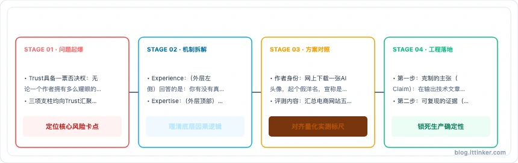
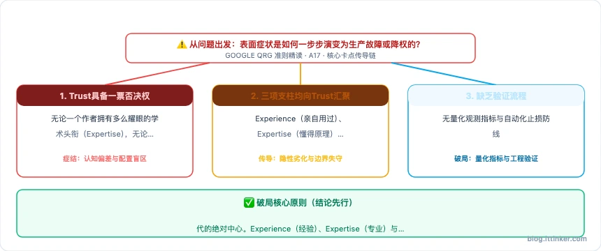
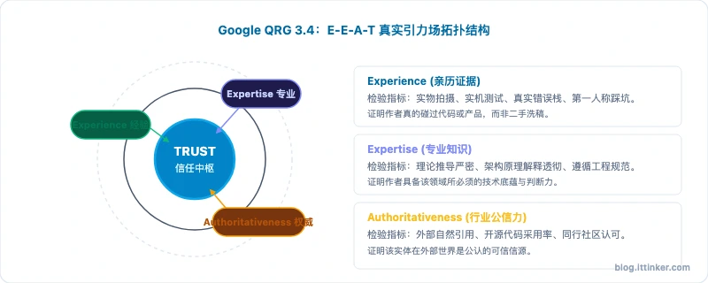
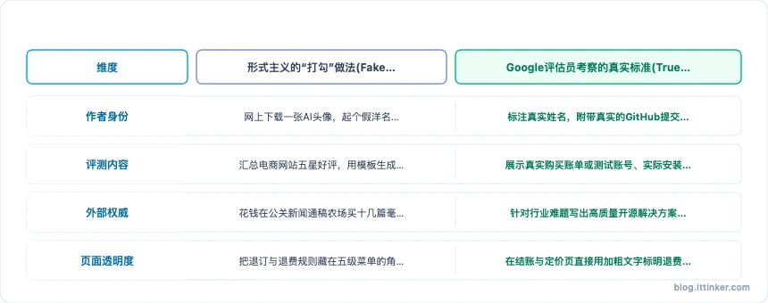
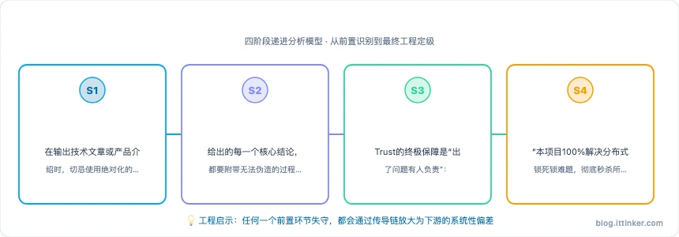
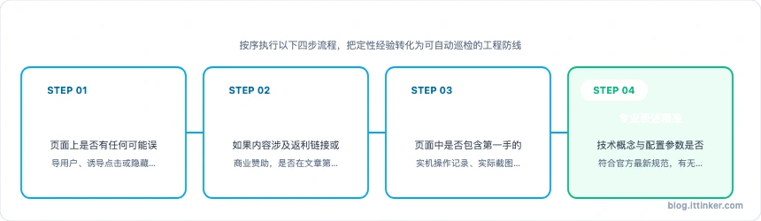

# “E-E-A-T 只是打勾项”？为什么 Trust 是唯一核心承重墙？ | 读懂 Google Search 基础认知 系列 017

> 🌐 **在线阅读与互动版**：[“E-E-A-T 只是打勾项”？为什么 Trust 是唯一核心承重墙？ | 读懂 Google Search 基础认知 系列 017](https://blog.ittinker.com/posts/e-e-a-t-到底是什么-为什么-trust-是唯一核心/)
> 📚 **所属专栏**：[《读懂 Google Search：110篇搜索质量与SEO实战指南》](../README.md)

---

### 📌 结论先行（TL;DR）
> **在 Google QRG 3.4 的官方定义中，**Trust（信任）是整个 E-E-A-T 家族中无可替代的绝对中心**。**
> **只要接触过现代 SEO，你就一定听过 **E-E-A-T**（经验、专业、权威、信任）。**
> **绝大多数教程是这样指导开发者的：**
> **这种把 E-E-A-T 当成“四个平行 Checkbox”的机械理解，是许多独立站投入大量精力做内容却依然排不上前列的根源。**
> **Google 从来没有把 E-E-A-T 设计成并列评分的记分卡。在官方评审指南 QRG 第 3.4 节中，Google 用极为严肃的笔触，重新校准了这个体系的几何重心。**
>
> - Experience（经验）、Expertise（专业）与 Authoritativeness（权威）并不是四个平起平坐的复选框，而是用来支撑 Trust 的三种不同证据维度。
> - **QRG 规定了一条铁律**：**一个不可信的页面（Untrustworthy page），无论其作者看起来多么有经验、多么专业或多么权威，其 E-E-A-T 都会被直接清零判定为最低档**。
> - **出海团队应当停止表面上的“资质打勾”**：转而构建由“真实主张、可重现证据、明确责任主体”组成的可信验证链条。
> - **“在网页底部加个作者头像**：打勾 Experience；”
> - **“在作者简介里写上名校毕业**：打勾 Expertise；”
> - **“到处交换外链买公关稿**：打勾 Authoritativeness；”
> - **“挂个 SSL 证书加个退款说明**：打勾 Trust。”

---

### 🚨 2026 → 2024 官方最新风向预警：Google 对Google E-E-A-T 架构演进与 Trust（信任）核心地位的确立的策略演进

#### 🕒 2026 → 2024 Google 官方对Google E-E-A-T 架构演进与 Trust（信任）核心地位的确立的策略演进

- **2026 · Trust 作为非线性乘法因子全面接入排名核心**
  在多模态与生成式搜索中，Trust 成为唯一的‘一票否决权’。即便页面展示了丰富的经验（E）与专业度（E），一旦 Trust 出现欺诈或存疑信号，总评级直接归零。

- **2025 · 经验与专业度的实体可验证性强化**
  反对套路化‘作者介绍框’，Google 要求所有的 Experience 与 Expertise 必须有外部可查的真实印证（如代码提交记录、执业资质、第三方论文）。

- **2024 · QRG 3.4 节确立 Trust 为 E-E-A-T 宇宙的绝对几何中心**
  Google 官方更新图示，将 Trust 明确放置在 E-E-A-T 圆形图谱的正中央，正式宣告形式主义拼凑四个维度的套路 SEO 走向彻底消亡。

---

## 1. 拆解 QRG 3.4：Trust 是唯一起点与终点

打开 QRG 3.4 节《Experience, Expertise, Authoritativeness, and Trust (E-E-A-T)》，首先映入眼帘的是官方的一段核心声明：

> *"Trust is the most important member of the E-E-A-T family because untrustworthy pages have low E-E-A-T no matter how Experienced, Expert, or Authoritative they may seem."*
>
> *"Experience, Expertise, and Authoritativeness overlap and inform Trust. For example, a website may be considered untrustworthy if the creator of the main content has significant conflict of interest."*

这几句话直接戳破了形式主义 SEO 的幻想：

1. **Trust 具备一票否决权**：无论一个作者拥有多么耀眼的学术头衔（Expertise），无论一家媒体拥有多少年的行业历史（Authoritativeness），一旦其页面被证实存在虚假误导、隐瞒利益冲突或诱导欺诈，它的整体 E-E-A-T 就会崩塌。
2. **三项支柱均向 Trust 汇聚**：Experience（亲自用过）、Expertise（懂得原理）、Authoritativeness（被同行认可），存在的意义不是为了展示虚荣指标，而是为了向用户回答同一个问题——**“我凭什么相信你说的这番话？”**

---

## 2. E-E-A-T 的真实同心圆拓扑架构

为了清晰呈现 QRG 3.4 的体系结构，我们可以将其绘制为一个以 Trust 为引力中心的矢量拓扑图：

从几何拓扑中可以清晰看到：
- **Experience**（外层左侧）回答的是：你有没有真的动过手？
- **Expertise**（外层顶部）回答的是：你懂不懂背后的科学与规范？
- **Authoritativeness**（外层底部）回答的是：外部同行认不认可你？
- **所有这三条支柱产生的力量，全部指向核心圆的 Trust**。

如果核心的 Trust 是破损的（例如存在隐瞒的商业赞助、虚假的使用评测），外围的支柱越高大，崩塌时产生的欺骗性就越严重，算法与评估员的惩罚也就越严厉。

---

## 3. SEO 形式主义误区与真实评估标准对照

很多团队在落地 E-E-A-T 时，把力气全部花在了给爬虫看的表象标签上，忽视了人类读者对真实性的基本感知：

| 维度 | 形式主义的“打勾”做法 (Fake E-E-A-T) | Google 评估员考察的真实标准 (True Trust) |
|---|---|---|
| **作者身份** | 网上下载一张 AI 头像，起个假洋名，宣称是前某大厂资深架构师 | 标注真实姓名，附带真实的 GitHub 提交记录、个人博客历史或真实工作履历 |
| **评测内容** | 汇总电商网站五星好评，用模板生成“十大最佳软件排名” | 展示真实购买账单或测试账号、实际安装报错截图、详尽的性能压测日志 |
| **外部权威** | 花钱在公关新闻通稿农场买十几篇毫无阅读量的外链 | 针对行业难题写出高质量开源解决方案，被真实技术博客自然引用 |
| **页面透明度** | 把退订与退费规则藏在五级菜单的角落，字体用灰色小字 | 在结账与定价页直接用加粗文字标明退费天数、客服响应时效与取消方式 |
| **利益声明** | 全文只字不提返佣，把带 Affiliate 追踪码的链接伪装成官方文档 | 开篇诚实标注利益关联：“本文包含推荐链接，若由此购买我将获得微薄支持” |

---

## 4. 落地 Trust 的工程模型：Claim → Evidence → Responsibility

独立开发者在没有庞大品牌预算的情况下，如何构建一个能扛住评估员推敲的 Trust 体系？

建议采用工程领域的**“信任铁三角模型”**：

### 第一步：克制的主张（Claim）
在输出技术文章或产品介绍时，切忌使用绝对化的高调词汇。
- 差的宣称：“本项目 100% 解决分布式锁死锁难题，彻底秒杀所有同类方案。”
- 好的主张：“在 Redis 7.2 单机与哨兵模式下，通过 Lua 脚本原子性校验将锁竞争重试耗时降低 34%，在网络分区场景下仍需配合看门狗机制。”

评估员在审阅内容时，措辞严密且坦诚承认方案边界的文章，其可信度远高于满嘴跑火车的神话。

### 第二步：可复现的证据（Evidence）
给出的每一个核心结论，都要附带无法伪造的过程证据：
- 贴出具体复现 Bug 的命令行报错文本；
- 贴出压测工具（如 k6、wrk）的完整输出概要；
- 提供经过实测的完整配置文件片段，标明关键参数的含义。

这些证据本身就构成了 Experience 与 Expertise 的双重证明。生成式 AI 可以在两秒内写出一篇结构工整的空洞大论，但它无法凭空编造出你在凌晨两点调试生产环境时终端里吐出的那 8 行特殊堆栈。

### 第三步：明确的责任主体（Responsibility）
Trust 的终极保障是“出了问题有人负责”：
- 网页右下角或页脚有明确有效的联络邮箱；
- 如果代码涉及安全或生产配置，给出清晰的免责边界与风险提醒（“本脚本会重启网络服务，请勿直接在无备份的生产环境执行”）；
- 工具产品提供明确的数据隐私政策，说明上传的数据是否会落盘存储。

当评估员看到一个主张严谨、证据可查、责任透明的页面时，即使该网站没有任何维基百科词条，它在 Trust 维度也能轻松斩获高分。

---

## 5. 独立开发者 E-E-A-T 落地自查清单

在发布核心商业页面或重点长文之前，对照以下项目完成自我审视：

- [ ] **Trust 核心自检**：页面上是否有任何可能误导用户、诱导点击或隐藏关键限制的表述？
- [ ] **利益披露诚实**：如果内容涉及返利链接或商业赞助，是否在文章第一屏清晰明示？
- [ ] **经验证据支撑**：页面中是否包含第一手的实机操作记录、实际截图或独家踩坑反思？
- [ ] **专业表述精准**：技术概念与配置参数是否符合官方最新规范，有无过时或危险的配置遗漏？
- [ ] **主体可信可查**：页面署名是否指向一个真实、可回溯的开发者个人主页或团队介绍？
- [ ] **边界与责任提示**：针对高危技术操作或潜在风险，是否向读者给出了明确的防护与还原建议？

---

## 下一篇预告

既然我们明确了 Experience（经验）和 Expertise（专业）都是服务于 Trust 的重要支柱，这就引出了一个出海内容创作者极为关注的现实议题：

在很多高风险的 YMYL 话题（比如重大疾病应对、个人破产投资、复杂移民法律）中，**“久病成医的普通患者所分享的真实亲身经验”**，与**“拥有执业资质的医学博士所给出的严谨指导方案”**，到底谁更容易被 Google 认可？

亲历体验能否替代专业资质？两者在搜索排名中到底如何分工？

下一篇，我们将深入拆解 QRG 3.4.1：**[“病人自述比主任医师更权威”？经验与资质的残酷博弈：YMYL 领域亲身经验（Experience）与专家知识（Expertise）谁说了算？（A18）](/posts/ymyl-内容里-亲身经验-experience-和专家知识-expertise-谁更重要/)**。

---

_这是「读懂 Google Search」系列第 17 篇，系统拆解 Google 官方质量指南，帮你建立长期抗算法波动的出海 SEO 护城河。_

---

## 读懂 Google Search 专栏导航

> 📚 **专栏收录**：本文为 [《读懂 Google Search：110篇搜索质量与SEO实战指南》](/posts/google-search-guide/) 第 **A17** 篇。

* **专栏主页**：[《读懂 Google Search：110篇搜索质量与SEO实战指南》全景地图与路线图](/posts/google-search-guide/)
