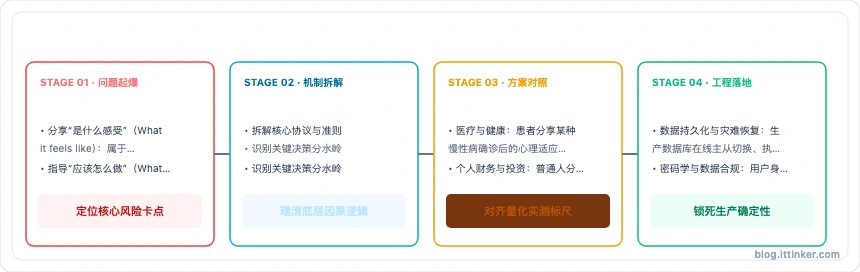
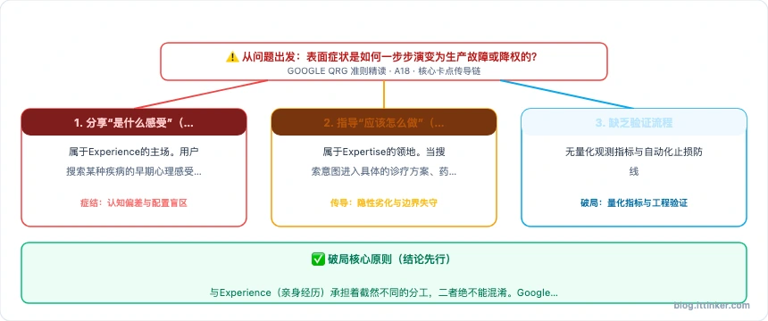
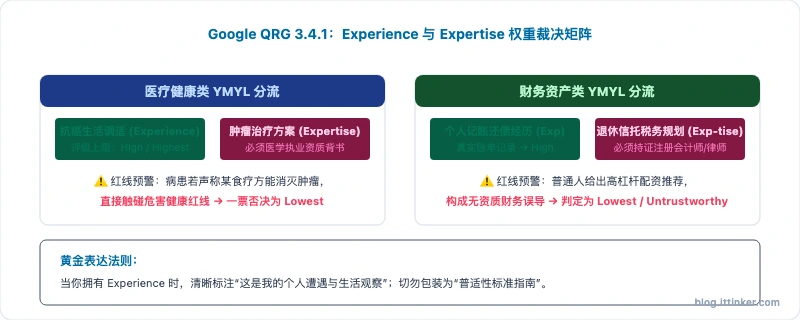
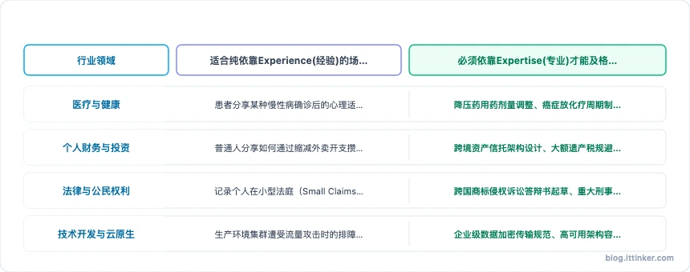
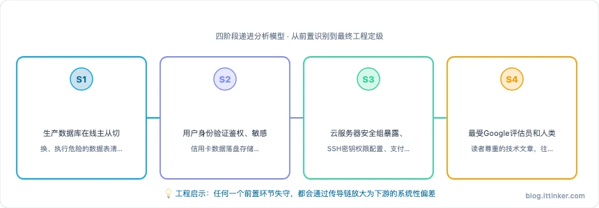
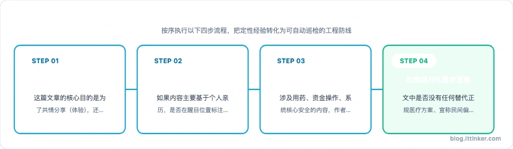

# “病人自述比主任医师更权威”？经验与资质的残酷博弈：YMYL 领域亲身经验（Experience）与专家知识（Expertise）谁说了算？ | 读懂 Google Search 基础认知 系列 018

> 🌐 **在线阅读与互动版**：[“病人自述比主任医师更权威”？经验与资质的残酷博弈：YMYL 领域亲身经验（Experience）与专家知识（Expertise）谁说了算？ | 读懂 Google Search 基础认知 系列 018](https://blog.ittinker.com/posts/ymyl-内容里-亲身经验-experience-和专家知识-expertise-谁更重要/)
> 📚 **所属专栏**：[《读懂 Google Search：110篇搜索质量与SEO实战指南》](../README.md)

---

### 📌 结论先行（TL;DR）
> **在涉及健康、财务与人身安全的 YMYL 领域，**Expertise（专业资质与科学共识）与 Experience（亲身经历）承担着截然不同的分工，二者绝不能混淆**。**
> **2022 年底，Google 对质量评估体系进行了一次里程碑式的重构：在原有的 E-A-T 架构前额外增加了一个字母 **E**，即 **Experience（亲身体验 / 亲历经验）**。**
> **这一调整让许多站长大受鼓舞。不少人得出结论：“既然 Google 开始青睐个人第一手经验，那以后写高权重文章是不是就不需要专家背书了？找几个人写点个人日记、主观吐槽就能拿到高排名？”**
> **这种盲目乐观在普通消费评测或旅行攻略领域或许成立，但在关乎用户身家性命的 **YMYL（Your Money or Your Life）** 领域，盲目拔高个人经验却可能踩中算法的最严厉红线。**
> **在 QRG 第 3.4.1 节中，Google 用多个极具代表性的场景，彻底厘清了“亲身经验”与“专家知识”在高风险话题下的适用边界。**
>
> - Google QRG 3.4.1 划定了一条安全红线：**生活应对与心理共鸣看经验，处方指导与合规决策必须依赖专家知识**。
> - 一个普通病患分享化疗期间的饮食作息可以被评为 High；
> - 但如果该病患宣称某种偏方能替代正规抗癌药，无论其表述多么真诚，都会被一票否决打入 Lowest。
> - 出海内容团队必须严格隔离“经历分享”与“专业指导”的表达边界。





---


### 🚨 2026 → 2024 官方最新风向预警：Google 对Google 在 YMYL 领域对亲身体验与专业权威边界的判定演进的策略演进

#### 🕒 2026 → 2024 Google 官方对Google 在 YMYL 领域对亲身体验与专业权威边界的判定演进的策略演进

- **2026 · 双轨分流机制（Dual-track Intent Separation for Health & Wealth）**
  Google 精准识别搜索意图中的‘情感共鸣诉求’与‘科学诊疗决策’。在治疗方案、财务操作等核心环节，算法严格锁定专家资质（Expertise），患者经验仅被允许作为心理慰藉辅助展示。

- **2025 · 伪专家借‘亲身经历’带货降权清退**
  对于在 YMYL 领域假借‘本人实测有效’兜售三无产品或伪科学疗法的页面，系统直接激活 Medical Consensus 冲突拦截，实施全网封杀。

- **2024 · QRG 3.4.1 节明确经验与专业度在不同场景下的权属划分**
  指南确立清晰标尺：日常生活与消费品选择重在 Experience，而关乎生命与财产的重大决策必须以经过同行评议的 Expertise 为唯一权威依归。


---


## 1. 拆解 QRG 3.4.1：双 E 的核心分水岭

在 QRG 第 3.4.1 节《YMYL Topics: Experience or Expertise?》中，Google 给出了清晰的区分指引：

> *"Sometimes, pages with firsthand life experience can be considered High quality, even for YMYL topics. For example, a page where someone with a rare cancer shares what it feels like to undergo treatment... has High E-E-A-T based on Experience."*
>
> *"However, medical advice, financial advice, or legal advice should be provided by people or organizations with appropriate Expertise... You would not want to follow advice about how to treat a disease from someone who has only experienced the disease themselves, with no medical training."*

官方给出的分水岭非常直白：

1. **分享“是什么感受”（What it feels like）**：属于 **Experience** 的主场。用户搜索某种疾病的早期心理感受、长途国际搬家的生活琐碎，需要的是真实人间的温度与细节，教科书上的冰冷条款反而无法解决这种情感与现实诉求。
2. **指导“应该怎么做”（What to do）**：属于 **Expertise** 的领地。当搜索意图进入具体的诊疗方案、药物剂量计算、跨境税务申报、合同违约处置时，主观经验完全失去效力，任何脱离正规执业资质的“经验之谈”都可能给搜索用户带来不可挽回的伤害。





---

## 2. YMYL 场景下的双 E 裁决矩阵

为了让开发者直观掌握两者在不同搜索意图下的权重分布，我们构建了以下决策矩阵：





---

## 3. 典型垂直主题下的双 E 需求对照

为了防止创作者在选题和立意阶段踩坑，下表整理了主流领域的评估基准：

| 行业领域 | 适合纯依靠 Experience (经验) 的场景 | 必须依靠 Expertise (专业) 才能及格的场景 | 混淆两者的致命扣分点 |
|---|---|---|---|
| **医疗与健康** | 患者分享某种慢性病确诊后的心理适应、家属陪护日程规划、轮椅使用技巧 | 降压药用药剂量调整、癌症放化疗周期制定、手术并发症处置指引 | 普通患者声称通过某款草药茶治愈了自身糖尿病，号召读者停止注射胰岛素 |
| **个人财务与投资** | 普通人分享如何通过缩减外卖开支攒下首付款、三年还清五万美元信用卡的记账表 | 跨境资产信托架构设计、大额遗产税规避合规方案、养老金资产配置组合 | 无金融执业资质的博主向读者推荐高风险合约炒币，宣称稳赚不赔 |
| **法律与公民权利** | 记录个人在小型法庭（Small Claims Court）参与劳资调解的见闻与心理状态 | 跨国商标侵权诉讼答辩书起草、重大刑事案件免责辩护策略 | 依据个别案例宣称某种合同漏洞可以合法拒绝向员工支付法定赔偿 |
| **技术开发与云原生** | 生产环境集群遭受流量攻击时的排障日记、某个罕见系统调用 Bug 的调试过程 | 企业级数据加密传输规范、高可用架构容灾标准、安全审计合规要求 | 未经并发安全验证的半吊子脚本伪装成银行级资产结算解决方案 |





---

## 4. 技术开发者的特殊考量：IT 运维领域中的 YMYL 属性

在很多出海独立开发者的固有观念中，“代码和技术运维属于非 YMYL 领域，随便写写踩坑记录完全不需要担惊受怕”。

这种看法只对了一半。普通的 CSS 居中排版、JavaScript 数组去重确实完全不涉及人身健康或财产风险，哪怕代码写得有小瑕疵，也只是常规质量高低的问题。

但一旦进入以下领域，技术内容就会立即被判定为具备 **高度财务与数据风险的准 YMYL 范畴**：
1. **数据持久化与灾难恢复**：生产数据库在线主从切换、执行危险的数据表清理（如 `DROP DATABASE`、`rm -rf` 指令）；
2. **密码学与数据合规**：用户身份验证鉴权、敏感信用卡数据落盘存储、GDPR 隐私数据脱敏处理；
3. **云上网络与防火墙策略**：云服务器安全组暴露、SSH 密钥权限配置、支付网关 Webhook 验签逻辑。

在这些极具破坏力的技术分支下，单纯凭借半瓶水的“个人试错经验”给出轻率建议，可能导致成百上千家小微企业数据库被删、服务瘫痪或遭受敲诈勒索。

### 优秀技术内容如何完美融合“双 E”
最受 Google 评估员和人类读者尊重的技术文章，往往是 **Experience 与 Expertise 的高度结合体**：

```text
[扎实的专业知识 (Expertise)]
深入剖析 PostgreSQL 16 逻辑复制的工作机制，引用官方内核文档解释 WAL 锁竞争原理。
          +
[独家亲身经验 (Experience)]
真实还原在千万级订单库上迁移时终端输出的锁等待日志，记录排查过程中遇到的死锁重现步骤。
          =
[具备极高信任度 (High Trust) 的顶级技术资产]
```

你不仅懂底层的计算机科学理论，而且真正经历过线上高压调试。这种文章不仅能避开算法的质量红线，更能建立坚不可摧的行业口碑。





---

## 5. 创作者内容属性自检清单

在为 YMYL 相关话题规划内容时，使用以下清单核验你的表达边界：

- [ ] **意图定位清晰**：这篇文章的核心目的是为了共情分享（体验），还是为了解决重大操作问题（专业）？
- [ ] **主观与客观分离**：如果内容主要基于个人亲历，是否在醒目位置标注免责提示（“本文仅为个人经历记录，不构成医疗/财务/法律建议”）？
- [ ] **高危建议有资质支撑**：涉及用药、资金操作、系统核心安全的内容，作者是否具备对应的执业资格或公认的专业背景？
- [ ] **杜绝绝对化医学宣称**：文中是否没有任何替代正规医疗方案、宣称民间偏方奇效的危险表述？
- [ ] **提供安全防护垫**：在涉及破坏性技术命令（如数据迁移或服务器防火墙改动）时，是否给出了备份与还原测试方案？





---

## 下一篇预告

搞清楚了 E-E-A-T 各要素的分工与底线之后，我们将正式进入 QRG 质量评审中最令人警醒的部分：**Google 判定一个网页死刑的硬性标准**。

很多开发者以为，“写得短、排版乱、访问稍慢”就是最低质量。

但在 Google 体系中，有一套专门的准则，能在几秒钟内将一个投入大量人力制作的页面直接宣判为 **Lowest Quality**。

下一篇，我们将深入拆解 QRG 4.0 与 4.1：**[“再差也不至于判最低档吧”？触碰红线的粉身碎骨：什么样的网页会直接跌入 Lowest Quality 的无底深渊？（A19）](/posts/什么样的网页会直接落到-lowest-quality/)**。

---

_这是「读懂 Google Search」系列第 18 篇，系统拆解 Google 官方质量指南，帮你建立长期抗算法波动的出海 SEO 护城河。_


---

## 读懂 Google Search 专栏导航

> 📚 **专栏收录**：本文为 [《读懂 Google Search：110篇搜索质量与SEO实战指南》](/posts/google-search-guide/) 第 **A18** 篇。

* **专栏主页**：[《读懂 Google Search：110篇搜索质量与SEO实战指南》全景地图与路线图](/posts/google-search-guide/)
