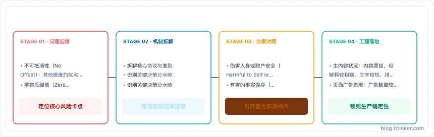
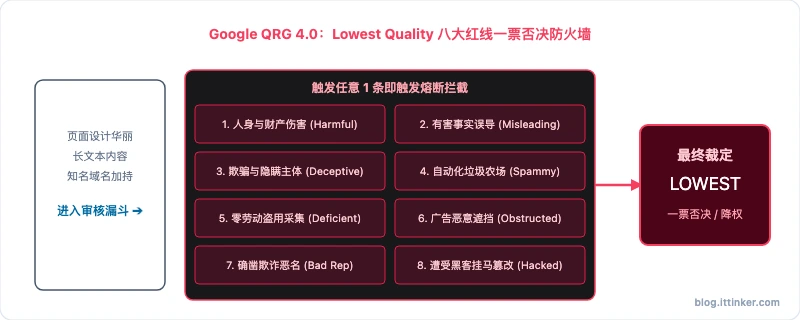
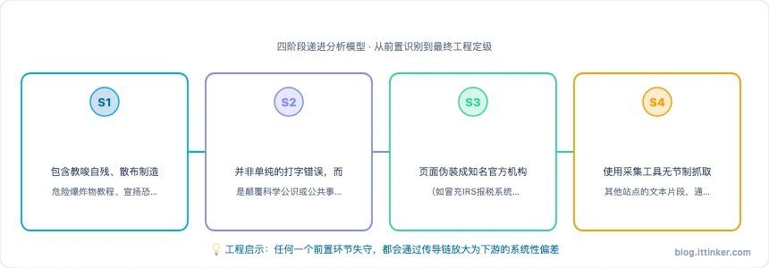
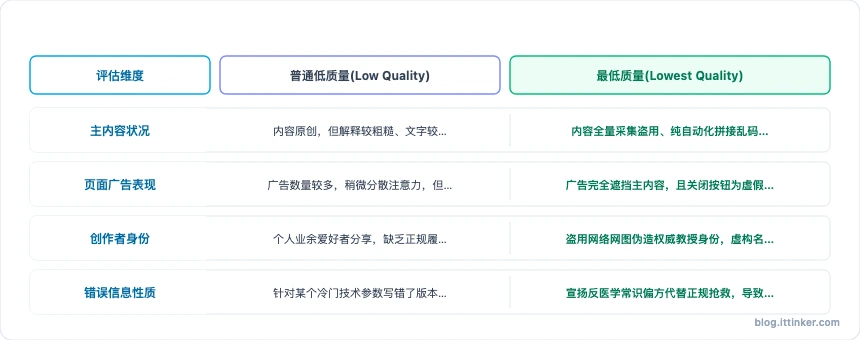
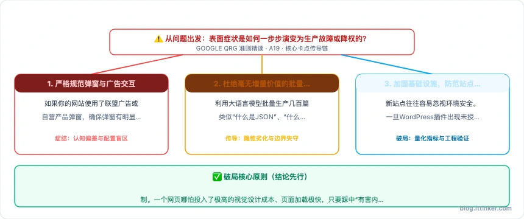
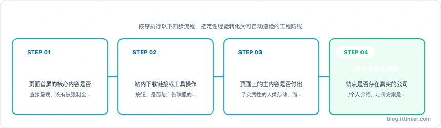

# 什么样的网页会直接落到 Lowest Quality？QRG 4.0 最低质量红线全景拆解 | 读懂 Google Search 基础认知 系列 019

> 🌐 **在线阅读与互动版**：[什么样的网页会直接落到 Lowest Quality？QRG 4.0 最低质量红线全景拆解 | 读懂 Google Search 基础认知 系列 019](https://blog.ittinker.com/posts/什么样的网页会直接落到-lowest-quality/)
> 📚 **所属专栏**：[《读懂 Google Search：110篇搜索质量与SEO实战指南》](../README.md)

---

### 📌 结论先行（TL;DR）
**在 Google 质量评估体系中，**Lowest Quality（最低质量）实行绝对的一票否决制**。**

1. 一个网页哪怕投入了极高的视觉设计成本、页面加载极快，只要踩中“有害内容、误导欺骗、主内容缺失、恶意声誉、自动化垃圾或黑客篡改”等任意一条红线，评级就会被直接打入 Lowest，绝无折衷妥协空间。
2. Lowest 不是“及格线以下的一般差生”，而是“搜索引擎生态中的有害垃圾与危险隐患”。
3. 出海独立团队必须将这八大红线作为研发与运维的不可逾越之底线。

在许多开发者的认知中，网页质量是一个平滑的打分光谱：
“写得好就是 High，写得普通就是 Medium，写得马虎一点、排版简陋一点大概就是 Low，要是再短一点、错别字多一点，应该就是 Lowest 了吧？”

这种理解完全误读了 Google 对搜索质量的防御逻辑。

在 Google 的质量评估手册 QRG 第 4.0 节中，**Lowest Quality 从来不是“写得平庸”的自然延伸，而是一个专门用来识别“网络毒瘤与欺诈行为”的防御隔离区**。

当一个网页被定级为 Lowest，意味着它在 Google 眼中不仅没有为搜索用户创造价值，甚至在对用户的财产安全、身体健康或基本信任造成实质性侵害。





---

## 1. 拆解 QRG 4.0：一票否决的绝对铁律

QRG 第 4.0 节《Lowest Quality Pages》开篇便确立了最高层级的执行法则：

> *"If a page has one or more of the following characteristics, the Lowest rating must be used... It does not matter how well-designed the page is, how many words it has, or how authoritative the creator is."*
>
> *"Pages with Lowest Quality ratings are often created to deceive users, spread harmful misinformation, or make money with little to no effort to help people."*

这段话清晰规定了质量评估员的作业准则：

1. **不可抵消性（No Offset）**：其他维度的优点无法弥补核心缺陷。你就算请来了诺贝尔奖得主署名，如果页面隐藏了诱导扣费的暗链，同样直接被打入 Lowest。
2. **零容忍阈值（Zero Tolerance）**：八大红线只要触碰其中任何一条，无需综合打分，直接终结评级流程。
3. **主观恶意的裁定**：Lowest 页面的核心特征往往不是技术水平低，而是“以欺骗、伤害或零劳动收割流量为初衷”。


---

## 2. Lowest Quality 八大红线全景防御图

为了让出海团队建立清晰的安全边界意识，我们可以将 QRG 4.1 归纳的八大最低质量类型绘制成如下防火墙架构图：





---

## 3. 逐项拆解：QRG 4.1 定义的八大坠入深渊场景

### 1. 伤害人身或财产安全（Harmful to Self or Others）
包含教唆自残、散布制造危险爆炸物教程、宣扬恐怖仇恨、实施网络钓鱼骗取登录账号或银行密码。此类页面直接触及现代社会的法律与生命底线，算法反作弊系统会协同安全机制直接从搜索生态中拔除。

### 2. 有害的事实误导（Harmfully Misleading Content）
并非单纯的打字错误，而是颠覆科学公识或公共事实的危险言论。例如“生吃某种植物可以彻底代替化疗”、“某次合法选举完全不存在”，此类内容在公共卫生与社会治理上极易引发不可逆恶果。下一篇（A20）我们将对这一机制展开深度剖析。

### 3. 不可信与欺骗性设计（Untrustworthy / Deceptive Pages）
页面伪装成知名官方机构（如冒充 IRS 报税系统、伪造 PayPal 支付页面），或者通过虚构知名媒体的报道徽章诱导用户注册自动扣费会员，且页面完全找不到真实的法律实体与退订入口。

### 4. 自动化拼接与垃圾网页（Spammy Webpages）
使用采集工具无节制抓取其他站点的文本片段，通过简单的词语替换或模板拼接填充页面。文本读起来语无伦次，堆砌了大量毫无逻辑的搜索长尾词，没有任何实质可用的主内容。

### 5. 严重缺乏人类投入与增量价值（Deficient MC / Effort）
直接复制粘贴他人已发表的深度教程，没有增加任何测试分析、排版优化或独家观点；或者页面上只有一两行空洞废话，剩下全是无意义的空白占位符。这种近乎零劳动的页面无法达成任何页面目的。

### 6. 主内容被广告恶意遮挡（Obstructed Main Content）
用户打开网页后，巨大的浮动广告或弹窗直接覆盖了核心正文，并且故意隐藏了关闭按钮，甚至设计了虚假的“播放”或“下载”诱导图标，强迫用户点击广告。这种恶意破坏阅读体验的行为，即使内容本身有价值，也会被直接降入 Lowest。

### 7. 确凿的欺诈恶名（Negative / Malicious Reputation）
正如我们在 A13 与 A15 中所讨论，当外部权威机构（如商业信用局、司法部门判决书、数百条真实消费者的集中报案）证实该网站长期从事信用卡盗刷或拒绝退费时，整站声誉直接归零，任何单页都难逃 Lowest 命运。

### 8. 被黑客入侵篡改（Hacked or Defaced Pages）
原本正常合规的独立站点，因服务器漏洞、弱口令或未修补的 WordPress 插件被攻击者注入了黑产跳转代码、博彩链接或恶意软件下载镜像。在评估员眼里，已被攻击者劫持的页面丧失了可信度，必须打入 Lowest 保护网民安全。





---

## 4. 普通低质量 (Low) 与绝对最低质量 (Lowest) 的本质区别

很多站长分不清什么样的缺点只会扣分（变成 Low），什么样的缺点会直接宣判死刑（变成 Lowest）。以下对比表格指明了两者的界限：

| 评估维度 | 普通低质量 (Low Quality) | 最低质量 (Lowest Quality) |
|---|---|---|
| **主内容状况** | 内容原创，但解释较粗糙、文字较短、排版较凌乱 | 内容全量采集盗用、纯自动化拼接乱码，或完全没有实质内容 |
| **页面广告表现** | 广告数量较多，稍微分散注意力，但核心内容仍可正常阅读 | 广告完全遮挡主内容，且关闭按钮为虚假设计或强制跳转第三方钓鱼页 |
| **创作者身份** | 个人业余爱好者分享，缺乏正规履历，但态度真诚 | 盗用网络网图伪造权威教授身份，虚构名校背景从事商业诱导 |
| **错误信息性质** | 针对某个冷门技术参数写错了版本号，属于无意疏忽 | 宣扬反医学常识偏方代替正规抢救，导致严重人身健康危害 |
| **声誉状态** | 外部缺乏讨论，或仅有一两条关于发货慢的用户正常抱怨 | 外部密集爆发信用卡盗刷、未授权扣费的集体维权控诉 |
| **判定机制** | 综合考量后打分，可通过优化内容重新提升回 Medium | 一票否决制，只要命中一条，其余所有优点全部清零 |





---

## 5. 出海独立开发者避免“误伤坠入 Lowest”的运维防线

绝大多数正规出海开发者不会主动去搞钓鱼欺诈。但在实际运维中，不少人因为粗心或技术疏忽，意外触碰了 Lowest 的检测雷区：


### 1. 严格规范弹窗与广告交互
如果你的网站使用了联盟广告或自营产品弹窗，确保弹窗有明显的关闭按钮（尺寸大于 24x24 像素），并且在移动端绝不能遮挡超过屏幕 30% 的主体视距。切勿使用“倒计时 15 秒才能看正文”的流氓逻辑。

### 2. 杜绝毫无增量价值的批量灌水
利用大语言模型批量生产几百篇类似“什么是 JSON”、“什么是 Python”的入门常识并不能帮助你的站点，反而会因为大面积同质化和缺乏原创投入，被算法识别为 Deficient MC 进而拖累整站信誉。聚焦于有真实技术细节、真实配置实测的高投入内容。

### 3. 加固基础设施，防范站点被黑客挂马
新站点往往容易忽视环境安全。一旦 WordPress 插件出现未授权 RCE 漏洞，攻击者在你的模板里植入了数千条黑灰产跳转，Google 爬虫会在第一时间将你的域名标记为安全威胁，打入 Lowest 并施加红屏警告。

建议出海团队定期检查服务器端口与进程安全，使用轻量化监控工具保持系统纯净：

```bash
# 检查当前服务器对外暴露的非常规端口与高占用异常进程
netstat -tulpn
ps aux --sort=-%cpu | head -n 10
```

保持生产环境最小化暴露，定期升级操作系统内核与容器基础镜像，是保障网站声誉不被意外摧毁的底线工程。





---

## 6. Lowest Quality 避雷自查清单

在任何核心页面上线或进行架构调整前，逐条确认以下红线：

- [ ] **无遮挡性广告**：页面首屏的核心内容是否直接呈现，没有被强制全屏覆盖且无法快速关闭的推广弹窗？
- [ ] **无诱导性按钮**：站内下载链接或工具操作按钮，是否与广告联盟的“假下载按钮”有着极高视觉区分度？
- [ ] **内容有实质增量**：页面上的主内容是否付出了实质性的人类劳动，而非纯粹从外部复制粘贴或自动化粗暴拼接？
- [ ] **身份与商业诚实**：站点是否存在真实的公司/个人介绍，定价方案是否透明，无任何隐藏自动续费陷阱？
- [ ] **无恶意安全警报**：在 Google Search Console 的“安全问题（Security Issues）”面板中，是否显示为“未检测到任何问题”？





---

## 下一篇预告

在拆解了 Lowest Quality 的八大类型之后，很多开发者对其中最微妙的一条依然心存疑虑：**“事实错误（Inaccuracy）”**。

在日常写作中，谁都难免写错一两个技术参数、引用错一条发布日期。这种普通的小差错，和 Google 严厉打击的“有害误导（Harmfully Misleading Content）”到底分界线在哪里？

在大语言模型（LLM）频繁产生“幻觉（Hallucination）”的时代，AI 瞎编的内容会不会在无意间将你的独立站推进 Lowest 的深渊？

下一篇，我们将深入拆解 QRG 4.2 至 4.4：**[错误信息什么时候会从“质量差”变成“有害（Harmful）”？事实准确性与安全底线（A20）](/posts/错误信息什么时候会从-质量差-变成-有害-harmful/)**。

---

_这是「读懂 Google Search」系列第 19 篇，系统拆解 Google 官方质量指南，帮你建立长期抗算法波动的出海 SEO 护城河。_


---

## 读懂 Google Search 专栏导航

> 📚 **专栏收录**：本文为 [《读懂 Google Search：110篇搜索质量与SEO实战指南》](/posts/google-search-guide/) 第 **A19** 篇。

* **专栏主页**：[《读懂 Google Search：110篇搜索质量与SEO实战指南》全景地图与路线图](/posts/google-search-guide/)
