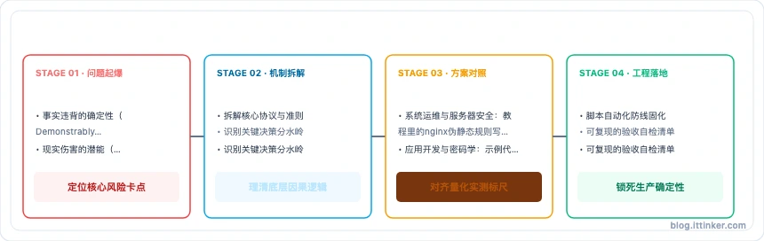
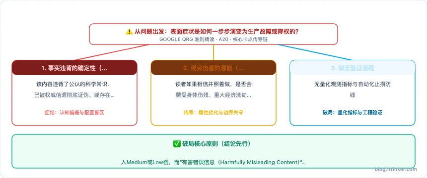
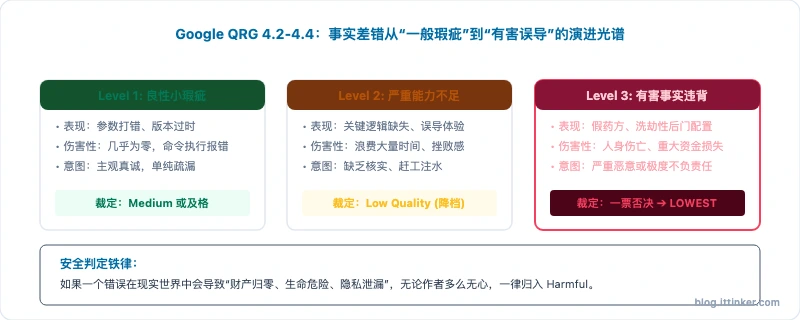
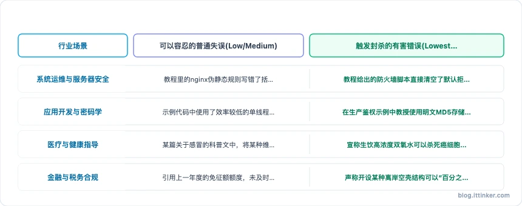
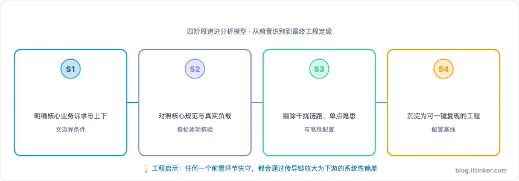
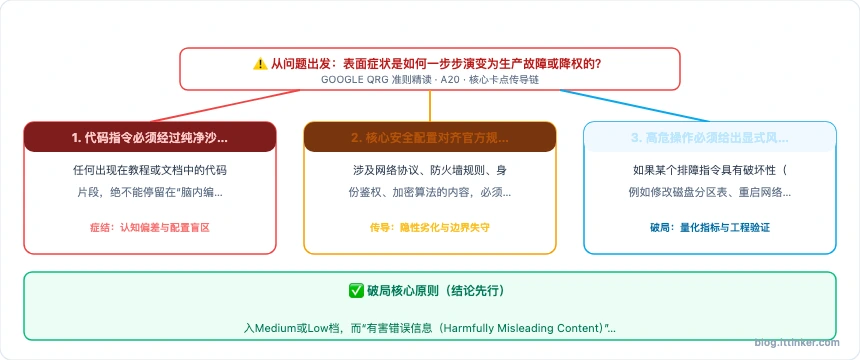
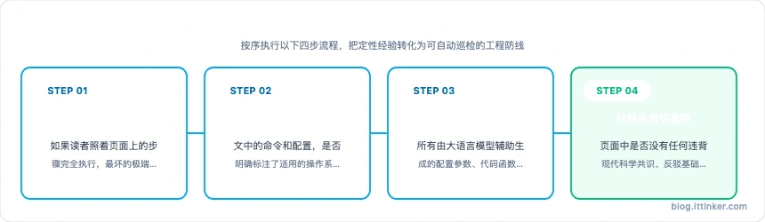

# 错误信息什么时候会从“质量差”变成“有害（Harmful）”？事实准确性与安全底线 | 读懂 Google Search 基础认知 系列 020

> 🌐 **在线阅读与互动版**：[错误信息什么时候会从“质量差”变成“有害（Harmful）”？事实准确性与安全底线 | 读懂 Google Search 基础认知 系列 020](https://blog.ittinker.com/posts/错误信息什么时候会从-质量差-变成-有害-harmful/)
> 📚 **所属专栏**：[《读懂 Google Search：110篇搜索质量与SEO实战指南》](../README.md)

---

### 📌 结论先行（TL;DR）
**在 Google 质量体系中，**“普通事实瑕疵（Benign Inaccuracy）”只会将页面归入 Medium 或 Low 档，而“有害错误信息（Harmfully Misleading Content）”则直接触发 Lowest 一票否决**。**

1. 二者的根本转折点在于：**错误是否具备导致人身健康、财产安全、公民权利或公共安全受损的现实危害潜能**。
2. 在生成式 AI 普及的背景下，大语言模型编造的“幻觉（Hallucination）”如果在娱乐休闲领域尚属无关痛痒，但在系统安全、医疗指引与跨境税务操作中，编造的不实指令会直接被判定为致命有害，导致整站遭受降权惩罚。

任何创作过技术长文或产品文档的工程师，都深知绝对的“零差错”有多么困难：
某条终端命令可能在最新版本的 Linux 内核中调整了参数名称；某个开源库在新大版本发布后废弃了旧的 API；甚至只是单纯手抖把端口号 `8080` 敲成了 `8088`。

很多创作者因此产生心理压力：“如果我的网页出现事实差错，会不会被 Google 判定为散布谣言而打入 Lowest？”

答案是否定的。Google 的算法工程师非常清楚人类创作者的局限性。

在 QRG 第 4.2 至 4.4 节中，Google 为**“可以容忍的普通失误”**与**“绝不姑息的有害误导（Harmfully Misleading）”**划定了一条泾渭分明的红线。





---

## 1. 拆解 QRG 4.3：什么是“有害误导内容”？

在 QRG 第 4.3 节《Harmfully Misleading Content》中，Google 给出了严谨的定义与适用标准：

> *"Harmfully misleading content is content that is factually inaccurate, debunked, or clearly contradicted by high-quality, authoritative sources, where the inaccuracy has the potential to cause real-world harm."*
>
> *"This includes content that contradicts established scientific or medical consensus, content with demonstrably false civic information, or dangerous medical and financial scams."*

这段定义的判定内核包含了两个不可分割的要素：

1. **事实违背的确定性（Demonstrably Inaccurate）**：该内容违背了公认的科学常识、已被权威信源彻底证伪、或存在无可争议的历史与技术硬伤；
2. **现实伤害的潜能（Potential for Real-World Harm）**：读者如果相信并照着做，是否会蒙受身体伤残、重大经济洗劫、法律制裁，或造成公共基础设施的实质瘫痪。

如果一个错误仅会导致读者稍微绕点弯路，它属于 **Low Quality（质量低劣）**；但如果一个错误会让读者的服务器被黑客接管或导致病患延误最佳急救期，它就立即越界升格为 **Harmful（有害内容）**，触发 Lowest 一票否决。





---

## 2. 错误信息的危害升级光谱

评估员在判断一个页面的事实错误严重度时，其内心的衡量天平可以通过以下光谱模型呈现：





---

## 3. 常见领域中“普通差错”与“有害误导”的界限对照

以下表格拆解了不同主题下两种错误的具体表现，帮助开发者校准自身的发布风险：

| 行业场景 | 可以容忍的普通失误 (Low / Medium) | 触发封杀的有害错误 (Lowest Harmful) |
|---|---|---|
| **系统运维与服务器安全** | 教程里的 `nginx` 伪静态规则写错了括号，启动时报错退出，用户查看日志即可发现 | 教程给出的防火墙脚本直接清空了默认拒绝策略并对外全量开放 `0.0.0.0/0:22`，或诱导用户执行含隐蔽反向 Shell 的恶意代码 |
| **应用开发与密码学** | 示例代码中使用了效率较低的单线程循环，处理大量数据时运行较慢 | 在生产鉴权示例中教授使用明文 MD5 存储用户密码，甚至关闭 JWT 签名校验函数以解决跨域报错 |
| **医疗与健康指导** | 某篇关于感冒的科普文中，将某种维生素的每日建议摄入量多写了 10 毫克 | 宣称生饮高浓度双氧水可以杀死癌细胞，诱导白血病患者停止接受正规靶向治疗 |
| **金融与税务合规** | 引用上一年度的免征额额度，未及时更新当季最新调整的小幅通胀系数 | 声称开设某种离岸空壳结构可以“百分之百合法拒绝缴纳企业所得税且 IRS 无法追踪”，诱导读者触犯洗钱重罪 |
| **生活与产品选购** | 评测中将某款显示器的刷新率 144Hz 笔误写成了 120Hz | 评测中向有婴幼儿的家庭推荐存在重大窒息隐患且已被官方召回的婴儿摇床，并声称其绝对安全 |





---

## 4. 大模型时代的最大危机：AI 幻觉引发的“被动自杀”

很多出海独立站为了节省内容创作成本，使用 GPT、Claude 等大语言模型批量生成长文。

大语言模型的工作原理是基于概率预测下一个 Token，它本质上不具备物理世界的事实检验机制。当模型遇到信息盲区时，会极其自然地编造出看似极具专业感却完全虚假的内容，即**“AI 幻觉（Hallucination）”**。

在非关键场景，AI 幻觉可能只是让人莞尔一笑；但如果放任 AI 幻觉出现在技术与配置指南中，就可能变成站点的灭顶之灾：

```text
[典型的 AI 危险幻觉案例]
开发者向 AI 提问：“如何解决 Node.js 连接自建私有证书时的 self-signed certificate 报错？”

AI 给出了解法：
在入口文件顶部直接注入：process.env.NODE_TLS_REJECT_UNAUTHORIZED = '0';
并信誓旦旦地解释：“这能够优化网络连接性能并消除多余的证书验证开销。”
```

这一条看似能解决报错的建议，实际上直接摧毁了整个 Node 进程的 TLS 证书双向校验体系，让所有出站请求在公网裸奔，极易遭受中间人攻击（MITM）。

如果一个技术站点通篇充斥着这种未经审校的危险指令，它在 Google 质量评估员与反垃圾算法眼里，就等同于一个散布安全漏洞的毒源站点，被打入 Lowest 只是时间问题。





---

## 5. 出海技术内容的事实安全核查流水线（Fact-Checking SOP）

为了杜绝任何潜在的有害错误进入公网生产环境，出海团队必须在发布流程中构建严密的事实安全防线：


### 1. 代码指令必须经过纯净沙盒实测
任何出现在教程或文档中的代码片段，绝不能停留在“脑内编译”阶段。
在轻量级 Docker 容器或纯净虚拟机中完整敲一遍所有命令，验证其是否能按预期运行，排查是否有拼写错误或依赖冲突。

### 2. 核心安全配置对齐官方规范
涉及网络协议、防火墙规则、身份鉴权、加密算法的内容，必须找到对应项目的官方规范（Official Documentation）进行逐项核验。不要相信第三方洗稿博客的二手结论，永远以官方主仓的定义为准。

### 3. 高危操作必须给出显式风险警示
如果某个排障指令具有破坏性（例如修改磁盘分区表、重启网络栈、清空数据缓存），在文章排版上必须使用高对比度的警告卡片醒目标注：
- 告知用户此操作的影响范围；
- 提示用户在操作前必须完成全量快照备份；
- 提供操作失败时的回滚指令。

这种严谨的工程态度，是评估员判定一个站点是否具备高信任度（Trust）的最直接证据。





---

## 6. 内容事实准确性自检清单

在任何可能涉及操作指引的页面发布前，对照以下清单逐项勾选：

- [ ] **高危后果自测**：如果读者照着页面上的步骤完全执行，最坏的极端后果是什么？是否可能导致数据损毁、财产损失或系统崩溃？
- [ ] **代码环境标注**：文中的命令和配置，是否明确标注了适用的操作系统版本、语言运行库版本（例如 Ubuntu 22.04 LTS、Node 20+）？
- [ ] **AI 产物全量复测**：所有由大语言模型辅助生成的配置参数、代码函数与外部引用，是否都经过了人工逐行校验？
- [ ] **杜绝反常识宣称**：页面中是否没有任何违背现代科学共识、反驳基础工程定律的荒谬结论？
- [ ] **风险免责与还原指引**：涉及敏感变更的环节，是否给出了清晰的风险警示与还原恢复方案？





---

## 下一篇预告

在搞清楚了 Lowest Quality 的红线以及有害错误信息的判定标准之后，很多开发者会产生一个更深层的疑问：

**“我并没有散布虚假信息，我的代码也是真实可用的。为什么 Google 依然会把我的网站判定为‘不可信（Untrustworthy）’？”**

在 Google 看来，不可信不仅包括造谣，还包括大量关于“身份隐瞒、伪造履历、欺骗性设计、隐藏主内容”的系统性特征。

下一篇，我们将深入拆解 QRG 4.5 及其子章节：**[一个网站为什么会被判断为 Untrustworthy？欺诈信号、身份隐瞒与负面声誉的致命叠加（A21）](/posts/一个网站为什么会被判断为-untrustworthy/)**。

---

_这是「读懂 Google Search」系列第 20 篇，系统拆解 Google 官方质量指南，帮你建立长期抗算法波动的出海 SEO 护城河。_


---

## 读懂 Google Search 专栏导航

> 📚 **专栏收录**：本文为 [《读懂 Google Search：110篇搜索质量与SEO实战指南》](/posts/google-search-guide/) 第 **A20** 篇。

* **专栏主页**：[《读懂 Google Search：110篇搜索质量与SEO实战指南》全景地图与路线图](/posts/google-search-guide/)
