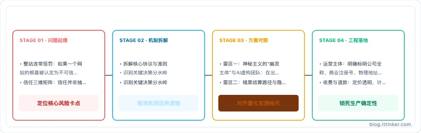
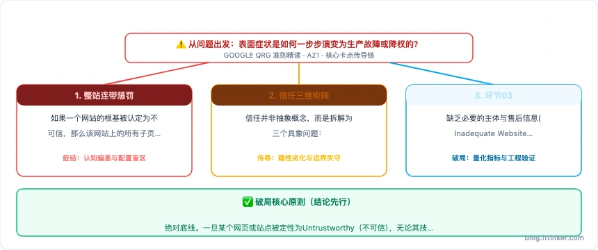
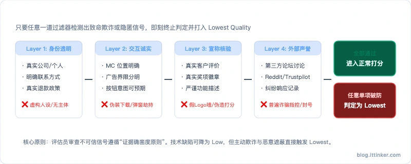
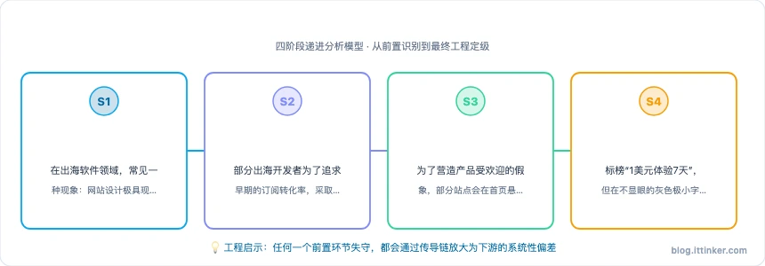
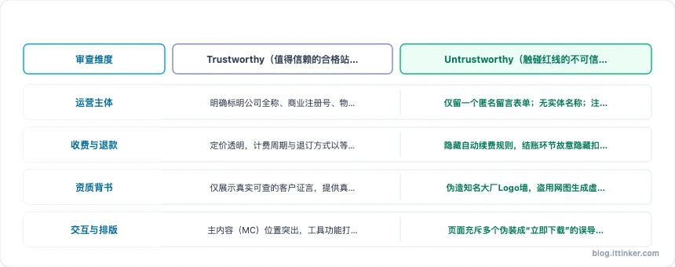
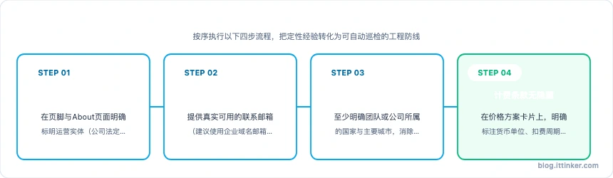

# “藏起公司地址免得被骚扰”？自以为聪明的信任自杀：欺诈信号、身份隐瞒与负面声誉的致命叠加 | 读懂 Google Search 基础认知 系列 021

> 🌐 **在线阅读与互动版**：[“藏起公司地址免得被骚扰”？自以为聪明的信任自杀：欺诈信号、身份隐瞒与负面声誉的致命叠加 | 读懂 Google Search 基础认知 系列 021](https://blog.ittinker.com/posts/一个网站为什么会被判断为-untrustworthy/)
> 📚 **所属专栏**：[《读懂 Google Search：110篇搜索质量与SEO实战指南》](../README.md)

---

### 📌 结论先行（TL;DR）
> **在 Google 质量评估指南（QRG 4.5）中，**Trust（可信度）是整套质量评估体系的绝对底线**。**
> **在分析过 Lowest 评级的总体框架与有害信息界限后，许多刚涉足海外市场的技术创业者常会遇到一个令人沮丧的现象：**
> **网站代码整洁、Core Web Vitals 全部绿标、甚至配备了详尽的文字说明，但新站上线后在搜索结果中始终石沉大海，甚至数周内彻底失去曝光。**
> **排查日志与索引状态后，很多人把原因归咎于“新站沙盒期”或“外链不足”。然而很多时候，站点其实已经触发了 Google 评估体系中最致命的暗礁——**Untrustworthy（不可信站点）**。**
> **在 Google 评估员指南 QRG 第 4.5 节中，Google 用了极长的篇幅，详细罗列了哪些行为会让一个网站被直接钉在“不可信”的耻辱柱上。理解这套底层逻辑，是每一个出海产品活过冷启动期的基本前提。**
>
> - 一旦某个网页或站点被定性为 **Untrustworthy（不可信）**，无论其技术指标多优异、页面加载多迅速，都会被一票否决直接打入 **Lowest Quality**。
> - **不可信的根源通常来自五大硬伤**：**运营主体身份隐瞒、虚构资质与虚假背书、暗黑交互与主内容遮蔽、重大事实违背、以及跨平台一致的负面声誉**。
> - 出海独立开发团队必须在上线前建立严格的信任审计（Trust Audit），把透明、真实与可验证性置于所有技术手段之上。





---


### 🚨 2026 → 2024 官方最新风向预警：Google 对Google 针对不可信（Untrustworthy）站点与隐瞒身份的算法判定的策略演进

#### 🕒 2026 → 2024 Google 官方对Google 针对不可信（Untrustworthy）站点与隐瞒身份的算法判定的策略演进

- **2026 · 隐匿商业实体溯源封堵（Dark Ownership Tracking）**
  针对使用空壳离岸公司、隐匿真实所有权开展商业收单与付费服务的站点，Google 核心系统直接打入不可信黑名单，并切断其在商业意图词上的索引推荐。

- **2025 · 欺诈信号联合惩戒（Multi-signal Fraud Identification）**
  虚假退款政策、隐藏额外费用、缺少 SSL 安全协议以及模糊的法律管辖声明被聚合计算为欺诈特征向量，全面触发 Untrustworthy 严厉打击。

- **2024 · QRG 4.2 节对 Untrustworthy 页面与站点的定义**
  指南明确建立判定铁律：如果一个网站在财务、身份或服务内容上对用户故意不诚实或故意隐瞒关键主体，其所有页面无论文字写得多好均直接被评为 Lowest。


---


## 1. 拆解 QRG 4.5：Untrustworthy 的判定标准

QRG 第 4.5 节《Untrustworthy Webpages or Websites》给出了直截了当的定义：

> *"A webpage or website is untrustworthy if it is not trustworthy or safe for users. Users need to be able to trust who is behind the website, what the website is trying to do, and whether the content is reliable."*
>
> *"Pages on untrustworthy websites should be rated Lowest, even if the page itself does not seem untrustworthy."*

这段官方说明包含了两个极具杀伤力的核心判断：

1. **整站连带惩罚**：如果一个网站的根基被认定为不可信，那么该网站上的**所有子页面都会被直接定为 Lowest**，即便具体某个单页看似客观中立、排版工整，也无法幸免。
2. **信任三维矩阵**：信任并非抽象概念，而是拆解为三个具象问题：
   - **Who**：背后是谁在运营？出现纠纷能否追责？
   - **What**：这个网站究竟想对用户做什么？是否存在隐蔽商业企图或欺诈陷阱？
   - **Reliability**：页面提供的信息或工具是否可靠？会不会误导决策甚至造成财产损失？

根据 QRG 4.5.1 至 4.5.5 的细分规范，评估员在审查目标站点时，会沿着以下五大维度展开逐层穿透：

```
1. 缺乏必要的主体与售后信息 (Inadequate Website Information)
2. 伪造背景与虚假背书 (Deceptive Claims & Misleading Credentials)
3. 欺骗性交互与暗黑模式 (Deceptive Design & Hidden Main Content)
4. 无法证实或荒谬的信息质量 (Inaccurate or Harmfully Misleading Content)
5. 压倒性的第三方负面声誉 (Extremely Negative Reputation)
```





---

## 2. Google 信任审计流水线（Trust Filter Pipeline）

为了让团队在工程与产品设计阶段直观把控风险，我们可以将 QRG 4.5 的审查流程还原为一个五层信任过滤器：





---

## 3. 出海团队最易触犯的三大不可信雷区

很多独立开发者并非主观作恶，但因为套用了一些陈旧的营销黑客手段，在无意中踩中了不可信的高压线。

### 雷区一：神秘主义的“幽灵主体”与 AI 虚构团队

在出海软件领域，常见一种现象：网站设计极具现代感，但翻遍整站找不到具体的实体名称、注册地或办公地址。

更恶劣的作法是利用 AI 人脸生成器捏造数个虚假员工头像，并冠以“前 Google 架构师”、“哈佛数据科学家”等显赫头衔。

QRG 4.5.2 明确指出：对于涉及金钱交易（YMYL）的商业网站，如果连基本的服务责任主体与退款沟通方式都含糊其辞，用户在遭遇消费欺诈或个人数据泄露时将无法追责。此类网站会立刻被定性为 **Inadequate Website Information**，并直接落入 Lowest。

真实、诚恳是最好的解药。哪怕你只是一个在车库里写代码的个人独立开发者，在 `About Us` 和页脚如实写明：“由独立开发者 [真实姓名] 独立构建与运营，注册地位于 [城市/国家]”，并在页面附上真实的个人社交账号或 GitHub 链接，其可信度远胜于虚构的硅谷跨国团队。

### 雷区二：暗黑结算路径与隐藏取消条款

部分出海开发者为了追求早期的订阅转化率，采取了激进的付款设计：
- 标榜“1 美元体验 7 天”，但在不显眼的灰色极小字号中默认勾选“到期自动按 49 美元/月续费”；
- 付款后，后台完全隐藏取消订阅的入口，用户必须在知识库深处反复搜寻，甚至被迫给响应迟缓的邮箱发邮件；
- 在用户申请退款时，故意制造长达数周的延误或直接失联。

这些手段一旦在海外用户社群中引发不满，用户会迅速聚集到 Reddit、Trustpilot、甚至商业改进局（Better Business Bureau, BBB）发起投诉。

当评估员或安全爬虫发现全网针对该域名的讨论充斥着 `unauthorized charge`、`impossible to cancel`、`scam refund` 等指控时，QRG 4.5.4（极度负面声誉）与 4.5 欺诈条款将直接生效，站点权重将遭遇毁灭性清算。

### 雷区三：社会认同欺诈（Social Proof Fraud）

为了营造产品受欢迎的假象，部分站点会在首页悬挂未经授权的知名企业标识：
- 在未获得任何正式采购合作的前提下，直接放置 Microsoft、Amazon、Netflix 的 Logo 并标注为“Our Customers”；
- 伪造虚假的“Product Hunt #1 Product of the Day”徽章；
- 放置伪造的 5 星评分卡片，名字配图皆为编造，甚至连评价文案都是 ChatGPT 批量生成的通俗赞美。

Google 评估员在接受培训时，被专门要求对“超常宣称”执行交叉比对：
- 评估员会直接在 Product Hunt 或 Google 搜索该产品的真实获奖记录；
- 评估员会通过图片反向检索审查客户头像是否盗用自图库；
- 评估员会检索名企与该软件的技术集成新闻。

一旦虚构事实被证实，站点立刻被归入 **Deceptive Claims**（QRG 4.5.1）。





---

## 4. Trustworthy vs Untrustworthy 页面全维度对照

| 审查维度 | Trustworthy（值得信赖的合格站点） | Untrustworthy（触碰红线的不可信站点） | QRG 对应条款 |
|---|---|---|---|
| **运营主体** | 明确标明公司全称、商业注册号、物理地址或真实开发者实名主页 | 仅留一个匿名留言表单；无实体名称；注册地刻意隐藏 | QRG 4.5.2 |
| **收费与退款** | 定价透明，计费周期与退订方式以等大字号清晰展示，支持一键退订 | 隐藏自动续费规则，结账环节故意隐藏扣费总额，无自主退订入口 | QRG 4.5 & 4.5.3 |
| **资质背书** | 仅展示真实可查的客户证言，提供真实外链或第三方评分平台原生小部件 | 伪造知名大厂 Logo 墙，盗用网图生成虚假用户赞誉，虚构媒体报道 | QRG 4.5.1 |
| **交互与排版** | 主内容（MC）位置突出，工具功能打开立即可用，下载按钮直接指向真实文件 | 页面充斥多个伪装成“立即下载”的误导性广告，核心内容被多重遮挡 | QRG 4.5.3 |
| **外部评价** | 在 Reddit 或 Trustpilot 上有自然讨论，即便有差评也能看到官方积极响应并妥善退费 | 外部搜索呈现压倒性的欺诈控诉，大量用户声称遭遇恶意扣费或信用卡盗刷 | QRG 4.5.4 |
| **安全性** | 全站 HTTPS，证书链有效，无混杂内容，无浏览器安全警告 | 触发 Google Safe Browsing 警告，包含恶意重定向脚本或钓鱼特征 | QRG 4.5.5 |





---

## 5. 出海产品上线前 Trust Audit（信任自审）清单

在向海外公众发布任何商业产品或工具服务前，技术团队应参照以下清单执行上线审计：

### 基础主体透明度
- [ ] **主体身份可确认**：在页脚与 `About` 页面明确标明运营实体（公司法定全称或创始人实名信息）。
- [ ] **有效联络渠道**：提供真实可用的联系邮箱（建议使用企业域名邮箱而非免费公共邮箱），并在 24 小时内有真实人员响应。
- [ ] **物理区域公开**：至少明确团队或公司所属的国家与主要城市，消除空壳站点的嫌疑。

### 商务与交互透明度
- [ ] **计费条款无隐藏**：在价格方案卡片上，明确标注货币单位、扣费周期（按月/按年）以及试用到期后的具体续费金额。
- [ ] **退订路径清晰**：在用户控制台个人中心提供明确的“Cancel Subscription”按钮，避免设置多重挽留障碍或强制发邮件。
- [ ] **退款政策明确（Refund Policy）**：提供专门的退款条款说明页面，明确界定哪些场景可以全额退款、退款周期为多少个工作日。

### 内容与信誉防御
- [ ] **真实社会认同**：移除所有未获得书面许可的第三方名企 Logo；若引用评测，尽量嵌入 Twitter/X 或 Product Hunt 的原生 Embed 组件以提供可信源头。
- [ ] **无暗黑下载欺骗**：页面中的“Download”或“Generate”按钮必须执行用户预期的动作，严禁为了赚取点击费而在核心按钮周围堆叠虚假广告按钮。
- [ ] **监控外部负向探针**：定期运行 `[品牌名] (scam OR fraud OR refund)` 检索，遇到用户公开投诉第一时间公开跟进解决，绝不任由纠纷在社区发酵。





---

## 下一篇预告

彻底规避了 Untrustworthy 的不可信红线后，你的网站已经拥有了立足搜索生态的基本资质。

但很多开发者随之产生了一个新的疑惑：**“我既没有骗人，也没有隐藏身份，为什么写了大量文章或生成了大量工具聚合页，依然会被 Google 判定为垃圾内容（Spam）？”**

事实上，现代 Google 搜索对“垃圾（Spam）”的定义，早已突破了十几年前“关键词重复堆砌”的陈旧范畴。

下一篇，我们将深入拆解 QRG 4.6 与 Google 现代反作弊体系：**[“不堆词我就不算作弊”？刻舟求剑的过时认知：Google 对 Spam 的现代定义，早已甩开传统站长十年！（A22）](/posts/google-对-spam-的定义-已经远远超过-关键词堆砌/)**。

---

_这是「读懂 Google Search」系列第 21 篇，系统拆解 Google 官方质量指南，帮你建立长期抗算法波动的出海 SEO 护城河。_


---

## 读懂 Google Search 专栏导航

> 📚 **专栏收录**：本文为 [《读懂 Google Search：110篇搜索质量与SEO实战指南》](/posts/google-search-guide/) 第 **A21** 篇。

* **专栏主页**：[《读懂 Google Search：110篇搜索质量与SEO实战指南》全景地图与路线图](/posts/google-search-guide/)
