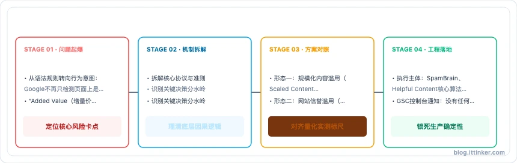
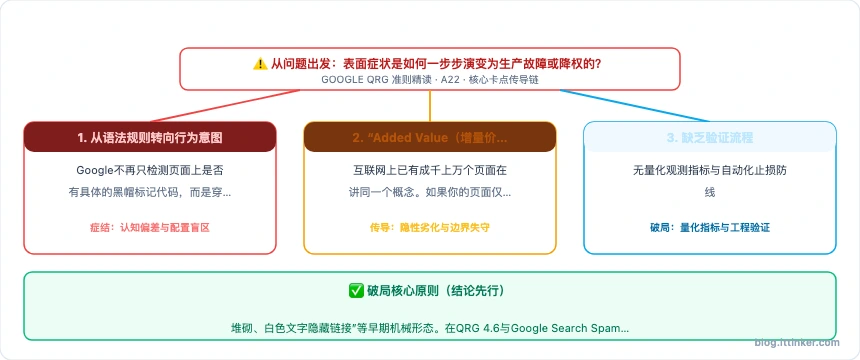
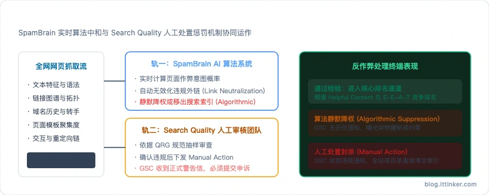
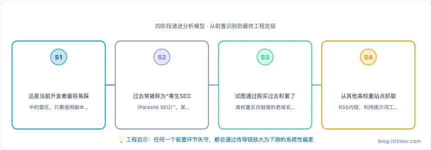
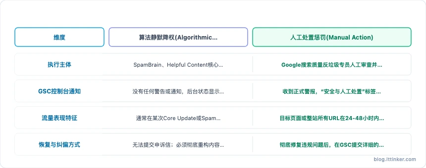
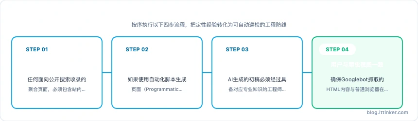

# Google 对 Spam 的定义，已经远远超过“关键词堆砌”：现代搜索反作弊体系全解 | 读懂 Google Search 基础认知 系列 022

> 🌐 **在线阅读与互动版**：[Google 对 Spam 的定义，已经远远超过“关键词堆砌”：现代搜索反作弊体系全解 | 读懂 Google Search 基础认知 系列 022](https://blog.ittinker.com/posts/google-对-spam-的定义-已经远远超过-关键词堆砌/)
> 📚 **所属专栏**：[《读懂 Google Search：110篇搜索质量与SEO实战指南》](../README.md)

---

### 📌 结论先行（TL;DR）
**现代 Google 搜索对 **Spam（搜索作弊与垃圾内容）** 的定义早已脱离了“关键词重复堆砌、白色文字隐藏链接”等早期机械形态。**

1. 在 QRG 4.6 与 Google Search Spam Policies 中，作弊的判定核心已经演进为**“该页面或内容的首要意图，是否在于操纵搜索引擎排名，而非真正为人类用户创造增量价值（Primary Purpose of Manipulating Search Rankings rather than Helping Users）”**。
2. 现代反作弊体系由 AI 反垃圾算法系统 **SpamBrain** 与人工处置团队（Manual Actions Team）双轨驱动。
3. 出海开发者必须认清：只要内容缺乏实质性人类增量价值，无论语法多么通顺、代码多么规范，都会被判定为现代意义上的 Spam。

在讨论搜索引擎反作弊时，不少工程师对作弊的理解依然停留在十年前的认知水平：
- “我的文章里没有硬塞 50 遍核心词，怎么可能是 Spam？”
- “我的 CSS 没有设置 `display: none` 藏字，为什么会被 Google 惩罚？”
- “页面文案句子通顺，全部由大语言模型精心润色，凭什么算垃圾内容？”

这种认知偏差正是大量出海独立站频繁遭遇流量断崖的根本原因。

Google 的反作弊系统经历过多轮结构性跃迁。今天在 Google QRG 第 4.6 节以及《Google 搜索基本准则》（Google Search Essentials）中，Spam 的边界已经拓展为一套包含意图判定、价值增量评估与网络拓扑异常检测的复杂体系。

---

## 1. 拆解 QRG 4.6：Spammy Webpages 的现代判定框架

QRG 第 4.6 节《Spammy Webpages》开门见山地给出了对垃圾页面的现代定性：

> *"Spammy webpages are created to manipulate search engines or deceive users rather than help people... They often have little or no unique content, and offer little to no added value beyond what can be found elsewhere on the web."*
>
> *"Spammy pages exist primarily to generate advertising revenue, affiliate commissions, or other financial gain for the website owner, without putting effort into creating an experience that genuinely benefits users."*

这一表述揭示了现代搜索引擎反作弊的底层逻辑转换：

1. **从语法规则转向行为意图**：Google 不再只检测页面上是否有具体的黑帽标记代码，而是穿透代码表层，评估该页面被制造出来的“第一性驱动力”。如果一个页面的存在理由完全由获取搜索曝光、薅取广告联盟点击驱动，对访问者没有任何实质增量收益，它就已经处于 Spam 的危险边缘。
2. **“Added Value（增量价值）”成为核心裁决标准**：互联网上已有成千上万个页面在讲同一个概念。如果你的页面仅仅是对维基百科或行业博客的段落重组、同义词替换或简单改写，即使语言天衣无缝，在 Google 评估体系中依然属于 **No Added Value**。在现代算法眼中，毫无增量价值的搬运等同于现代垃圾内容。

---

## 2. Google 现代反作弊双轨防御架构（SpamBrain + Manual Actions）

Google 拦截垃圾内容并非依靠单一算法，而是构建了基于大规模机器学习与专业人工审核的双轨流水线：

---

## 3. 现代 Spam 的五大核心形态全景

Google 在近年不断更新《Google Search Spam Policies》，重点打击那些利用自动化工具、既有权重资产进行流量套利的行为：

### 形态一：规模化内容滥用（Scaled Content Abuse）
这是当前开发者最容易踩中的雷区。只要使用脚本或自动化程序（无论是否调用 AI API），在极短时间内大批量生成海量网页，其核心目的若是为了抢占长尾搜索词排名，而没有针对每一个页面注入真实的测试数据、独立观点或人工工程验证，都会直接触发此项违规。

### 形态二：网站信誉滥用（Site Reputation Abuse）
过去常被称为“寄生 SEO（Parasite SEO）”。某些第三方营销团队看中高权重权威媒体（如大型新闻站、大学站点）的域名信任度，付费在这些大站的二级目录或子域名下租用版块，大批量发布诸如优惠券、博彩、代币投资等与宿主网站主营方向毫无关联的内容。这类行为在 2024 年已被 Google 设立专项目录予以严厉打击。

### 形态三：过期老域名滥用（Expired Domain Abuse）
试图通过购买过去积累了高权重反向链接的老域名（例如倒闭的非营利组织、破产政府项目或历史悠久的医疗诊所），然后将域名解析到全新的博彩导航、低质内容农场或无关 Affiliate 站。系统一旦检测到域名历史主体与当前主营内容的彻底断裂，会直接将历史权重归零并施加作弊惩罚。

### 形态四：伪装采集与无增量改写（Scraped Content without Added Value）
从其他高权重站点抓取 RSS 内容，利用提示词工程将文章段落打散、更换近义词、调整小标题后重新发布。这种内容在字面重复率检测工具里或许能拿到高分，但在深度语义解析引擎中，其信息增益（Information Gain）无限接近于零，被直接视为纯采集垃圾。

### 形态五：障眼法与隐蔽跳转（Cloaking & Sneaky Redirects）
向 Googlebot 展示一套精心编写的、合规的高质量文本页面，但当真实人类用户或特定 IP 访问时，通过前端 JavaScript 脚本或服务端反向代理将用户悄悄重定向到灰产落地页、杀猪盘或强制下载器。这是反作弊体系中定性最严重的恶意违规之一。

---

## 4. 算法降权（Algorithmic Demotion） vs 人工处置（Manual Action）

当出海站点因触碰 Spam 边界受到惩罚时，通常表现为两种完全不同的技术形式：

| 维度 | 算法静默降权 (Algorithmic Demotion) | 人工处置惩罚 (Manual Action) |
|---|---|---|
| **执行主体** | SpamBrain、Helpful Content 核心算法组件自动化执行 | Google 搜索质量反垃圾专员人工审查并批准 |
| **GSC 控制台通知** | **没有任何警告或通知**，后台状态显示正常 | **收到正式警报**，“安全与人工处置”标签显示红标及具体违规类别 |
| **流量表现特征** | 通常在某次 Core Update 或 Spam Update 发售后，展现量与点击量遭遇悬崖式下跌 | 目标页面或整站所有 URL 在 24-48 小时内被强制清出搜索索引 |
| **恢复与纠偏方式** | 无法提交申诉信；必须彻底重构内容体系，等待算法在未来几个月重新评估计算 | 彻底修复违规问题后，在 GSC 提交详细的反思说明与 Request Review 申诉 |
| **检测修复难度** | 极高；需要团队深刻自省哪些内容属于无增量垃圾，并大刀阔斧删除 | 明确；官方通常指明了违规类型（如 Unnatural links 或 Scaled content） |

---

## 5. 出海团队现代反作弊防御 Checklist

为了保证技术资产长治久安，工程团队与内容运营人员必须将反作弊规范融入自动化流水线中：

### 数据与内容生成规范
- [ ] **拒绝纯搬运聚合**：任何面向公开搜索收录的聚合页面，必须包含站内专有的结构化计算结果（如真实抓取的 API 状态、独家基准测试得分或社区用户交互沉淀）。
- [ ] **杜绝机械模板填充**：如果使用自动化脚本生成页面（Programmatic SEO），每个页面的动态差异率必须有实质意义，严禁仅替换城市名或年份。
- [ ] **人工专业介入痕迹**：AI 生成的初稿必须经过具备对应专业知识的工程师或编辑进行事实查证，并补充一线操作代码、排错日志或真实截图。

### 交互与路由纯洁度
- [ ] **用户与爬虫视图一致**：确保 Googlebot 抓取的 HTML 内容与普通浏览器在首屏呈现的内容完全一致，不存在动态篡改重定向链接的作弊逻辑。
- [ ] **联盟与推广标签声明**：站内所有带利益返佣性质的链接，在 HTML 标签中必须严格声明 `rel="sponsored"` 或 `rel="nofollow"`，防止被判定为外链交易作弊。
- [ ] **严格管理用户生成内容（UGC）**：如果站点包含评论区、论坛或可自由发帖的模块，必须配置敏感词拦截与 `rel="ugc"` 属性，防止被外部黑产利用作为放毒工具。

---

## 下一篇预告

在明确了现代 Spam 的核心定义与拦截架构后，接下来的三篇我们将对出海圈讨论最激烈的三种“高危边缘玩法”进行单点深度穿透。

首先摆在许多开发者面前的诱惑是：**“做一个全新域名需要漫长的冷启动，那我花几百美元去购买一个有十年历史、带大量 Wikipedia 外链的过期老域名（Expired Domain）来做我的 SaaS 产品，到底行不行？合规收购与垃圾滥用的分界线究竟在哪？”**

下一篇，我们将深入拆解 QRG 4.6.3：**[Expired Domain Abuse：买老域名做 SEO 的合规边界与垃圾滥用红线在哪里？（A23）](/posts/expired-domain-abuse-买老域名做-seo-的合规边界与垃圾滥用红线在哪里/)**。

---

_这是「读懂 Google Search」系列第 22 篇，系统拆解 Google 官方质量指南，帮你建立长期抗算法波动的出海 SEO 护城河。_

---

## 读懂 Google Search 专栏导航

> 📚 **专栏收录**：本文为 [《读懂 Google Search：110篇搜索质量与SEO实战指南》](/posts/google-search-guide/) 第 **A22** 篇。

* **专栏主页**：[《读懂 Google Search：110篇搜索质量与SEO实战指南》全景地图与路线图](/posts/google-search-guide/)
