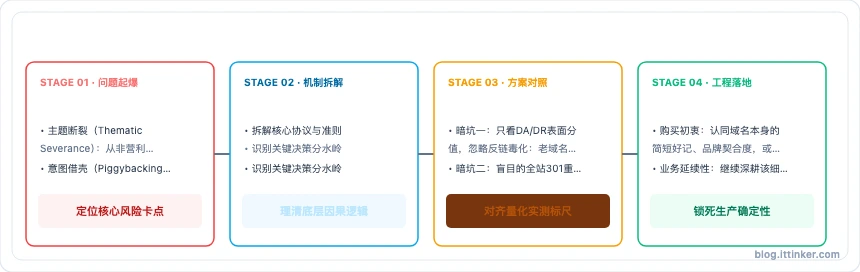
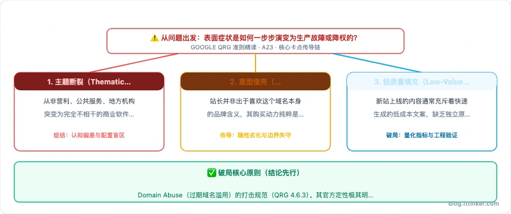
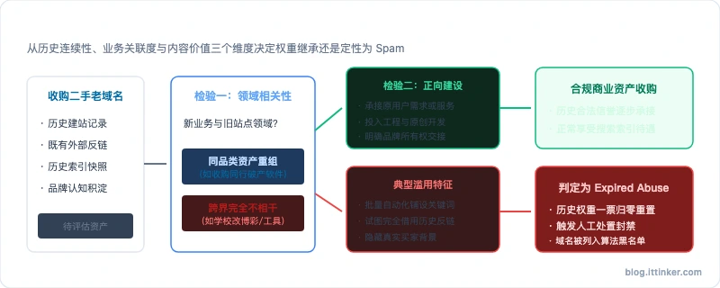
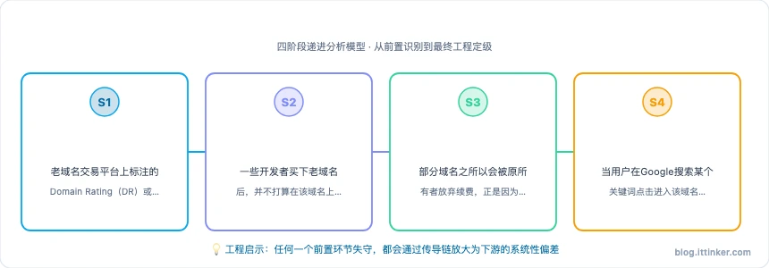
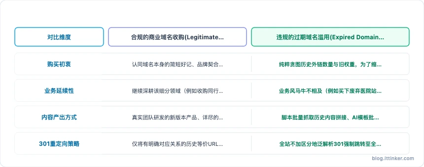
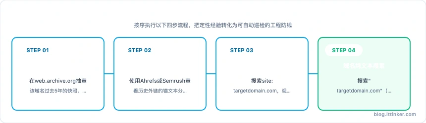

# “买老域名就能继承百万权重”？被黑帽割韭菜的致命迷思：Expired Domain Abuse 监管风暴下，为什么你的‘高权重外链’正在招致整站清算？ | 读懂 Google Search 基础认知 系列 023

> 🌐 **在线阅读与互动版**：[“买老域名就能继承百万权重”？被黑帽割韭菜的致命迷思：Expired Domain Abuse 监管风暴下，为什么你的‘高权重外链’正在招致整站清算？ | 读懂 Google Search 基础认知 系列 023](https://blog.ittinker.com/posts/expired-domain-abuse-买老域名做-seo-的合规边界与垃圾滥用红线在哪里/)
> 📚 **所属专栏**：[《读懂 Google Search：110篇搜索质量与SEO实战指南》](../README.md)

---

### 📌 结论先行（TL;DR）
> **Google 在 2024 年 3 月的搜索核心更新与反作弊政策中，正式确立了针对 **Expired Domain Abuse（过期域名滥用）** 的打击规范（QRG 4.6.3）。**
> **在海外独立开发与 SEO 社区中，“买老域名起站”曾是一门被奉为圭臬的“增长捷径”。**
> **许多教程这样传授经验：**
> **然而，随着 2024 年 Google 针对垃圾内容发起最大规模整肃，数以万计依赖过期老域名的站点在一夜之间遭遇“灭顶之灾”：关键词排名彻底归零，很多老域名被永久移出索引。**
> **在最新版 QRG 第 4.6.3 节与 Google Search Essentials 中，Google 为这种行为立下了正式的法律定义：**Expired Domain Abuse**。**
>
> - **其官方定性极其明确**：**“购买过期域名并利用其原先积累的搜索信誉与反向链接，托管与原站毫无关联的低价值内容以操纵搜索排名”**。
> - 正规的商业域名收购与作弊滥用的核心分水岭在于**业务主题的真实延续性、对原受众的有效承接、以及新内容的人类增量价值**。
> - 若出海开发者仅仅看中旧域名的 DR 评分，买下后跨行业改造成无关工具或 Affiliate 推广页，将迅速触发历史权重归零乃至整站人工惩罚。
> - **“新域名沙盒期长达半年**：买一个 10 年域龄的过期域名，三天就能收录上百页；”
> - “专门寻找拥有 Wikipedia、.edu、.gov 外链的废弃学校或公益组织域名；”
> - “买下后直接把旧 URL 批量 301 重定向到你的新产品首页，瞬间继承高权威度。”

---

### 🚨 2026 → 2024 官方最新风向预警：Google 对Google 对过期老域名滥用（Expired Domain Abuse）的专项严打的策略演进

#### 🕒 2026 → 2024 Google 官方对Google 对过期老域名滥用（Expired Domain Abuse）的专项严打的策略演进

- **2026 · 域名历史指纹重置与主题漂移斩断（Domain History Reset）**
  一旦监测到域名易手且内容主题发生剧烈突变（如大学校友会域名改做菠菜或外贸批发），系统自动彻底清零历史积累的外链权威分，将其视同全新域名重新审查，彻底废除老域名投机空间。

- **2025 · 人工与算法双轨清算（Manual Action for Expired Domains）**
  Google Search Console 对购买老域名快速引流的站点大面积下发人工处置通知，严厉清除‘买皮囊借尸还魂’的黑帽套路。

- **2024 · 2024 年 3 月核心更新将 Expired Domain Abuse 列为官方违规政策**
  Google 官方反垃圾政策正式将购买过期域名以操纵排名的行为定性为严重违规，明确保护用户不被利用旧声誉背书的无关站点误导。

---

## 1. 拆解 QRG 4.6.3：Expired Domain Abuse 的官方判定边界

Google 在官方垃圾内容政策与 QRG 4.6.3 中给出了严密的定义：

> *"Expired domain abuse is where an expired domain name is purchased and repurposed primarily to manipulate search rankings by hosting content that provides little to no value to users."*
>
> *"People might purchase a domain previously used by a government agency, medical clinic, or elementary school, and repurpose it to host low-quality casino, loan, or affiliate content, hoping to trade on the past reputation of the domain."*
>
> *"Using an expired domain name for a new, original site that is designed to serve users with high-quality content is not a violation, but attempting to piggyback on the domain's prior ranking signals for manipulative purposes is considered spam."*

这段定义确立了三条红线：

1. **主题断裂（Thematic Severance）**：从非营利、公共服务、地方机构突变为完全不相干的商业软件、网贷、博彩或跨境电商；
2. **意图借壳（Piggybacking on Prior Signals）**：站长并非出于喜欢这个域名本身的品牌含义，其购买动力纯粹是为了吸纳旧域名遗留的外部反向链接；
3. **低质量填充（Low-Value Hosting）**：新站上线的内容通常充斥着快速生成的低成本文案，缺乏独立原创调研。

---

## 2. 老域名合规收购 vs 滥用作弊判定流

为了帮助出海团队在考虑域名资产时明确边界，以下矢量图还原了 Google 评估老域名的审查路径：

---

## 3. 独立开发者在老域名交易中最易踩入的四大暗坑

很多技术背景的创始人并非有意作恶，但因为轻信某些老域名经纪商的吹捧，往往付出惨重代价：

### 暗坑一：只看 DA/DR 表面分值，忽略反链毒化
老域名交易平台上标注的 Domain Rating（DR）或 Domain Authority（DA）只是第三方工具依据反链数量计算出的数学估值。
许多表面 DR 达到 50 以上的域名，其背后的反向链接其实来自于私有博客网络（PBN）、俄罗斯黑客注入的垃圾链接或东南亚博彩暗链。Google 早已对这些链接实施了静默中和（Neutralization）。你花了上千美元买到的，只是一个在搜索引擎黑名单上早已被判处“死缓”的废弃壳子。

### 暗坑二：盲目的全站 301 重定向灾难
一些开发者买下老域名后，并不打算在该域名上建站，而是通过 Cloudflare 配置规则：将老域名的 `*` 路径全部 301 重定向到自己的新产品主站 `mynewapp.com`。
这种做法在当下极度危险：
- 如果老域名被算法识别出带有垃圾外链特征，301 重定向会直接把这部分历史负面信号连带传导给你的全新主站；
- Google 的算法对于“跨不相关主题的 301 重定向”，在很大程度上采取直接忽略策略，旧权重根本无法流入新站，反而增加了主站被风控系统关联调查的风险。

### 暗坑三：前任主人的未解 Manual Action 负资产
部分域名之所以会被原所有者放弃续费，正是因为它在被弃用前已经收到了 Google Search Console 的严重违规处置（例如非自然外链惩罚或恶意软件警告）。
当你在域名注册商重新抢注该域名时，该域名的历史惩罚记录在 Google 的数据库中往往依然存在。你上线了辛辛苦苦写出的高质量产品，却发现页面收录率始终是 0，原因就在于你继承了别人的处罚黑历史。

### 暗坑四：域名历史快照与当前意图的剧烈冲突
当用户在 Google 搜索某个关键词点击进入该域名，其期望看到的原本是一个地方非营利动物救助站的信息，但打开后却是一个“AI PDF 转 Markdown”的工具页。这种意图断裂在指标上会体现为秒级跳回（Pogosticking）。算法会迅速判定该域名的历史关联词已经失效，并对整站重新进行沙盒限制。

---

## 4. 合规商业收购 vs 违规老域名滥用对照矩阵

并非所有老域名交易都属于违规。区分正常商业收购与恶意滥用的关键维度如下：

| 对比维度 | 合规的商业域名收购 (Legitimate Domain Acquisition) | 违规的过期域名滥用 (Expired Domain Abuse) |
|---|---|---|
| **购买初衷** | 认同域名本身的简短好记、品牌契合度，或收购同赛道破产团队的产品资产 | 纯粹贪图历史外链数量与旧权重，为了缩短新站排名的冷启动周期 |
| **业务延续性** | 继续深耕该细分领域（例如收购同行业的技术博客或竞品工具，保留部分核心内容） | 业务风马牛不相及（例如买下废弃医院站转做跨境电子烟或在线加密钱包导航） |
| **内容产出方式** | 真实团队研发的新版本产品、详尽的技术文档、真实的更新日志 | 脚本批量抓取历史内容拼接、AI 模板批量制造海量低质长尾文章 |
| **301 重定向策略** | 仅将有明确对应关系的历史等价 URL 做 1 对 1 精准重定向，其他页面返回 404/410 | 全站不加区分地泛解析 301 强制跳转至全新推广落地页 |
| **关于我们与透明度** | 公告品牌变更说明，解释所有权转移与新版本计划，公开真实运营团队 | 故意保留原机构的部分假象以诱导老访客，隐瞒新买家的真实背景 |
| **Google 最终判定** | 视同正常商业演进；旧外链相关部分自然流转，无关部分合理沉淀 | 判定为 Expired Domain Abuse，直接清空历史权重并列入违规处置 |

---

## 5. 出海开发者老域名采购与审计实操 Checklist

如果你的商业策略确实需要收购一个已有历史的优质品牌域名，在支付款项前必须完成以下安全排查流水线：

### 历史记录穿透调查
- [ ] **Wayback Machine 历史快照复核**：在 `web.archive.org` 抽查该域名过去 5 年的快照。确认历史上是否存在任何一个时期被改造成博彩、成人、盗版或低俗广告站。一旦发现历史污染，立刻放弃。
- [ ] **锚文本拓扑审查（Anchor Text Audit）**：使用 Ahrefs 或 Semrush 查看历史外链的锚文本分布。如果出现大量日文乱码、赌博词、伟哥词汇，说明曾遭遇过黑帽黑客入侵，属于严重污染域名。

### 搜索引擎状态探测
- [ ] **Google 现场索引侦测**：搜索 `site:targetdomain.com`，观察是否还有历史页面残留，残留页面的标题是否正常。
- [ ] **域名纯文本搜索**：搜索 `"targetdomain.com"`（排除原域名），查看外部真实媒体对该域名的评价，核实是否存在未被解决的诈骗争议或法务纠纷。

### 接手后的正确技术部署
- [ ] **主动清理历史失效路由**：不要把过去的旧 URL 全盘 301 到新首页。对于已经不再提供的旧业务页面，坚决返回 `404 Not Found` 或 `410 Gone`，告知搜索引擎旧业务已经终止。
- [ ] **提交 Google Search Console 重新评估**：接手后第一时间绑定 GSC。查看“安全问题”与“人工处置”板块。如果存在历史遗留处罚，在彻底清理完旧内容后，以新拥有者的身份诚恳提交重新审核说明（Review Request）。
- [ ] **坦诚发布品牌迁移声明**：在首页或博客第一篇发布公告，清楚说明域名的所有权交接历史与全新产品定位，展示真实团队信息，消除欺骗意图。

---

## 下一篇预告

除了自己直接买老域名，“借用他人高权重域名”还有一种更隐蔽、涉及商业利益更深的方式：

许多大型传统媒体（如知名报业、门户网站）拥有数十年的顶级域名信誉。某些营销团队于是通过分成合作，在这些大报的子目录下大批量发布与报社毫不相干的信用卡推荐、博彩返水与购物优惠券，试图在几周内席卷搜索前三。

这种在业界被称为“寄生 SEO（Parasite SEO）”的打法，如今正在迎来 Google 的毁灭性反扑。

下一篇，我们将深入拆解 QRG 4.6.4：**[“花钱租个大媒体二级目录做躺赢”？大站寄生 SEO 的死期已至：为什么 Site Reputation Abuse 成为 Google 斩杀的核心目标？（A24）](/posts/site-reputation-abuse-为什么-大站寄生-seo-在-google-新政下越来越危险/)**。

---

_这是「读懂 Google Search」系列第 23 篇，系统拆解 Google 官方质量指南，帮你建立长期抗算法波动的出海 SEO 护城河。_

---

## 读懂 Google Search 专栏导航

> 📚 **专栏收录**：本文为 [《读懂 Google Search：110篇搜索质量与SEO实战指南》](/posts/google-search-guide/) 第 **A23** 篇。

* **专栏主页**：[《读懂 Google Search：110篇搜索质量与SEO实战指南》全景地图与路线图](/posts/google-search-guide/)
