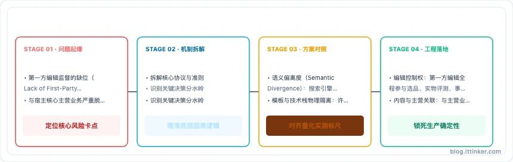
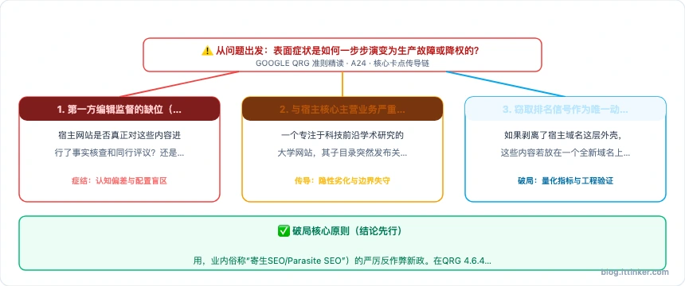
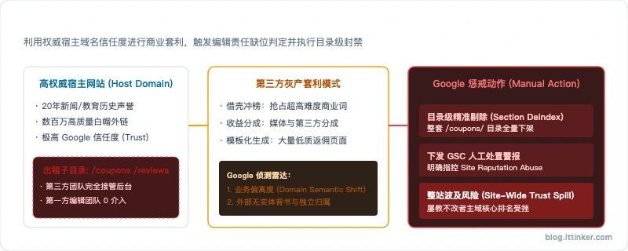
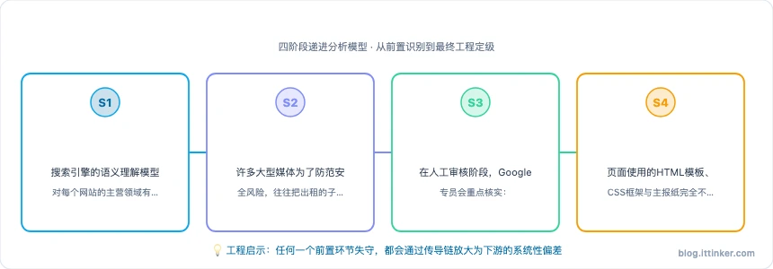
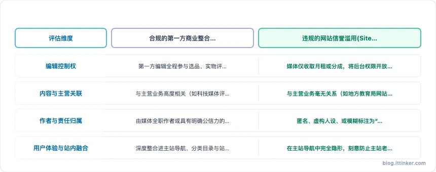
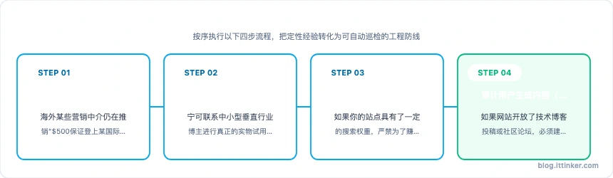

# Site Reputation Abuse：为什么“大站寄生 SEO”在 Google 新政下越来越危险？ | 读懂 Google Search 基础认知 系列 024

> 🌐 **在线阅读与互动版**：[Site Reputation Abuse：为什么“大站寄生 SEO”在 Google 新政下越来越危险？ | 读懂 Google Search 基础认知 系列 024](https://blog.ittinker.com/posts/site-reputation-abuse-为什么-大站寄生-seo-在-google-新政下越来越危险/)
> 📚 **所属专栏**：[《读懂 Google Search：110篇搜索质量与SEO实战指南》](../README.md)

---

### 📌 结论先行（TL;DR）
**Google 在 2024 年 5 月正式开始执行针对 **Site Reputation Abuse（网站信誉滥用，业内俗称“寄生 SEO / Parasite SEO”）** 的严厉反作弊新政。**

1. 在 QRG 4.6.4 中，核心违规定义非常明确：**“第三方在第一方高权重网站上发布内容，而第一方网站几乎没有实质性的编辑监督或直接参与，其主要意图在于利用第一方站点的搜索排名信号获取不正当竞争优势”**。
2. 过去通过向大型新闻媒体或大学租赁子目录、批量发布高佣金博彩或评测页面的暴利时代已经终结。
3. 无论采用何种白标包装，只要第一方主体未能承担严格的编辑责任，该子目录甚至整个主域名都会遭遇 Google 的精准降权与人工处置（Manual Action）。

在出海搜索营销领域，“寄生 SEO（Parasite SEO）”曾被部分灰帽团队视为稳赚不赔的流量印钞机。

其操作手法十分典型：
- 小型独立站由于域名权重积累缓慢，难以在“Best credit cards”、“Best VPN”或“Online casino”等竞争激烈的商业大词上抢夺前排位置；
- 某些团队转而寻找具有极高权重、拥有数十年历史的权威媒体（例如知名国际报业、门户新闻网、教育机构）；
- 通过与媒体的商业拓展部门签订赞助协议，租用这些大站的一个独立子目录（例如 `news.com/coupons/` 或 `media.com/reviews/`）；
- 在该目录下由第三方团队批量发布商业评测与返佣链接，借助大站高达 DR 90+ 的天然信誉，在几天内将关键词推上 Google 首页。

然而，这种将公共权威出租给流量掮客的模式，直接破坏了搜索结果的公平性。

2024 年 5 月 6 日，Google 正式启动了对 Site Reputation Abuse 的人工惩罚浪潮，包括多份国际顶尖媒体的优惠券与导购子频道在内的海量寄生页面，在 48 小时内被连根拔起。

---

## 1. 拆解 QRG 4.6.4：Site Reputation Abuse 的官方判定准则

在 Google 垃圾内容政策与 QRG 4.6.4 中，Google 对网站信誉滥用进行了极其详尽的界定：

> *"Site reputation abuse is when third-party pages are published with little or no first-party oversight or involvement, where the purpose is to manipulate search rankings by taking advantage of the first-party site's ranking signals."*
>
> *"Such third-party pages include sponsored, partner, or other third-party pages that are typically independent of a host site's main purpose or produced without close oversight or involvement of the host site, and provide little or no value to users."*
>
> *"We do not consider typical first-party advertising or affiliate programs that are closely vetted and integrated by the host site to be a violation."*

从官方准则中，可以提炼出判定寄生违规的三大核心判定维度：

1. **第一方编辑监督的缺位（Lack of First-Party Oversight）**：宿主网站是否真正对这些内容进行了事实核查和同行评议？还是仅仅提供了一个后台账号，任由第三方通过 API 自动化发布？
2. **与宿主核心主营业务严重脱节（Independence from Host's Main Purpose）**：一个专注于科技前沿学术研究的大学网站，其子目录突然发布关于“哪款减肥药效果最好”的商品导购；一家地方都市报纸，其二级目录充斥着离岸加密货币杠杆交易指南。这种强烈的领域割裂是判定的显著特征。
3. **窃取排名信号作为唯一动力（Manipulative Motive）**：如果剥离了宿主域名这层外壳，这些内容若放在一个全新域名上根本无法获得任何排名，说明其完全依赖宿主站点的声誉光环进行套利。

---

## 2. 寄生 SEO 的运作链条与 Google 精准打击模型

为了看清这类行为为何必然招致算法与人工审核的双重打击，以下矢量图展示了寄生链条的运作与 Google 的拦截逻辑：

---

## 3. Google 算法与审核员如何识别“寄生行为”？

很多运营人员好奇：既然页面部署在大站自身的域名下，使用的是大站的证书和 CDN，Google 到底凭什么判定它是“缺乏第一方监督的寄生内容”？

在真实审查流程中，以下特征几乎无所遁形：

### 1. 语义偏离度（Semantic Divergence）
搜索引擎的语义理解模型对每个网站的主营领域有精准的主题画像（Topic Profile）。
当一个长期聚焦于“计算机软件工程与开源技术”的站点，其某个目录突然高频涌现“线上体育博彩”、“低息免征信贷款”或“减肥胶囊对比”时，算法内部的语义一致性得分会发生剧烈异常漂移。

### 2. 模板与技术栈物理隔离
许多大型媒体为了防范安全风险，往往把出租的子目录部署在完全独立的第三方服务器上：
- 页面使用的 HTML 模板、CSS 框架与主报纸完全不一致；
- 页面的作者署名、评论组件均连接到第三方的外部数据库；
- 站内的主导航栏（Header）甚至刻意不包含通往该子目录的入口，该目录唯一的流量来源就是外部搜索引擎。

这种“在站内像孤岛、在站外却拼命抢词”的异常拓扑，是自动化反作弊系统的重点捕获目标。

### 3. 第一方审查证据缺失
在人工审核阶段，Google 专员会重点核实：
- 文章末尾是否有大站全职编辑团队的真实审校记录？
- 遇到产品争议或法律纠纷时，大站的公关与法务团队是否能够代表该页面做出正式答复？
- 页面是否存在排他性的单一商业联盟属性？

如果答案全是否定的，判定为 Site Reputation Abuse 毫无争议。

---

## 4. 合规商业合作 vs 违规寄生 SEO 全景对照

并非所有与第三方的商务合作都被禁止。清楚界定合规商业内容与违规寄生的界限如下：

| 评估维度 | 合规的第一方商业整合 (Legitimate Content) | 违规的网站信誉滥用 (Site Reputation Abuse) |
|---|---|---|
| **编辑控制权** | 第一方编辑全程参与选品、实物评测、事实核查与排版发布 | 媒体仅收取月租或分成，将后台权限开放给第三方自由批量发布 |
| **内容与主营关联** | 与主营业务高度相关（如科技媒体评测无线降噪耳机） | 与主营业务毫无关系（如地方教育局网站发布赌博优惠券） |
| **作者与责任归属** | 由媒体全职作者或具有明确公信力的特约专业作家署名 | 匿名、虚构人设、或模糊标注为“Sponsored Agency Network” |
| **用户体验与站内融合** | 深度整合进主站导航、分类目录与站内搜索系统中 | 在主站导航中完全隐形，刻意防止主站老读者发现，纯为搜索爬虫存在 |
| **利益声明** | 显眼位置清晰标注推广关系，链接包含 `rel="sponsored"` 属性 | 试图隐瞒商业赞助实质，甚至企图伪装成严肃新闻调查报道 |
| **Google 处理方式** | 视为正常内容，依靠质量与实用性指标正常打分竞争 | 下发 Site Reputation Abuse 人工处置，强行从索引库批量剔除 |

---

## 5. 出海团队双重视角安全防御 Checklist

对于出海独立团队与技术人员，理解这一政策需要兼顾“作为买方”与“作为站长”的两种视角：

### 视角一：作为出海营销买方（避免白费预算）
- [ ] **终止购买大站寄生外链或软文包**：海外某些营销中介仍在推销“$500 保证登上某国际大报子目录”的服务。在当前高压监管下，此类页面生命周期极短，随时面临被整批拔除，投入的资金与外链资产会彻底归零。
- [ ] **投资于正规独立公关与自然评测**：宁可联系中小型垂直行业博主进行真正的实物试用与真实发声，也不要在无监督的寄生栏目上投机取巧。

### 视角二：作为出海站点所有者（保护自身域名资产）
- [ ] **严格管控子域名与子目录权限**：如果你的站点具有了一定的搜索权重，严禁为了赚取所谓“被动赞助费”而将子目录（如 `/coupons/`）出租给第三方代运营。
- [ ] **审计用户生成内容（UGC）与客座投稿**：如果网站开放了技术博客投稿或社区论坛，必须建立人工审核流程。严禁放行带有明显商业导流意图的低质外链文章。
- [ ] **技术隔离与 `rel="nofollow"` 兜底**：站内所有来自外部商业合作的内容，外链必须强制加上 `rel="sponsored"` 或 `rel="nofollow"`，防止算法将这些外链判定为付费链接作弊。

---

## 下一篇预告

无论是买过期老域名借权，还是租用权威大站二级目录寄生，其底层动机都是为了“逃避从零开始积累信任的漫长工程”。

而另一种在技术层面更具普遍性、几乎每个出海独立开发者都曾考虑过的方式，则是利用现代 AI 大模型的高并发生成能力，在短时间内铺设几千乃至几万个长尾关键词页面。

这种所谓的“Programmatic SEO（程序化 SEO）”到底什么时候是创新工具，什么时候会触犯 Google 的**规模化内容滥用（Scaled Content Abuse）**死罪？

下一篇，我们将深入拆解 QRG 4.6.5：**[Scaled Content Abuse：AI 批量生成内容真正危险在哪里？Google 打击规模化滥用的底层逻辑（A25）](/posts/scaled-content-abuse-ai-批量生成内容真正危险在哪里/)**。

---

_这是「读懂 Google Search」系列第 24 篇，系统拆解 Google 官方质量指南，帮你建立长期抗算法波动的出海 SEO 护城河。_

---

## 读懂 Google Search 专栏导航

> 📚 **专栏收录**：本文为 [《读懂 Google Search：110篇搜索质量与SEO实战指南》](/posts/google-search-guide/) 第 **A24** 篇。

* **专栏主页**：[《读懂 Google Search：110篇搜索质量与SEO实战指南》全景地图与路线图](/posts/google-search-guide/)
