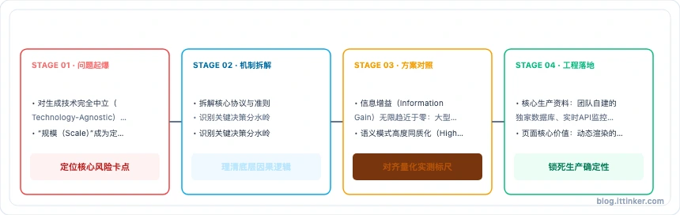
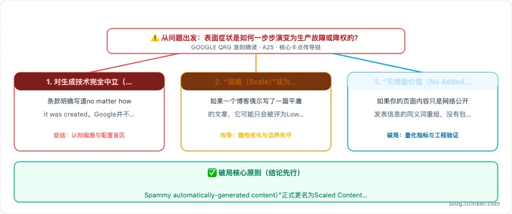
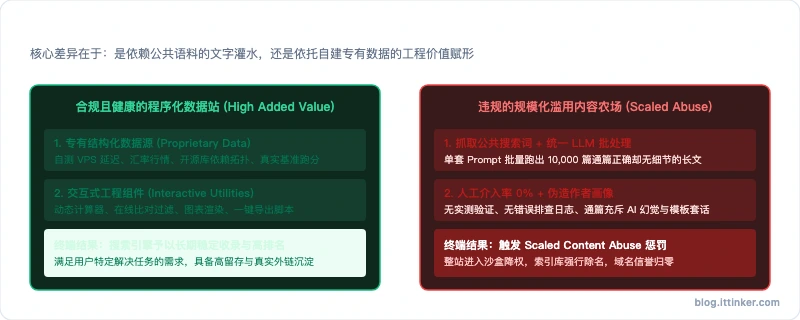
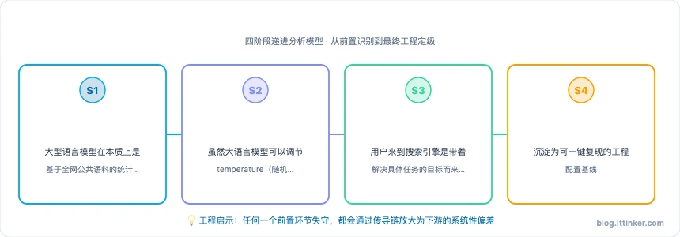
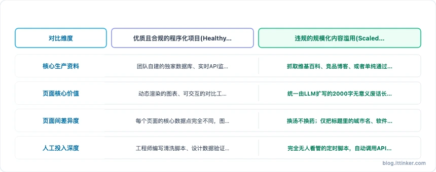
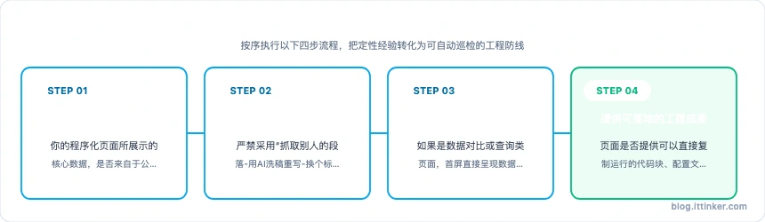

# “排版花哨就是专业”？中等质量（Medium PQ）的天花板在哪？ | 读懂 Google Search 基础认知 系列 025

> 🌐 **在线阅读与互动版**：[“排版花哨就是专业”？中等质量（Medium PQ）的天花板在哪？ | 读懂 Google Search 基础认知 系列 025](https://blog.ittinker.com/posts/scaled-content-abuse-ai-批量生成内容真正危险在哪里/)
> 📚 **所属专栏**：[《读懂 Google Search：110篇搜索质量与SEO实战指南》](../README.md)

---

### 📌 结论先行（TL;DR）
> **Google 在 2024 年 3 月将反作弊政策中的条款从早期的“自动化生成垃圾内容（Spammy automatically-generated content）”正式更名为 **Scaled Content Abuse（规模化内容滥用，QRG 4.6.5）**。**
> **在大语言模型（LLM）与生成式 API 席卷全球后，出海社区中涌现出大量类似的暴富神话：**
> **然而，随后的反转同样迅猛：在 2024 年的数次 Google 核心更新中，这批纯粹依靠模型自动批发的站点遭遇了系统性清洗。**
> **不仅关键词排名在几天内清零，很多域名的收录页面数量从数万页瞬间锐减为几个无足轻重的死链接。**
> **许多开发者困惑：“Google 官方不是公开表态过‘不反对使用 AI 辅助创作’吗？为什么我的 AI 生成页面还是被全盘拔除了？”**
> **答案就在 Google 官方反作弊规范 QRG 第 4.6.5 节中。**
>
> - **这一术语演进释放了清晰信号**：**Google 打击的核心从来不是“是否使用了 AI”，而是“不加节制的粗制滥造规模 + 极度匮乏的人工投入 + 毫无增益价值 + 旨在操纵排名的第一动机”**。
> - 无论内容是由大语言模型（LLM）高并发输出，还是雇佣廉价写手流水线拼接，只要缺乏独家数据与工程增量，盲目批量起站必然招致全站降权。
> - 开展程序化 SEO（Programmatic SEO）的正确姿势，必须建立在“专有结构化数据与实用交互工具”之上。
> - **“写了一段 Python 脚本**：对接 OpenAI API，一天刷出 10,000 篇多语言对比文章；”
> - **“爬取竞品的所有功能列表**：用提示词批量重写，两周铺了 50,000 个长尾落地页；”
> - “借此在 30 天内收割了几十万月度搜索展示。”

---

### 🚨 2026 → 2024 官方最新风向预警：Google 对Google 针对规模化内容滥用（Scaled Content Abuse）的算法打击的策略演进

#### 🕒 2026 → 2024 Google 官方对Google 针对规模化内容滥用（Scaled Content Abuse）的算法打击的策略演进

- **2026 · 自动化工业级内容农场检测模型（Scaled Abuse Classifier）**
  算法不在乎内容是由 AI 还是廉价劳动力撰写，其监控重点在于‘生成规模是否远远超出合理价值交付速度’。日发上千篇但零增量价值的批量垃圾站被直接从索引库批量剔除。

- **2025 · 搜索生态环境大清洗（Web Ecosystem De-indexing）**
  Google 通过多轮核心更新，将数以千万计靠大模型批量制造的‘假原创、真注水’网页彻底除名，宣告规模化工业铺量时代的落幕。

- **2024 · 2024 年 3 月更新将‘规模化内容滥用’确立为核心政策**
  官方正式废止单一靠‘人工还是机器’的判定维度，将矛头彻底对准‘任何旨在操纵搜索排名而不提供真实价值的大规模内容生产’。

---

## 1. 拆解 QRG 4.6.5：从“自动化”到“规模化”的规则演进

在 QRG 4.6.5 与更新后的《Google 搜索反作弊政策》中，Google 彻底重构了该违规项的定性框架：

> *"Scaled content abuse is when many pages are generated for the primary purpose of manipulating search rankings and not helping users. This practice typically involves producing large amounts of unoriginal content that provides little to no value to users, no matter how it was created."*
>
> *"This includes, but is not limited to: Using generative AI tools or other similar tools to produce many pages without adding value for users; Scraping feeds, search results, or other content to generate many pages...; Stitching or combining content from different web pages without adding value."*

这套新规确立了三个关键认知：

1. **对生成技术完全中立（Technology-Agnostic）**：条款明确写道 `no matter how it was created`。Google 并不在乎文章是人类纯手打、AI 自动吐字、还是两者的混合产物。只要大量页面呈现出“低原创度、无增量价值、纯为抢排名”的特征，统统定性为 Scaled Abuse。
2. **“规模（Scale）”成为定性恶化的放大器**：如果一个博客偶尔写了一篇平庸的文章，它可能只会被评为 Low 或 Medium，并不构成违规。但如果你使用脚本将这种平庸复制了 5,000 份并推向公开索引库，这就对搜索引擎的爬取资源与用户体验造成了系统性破坏，性质立即上升为搜索作弊。
3. **“无增量价值（No Added Value）”是一票否决的关键**：如果你的页面内容只是网络公开发表信息的同义词重组，没有包含新的第一手测试、独家数据集或专业代码工程验证，它在算法眼里就是消耗存储成本的冗余垃圾。

---

## 2. 合规程序化 SEO vs 违规规模化内容滥用决策模型

并非所有批量生成页面的工程实践都会被封杀。区分优秀的程序化 SEO 与违规滥用的底层分水岭如下：

---

## 3. 为什么纯 AI 批量生成的文章必然在现代搜索体系中溃败？

很多技术人员容易把 SEO 视作纯粹的代码对抗。但在 Google 现代多模态语义与用户体验评估模型面前，纯 AI 灌水文章在底层逻辑上存在三大难以克服的硬伤：

### 1. 信息增益（Information Gain）无限趋近于零
大型语言模型在本质上是基于全网公共语料的统计概率补全机制。
当一个模型被要求撰写“如何在 Ubuntu 上配置 Nginx 反向代理”时，它输出的内容必定是全网已有 10 万篇教程中重合度最高的那部分常识。
Google 的专利《Information Gain Score》（信息增益评分）专门用于计算一个新页面相比搜索历史结果新增了多少独到信息。如果一篇文章读完后不能给用户带来任何超出已有前排结果的新事实、新数据或新代码修正，其信息增益分直接为零，根本无法进入高排名队列。

### 2. 语义模式高度同质化（High Semantic Monotony）
虽然大语言模型可以调节 `temperature`（随机度），但其在论证逻辑、段落承接与词汇搭配上存在极其清晰的统计学特征。
当一个站点连续发布几千篇由同一种提示词结构生产的文章时，反垃圾系统（SpamBrain）可以轻而易举从页面指纹中识别出高度机械化的生成印记。这无需人工阅读，纯粹依靠数学统计即可判定其属于流水线生产。

### 3. 真实用户微观体验的反噬
用户来到搜索引擎是带着解决具体任务的目标而来的。
当用户点击进入一篇由 AI 批量生成的文章，发现前四段全是在复述“Nginx 是一个非常优秀的高性能 Web 服务器，具有广泛的应用场景”，翻了两屏还没看到配置块代码时，用户的第一反应必然是点击浏览器的“后退”按钮，返回搜索结果重新选择其他页面。
这种高频发生的秒退行为（Pogosticking）会向搜索系统发送明确的负向质量信号，导致该页面的排名迅速滑向深渊。

---

## 4. 合规程序化开发 vs 违规规模滥用对比表

| 对比维度 | 优质且合规的程序化项目 (Healthy pSEO) | 违规的规模化内容滥用 (Scaled Content Abuse) |
|---|---|---|
| **核心生产资料** | 团队自建的独家数据库、实时 API 监控数据、结构化测评矩阵 | 抓取维基百科、竞品博客、或者单纯通过关键词工具导出的词表 |
| **页面核心价值** | 动态渲染的图表、可交互的对比工具、可直接运行的代码片段 | 统一由 LLM 扩写的 2000 字无意义废话长文，缺乏实质工具 |
| **页面间差异度** | 每个页面的核心数据点完全不同，图表与分析依据真实数值动态变化 | 换汤不换药；仅把标题里的城市名、软件名替换，主体段落高度雷同 |
| **人工投入深度** | 工程师编写清洗脚本、设计数据验证规则、专家抽检核心业务逻辑 | 完全无人看管的定时脚本，自动调用 API 生成后直接自动发布上线 |
| **用户访问动机** | 查阅具体的参数配置、对比具体的性能跑分、下载具体的适配配置 | 纯粹被长尾标题诱骗进入，发现页面没有任何可落地的操作指导 |
| **Google 长期态度** | 鼓励并收录；被视为高价值垂直工具（如航班查询、天气预报、代码手册） | 严厉打击；直接判定为 Scaled Content Abuse 垃圾农场并封禁 |

---

## 5. 出海开发者拥抱 AI 辅助与 pSEO 的安全规范 Checklist

AI 是一套极具生产力的技术杠杆，但只有把杠杆用在正确的位置上，才能构筑长期资产：

### 数据与资产独立性
- [ ] **是否拥有数据源独占性**：你的程序化页面所展示的核心数据，是否来自于公开搜索很难直接一览便知的一手数据（例如自研脚本跑出的各地区延迟、独家用户调研评分、或自研工具解析出的结构化参数）？
- [ ] **拒绝纯文字同义词替换**：严禁采用“抓取别人的段落 -> 用 AI 洗稿重写 -> 换个标题发布”的陈旧套路。这种行为已被明确纳入采集违规范畴。

### 页面实用性与交互设计
- [ ] **首屏直奔功能（MC First）**：如果是数据对比或查询类页面，首屏直接呈现数据对比表格或交互计算器，不要为了“凑 SEO 字数”而在顶部硬塞数百字毫无意义的 AI 概念解释。
- [ ] **提供可落地的工程成果**：页面是否提供可以直接复制运行的代码块、配置文件模板或一键下载资产？这些实打实的工程价值才是留住用户与赢得推荐的核心。

### 规模克制与质量监控
- [ ] **小规模灰度发布**：在部署程序化页面时，切忌第一天就向 Googlebot 提交 50,000 个 URL。先上线 50 到 100 个具备代表性的高质量页面，观察 Search Console 中的抓取频次、有效收录比例与跳出率表现。
- [ ] **建立人工抽检机制**：定期抽查程序化生成的页面，确认数据字段是否存在空值（`undefined` 或 `null`）、图表渲染是否正常、AI 润色的技术描述是否存在严重的事实性幻觉。

---

## 下一篇预告

在理清了规模化滥用（Scaled Content Abuse）的红线之后，许多认真撰写技术博客的开发者往往会提出更深层的工程疑问：

**“如果我不用脚本大批量狂刷页面，而是人工一篇篇写，但我参考了十几篇全网优秀资料，把它们精炼、翻译、改写并总结成一篇系统全面的长文，这样的‘深度综述’在 Google 眼里究竟算不算有 Added Value（增量价值）？改写与原创的边界到底在哪里？”**

下一篇，我们将深入拆解 QRG 4.6.6 与 4.6.7：**[“把 Top 10 文章洗一遍拼成大作”？毫无意义的洗稿拼贴：QRG 4.6 为什么判定改写与总结依然是‘零增量价值’？（A26）](/posts/改写-总结-拼接为什么可能仍然没有-added-value/)**。

---

_这是「读懂 Google Search」系列第 25 篇，系统拆解 Google 官方质量指南，帮你建立长期抗算法波动的出海 SEO 护城河。_

---

## 读懂 Google Search 专栏导航

> 📚 **专栏收录**：本文为 [《读懂 Google Search：110篇搜索质量与SEO实战指南》](/posts/google-search-guide/) 第 **A25** 篇。

* **专栏主页**：[《读懂 Google Search：110篇搜索质量与SEO实战指南》全景地图与路线图](/posts/google-search-guide/)
