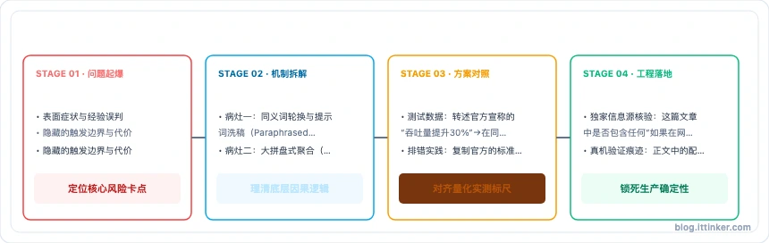
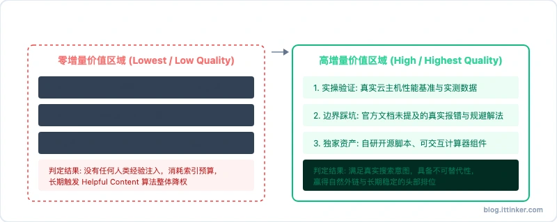
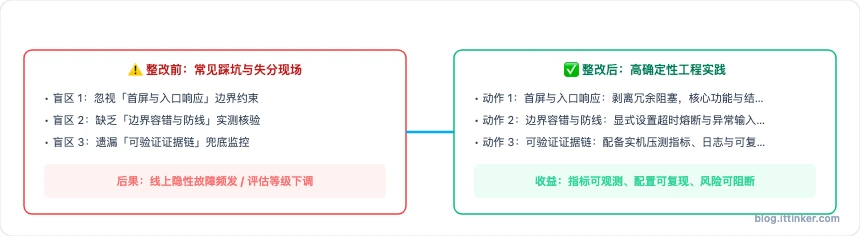
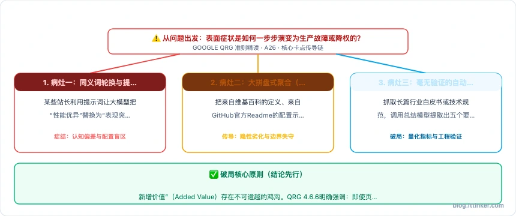
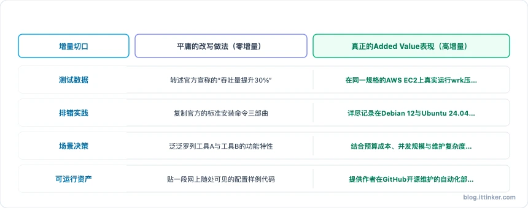
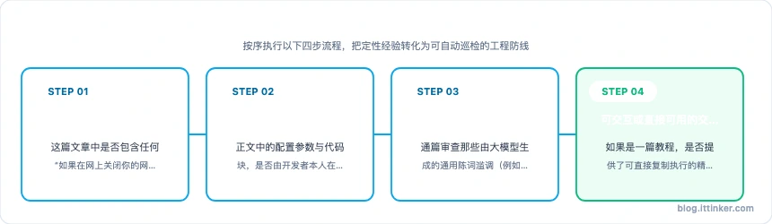

# “把 Top 10 文章洗一遍拼成大作”？毫无意义的洗稿拼贴：QRG 4.6 为什么判定改写与总结依然是‘零增量价值’？ | 读懂 Google Search 基础认知 系列 026

> 🌐 **在线阅读与互动版**：[“把 Top 10 文章洗一遍拼成大作”？毫无意义的洗稿拼贴：QRG 4.6 为什么判定改写与总结依然是‘零增量价值’？ | 读懂 Google Search 基础认知 系列 026](https://blog.ittinker.com/posts/改写-总结-拼接为什么可能仍然没有-added-value/)
> 📚 **所属专栏**：[《读懂 Google Search：110篇搜索质量与SEO实战指南》](../README.md)

---

### 📌 结论先行（TL;DR）
> **在 Google 的内容评估逻辑中，**“信息加工”（Information Repackaging）和“新增价值”（Added Value）存在不可逾越的鸿沟**。**
> **在大语言模型被广泛调用的今天，很多出海站长摸索出了一套自以为高效的流水线：**
> **输入一个目标关键词，抓取 Google 搜索结果排名前五的页面，把它们喂给 AI 提示词：“请将以上内容融会贯通，提取核心观点，重新组织语言，写成一篇结构更加完整、字数更充沛的综合指南”。**
> **不到一分钟，一篇拥有 3000 字、小标题规整、排版干净的文章就诞生了。**
> **许多站长误以为这就是“优质原创”。**
> **然而在 Google 质量评估员与算法系统的审查下，这类文章往往被毫不留情地标记为：**缺乏增量价值的派生内容（Copied Content with Little or No Added Value）**。**
> **要跳出这种“虚假勤奋”的陷阱，我们必须回到 QRG 4.6 节，看看 Google 是如何划定信息搬运与真实创作的界限的。**
>
> - **QRG 4.6.6 明确强调**：即使页面上的文字没有直接逐字复制，而是通过同义词替换、多源摘要整合、跨语言翻译或套用自动化模板拼凑而成，只要它没有为搜索用户提供超越既有信息源的新事实、新测试、新结论或独到洞见，该内容就会被判定为“Little or No Added Value”，直接被打入 Lowest 或 Low Quality。
> - **长篇大论的洗稿文字不仅换不来长期排名**：反而会在 Helpful Content 算法迭代中迅速触发整站降权。

---

### 🚨 2026 → 2024 官方最新风向预警：Google 对Google 对洗稿拼接、AI 总结与缺少 Added Value 的识别演进的策略演进

#### 🕒 2026 → 2024 Google 官方对Google 对洗稿拼接、AI 总结与缺少 Added Value 的识别演进的策略演进

- **2026 · 信息增量衰减检测（Information Entropy & Incremental Value Analysis）**
  Google 算法对网页中包含的‘新信息节点’进行熵值测算。凡是与已索引的 Top 10 结果信息完全重合、仅仅做了同义词替换或语序重排的页面，被直接判定为‘零增量价值（Zero Added Value）’并丢入收录垃圾箱。

- **2025 · 洗稿工具特征指纹识别**
  算法精准识别主流‘伪原创’、‘改写降重’工具生成的内容特征，破除只要相似度低于特定阈值就能蒙混过关的侥幸心理。

- **2024 · QRG 4.6 节对‘零实质价值抄袭与总结’的判定标准**
  指引明确指示评估员：即使作者花费了大量时间去拼凑多篇现有文章，只要整篇内容没有贡献任何独特的见解、实测或新结论，其评级必须定为 Low。

---

## 1. 拆解 QRG 4.6.6：什么叫“缺乏新增价值”？

在 QRG 第 4.6.6 节《Copied Content with Little or No Added Value》中，Google 列出了极其直白的判据：

> *"Content which is copied or derived with little or no added value from other sources, including: content that is slightly modified (e.g., automated paraphrasing or replacing words with synonyms), content that is aggregated from multiple sources with little or no original thought, or automated summaries that do not add new insight."*

Google 在指南中反复强调一个词：**Derived（派生性）**。

在搜索引擎的知识图谱中，互联网不需要第一万篇雷同的“Docker 安装步骤”，也不需要第一千篇从官方文档摘抄命令并用花哨副词包装的“新手进阶教程”。

用户来到 Google 检索，是为了获取能够解决特定阻碍的具体方案，或者是为了对比真实客观的第一手评测。如果你的页面仅仅是现有网页的语义重述，那么用户阅读你的页面，相比直接阅读被你改写的那篇原网页，**没有获得哪怕一丁点新增的真实收益**。

---

## 2. 伪原创的四种典型病灶

在出海技术站点与联盟营销站中，缺乏增量价值的搬运主要表现为以下四种形态：

### 病灶一：同义词轮换与提示词洗稿（Paraphrased Content）
某些站长利用提示词让大模型把“性能优异”替换为“表现突出”，把“高可用架构”重写为“具备冗余容灾能力的拓扑体系”。整篇文字看起来句子通顺、语法优美，但每一段所表达的实质信息点，与被洗的目标文章分毫不差。这种缺乏事实演进的重写，会被算法语义向量比对系统迅速识破。

### 病灶二：大拼盘式聚合（Stitched Aggregation）
把来自维基百科的定义、来自 GitHub 官方 Readme 的配置示例，以及来自某篇高赞博客的使用心得，像拼积木一样拼成一篇文章。页面上没有任何属于作者本人的思考，甚至没有统一的代码格式与运行环境说明。在 QRG 体系中，这类聚合如果不包含作者对多源信息的独家提炼、纠错与归纳，依然属于 Lowest。

### 病灶三：毫无验证的自动摘要（Automated Summaries）
抓取长篇行业白皮书或技术规范，调用总结模型提取出五个要点制成文章。如果总结出来的五个要点脱离了原文的数据支撑，甚至在概括过程中产生了幻觉（Hallucinations），就会直接演变为 QRG 4.6.7 所定义的“错误误导性内容”，面临毁灭性降权。

### 病灶四：机械式模板 pSEO（Template programmatic SEO）
通过脚本读取一份包含 500 个城市的名单，套入同一个模板：“如何在 [城市名] 快速搭建高可用网站”，除了地名不同，中间的命令、配置和说明文字一模一样。这种批量复制模板缺乏对不同地区网络基础设施的真实调研，属于典型的垃圾规模化滥用（Scaled Content Abuse）。

---

## 3. 产生真正 Added Value 的五大破局切口

对于出海独立开发者而言，要彻底告别这种毫无排位竞争力的信息加工，必须在每一篇技术内容中注入坚实的增量资产：

| 增量切口 | 平庸的改写做法（零增量） | 真正的 Added Value 表现（高增量） |
|---|---|---|
| **测试数据** | 转述官方宣称的“吞吐量提升 30%” | 在同一规格的 AWS EC2 上真实运行 wrk 压测，放出完整的压测命令、延迟分位数对比表格与硬件负载图 |
| **排错实践** | 复制官方的标准安装命令三部曲 | 详尽记录在 Debian 12 与 Ubuntu 24.04 上执行报错时的日志片段，并给出修改内核参数或解决端口冲突的具体指令 |
| **场景决策** | 泛泛罗列工具 A 与工具 B 的功能特性 | 结合预算成本、并发规模与维护复杂度，给出清晰的二选一选型逻辑树与生产环境避坑建议 |
| **可运行资产** | 贴一段网上随处可见的配置样例代码 | 提供作者在 GitHub 开源维护的自动化部署脚本一键命令，或者嵌入可即时计算的在线参数配置生成器 |
| **纠错与去伪** | 照搬老旧博客中已经过期的危险配置 | 指出社区流传脚本中导致内存泄漏的致命参数，解释官方在最新补丁中的弃用原因并给出推荐替代方案 |

---

## 4. 独立开发者的“增量价值”自查工程

在将内容发布到站点之前，请对照以下清单逐一排查。只要文章没有通过这些核心关卡，就坚决不要上线：

- [ ] **独家信息源核验**：这篇文章中是否包含任何“如果在网上关闭你的网页，用户在别处就绝对查不到”的第一手数据、独创脚本或排错结论？
- [ ] **真机验证痕迹**：正文中的配置参数与代码块，是否由开发者本人在干净的环境中完整跑通了一次？是否存在未经复现的盲猜段落？
- [ ] **消灭正确废话**：通篇审查那些由大模型生成的通用陈词滥调（例如“在软件工程中稳定性十分关键”），坚决将其删减，把篇幅全部留给命令和参数。
- [ ] **可交互或直接可用的交付物**：如果是一篇教程，是否提供了可直接复制执行的精简命令集？如果是一个对比分析，是否有对比鲜明的对照表？
- [ ] **诚实的引用披露**：如果部分数据引用了官方白皮书或第三方权威机构，是否准确给出了源头出处，并在其基础上提出了自己的交叉验证成果？

---

## 下一篇预告

理解了零增量内容的致命危险后，我们开始进入 QRG 的具体质量等级体系。

很多开发者常常困惑：**“我的文章虽然算不上旷世巨著，但我绝对没有作弊、没有洗稿、没有挂马，为什么在 Google 评估体系中依然拿不到及格分，甚至被评为 Low Quality？”**

答案在于：**Low Quality 往往不是作恶，而只是“不够好”**。

下一篇，我们将深入剖析低质量页面的六大典型病灶：**[“我的内容不是垃圾怎么没有排名”？普通平庸的慢性死亡：QRG 5.0 告诉你，Low Quality 往往只是因为‘不够好’（A27）](/posts/low-quality-页面往往不是垃圾-只是-不够好/)**。

---

_这是「读懂 Google Search」系列第 26 篇，系统拆解 Google 官方质量指南，帮你建立长期抗算法波动的出海 SEO 护城河。_

---

## 读懂 Google Search 专栏导航

> 📚 **专栏收录**：本文为 [《读懂 Google Search：110篇搜索质量与SEO实战指南》](/posts/google-search-guide/) 第 **A26** 篇。

* **专栏主页**：[《读懂 Google Search：110篇搜索质量与SEO实战指南》全景地图与路线图](/posts/google-search-guide/)
