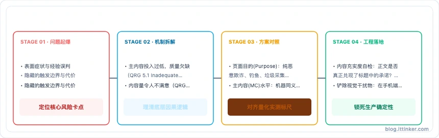
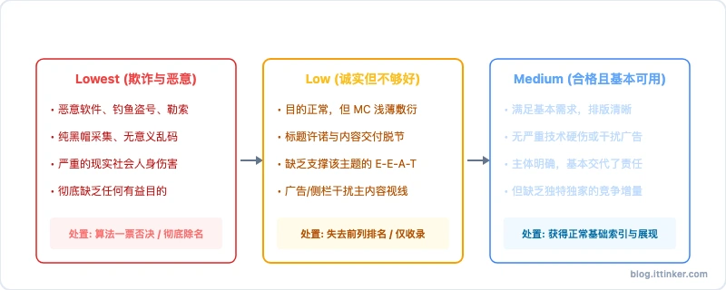
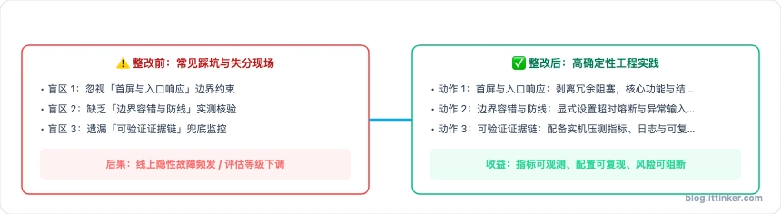
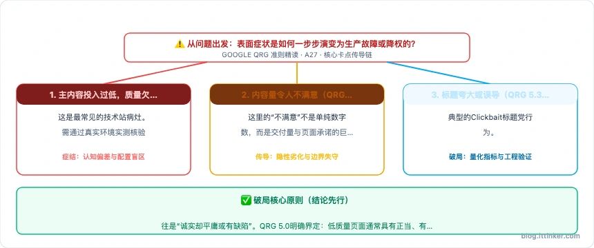
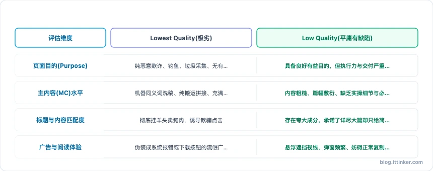
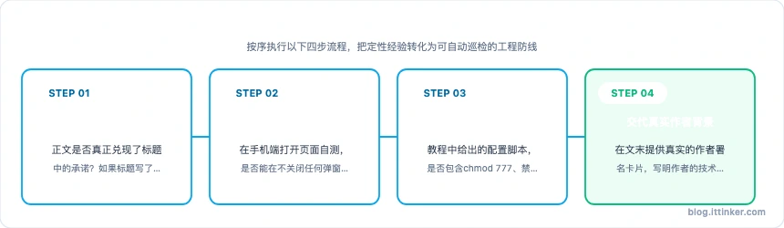

# “我的内容不是垃圾怎么没有排名”？普通平庸的慢性死亡：QRG 5.0 告诉你，Low Quality 往往只是因为‘不够好’ | 读懂 Google Search 基础认知 系列 027

> 🌐 **在线阅读与互动版**：[“我的内容不是垃圾怎么没有排名”？普通平庸的慢性死亡：QRG 5.0 告诉你，Low Quality 往往只是因为‘不够好’ | 读懂 Google Search 基础认知 系列 027](https://blog.ittinker.com/posts/low-quality-页面往往不是垃圾-只是-不够好/)
> 📚 **所属专栏**：[《读懂 Google Search：110篇搜索质量与SEO实战指南》](../README.md)

---

### 📌 结论先行（TL;DR）
> **在 Google 的评分体系中，**Lowest Quality 是“恶意与欺诈”，而 Low Quality 往往是“诚实却平庸或有缺陷”**。**
> **在很多站长的观念里，质量评估只有两个极端：要么是排名第一的优质神作，要么就是挂马、搞黑产的垃圾站点。**
> **当他们看到自己的独立站长期收录缓慢、核心关键词徘徊在搜索结果第五页开外时，常常满腹委屈：**
> **“我用的都是自己写的合法代码，服务器配置很高，没有放弹窗广告，也没有做黑帽外链，Google 凭什么不给我流量？”**
> **打开 Google 官方质量指南 QRG 第 5.0 节，答案一目了然：**你的网页没有作恶，但它落入了“Low Quality（低质量）”的泥潭**。**
> **在 Google 的量尺上，Low Quality 对应的不是罪大恶极的垃圾，而是**“不够好（Just Not Good Enough）”**。**
>
> - **QRG 5.0 明确界定**：低质量页面通常具有正当、有益的目的，既没有散播恶意软件，也没有实施钓鱼诈骗，但它们因为“主内容粗糙、内容量令人不满、广告干扰阅读、缺乏专业资质（Inadequate E-E-A-T）或主体信誉轻度受损”，导致无法让用户感到满意。
> - **对于独立开发者来说**：最危险的往往是掉入 Low Quality 的温水煮青蛙陷阱——自以为做了一个正常的合规页面，却因为细节打磨不到位，被算法归类为“不够好”而长期得不到展现。

---

### 🚨 2026 → 2024 官方最新风向预警：Google 对Google 页面质量评估对 Low Quality 阈值的持续提高的策略演进

#### 🕒 2026 → 2024 Google 官方对Google 页面质量评估对 Low Quality 阈值的持续提高的策略演进

- **2026 · ‘平庸即淘汰’搜索供需法则全面显现**
  在内容极度泛滥的时代，Google 搜索展现资源高度收敛。即便内容毫无违规、排版工整，但只要缺乏深入度和独特体验，算法直接将其归入低质量（Low Quality）区间，不再给予有效排名。

- **2025 · 任务交付阻滞与阅读疲劳监测**
  算法结合真实访客跳出率与滑动交互，精准捕捉那些‘文字冗长却始终讲不到重点’的半生不熟内容，实施温水煮青蛙式的排名滑落。

- **2024 · QRG 第 5 章 Low Quality 的典型病灶画像公布**
  条款详细剖析了包括‘MC 投入不足’、‘标题夸大失实’、‘辅助内容分散注意力’等常见病因，警示站长‘不做坏事’不等于‘能拿好排名’。

---

## 1. 拆解 QRG 5.0：低质量页面的官方定义

QRG 第 5.0 节《Low Quality Pages》给出了极其精确的定位：

> *"Low quality pages may have been created for a beneficial purpose... However, low quality pages are unsatisfying or lack an appropriate level of quality for their purpose."*

Google 强调，低质量页面的创作者往往是抱着服务用户的良好初衷去制作页面的。问题出在**执行力与交付成果的严重失准**。

评估员在判断 Low Quality 时，遵循“木桶原理”：只要页面在主内容、经验资质、排版体验或主体透明度中存在任何一个显著的短板，即使其他方面中规中矩，该页面也会被直接定级为 Low。

---

## 2. 深度拆解 QRG 5.1 至 5.6：低质量页面的六大典型病灶

在 QRG 指南中，Google 详细列举了将一个网页宣判为 Low Quality 的六大主要病灶。出海开发者可以对照自己的项目进行深度对齐：

### 1. 主内容投入过低，质量欠缺（QRG 5.1 Inadequate Quality of Main Content）
这是最常见的技术站病灶。
虽然作者确实想解答某个技术问题，但正文写得极其潦草。例如写一篇《Nginx 反向代理配置》，正文只有三行未经解释的指令配置，既没有交代具体的运行环境（Debian 还是 Alpine），也没有说明端口监听冲突该如何排查。页面虽然有答案，但读者执行起来处处碰壁。Google 认为这种内容缺乏足够的工程心智投入（Lack of Effort）。

### 2. 内容量令人不满意（QRG 5.2 Unsatisfying Amount of Main Content）
这里的“不满意”不是单纯数字数，而是**交付量与页面承诺的巨大落差**。
如果一个页面的标题写着《2026 年最具性价比出海云服务器终极选型评测》，读者期待看到的是横跨 AWS、Hetzner、DigitalOcean、Vultr 等多个机房的详尽价格阶梯、网络延迟及磁盘 I/O 实测表格；然而点进页面，作者只写了 200 字，泛泛提及“某某云挺便宜的”，并直接附上推广链接。这种严重的期待落差会被评估员直接打入 Low。

### 3. 标题夸大或误导（QRG 5.3 Exaggerated or Shocking Title）
典型的 Clickbait 标题党行为。
标题宣称“一条命令彻底解决跨域 CORS 报错”，而正文给出的解法居然是在服务器全局开启 `Access-Control-Allow-Origin: *`。这种不仅没有解决生产环境安全限制，反而带来严重安全漏洞的夸大交付，会被判定为缺乏基本专业度。

### 4. 辅助内容与广告过度干扰（QRG 5.4 Distracting Ads or SC）
用户在移动端打开页面，首屏完全被一个固定悬浮的广告大横幅占据；向下滚动两屏，正文中间穿插着闪烁的动态 GIF 推荐图；当用户试图复制终端命令时，突然弹出一个遮罩询问是否订阅新闻信（Newsletter）。虽然网站内容本身写得还可以，但由于广告和辅助组件严重妨碍了核心内容的获取，页面整体评分会被强制拖入 Low。

### 5. 缺乏足以支撑该主题的资质（QRG 5.5 Inadequate E-E-A-T）
当页面涉及需要一定专业门槛的主题时，作者却交不出任何信誉凭证。
例如写一篇关于“跨境 SaaS 架构如何通过欧盟 GDPR 隐私合规审计”的指南，文章署名是一个刚刚注册两天的匿名小号，正文充满了模棱两可的外行推测，没有任何持牌数据保护官（DPO）或资深合规架构师的审核痕迹。在 Google 看来，这种缺乏资质的输出是对读者的潜在伤害。

### 6. 主体与客服信息模糊缺失（QRG 5.6 Inadequate Website Information）
一个售卖技术开发模板的小型商城，用户在购买前找遍了页眉页脚，找不到运营该商城的团队信息，没有退款申请说明，联系方式只有一个永远不会弹窗的网页客服挂件。这种对用户缺乏基本交代的主体透明度缺失，即使代码模板本身能用，页面也会被评定为 Low。

---

## 3. 维度对照表：Lowest、Low 与 Medium 的判定分水岭

为了在开发与撰写过程中建立清晰的质量雷达，我们将三者的界限汇总如下：

| 评估维度 | Lowest Quality (极劣) | Low Quality (平庸有缺陷) | Medium Quality (合格正常) |
|---|---|---|---|
| **页面目的 (Purpose)** | 纯恶意欺诈、钓鱼、垃圾采集、无有益目的 | 具备良好有益目的，但执行力与交付严重打折 | 目的清晰明确，较好地完成了预定任务 |
| **主内容 (MC) 水平** | 机器同义词洗稿、纯搬运拼接、充满事实谎言 | 内容粗糙、篇幅敷衍、缺乏实操细节与必要解释 | 内容完整准确，提供了标准答案与基础说明 |
| **标题与内容匹配度** | 彻底挂羊头卖狗肉，诱导欺骗点击 | 存在夸大成分，承诺了详尽大篇却只给简陋短文 | 标题准确平实，所见即所得，承诺与交付一致 |
| **广告与阅读体验** | 伪装成系统报错或下载按钮的流氓广告 | 悬浮遮挡视线、弹窗频繁、妨碍正常复制代码 | 广告边界分明，不打断阅读，排版清晰规整 |
| **E-E-A-T 资质表现** | 伪造专业履历、冒充权威机构或知名专家 | 涉及专业主题但作者毫无实操背景或背景空白 | 作者具备相应领域的日常经验或公开实操档案 |
| **主体透明度与保障** | 刻意隐匿所有信息，随时准备跑路闭站 | 缺乏退款流程指引，联系表单难以确认有效性 | 提供清晰的关于页、可用邮箱与合理的响应时限 |

---

## 4. 独立开发者告别 Low Quality 的六项自救清单

如果你的独立站或工具页面正在面临流量停滞，请立刻对照以下清单排查并修正你的页面病灶：

- [ ] **内容充实度自检**：正文是否真正兑现了标题中的承诺？如果标题写了“深度实战”，正文是否给出了完整的环境依赖、命令参数和运行结果？
- [ ] **铲除视觉干扰物**：在手机端打开页面自测，是否能在不关闭任何弹窗的情况下，直接阅读首屏核心正文？如果不能，果断移除首屏全屏遮罩。
- [ ] **剔除代码中的安全隐患**：教程中给出的配置脚本，是否包含 `chmod 777`、禁用防火墙或跨域通配符等危险操作？若有，必须补充说明风险原因与生产级加固方案。
- [ ] **交代真实作者背景**：在文末提供真实的作者署名卡片，写明作者的技术栈与踩坑经历，避免使用“Admin”或匿名发布。
- [ ] **补齐主体与合规链路**：页脚是否清晰挂出了真实运营者介绍（About）与有效联络渠道（Contact）？
- [ ] **消灭不可达的死链**：排查正文引用与侧边栏推荐中是否存在打不开的 404 链接，修复破损的交互按钮。

---

## 下一篇预告

克服了 Low Quality 的六大病灶后，你的网页将顺利跃升到及格线以上。

但紧接着，你将面临一个更加普遍的现实：**“为什么我的网页既没有扣分项，排版也很规范，但在搜索排名中依然被淹没在第二页、第三页？为什么绝大多数合规的网页，在 Google 眼里都仅仅只是 Medium？”**

下一篇，我们将探讨大多数网页都会陷入的瓶颈：**[“大部分网站为什么卡在及格线”？不上不下的中庸困局：QRG 6.0 深度解构 Medium 质量的真实边界（A28）](/posts/为什么互联网上大多数正常网页其实都只是-medium/)**。

---

_这是「读懂 Google Search」系列第 27 篇，系统拆解 Google 官方质量指南，帮你建立长期抗算法波动的出海 SEO 护城河。_

---

## 读懂 Google Search 专栏导航

> 📚 **专栏收录**：本文为 [《读懂 Google Search：110篇搜索质量与SEO实战指南》](/posts/google-search-guide/) 第 **A27** 篇。

* **专栏主页**：[《读懂 Google Search：110篇搜索质量与SEO实战指南》全景地图与路线图](/posts/google-search-guide/)
