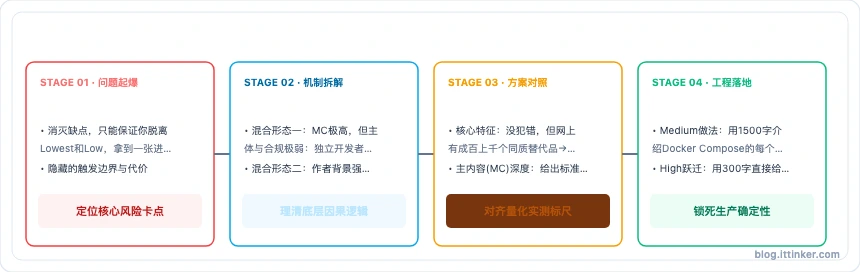
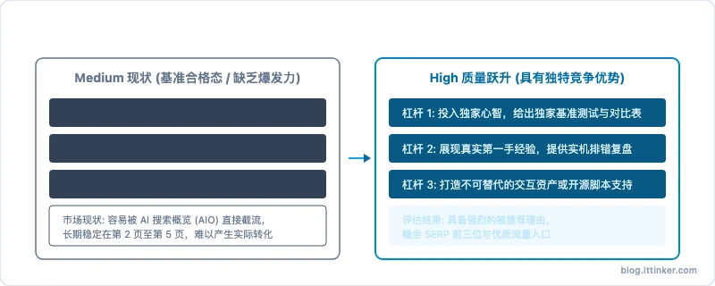
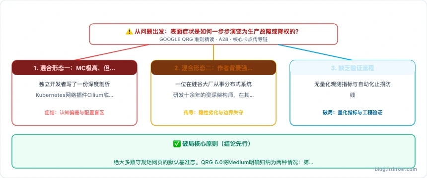
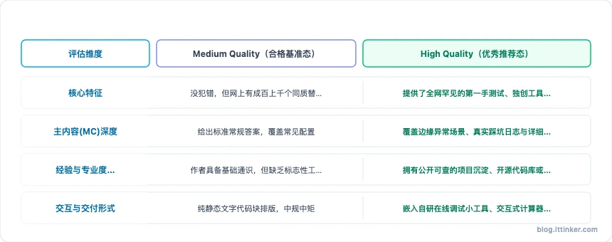
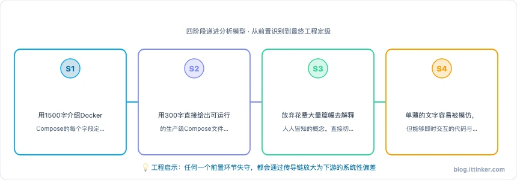
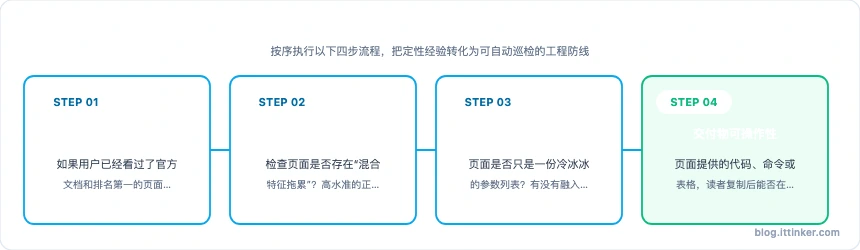

# “大部分网站为什么卡在及格线”？不上不下的中庸困局：QRG 6.0 深度解构 Medium 质量的真实边界 | 读懂 Google Search 基础认知 系列 028

> 🌐 **在线阅读与互动版**：[“大部分网站为什么卡在及格线”？不上不下的中庸困局：QRG 6.0 深度解构 Medium 质量的真实边界 | 读懂 Google Search 基础认知 系列 028](https://blog.ittinker.com/posts/为什么互联网上大多数正常网页其实都只是-medium/)
> 📚 **所属专栏**：[《读懂 Google Search：110篇搜索质量与SEO实战指南》](../README.md)

---

### 📌 结论先行（TL;DR）
> **在 Google 的评估体系中，**Medium Quality（中等质量）不是贬义词，而是互联网绝大多数守规矩网页的默认基准态**。**
> **在日常网站审核咨询中，我们经常遇到这样的开发者：**
> **他们检查了网站的每一个技术细节：Core Web Vitals 全部绿标，页面没有弹窗广告，正文没有抄袭其他网页，配置教程也是作者自己一步步敲出来的。**
> **他们带着疑惑提问：“既然我的页面完全合规，排版也很舒服，为什么在关键词竞争中连前十名都进不去？”**
> **这种困惑的根源在于：**很多人误以为“没有缺点”就等于“优秀”**。**
> **在 Google 官方质量指南 QRG 第 6.0 节中，评估员给这种页面确立了一个精准的定级：**Medium（中等质量）**。**
> **在 Google 的庞大索引库里，超过 80% 的正规网页都拥挤在这个区间里。它们没有犯任何错误，但也找不出任何非把它们推上首页不可的理由。**
>
> - QRG 6.0 将 Medium 明确归纳为两种情况：第一种是“没有任何硬伤，但也毫无出彩之处（Nothing Wrong, But Nothing Special）”，内容中规中矩、排版合格、没有流氓广告，但也缺乏独特的第一手经验与独家深度；
> - 第二种是“优缺点相互抵消的混合特征（Mixed Characteristics）”，例如主内容扎实但缺乏足够的作者资质背书。
> - 在以生成式 AI 概览（AI Overviews）和头部权威结果为主导的现代 SERP 中，停留在 Medium 就意味着沦为“毫无记忆点的背景板”，独立开发者必须精准发力才能完成向 High Quality 的跃升。

---

### 🚨 2026 → 2024 官方最新风向预警：Google 对Google 对中等质量（Medium）页面的定义与排名空间挤压的策略演进

#### 🕒 2026 → 2024 Google 官方对Google 对中等质量（Medium）页面的定义与排名空间挤压的策略演进

- **2026 · 及格线内容的流量断崖式压缩**
  Google 生成式搜索与顶级结果优先机制确立，卡在及格线（Medium Quality）的页面在 SERP 上的展现空间被极度压缩，仅能获取微弱的超长尾残余流量。

- **2025 · 中等质量向高阶跃升的门槛提高**
  算法拉大了及格页面与优秀页面之间的评分差距，中庸页面若想摆脱‘食之无味弃之可惜’的尴尬处境，必须在专业深度或第一手证据上完成关键突破。

- **2024 · QRG 第 6 章确立 Medium Quality 作为基线常态**
  指引指出：互联网上绝大多数合规但平凡的网页都属于 Medium，这是内容生产的基础底盘，但绝对不足以支撑核心商业大词的榜首竞争。

---

## 1. 拆解 QRG 6.1：没犯错，但毫无出彩之处

QRG 第 6.1 节在定义中等质量页面时，写下了一句让无数技术站长醍醐灌顶的评语：

> *"Pages with a Medium rating have a beneficial purpose and are not Low quality, but they do not have the characteristics of a High quality page... There is nothing wrong with the page, but there is also nothing special about it."*

这句话揭示了质量评级的残酷现实：
- **消灭缺点，只能保证你脱离 Lowest 和 Low，拿到一张进入及格区（Medium）的入场券；**
- **但要想拿到前排曝光，页面必须具备某种“Special（卓越且独特）”的特质。**

如果一个技术教程写的是“如何在 Ubuntu 上配置静态 IP”，文章给出了官方标准的 netplan 配置文件模板，没有语法错误，文字简练清晰。用户看完了确实能把 IP 配好。

这个页面糟糕吗？完全不糟糕，它甚至很实用。
但这个页面出彩吗？完全不出彩。因为在全网范围内，能够提供同样那五行 netplan 配置的网页有上万个。

既然一万个页面都能解决这个问题，Google 凭什么要把你的新站排在 DigitalOcean 社区、Ubuntu 官方文档或者极客大牛的博客前面？

---

## 2. 拆解 QRG 6.2：混合特征（Mixed Characteristics）的拉扯

除了“平庸无奇”，QRG 6.2 揭示了导致页面落入 Medium 的另一个隐蔽原因：**Mixed Characteristics（混合特征）**。

> *"A webpage may have a mix of High quality and Low quality characteristics... For example, a page may have high quality MC, but the website has a mildly negative reputation. Or, a page may have an unsatisfying amount of MC, but the creator of the page has very high E-E-A-T."*

很多时候，站长在某个维度倾注了大量心血，却在另一个维度留下了明显短板。这种长短板相遇，最终评级往往不会就高，而是会被折中拉平到 Medium：

### 混合形态一：MC 极高，但主体与合规极弱
独立开发者写了一份深度剖析 Kubernetes 网络插件 Cilium 底层 eBPF 实现的极品长文。文章有图有真相，测试数据翔实，MC 绝对有资格评为 Highest。
然而，这篇文章放在一个完全匿名的博客上，站点没有 About 页，没有作者真实姓名，甚至整站连个可点击的联系邮箱都没有。评估员无法确认作者的真实背景，综合评级只能给到 Medium。

### 混合形态二：作者背景强大，但交付内容敷衍
一位在硅谷大厂从事分布式系统研发十余年的资深架构师，在其个人博客上发了一篇短文，标题写着《关于微服务拆分的思考》，正文只有两段随手写的感想，总共 150 字，没有案例、没有反思、没有论据。虽然作者本人的 E-E-A-T 极高，但因为主内容极其单薄，该单页同样只能拿到 Medium。

---

## 3. 对照表：Medium（及格可用）vs High（优秀出彩）

要从及格态突围，我们必须把 Medium 与 High 在具体落地层面的差异彻底看透：

| 评估维度 | Medium Quality（合格基准态） | High Quality（优秀推荐态） |
|---|---|---|
| **核心特征** | 没犯错，但网上有成百上千个同质替代品 | 提供了全网罕见的第一手测试、独创工具或深刻洞察 |
| **主内容 (MC) 深度** | 给出标准常规答案，覆盖常见配置 | 覆盖边缘异常场景、真实踩坑日志与详细性能对比 |
| **经验与专业度 (E-E-A-T)** | 作者具备基础通识，但缺乏标志性工程背书 | 拥有公开可查的项目沉淀、开源代码库或真实生产环境履历 |
| **交互与交付形式** | 纯静态文字代码块排版，中规中矩 | 嵌入自研在线调试小工具、交互式计算器或开源一键脚本 |
| **用户离开时的心理** | “知道了，查到了标准命令，跟别处差不多” | “太棒了！原来这个报错是这里引起的，必须把这篇加入书签” |
| **搜索排位表现** | 沉淀在 SERP 第二页至第五页，流量极低 | 稳定在核心词首页，并持续收获自然反向链接 |

---

## 4. 独立开发者摆脱“平庸可用”的跃迁战术

对于出海独立站而言，长期停留在 Medium 是极其危险的。在 Google 积极引入 AI Overviews（AI 搜索摘要）的趋势下，那些平庸的、只提供标准通识答案的 Medium 网页，会被 AI 概览直接吸收提炼，读者根本无需点击进入你的网站。

要跨过这条鸿沟，必须在项目中坚决执行三项跃迁战术：

### 战术一：把“通用常识”压缩，把“异常处理”拉满
放弃花费大量篇幅去解释人人皆知的概念。直接切入生产环境中官方文档避而不谈的“灰色地带”与“疑难杂症”。
- **Medium 做法**：用 1500 字介绍 Docker Compose 的每个字段定义。
- **High 跃迁**：用 300 字直接给出可运行的生产级 Compose 文件，重点用 1500 字详述容器跨宿主机通信时 MTU 不匹配导致网络静默丢包的排查全过程，附带抓包过滤命令。

### 战术二：在正文中植入自研的工具资产
单薄的文字容易被模仿，但能够即时交互的代码与工具资产具备天然壁垒。
如果你在讲解 Cloudflare 缓存规则与安全防御，不仅给出文字方案，还在正文中直接植入你在 GitHub 开源维护的自动化基线配置脚本，或者在页面中内嵌一个“缓存规则正则验证生成器”。这种工程交付能力会将页面的 Effort 与 Added Value 瞬间推向 High。

### 战术三：为内容打上不可磨灭的个人印记
彻底摆脱第三方说明书式的第三人称冷漠叙事。多用第一人称呈现：“我们在部署上线第 3 天遇到了 CPU 100% 打满”、“通过分析火焰图，我发现这行配置存在严重的锁竞争”。真实的人类实战手记是对抗平庸最锐利的武器。

---

## 5. 页面跃迁自查 Checklist

在完成一篇文章或功能页之后，问自己以下五个问题：

- [ ] **独特性自测**：如果用户已经看过了官方文档和排名第一的页面，读完我的页面，他能获得哪些此前完全未知的新信息？
- [ ] **长短板对齐**：检查页面是否存在“混合特征拖累”？高水准的正文是否配上了同样透明可信的作者介绍与站点合规页面？
- [ ] **消灭说明书腔调**：页面是否只是一份冷冰冰的参数列表？有没有融入真实的选型权衡、踩坑经历与推荐倾向？
- [ ] **交付物可操作性**：页面提供的代码、命令或表格，读者复制后能否在 60 秒内解决他的实际卡点？
- [ ] **收藏价值评估**：平心而论，作为一名工程师，如果自己在工作中搜索到这篇文章，会不会愿意把它收藏进个人的常用工具夹？

---

## 下一篇预告

认清了 Medium 的平庸陷阱之后，我们的目标变得无比明确：全面向 High Quality 发起冲击。

**那么，那些被 Google 评为 High Quality 的标杆网页，到底在内容编排、经验呈现和声誉塑造上多做了哪四个关键动作？独立开发者该如何一套套照着做？**

下一篇，我们将深入解构优秀网页的黄金标准：**[“从及格跃升卓越到底差在哪”？拉开身位的关键胜负手：QRG 7.0 High Quality 页面必须做到的四个核心动作（A29）](/posts/high-quality-页面到底多做了什么/)**。

---

_这是「读懂 Google Search」系列第 28 篇，系统拆解 Google 官方质量指南，帮你建立长期抗算法波动的出海 SEO 护城河。_

---

## 读懂 Google Search 专栏导航

> 📚 **专栏收录**：本文为 [《读懂 Google Search：110篇搜索质量与SEO实战指南》](/posts/google-search-guide/) 第 **A28** 篇。

* **专栏主页**：[《读懂 Google Search：110篇搜索质量与SEO实战指南》全景地图与路线图](/posts/google-search-guide/)
