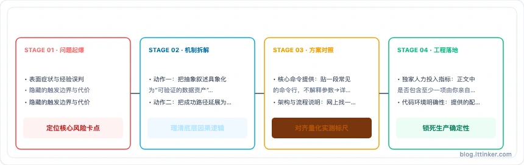
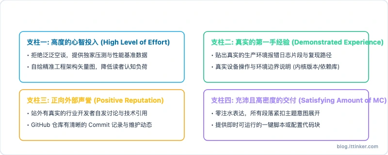
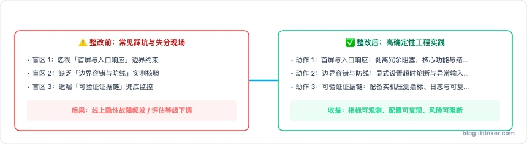
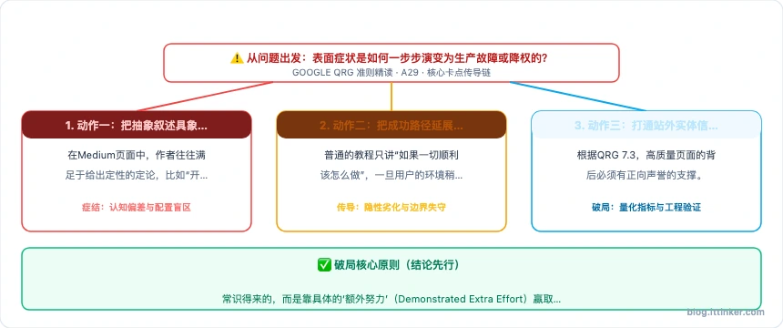
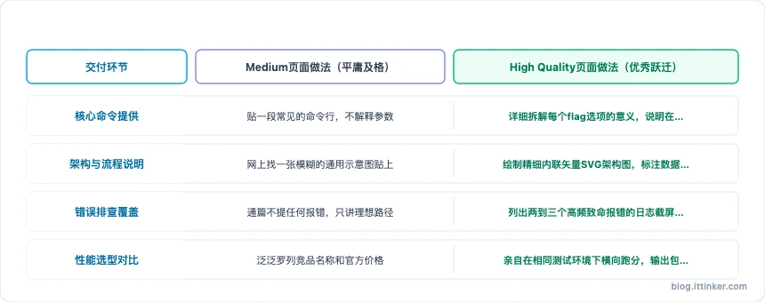
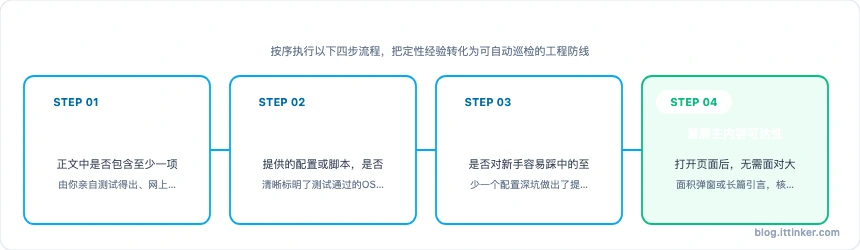

# “搜一个词全球都一样”？User Location 怎样影响检索结果？ | 读懂 Google Search 基础认知 系列 029

> 🌐 **在线阅读与互动版**：[“搜一个词全球都一样”？User Location 怎样影响检索结果？ | 读懂 Google Search 基础认知 系列 029](https://blog.ittinker.com/posts/high-quality-页面到底多做了什么/)
> 📚 **所属专栏**：[《读懂 Google Search：110篇搜索质量与SEO实战指南》](../README.md)

---

### 📌 结论先行（TL;DR）
> **在 Google 的评级逻辑中，**High Quality（高质量）页面绝不是靠堆砌字数或重复常识得来的，而是靠具体的‘额外努力’（Demonstrated Extra Effort）赢取的**。**
> **很多站长在追求高质量内容时，容易陷入一种“体力竞赛”：**
> **竞争对手写了 2000 字，他就让大模型扩写到 5000 字；**
> **竞争对手放了 3 张网图，他就搜集 10 张插图塞进去。**
> **然而当 Google 算法更新之后，这类强行注水的长文往往最先被 Helpful Content 系统降权。**
> **在 Google 官方质量指南 QRG 第 7.0 节中，评估员在评定 High Quality 时，从来不是拿尺子量文字长度，而是寻找页面中展现出的**“非凡努力（Extra Effort）”与“不可替代性”**。**
> **想要让你的独立产品页面或技术博客从平庸的及格线跃升到 High Quality 梯队，必须准确落实 QRG 7.0 揭示的四个关键动作。**
>
> - QRG 7.0 明确界定了 High 级页面的四根支撑支柱：一是**高质量的主内容（High Quality MC）**，展现出卓越的人类心智投入、原创研究与精准度；
> - 二是**高度的经验、专业、权威与信任（High Level of E-E-A-T）**，作者能够拿出第一手实操成果证明自身的实战经历；
> - 三是**正向且清白的声誉（Positive Reputation）**，在所属领域拥有真实的站外好评与引用；
> - 四是**令人满意的内容密度与满足感（Satisfying Amount of MC）**。

---

### 🚨 2026 → 2024 官方最新风向预警：Google 对Google High Quality 优质页面标准演进与第一手信息奖励的策略演进

#### 🕒 2026 → 2024 Google 官方对Google High Quality 优质页面标准演进与第一手信息奖励的策略演进

- **2026 · 第一手实操证据（First-hand Evidence）成为高分硬通货**
  Google 核心算法明确向提供独家实测截图、真实基准跑分数据、原创流程图谱的页面倾斜核心权重，奖励那些真正付出劳动与工程实践的 High Quality 站点。

- **2025 · 专业权威度与用户口碑深度融合**
  优秀页面不仅在内容深度上傲视群雄，更在全网积累了正面口碑，成为用户愿意收藏、引用并反复回访的目的地站点。

- **2024 · QRG 第 7 章公布 High Quality 的四大支柱**
  官方明确了卓越内容的黄金法则：明确且有益的页面目的、极高水平的 MC 投入度与原创性、充分展现的专业度，以及令人安心的正面声誉。

---

## 1. 拆解 QRG 7.0：High Quality 的评级标准

在 QRG 第 7.0 节《High Quality Pages》与第 7.1 节中，Google 确立了高质量页面的基石原则：

> *"High quality pages achieve their purpose very well. The purpose of the page should be achieved with a high level of effort, originality, talent, or skill... A high level of effort means that the content took time, effort, and care to create."*

Google 在指南中特别提到了 **Care（用心）** 这个词。

机器批量改写的文章是没有心智温度的，它只在乎关键词排布；而优秀的工程师写下的实战记录，每一个参数都是为了让读者在实际部署时少踩一个深坑。

评估员正是通过以下四根支柱，来确认页面是否凝聚了足够的专业心智：

---

## 2. 跃迁优秀的四个关键动作

### 动作一：把抽象叙述具象化为“可验证的数据资产”
在 Medium 页面中，作者往往满足于给出定性的定论，比如“开启 Redis 缓存可以大幅降低数据库压力”。读者虽然赞同，但心里没有具体预期。
而在 High Quality 页面中，作者会展示具体的测试方法与量化指标：
- “在 4 核 8G 云主机上，通过 wrk 进行 5000 并发压测：未开启缓存时接口延迟中位数为 240ms，QPS 为 620；配置 Redis 读写分离后，延迟降至 12ms，QPS 稳定在 4800”。
- 附带提供压测脚本命令与完整的监控截图。

这种数据资产凝聚了真实的人力与时间成本，是机器洗稿无论如何也无法伪造的核心壁垒。

### 动作二：把成功路径延展为“异常边界防御”
普通的教程只讲“如果一切顺利该怎么做”，一旦用户的环境稍微有些差异，整篇教程就变成了废纸。
High Quality 页面会主动提供“故障排查与边缘场景处理”：
- 如果宿主机开启了 SELinux，该配置会导致权限拒绝，如何配置安全上下文？
- 如果遇到端口被占用，如何通过 `ss -tulpn` 快速定位并优雅迁移？
- 明确标注此方案适用的软件版本区间（例如“适用于 Node 20+，低版本需引入 polyfill”）。

当用户遇到阻碍并顺利在你的页面上找到解法时，页面的驻留时长与解决率会给搜索引擎算法送回极其积极的正向信号。

### 动作三：打通站外实体信誉链路
根据 QRG 7.3，高质量页面的背后必须有正向声誉的支撑。
这并不要求独立开发者必须成为百万粉丝网红。Google 对个人开发者的要求非常务实：
- 在技术博客中，链接到你在 GitHub 上真实维护的开源代码仓库；
- 在文章涉及自研工具时，提供项目的更新日志（Changelog）与 Issue 交流地址；
- 保持外部技术社区（如 Twitter/X、V2EX、Reddit）上的专业发声与技术讨论。
当外部网络开始出现“这个工具的作者在某技术点上很有研究”的自发提及时，你的全站 E-E-A-T 护城河就已成型。

### 动作四：用自研开源脚本提升交付效率
单纯给出配置片段，用户仍然需要手动复制、打开终端、寻找路径、修改权限。
High Quality 页面会把繁琐的手工流程封装成标准化的自动化脚本。
例如在讲解服务器健康监控或安全加固时，正文不仅分段解析每一项系统参数的意义，还在文末提供一行即可调用的开源维护脚本，读者可以直接一键完成生产基线配置。这种极高的交付效率，是衡量“Very Satisfying MC”的最佳实践。

---

## 3. 实战对比表：及格 Medium 与优秀 High Quality 的代码与排版对照

| 交付环节 | Medium 页面做法（平庸及格） | High Quality 页面做法（优秀跃迁） |
|---|---|---|
| **核心命令提供** | 贴一段常见的命令行，不解释参数 | 详细拆解每个 flag 选项的意义，说明在内存受限机器上的参数优化 |
| **架构与流程说明** | 网上找一张模糊的通用示意图贴上 | 绘制精细内联矢量 SVG 架构图，标注数据流向与网络端口调用 |
| **错误排查覆盖** | 通篇不提任何报错，只讲理想路径 | 列出两到三个高频致命报错的日志截屏，并给出针对性的修复指令 |
| **性能选型对比** | 泛泛罗列竞品名称和官方价格 | 亲自在相同测试环境下横向跑分，输出包含延迟、吞吐与成本的对比表格 |
| **作者背景呈现** | 匿名发布或通用“Admin”署名 | 个人实名技术档案，标明技术领域年限、开源代表作与联系方式 |

---

## 4. 独立开发者 High Quality 页面交付 Checklist

在每一次推代码或发文章前，对照这套标准完成自审：

- [ ] **独家人力投入指标**：正文中是否包含至少一项由你亲自测试得出、网上其他地方找不到的数据或结论？
- [ ] **代码环境明确性**：提供的配置或脚本，是否清晰标明了测试通过的 OS 版本、内核版本与依赖库版本？
- [ ] **高频报错预判**：是否对新手容易踩中的至少一个配置深坑做出了提前预警与修复指引？
- [ ] **首屏主内容可达性**：打开页面后，无需面对大面积弹窗或长篇引言，核心方案是否在 10 秒内清晰可达？
- [ ] **外部可信背书连接**：正文涉及的专业事实，是否准确指向了官方 RFC 规范、Linux 内核文档或学术权威白皮书？

---

## 下一篇预告

当你能够稳定地将大部分核心页面交付到 High Quality 时，你的网站已经击败了互联网上 90% 的竞争对手。

然而，在某些核心赛道中，依然存在一些站在金字塔尖的顶级页面——**Highest Quality**。

**到底什么样的网页才能拿到 Google 评估体系中的最高评级 Highest？这种顶尖护城河可以被独立开发者攻克吗？**

下一篇，我们将深入探索评级的终极殿堂：**[“不可替代的护城河究竟是什么”？顶尖站点的封神之路：QRG 8.0 Highest Quality 如何建立绝对权威与深度壁垒？（A30）](/posts/highest-quality-的护城河是什么/)**。

---

_这是「读懂 Google Search」系列第 29 篇，系统拆解 Google 官方质量指南，帮你建立长期抗算法波动的出海 SEO 护城河。_

---

## 读懂 Google Search 专栏导航

> 📚 **专栏收录**：本文为 [《读懂 Google Search：110篇搜索质量与SEO实战指南》](/posts/google-search-guide/) 第 **A29** 篇。

* **专栏主页**：[《读懂 Google Search：110篇搜索质量与SEO实战指南》全景地图与路线图](/posts/google-search-guide/)
