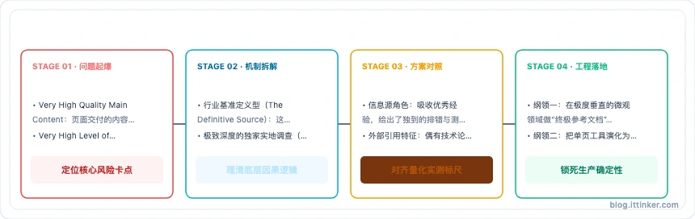
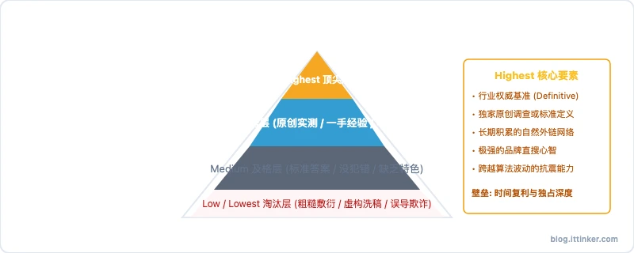
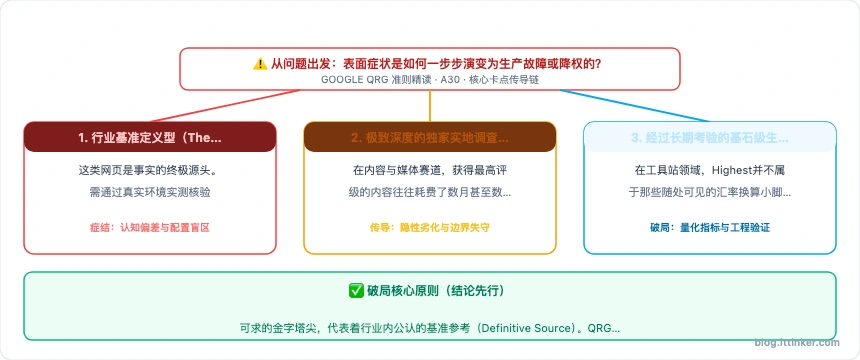
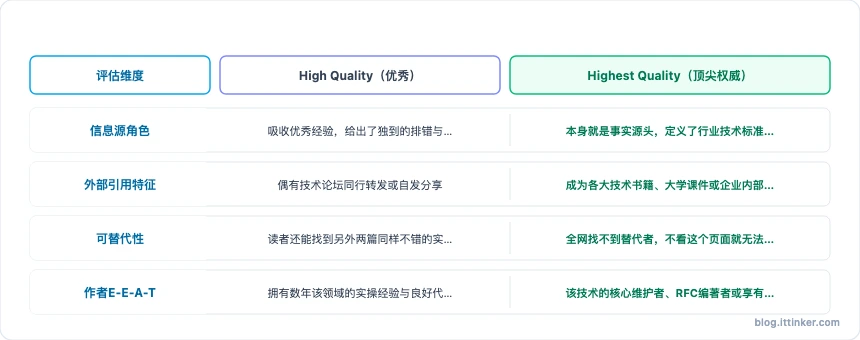
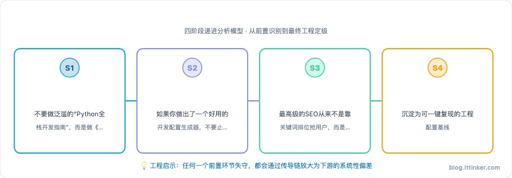
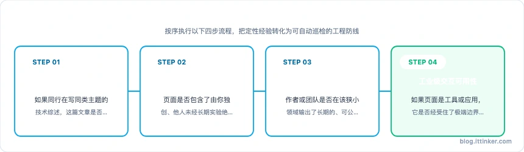

# “不可替代的护城河究竟是什么”？顶尖站点的封神之路：QRG 8.0 Highest Quality 如何建立绝对权威与深度壁垒？ | 读懂 Google Search 基础认知 系列 030

> 🌐 **在线阅读与互动版**：[“不可替代的护城河究竟是什么”？顶尖站点的封神之路：QRG 8.0 Highest Quality 如何建立绝对权威与深度壁垒？ | 读懂 Google Search 基础认知 系列 030](https://blog.ittinker.com/posts/highest-quality-的护城河是什么/)
> 📚 **所属专栏**：[《读懂 Google Search：110篇搜索质量与SEO实战指南》](../README.md)

---

### 📌 结论先行（TL;DR）
> **在 Google 的整个页面质量评估天平上，**Highest Quality（最高质量）是可遇不可求的金字塔尖，代表着行业内公认的基准参考（Definitive Source）**。**
> **在经历了 Low 的淘汰、打破了 Medium 的平庸、达成了 High 的标准之后，许多出海站长会把目光投向搜索领域的最终殿堂：**Highest Quality（最高质量等级）**。**
> **在 Google 的日常搜索结果中，有一类页面几乎永远稳居第一位：**
> **无论算法如何颠簸变幻，无论是面对大语言模型的概括冲击，它们依然岿然不动。**
> **用户在查找某种技术规范时，只认 MDN；**
> **工程师在核验底层网络协议时，只信 IETF RFC；**
> **开发者在寻求某种系统调用时，只查 Linux man-pages。**
> **为什么这些页面能够跨越算法周期，享有近乎豁免级的顶级权重？**
> **在 Google 官方指南 QRG 第 8.0 节中，Google 用详尽的篇幅揭示了顶级网页的底层护城河。**
>
> - QRG 8.0 设定了极其严苛的三个‘Very’考核门槛：**极高质量的主内容（Very High Quality MC）**，展现出无可挑剔的独家深度与严谨性；
> - 极高水准的 E-E-A-T（Very High Level of E-E-A-T）**，作者或机构属于该领域的顶尖权威或资深实践者；
> - 极具声望的外部声誉（Very Positive Reputation）**，拥有外部长期不可撼动的专业口碑与行业背书。
> - Highest 的护城河无法靠短期 SEO 刷量催生，它是‘独创技术资产 + 行业共识引用 + 长期时间复利’的自然沉淀。

---

### 🚨 2026 → 2024 官方最新风向预警：Google 对Google Highest Quality 顶尖内容标准与权威实体（Entities）认可的策略演进

#### 🕒 2026 → 2024 Google 官方对Google Highest Quality 顶尖内容标准与权威实体（Entities）认可的策略演进

- **2026 · 顶级知识图谱实体（Authoritative Entity Recognition）赋权**
  获得 Highest 评价的页面直接被绑定为领域内的‘权威事实来源’。即便遭遇核心算法大震荡，这类拥有绝对专业壁垒和不可替代学术/工程地位的站点依然稳如泰山。

- **2025 · 全网无争议的声誉巅峰（Pinnacle of Reputation）**
  该档位要求站点在其细分领域拥有公认的领导地位（如普利策奖级报道、顶尖开源框架官方文档、行业权威标准制定者）。

- **2024 · QRG 第 8 章对 Highest 极高标准的官方阐释**
  指引为评估员树立了行业天花板标杆：只有那些在 Effort、Originality、Skill 和 Trust 上都做到极致、且在全网赢得崇高声望的内容，才配冠以 Highest 桂冠。

---

## 1. 拆解 QRG 8.0：三个“Very”与权威定义的门槛

在 QRG 第 8.0 节《Highest Quality Pages》中，Google 划定了最高评级的进入标准：

> *"Highest quality pages achieve their purpose to an exceptionally high degree. The purpose of the page should be achieved with a very high level of effort, originality, talent, or skill... These pages have a very high level of E-E-A-T, very high quality MC, and a very positive reputation."*

Google 在指南中连续使用了三个 **Very**：
1. **Very High Quality Main Content**：页面交付的内容不仅完整，而且在该细分领域树立了事实标杆，具备无可争议的严密性与深度；
2. **Very High Level of E-E-A-T**：内容的创作者或运营主体，本身就是该技术的发明者、主要维护团队、持牌学术大家或领域顶尖先锋；
3. **Very Positive Reputation**：在站外拥有大量长期存在的学术引用、顶级行业奖项、知名同行的高频自发推荐，没有任何悬而未决的欺诈或重大服务失信记录。

---

## 2. 官方 Highest 案例特征：什么叫“不可替代的基准参考”？

在 QRG 第 8.4 节《Examples of Highest Quality Pages》中，Google 列举了多类被判定为 Highest 的具体案例。分析这些案例，我们可以发现三类典型形态：

### 1. 行业基准定义型（The Definitive Source）
这类网页是事实的终极源头。
例如权威技术协会发布的协议标准（IETF RFC 9114 HTTP/3 标准文档），或者权威机构的实时气象观测数据。其他所有网站在讨论该话题时，都必须把该页面作为源头引用链接。**成为生态其他节点的引用终点，是 Definitive Source 的终极特征**。

### 2. 极致深度的独家实地调查（In-depth Investigative Content）
在内容与媒体赛道，获得最高评级的内容往往耗费了数月甚至数年的实地调研。
例如揭露某跨国科技巨头数据隐私泄露的独家深度调查报告，包含多方采访录音证据、法庭文件卷宗与独立安全审计员的签名证书。这类内容具有极强的排他性，全网没有任何第二家能够提供同等级别的第一手证据。

### 3. 经过长期考验的基石级生产工具（Essential Utility）
在工具站领域，Highest 并不属于那些随处可见的汇率换算小脚本，而是属于那些承载了工业级信任的产品。
例如一个在线正则表达式测试与反向生成器（如 Regex101），不仅支持 PCRE、JavaScript、Python 等全流派正则引擎，还精确可视化了状态机的回溯步骤，并拥有全球开发者数百万条自发贡献的测试用例库。其功能深度和稳定性，让它成为了工程师日常工作流不可分割的基石。

---

## 3. 维度对决：High（优秀）与 Highest（顶尖护城河）的边界

出海独立开发者常常好奇：我的文章已经拿到了 High，到底差在哪一步才算迈进 Highest？

| 评估维度 | High Quality（优秀） | Highest Quality（顶尖权威） |
|---|---|---|
| **信息源角色** | 吸收优秀经验，给出了独到的排错与测试 | 本身就是事实源头，定义了行业技术标准或发现新机理 |
| **外部引用特征** | 偶有技术论坛同行转发或自发分享 | 成为各大技术书籍、大学课件或企业内部规范的标准引文 |
| **可替代性** | 读者还能找到另外两篇同样不错的实战博文 | 全网找不到替代者，不看这个页面就无法完成核心决策 |
| **作者 E-E-A-T** | 拥有数年该领域的实操经验与良好代码实践 | 该技术的核心维护者、RFC 编著者或享有盛誉的行业宗师 |
| **时间敏感度** | 随着软件版本更迭，需要定期追更维护 | 沉淀为该领域的经典文献或核心架构范式，生命周期以数年计 |
| **优化实现周期** | **短期可达**：通过 2-3 天专注打磨实测与排版即可实现 | **长期复利**：依赖数月至数年的技术深耕、信誉沉淀与社区共识 |

从对比中可以看出：**从及格到 High，依靠的是敏锐的执行力与对细节的极致打磨；而从 High 到 Highest，依靠的是在某一垂直细分赛道上持之以恒的技术深耕与资产独占。**

---

## 4. 独立开发者打造细分垂直 Highest 资产的行动纲领

独立开发者资源有限，不可能去和大型机构争夺通用大词的 Highest 席位。但出海开发者完全可以通过“极端垂直化”策略，在细分小赛道建立起属于自己的 Highest 护城河：

### 纲领一：在极度垂直的微观领域做“终极参考文档”
不要做泛滥的“Python 全栈开发指南”，而是做《在 Cloudflare Workers 上冷启动优化与 WASM 内存绑定的终极基准实测》。
把这个狭小技术点上的每一个细节、每一个底层汇编调用、每一次网络微秒级波动全部测透，写成全网无人能出其右的权威白皮书。让任何想要在这个场景落地的开发者，都必须引用你的研究。

### 纲领二：把单页工具演化为“不可替代的开源基础设施”
如果你做出了一个好用的开发配置生成器，不要止步于简单的网页输入框。
将核心解析引擎开源在 GitHub，编写详尽的测试套件，接入 npm/crates.io 等包管理系统，并提供与 CI/CD 自动集成的 CLI 终端命令行工具。当全球成千上万个 GitHub Actions 工作流每天都在调用你的开源工具时，你的产品站就自然具备了无可替代的 Very High E-E-A-T。

### 纲领三：建立以实体为核心的品牌直搜心智
最高级的 SEO 从来不是靠关键词排位抢用户，而是让用户在搜索框里直接输入你的品牌词。
当用户在 Google 里搜索“ittinker cdn 调优”而不是普通的“cdn 调优”时，你的站点在 Google 知识图谱中的实体权威度就完成了质的飞跃。这种直接搜索心智，是对抗任何算法风暴的最强护城河。

---

## 5. 顶尖资产锻造自查 Checklist

用这套标准评估你的核心拳头产品或深度内容：

- [ ] **终极引用度自测**：如果同行在写同类主题的技术综述，这篇文章是否具备让他们无法绕开、必须超链接引用的深度？
- [ ] **独占资产核验**：页面是否包含了由你独创、他人未经长期实验绝对无法复制的核心数据矩阵或开源工具？
- [ ] **实体背书对齐**：作者或团队是否在该狭小领域输出了长期的、可公开溯源的系列研究成果？
- [ ] **工业级交互可用性**：如果页面是工具或应用，它是否经受住了极端边界输入的考验，做到了零崩溃、低延迟、精准交付？
- [ ] **品牌词搜索沉淀**：站点是否开始在 Search Console 中收获带有自身品牌名的长尾复合检索词？

---

## 下一篇预告

至此，我们完成了 QRG 整个质量阶梯的深度巡礼：从零增量的改写陷阱（A26）、低质量的典型病灶（A27）、中等质量的平庸边界（A28）、高质量的四个动作（A29），一路登顶最高质量的权威护城河（A30）。

然而，互联网上还有一类极其特殊的页面形态：**论坛、社区 Q&A、百科以及 404 错误页面**。
为什么 Reddit、Stack Overflow 上的散乱讨论，即便排版粗糙甚至充满分歧，却依然能屡获高分？

下一篇，我们将跨入特殊页面评级逻辑：**[“论坛和 UGC 页面无法用常规标准评”？社区生态的特殊审判：Wikipedia、Reddit 与报错页面的质量裁决底牌（A31）](/posts/论坛-百科和错误页面为什么需要单独评价/)**。

---

_这是「读懂 Google Search」系列第 30 篇，系统拆解 Google 官方质量指南，帮你建立长期抗算法波动的出海 SEO 护城河。_

---

## 读懂 Google Search 专栏导航

> 📚 **专栏收录**：本文为 [《读懂 Google Search：110篇搜索质量与SEO实战指南》](/posts/google-search-guide/) 第 **A30** 篇。

* **专栏主页**：[《读懂 Google Search：110篇搜索质量与SEO实战指南》全景地图与路线图](/posts/google-search-guide/)
