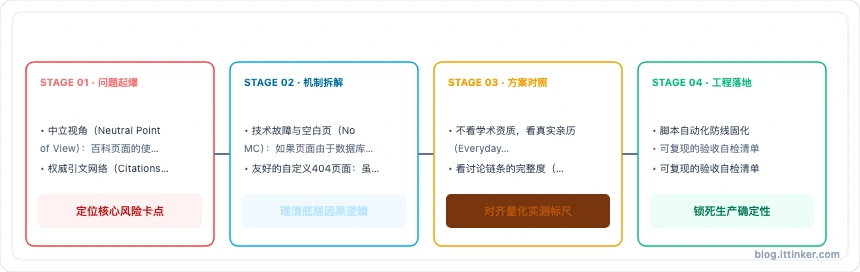
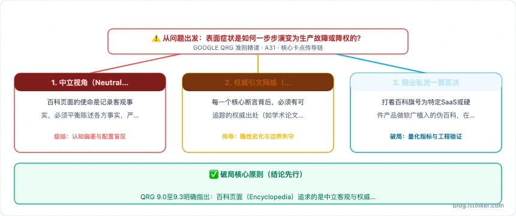
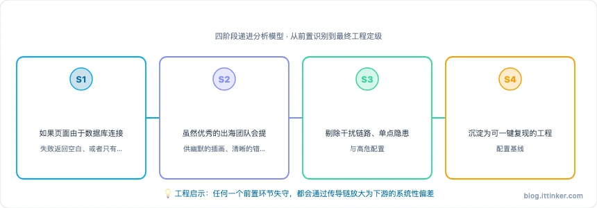
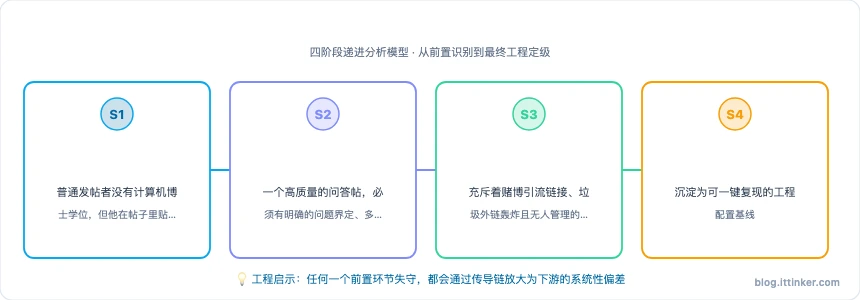
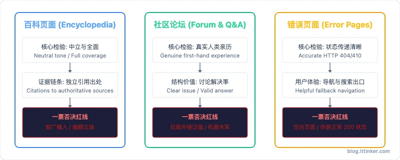
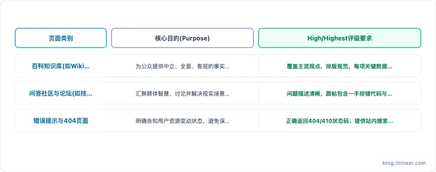
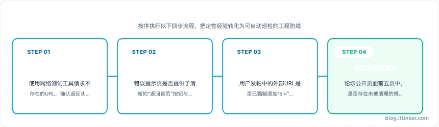

# 论坛、百科和错误页面为什么需要单独评价？社区 UGC 与特殊页面的质量裁决 | 读懂 Google Search 基础认知 系列 031

> 🌐 **在线阅读与互动版**：[论坛、百科和错误页面为什么需要单独评价？社区 UGC 与特殊页面的质量裁决 | 读懂 Google Search 基础认知 系列 031](https://blog.ittinker.com/posts/论坛-百科和错误页面为什么需要单独评价/)
> 📚 **所属专栏**：[《读懂 Google Search：110篇搜索质量与SEO实战指南》](../README.md)

---

### 📌 结论先行（TL;DR）
**在 Google 的质量评估体系中，**不同形态的网页适用完全不同的质量裁决标尺**。**

1. QRG 9.0 至 9.3 明确指出：百科页面（Encyclopedia）追求的是中立客观与权威引文，严禁商业私货；
2. 问答论坛（Forum/Q&A）追求的是群体真实亲历与讨论解决率，不能机械苛求每个发帖者拥有专家证书；
3. 错误页面（Error Pages）必须清晰传递状态并提供有效出口，缺乏主内容的死链会被系统性归入最低档。

出海开发者在评估网站质量时，经常陷入一种机械化思维：无论看到什么网页，都要求它具备标准的长篇大论、详尽的作者履历、结构化的结论摘要。

然而，互联网的内容形态极其丰富。当用户在 Google 搜索某个冷门软件的报错代码时，一条来自 Reddit 或 Stack Overflow 的三行回答，往往比一篇经过营销润色的万字公关文更加管用；当用户搜索某个历史事件时，他们需要的是没有商业偏见的维基百科，而不是某个品牌的单方面宣传。

在 Google 质量评估指南 QRG 第 9 部分中，官方专门设立了独立章节，规训评估员如何对百科、错误页与问答社区进行差异化打分。

---

## 1. 拆解 QRG 9.0 与 9.1：百科页面的“中立性与可查证度”

QRG 第 9.1 节《Encyclopedia Pages》确立了百科类知识库的质量底线：

> *"Encyclopedia pages are intended to provide comprehensive, factual, and neutral information on a topic... High quality encyclopedia pages should have extensive coverage, a neutral point of view, and citations to authoritative sources."*
>
> *"If an encyclopedia article appears to be written from a biased perspective, promotes a specific commercial product, or lacks basic citations, it should not receive a High rating."*

这指出了百科类知识资产的核心评估维度：
1. **中立视角（Neutral Point of View）**：百科页面的使命是记录客观事实，必须平衡陈述各方事实，严禁加入煽动性言辞或带有营销倾向的形容词。
2. **权威引文网络（Citations to Sources）**：每一个核心断言背后，必须有可追踪的权威出处（如学术论文、官方公告、历史文献）。
3. **商业私货一票否决**：打着百科旗号为特定 SaaS 或硬件产品做软广植入的伪百科，在评估员眼中会被直接剔除出 High 档位。

---

## 2. 拆解 QRG 9.2：错误页面与空内容的判定底线

许多开发者在处理下线商品、废弃文章或系统维护时，往往随意返回一个空白页或默认的服务端报错。QRG 第 9.2 节《Error Pages and Pages with No MC》给出了严厉警告：

> *"An error page is a page that communicates that a problem has occurred, such as a 404 (Page Not Found) error... Pages with no Main Content, or pages that do not accomplish their purpose because of technical failure, must be rated Lowest."*
>
> *"A customized 404 page that explains the issue clearly and provides helpful navigation links can offer a good user experience, but it still cannot satisfy an informational or functional search intent."*

对于搜索引擎而言，错误页面存在两层判断：
- **技术故障与空白页（No MC）**：如果页面由于数据库连接失败返回空白、或者只有一行动信提示而无实质内容，评估员必须直接打入 **Lowest**。
- **友好的自定义 404 页面**：虽然优秀的出海团队会提供幽默的插画、清晰的错误提示与站内搜索框，但评估员依然清楚，该页面无法解决搜索用户的核心诉求。如果索引库中残留此类页面，其排名权重会被迅速归零。

---

## 3. 拆解 QRG 9.3：论坛与问答社区的“群体经验法则”

近年来，Google 在搜索结果中显著加大了对 Reddit、Quora、Stack Overflow 以及各类垂直极客社区的展示权重。QRG 第 9.3 节《Forum and Q&A Pages》给出了根本原因：

> *"Forums and Q&A pages are unique because the Main Content consists of a question or initial post followed by discussions or answers created by multiple users (UGC)."*
>
> *"Do not expect everyday forum participants to have formal expertise or institutional credentials. High quality can be achieved through genuine personal experience, detailed troubleshooting steps, and active community consensus."*

评估员在审查论坛页面时，遵循与传统文章完全不同的逻辑：
- **不看学术资质，看真实亲历（Everyday Experience）**：普通发帖者没有计算机博士学位，但他在帖子里贴出了自己昨天排查网卡驱动掉线的真实日志与修复脚本，这就是最高级别的 Experience。
- **看讨论链条的完整度（Thread Resolution）**：一个高质量的问答帖，必须有明确的问题界定、多视角的排错建议，以及被提问者或社区验证采纳的有效解法。
- **看社区治理水准（Moderation）**：充斥着赌博引流链接、垃圾外链轰炸且无人管理的死寂论坛，即便某个历史回帖写得再好，整页也会被评为 Low。

---

## 4. 特殊页面质量判定三轨模型

我们可以用以下矢量架构图清晰呈现三种特殊页面的判定路径差异：

---

## 5. 三类特殊页面的质量要素横向对照

理解不同页面的考核侧重点，能避免在错误的方向上浪费工程精力：

| 页面类别 | 核心目的 (Purpose) | High / Highest 评级要求 | 典型降级或违规陷阱 |
|---|---|---|---|
| **百科知识库** (如 Wiki、技术概念库) | 为公众提供中立、全面、客观的事实参考 | 覆盖主流观点，排版规范，每项关键数据均附有权威可点击的参考来源 | 通篇偏向特定赞助商；夹带未披露的商业推广链接；缺乏基本引用 |
| **问答社区与论坛** (如技术社区、用户交流群) | 汇聚群体智慧，讨论并解决现实场景中的具体疑难 | 问题描述清晰，跟帖包含一手排错代码与真实踩坑日志，存在公认有效解法 | 大量 AI 自动生成的洗稿灌水贴；泛滥的赌博与灰产外链；提问长期处于零有效回答状态 |
| **错误提示与 404 页面** | 明确告知用户资源变动状态，避免误解并提供自救入口 | 正确返回 404/410 状态码；提供站内搜索框、推荐热门文章、引导返回主站 | 软 404（Soft 404，页面不存在却返回 HTTP 200）；完全空白页面；诱导点击广告 |

---

## 6. 出海团队运营特殊页面的工程落地 SOP

如果你的出海项目包含产品文档 Wiki、社区交流板块或大量动态生成的页面，请严格执行以下技术规范：

### 1. 规范处理废弃页面的 HTTP 状态码
坚决消灭“软 404（Soft 404）”。很多开发者为了保住流量，在文章删除后返回 200 状态码并用 JavaScript 弹窗提示“内容已失效”。
在 Google 爬虫眼中，这属于严重的内容欺诈。正确的工程做法是：
- 确认内容彻底删除且无替代页：直接在 Web 服务器层返回标准 `404 Not Found` 或 `410 Gone`；
- 内容迁移到了新 URL：通过服务端返回 `301 Moved Permanently` 永久重定向。

### 2. 社区板块严格布防反垃圾机制
如果你的网站开放了用户发帖或评论功能，必须建立高强度的防刷体系：
- 所有 UGC 外链默认注入 `rel="ugc"` 或 `rel="nofollow"` 属性，阻断外链黑产的投机动机；
- 部署内容过滤规则，对于新注册账号发布的包含多个外链的帖子强制进入人工审核队列；
- 定期清理无任何交互的僵尸讨论帖，保证社区整体的内容信噪比。

### 3. 文档 Wiki 严格维护外部证据链接
在撰写技术架构对比或参数定义时，切勿凭空编造结论。在关键段落结尾添加标注，直接指向官方 RFC 规范、原厂架构白皮书或开源代码库的 Commit 地址。可核验的引用链条是维系文档高信任度的基石。

---

## 7. 独立开发者特殊页面质量体检清单

在部署社区与文档系统前，完成以下自检：

- [ ] **HTTP 状态码合规**：使用网络测试工具请求不存在的 URL，确认返回头是纯正的 `404` 而非带内容的 `200`？
- [ ] **404 页面出口完备**：错误提示页是否提供了清晰的“返回首页”按钮与全站检索框？
- [ ] **UGC 链接属性隔离**：用户发帖中的外部 URL 是否已强制添加 `rel="nofollow ugc"`？
- [ ] **社区无垃圾灌水**：论坛公开页面前五页中，是否存在未被清理的博彩、黑灰产引流广告？
- [ ] **Wiki 严禁商业伪装**：自建的百科概念词条中，是否客观对比了优缺点，而非刻意抹黑竞品？

---

## 下一篇预告

学习了各种特殊网页的裁决逻辑后，我们已经完整走完了 Google Page Quality（PQ）的所有理论模块。

但是，理论最终要服务于实战：**如果现在把一套真实的网页、真实的业务交给你的团队，你能不能像受雇于 Google 的高级评估员一样，从零开始推导出一份严密的打分报告？**

下一篇，我们将进行一次全景模拟复盘：**[如果真的让你当 Google Rater，你会怎么给网页打分？端到端 PQ 评分全流程实战复盘（A32）](/posts/如果真的让你当-google-rater-你会怎么给网页打分/)**。

---

_这是「读懂 Google Search」系列第 31 篇，系统拆解 Google 官方质量指南，帮你建立长期抗算法波动的出海 SEO 护城河。_

---

## 读懂 Google Search 专栏导航

> 📚 **专栏收录**：本文为 [《读懂 Google Search：110篇搜索质量与SEO实战指南》](/posts/google-search-guide/) 第 **A31** 篇。

* **专栏主页**：[《读懂 Google Search：110篇搜索质量与SEO实战指南》全景地图与路线图](/posts/google-search-guide/)
