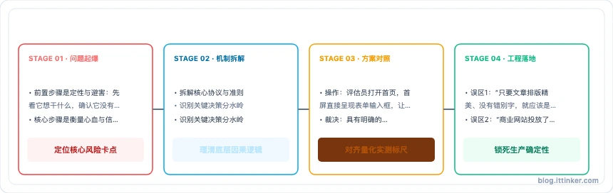
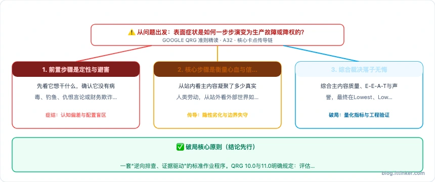
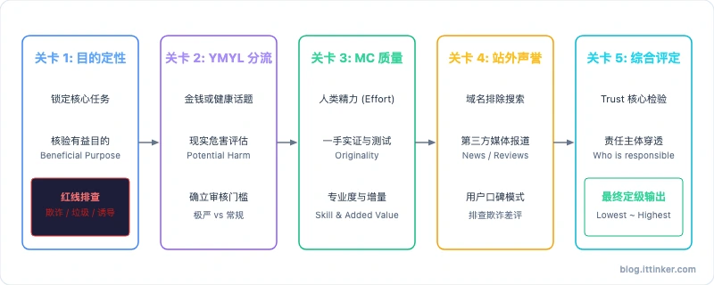
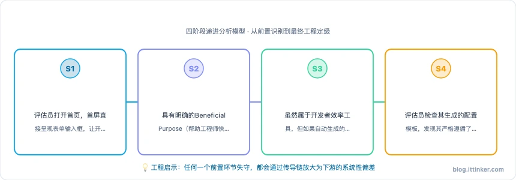
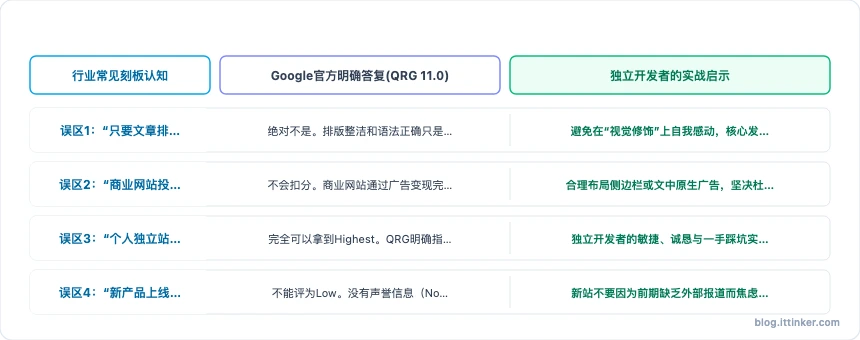
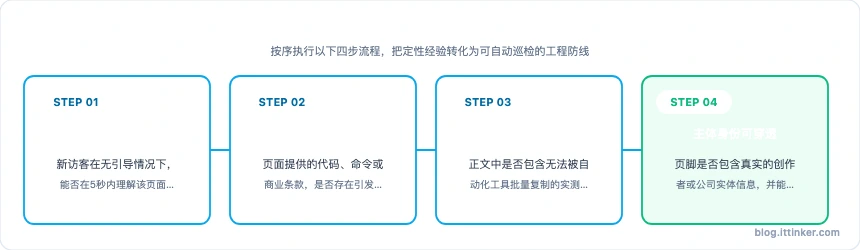

# 如果真的让你当 Google Rater，你会怎么给网页打分？端到端 PQ 评分全流程实战复盘 | 读懂 Google Search 基础认知 系列 032

> 🌐 **在线阅读与互动版**：[如果真的让你当 Google Rater，你会怎么给网页打分？端到端 PQ 评分全流程实战复盘 | 读懂 Google Search 基础认知 系列 032](https://blog.ittinker.com/posts/如果真的让你当-google-rater-你会怎么给网页打分/)
> 📚 **所属专栏**：[《读懂 Google Search：110篇搜索质量与SEO实战指南》](../README.md)

---

### 📌 结论先行（TL;DR）
**Google 质量评估员在对一个陌生网页执行 Page Quality（PQ）打分时，遵循的是一套**“逆向排查、证据驱动”的标准作业程序**。**

1. QRG 10.0 与 11.0 明确规定：评估员不会给网页预设“及格分”，而是严格按照**“目的定性 → 危害排查 → 主内容心血核验 → 站外声誉穿透 → Trust 底座裁决”**五步流水线层层推演。
2. 任何把没有错别字当成 High、把个人小站默认当成 Low 的认知，在官方评估机制面前都被彻底否定。

在前面的章节中，我们系统拆解了 Page Quality 的各个原子要素：页面目的（[A05](/posts/评价网页之前-为什么必须先搞清楚页面目的/)）、主体透明度（[A10](/posts/about-contact-customer-service-为什么不是-seo-装饰/)）、主内容四大基石（[A12](/posts/什么才叫高质量-main-content/)）、第三方独立声誉（[A13](/posts/google-怎么看一个网站的-reputation/)）以及用户评论甄别（[A14](/posts/用户评论到底算不算-信誉/)）。

如果现在将一个真实的海外在线工具或技术博客推到你面前，你能否像一名经验丰富的 Google 评估员那样，客观、严密地给出一份站得住脚的质量评级？

QRG 第 10 节《Page Quality Rating Steps》与第 11 节《Page Quality Rating FAQs》正是整部指南对评估员的“结业大考”。

---

## 1. 拆解 QRG 10.0 与 10.1：评估员标准打分作业流

QRG 第 10.0 节《Page Quality Rating Steps》列出了评估员每次评测的规定动作：

> *"To determine the Page Quality rating of a webpage, follow these steps:*
> *1. Understand the purpose of the webpage.*
> *2. Assess the potential for harm or untrustworthiness.*
> *3. Assess the quality of the Main Content (MC).*
> *4. Identify who is responsible for the website and content creator.*
> *5. Research the reputation of the website and content creator.*
> *6. Determine the final Page Quality rating based on all considerations."*

这六个步骤呈现出清晰的逻辑链路：
- **前置步骤是定性与避害**：先看它想干什么，确认它没有病毒、钓鱼、仇恨言论或财务欺诈的恶意企图；
- **核心步骤是衡量心血与信任**：从站内看主内容凝聚了多少真实人类劳动，从站外看外部世界如何独立评价这个实体；
- **综合裁决落子无悔**：综合主内容质量、E-E-A-T 与声誉，最终在 Lowest、Low、Medium、High、Highest 中给出定级。

---

## 2. 端到端 PQ 评分全景工作流

以下矢量架构图完整还原了评估员从接收到评测任务到提交评级的五大阶段：

---

## 3. 实战推演：审计一个出海 Docker 部署工具站

为了让这套流水线更加具象，我们以一个真实的独立开发产品形态进行全流程推演：

### 目标对象
一个名为 `DevContainer.run` 的出海工具站，提供在线一键生成生产级 Dockerfile 与 docker-compose 配置文件的服务，附带技术排错博客。

### 阶段一：审查页面目的与第一印象
- **操作**：评估员打开首页，首屏直接呈现表单输入框，让开发者勾选环境依赖（Node.js、PostgreSQL、Redis 等），并提供实时生成的语法树。
- **裁决**：具有明确的 **Beneficial Purpose（帮助工程师快速生成可靠配置）**。没有任何诱导点击假按钮或强行弹窗，顺利通过基础排查。

### 阶段二：YMYL 属性与潜在危害核验
- **操作**：虽然属于开发者效率工具，但如果自动生成的 Docker 配置中默认开放了高危无密码端口（如 Redis 裸跑公网 6379），则会对服务器安全构成现实威胁。
- **裁决**：评估员检查其生成的配置模板，发现其严格遵循了非 root 用户运行规范，并在密码区域强制提示随机生成环境变量。**不存在技术误导或危害隐患**。

### 阶段三：主内容质量深度穿透
- **操作**：评估员随机抽查其附带的一篇技术文章《How to Fix Docker Permission Denied on Linux Socket》。
- **发现**：文章没有长篇大论介绍 Linux 发展史，而是开门见山列出了错误堆栈日志，并给出了两套经本地验证的命令（一套用于调试，一套用于生产守护进程权限设置），还附带了自动化检测的 Bash 脚本片段。
- **裁决**：具备极高的 **Effort（真实排错实证）** 与 **Talent/Skill（排版规整，代码高亮准确）**，主内容质量达到 **High** 门槛。

### 阶段四：跳出网站展开声誉背景调查
- **操作**：评估员在搜索框输入 `devcontainer.run -site:devcontainer.run`。
- **发现**：该项目在 GitHub 上开源了核心配置模板代码库，积累了 800+ Star；在 Reddit 的 `r/devops` 板块上有数条同行关于其配置体积小、缓存优化到位的正面讨论；在 Trustpilot 上没有集中差评。
- **裁决**：声誉属于 **Positive & Organic（自然健康的良好口碑）**。

### 阶段五：核验主体透明度并给出最终评分
- **操作**：评估员查看页面底部，发现清晰的“About Developer”链接，指向作者个人真实 GitHub 与 Twitter 主页，同时附有开源项目赞助说明与隐私政策。
- **最终综合裁决**：**High Quality（高页面质量）**。如果未来该工具成为业界事实标准库或被 Docker 官方推荐，则具备冲刺 **Highest** 的资质。

---

## 4. 拆解 QRG 11.0：评估员常见官方 FAQ 辨析

在 QRG 第 11 节中，Google 列出了一批评估员在日常打分中最容易困惑的典型场景，每一个解答都直接针对业界的刻板印象：

| 行业常见刻板认知 | Google 官方明确答复 (QRG 11.0) | 独立开发者的实战启示 |
|---|---|---|
| **误区 1**：“只要文章排版精美、没有错别字，就应该是 High？” | **绝对不是**。排版整洁和语法正确只是及格线。如果文字通篇缺乏一手原创、全网到处可见，依然只能评为 Medium 甚至 Low。 | 避免在“视觉修饰”上自我感动，核心发力点在于提供独家数据或实测经验。 |
| **误区 2**：“商业网站投放了 Google AdSense 广告，会被扣分吗？” | **不会扣分**。商业网站通过广告变现完全正当。只有当广告遮挡了主内容、伪装成下载按钮或严重拖慢性能时才扣分。 | 合理布局侧边栏或文中原生广告，坚决杜绝侵入式全屏弹窗与欺骗性点击诱导。 |
| **误区 3**：“个人独立站没有大公司背景，最高能拿什么分？” | **完全可以拿到 Highest**。QRG 明确指出，如果个人博主在特定技术利基领域展现出了极高的亲身经历与卓越技能，其得分与跨国机构完全平权。 | 独立开发者的敏捷、诚恳与一手踩坑实录，正是对抗大厂平庸洗稿团队的核心武器。 |
| **误区 4**：“新产品上线在网上搜不到任何讨论，直接判定为 Low？” | **不能评为 Low**。没有声誉信息（No Reputation）属于中立状态，评估员必须完全依据单页内容表现客观定级。 | 新站不要因为前期缺乏外部报道而焦虑，只要把单页体验做到极致，依然能稳定获得 High。 |

---

## 5. 独立开发者上线前“自审 SOP 落地清单”

在每个核心页面推向市场前，按照评估员的视角完成最终的全面自审：

- [ ] **首屏任务一目了然**：新访客在无引导情况下，能否在 5 秒内理解该页面的功能或交付物？
- [ ] **生产安全边界校验**：页面提供的代码、命令或商业条款，是否存在引发数据丢失或安全泄露的风险？
- [ ] **一手劳动痕迹固化**：正文中是否包含无法被自动化工具批量复制的实测结果、配置案例或原创图表？
- [ ] **主体身份可穿透**：页脚是否包含真实的创作者或公司实体信息，并能链接到活跃的第三方技术履历？
- [ ] **广告与变现克制**：页面加载后，主内容区域（MC）是否占据了首屏绝对主导视距？

---

## 下一篇预告

到此为止，我们完成了 Google 质量指南第一大支柱 **Page Quality（页面质量）** 的全部拆解。

从下一篇开始，我们将步入搜索质量审判的第二大支柱：**Needs Met（搜索意图与需求满足）**。

很多开发者往往不解：**“为什么我的页面明明被打成了 High Quality，但在某个核心搜索词下，排名却被一个非常简陋的竞品单页死死压制？”**

因为：**页面再好，如果不是搜索用户此时此刻想要的东西，在 Google 眼里依然毫无意义。**

下一篇，我们将探讨搜索优化的全新范式：**[理解 Query，是搜索优化真正的起点：从“找关键词”到“解构用户真实需求”（A33）](/posts/理解-query-是搜索优化真正的起点/)**。

---

_这是「读懂 Google Search」系列第 32 篇，系统拆解 Google 官方质量指南，帮你建立长期抗算法波动的出海 SEO 护城河。_

---

## 读懂 Google Search 专栏导航

> 📚 **专栏收录**：本文为 [《读懂 Google Search：110篇搜索质量与SEO实战指南》](/posts/google-search-guide/) 第 **A32** 篇。

* **专栏主页**：[《读懂 Google Search：110篇搜索质量与SEO实战指南》全景地图与路线图](/posts/google-search-guide/)
