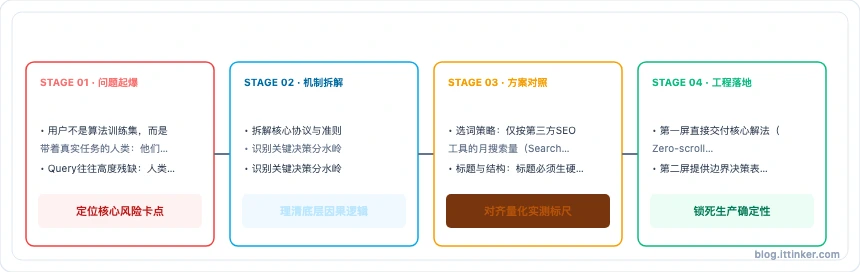
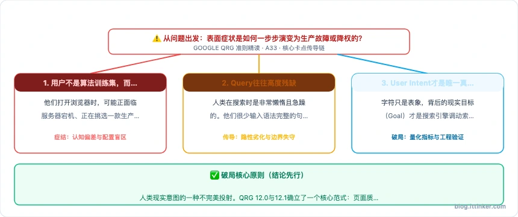
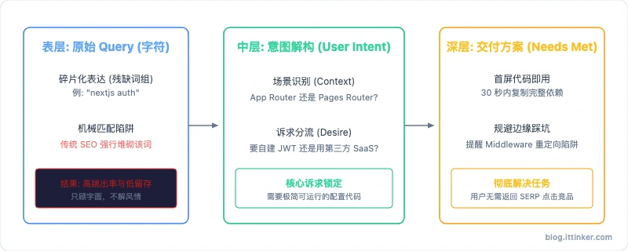
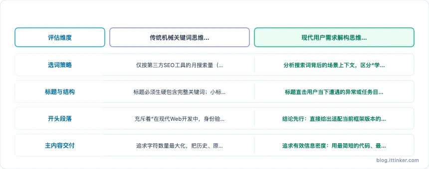
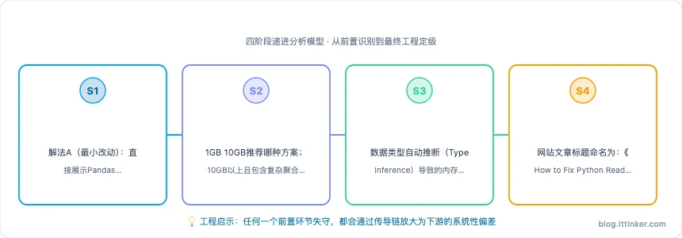
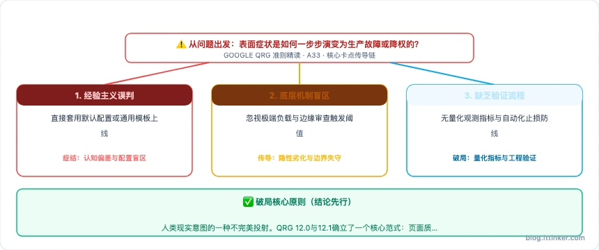
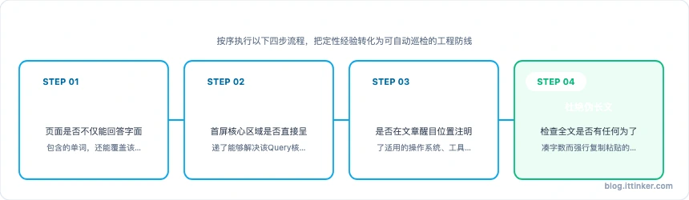

# “盯着搜索词看不如看用户想干嘛”？跳出关键词的思维革命：从‘找词打标签’到‘解构用户真实需求’ | 读懂 Google Search 基础认知 系列 033

> 🌐 **在线阅读与互动版**：[“盯着搜索词看不如看用户想干嘛”？跳出关键词的思维革命：从‘找词打标签’到‘解构用户真实需求’ | 读懂 Google Search 基础认知 系列 033](https://blog.ittinker.com/posts/理解-query-是搜索优化真正的起点/)
> 📚 **所属专栏**：[《读懂 Google Search：110篇搜索质量与SEO实战指南》](../README.md)

---

### 📌 结论先行（TL;DR）
> **在现代搜索引擎眼里，**用户在输入框敲下的 Query 绝不是冰冷的字面匹配符，而是人类现实意图的一种不完美投射**。**
> **在前面的 32 篇系列指南中，我们完整遍历了 Google QRG 的第一大支柱：**Page Quality（页面质量评级）**。我们讨论了页面目的、主体责任、E-E-A-T 以及外部声誉。**
> **然而，在实际出海操盘中，很多站长会产生巨大的心理落差：**
> **“我的网站架构严谨，主内容凝聚了大量原创心血，在 Page Quality 维度稳稳处于 High 级别，为什么在某些搜索量极大的核心词下，依然毫无自然流量？”**
> **答案在于：**好内容不等于好答案。**
> **一个 5000 字严谨详实的“SSH 密码学原理深度科普”，即使 PQ 评分为最高级（Highest），但当一个运维工程师在终端报错时急匆匆搜索 `ssh connection refused port 22` 时，这篇文章对他就没有任何用处。用户此时此刻需要的是三行能够立刻排查防火墙与守护进程的命令。**
> **从 QRG 第 12 部分开始，Google 质量指南正式从“审视网页本身”跃迁到“审视用户需求”。**
>
> - QRG 12.0 与 12.1 确立了一个核心范式：页面质量（PQ）只决定了你的页面本身是否优秀，而需求满足（Needs Met）才决定了你是否配得上当前 Query 的排名。
> - 出海团队如果只盯着关键词的月搜索量和字符匹配，却读不懂输入框背后用户急需解决的现实任务，生产出的长文无论文笔多好，都无法命中核心流量。





---


### 🚨 2026 → 2024 官方最新风向预警：Google 对Google 语义搜索与用户意图解析（MUM & Gemini 驱动）的演进的策略演进

#### 🕒 2026 → 2024 Google 官方对Google 语义搜索与用户意图解析（MUM & Gemini 驱动）的演进的策略演进

- **2026 · 多模态全意图空间建模（Semantic Intent Graph）**
  Googlebot 彻底摆脱分词匹配，依托 Gemini 大模型直接解构用户搜索词背后的深层任务场景（如用户搜代码报错时，其真正诉求是快速排障而非阅读技术发展史）。

- **2025 · 搜索会话链路追踪与意图预测**
  算法结合用户的连续搜索行为（Query Sequences），精准预判其下一阶段需求，将单纯的内容匹配升维为对整个用户探索链路的赋能。

- **2024 · QRG 第 12 章 Query 理解核心总纲确立**
  规范明确提出：评估搜索质量的唯一正确起点，是站在用户的鞋子里，彻底弄明白该用户在现实生活中遭遇了什么困难，需要获取什么样的实质帮助。


---


## 1. 拆解 QRG 12.0 与 12.1：从词汇到意图的认知重塑

QRG 第 12.0 节《Understanding Search Users, Queries, and Results》开宗明义地写道：

> *"Search is all about helping users find what they are looking for. To evaluate how well a search engine works, quality raters must understand search users, their queries, and the results they are shown."*

在第 12.1 节《Important Definitions》中，Google 给出了三个最核心的概念界定：

> - *"**Search User**: A person who is trying to find information, accomplish a task, or be entertained using a search engine."*
> - *"**Query**: The word or words a user enters into a search box."*
> - *"**User Intent**: The goal or objective of the search user when typing the query into the search engine."*

这三条定义看似平实，却揭示了搜索行为的本质：
1. **用户不是算法训练集，而是带着真实任务的人类**：他们打开浏览器时，可能正面临服务器宕机、正在挑选一款生产力工具、或者正准备给异地女友订花。
2. **Query 往往高度残缺**：人类在搜索时是非常懒惰且急躁的。他们很少输入语法完整的句子，而是倾向于输入碎片化的短语（例如 `best db for rust`、`node memory leak`）。
3. **User Intent 才是唯一真理**：字符只是表象，背后的现实目标（Goal）才是搜索引擎调动索引库去满足的真正靶心。





---

## 2. 搜索需求解构的三层认知模型

为了摆脱传统机械做词的窠臼，我们可以通过以下矢量架构图理解从输入字符到需求满足的深层映射：





---

## 3. 两种截然不同的内容规划思维对照

很多出海网站在流量竞争中败下阵来，根本原因在于依然停留在 2015 年的“字面做词”阶段，从未真正跨入“需求解构”：

| 评估维度 | 传统机械关键词思维 (Keyword-Centric) | 现代用户需求解构思维 (Intent-Centric) |
|---|---|---|
| **选词策略** | 仅按第三方 SEO 工具的月搜索量（Search Volume）和竞价单价排序，机械筛选高频词。 | 分析搜索词背后的场景上下文，区分“学习原理”、“寻找替代品”还是“排错自救”。 |
| **标题与结构** | 标题必须生硬包含完整关键词；小标题反复出现主词与长尾词的机械排列。 | 标题直击用户当下遭遇的异常或任务目标；正文层次按照排障或决策心理学递进。 |
| **开头段落** | 充斥着“在现代 Web 开发中，身份验证是一个非常重要的话题”这类通用废话。 | 结论先行：直接给出适配当前框架版本的最佳解决方案架构与一键安装命令。 |
| **主内容交付** | 追求字符数量最大化，把历史、原理、甚至不相关的安装教程硬塞进一篇文章。 | 追求有效信息密度：用最简短的代码、最直观的架构图，在最短视距内帮用户通关。 |
| **衡量标准** | 关键词密度是否达标、页面是否包含足够的外链锚文本。 | 搜索用户是否在看完页面后彻底关闭浏览器完成了任务，不再发生二次点击行为。 |





---

## 4. 案例实战：如何解构一个真实的技术 Query？

以技术开发者极常搜索的词条为例：
**Query: `python read large csv out of memory`**

### 机械关键词思维的做法
- 网站文章标题命名为：《How to Fix Python Read Large CSV Out of Memory: A Complete Guide》；
- 前言用 1500 字科普 CSV 文件的存储格式、Python 内存管理机制（Garbage Collection）、Pandas 的前世今生；
- 中间贴出 4 种通用的读取方式，但没有任何环境配置与性能压测数据；
- 结果：一个正在生产环境面临 OOM（Out of Memory）报错崩溃的工程师打开页面，向下滚动了三屏依然看不到核心解决方案，骂骂咧咧地关掉网页返回 Google 重新搜索。

### 需求解构思维的做法
评估员在审查该 Query 时，会先判断用户的真实困境：**用户的进程挂了，物理内存在报警，他需要以最低改动成本换取流式或分块处理能力。**
- **第一屏直接交付核心解法（Zero-scroll solution）**：
  - 解法 A（最小改动）：直接展示 Pandas `chunksize` 参数与迭代器用法，附 5 行可运行代码；
  - 解法 B（性能飞跃）：直接推荐使用 Polars 或 DuckDB 并提供 `scan_csv` 惰性计算命令；
- **第二屏提供边界决策表**：
  - 1GB ~ 10GB 推荐哪种方案；10GB 以上且包含复杂聚合推荐哪种架构；
- **第三屏提示隐藏陷阱**：
  - 数据类型自动推断（Type Inference）导致的内存膨胀问题，给出明确指定 `dtype` 的最佳实践。

当你的页面能够如此锋利地切中意图时，它在 Google Needs Met 评分中就会直接拿到 **Highly Meets**。





---

## 5. 出海开发者解构 Query 意图的四步 SOP

在为自己的产品站、文档站或技术博客选题时，请按以下步骤对每个目标搜索词进行“逆向透视”：

```text
步骤 1: 场景还原 (Context Identification)
  - 这个人在什么环境下敲下这个词？(在公司排错？在地铁查资料？在对比竞品报价？)

步骤 2: 卡点穿透 (Friction Point)
  - 他当下最大的卡点是什么？(时间不够？代码跑不通？担心被隐形扣费？)

步骤 3: 最小交付单元设计 (Minimal Resolving Unit)
  - 能够瞬间解决他问题的最小实体是什么？(一段代码？一个计算器？一张对比表？)

步骤 4: 竞争增量注入 (Added-Value Delta)
  - 相比当前 SERP 排名前三的页面，我能提供什么他们遗漏的真实细节？
```





---

## 6. 独立开发者 Query 理解自查清单

在动笔写下任何文章或设计落地页之前，对照以下清单完成核验：

- [ ] **摆脱字面依赖**：页面是否不仅能回答字面包含的单词，还能覆盖该任务必然伴随的衍生困扰与场景？
- [ ] **首屏有效交付**：首屏核心区域是否直接呈递了能够解决该 Query 核心诉求的答案，而非概念铺垫？
- [ ] **场景限制明确**：是否在文章醒目位置注明了适用的操作系统、工具版本或技术栈环境？
- [ ] **杜绝伪长文**：检查全文是否有任何为了凑字数而强行复制粘贴的百科常识？
- [ ] **满足度验证**：站在一个急躁用户的视角，本页面的解答能否让你停止寻找其他网页？





---

## 下一篇预告

理解了 Query 背后深层次的用户意图之后，很多开发者立刻会遇到更棘手的现实情况：

**用户输入的同一个词，在不同国家、不同语境、甚至不同时间，意思可能完全相反！**

例如搜 `apple`，用户到底是要吃水果、还是要买手机、还是要查苹果公司的股价？
搜 `coffee`，在纽约搜和在伦敦搜，Google 呈现的结果为什么有着天壤之别？

下一篇，我们将深入拆解 QRG 12.2 至 12.6：**[“同一个词搜出来的内容千差万别”？意图分裂的致命陷阱：Dominant、Common 与 Minor Interpretation 深度解构（A34）](/posts/同一个关键词为什么可能有完全不同的意思/)**。

---

_这是「读懂 Google Search」系列第 33 篇，系统拆解 Google 官方质量指南，帮你建立长期抗算法波动的出海 SEO 护城河。_


---

## 读懂 Google Search 专栏导航

> 📚 **专栏收录**：本文为 [《读懂 Google Search：110篇搜索质量与SEO实战指南》](/posts/google-search-guide/) 第 **A33** 篇。

* **专栏主页**：[《读懂 Google Search：110篇搜索质量与SEO实战指南》全景地图与路线图](/posts/google-search-guide/)
