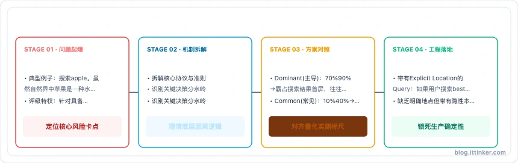
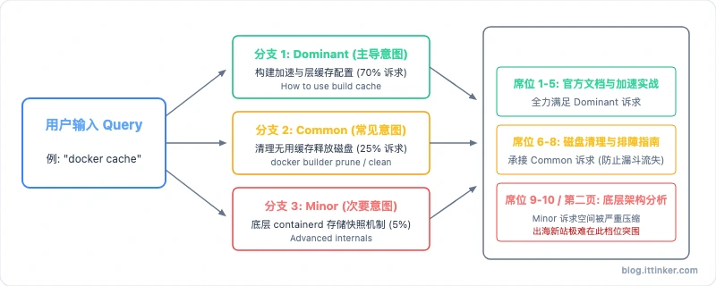
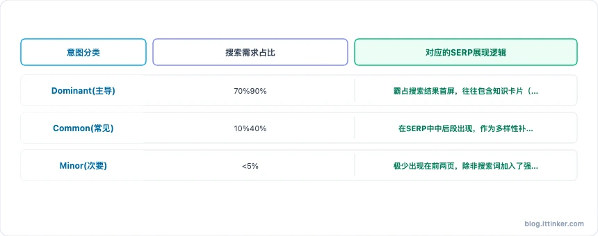
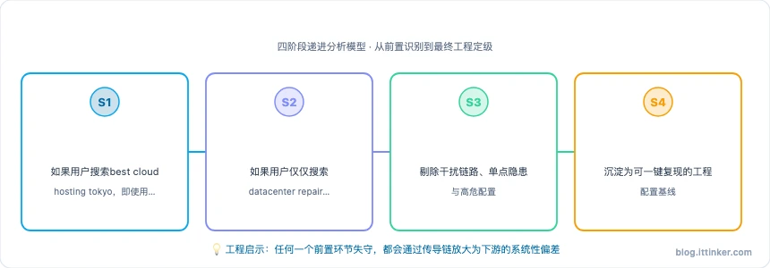
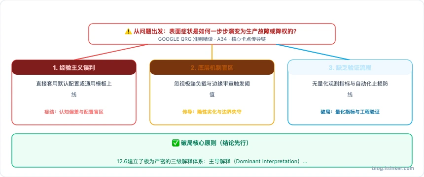
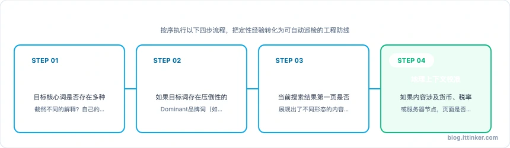

# “官网凭什么霸占第一”？Website Intent 导航词优化逻辑 | 读懂 Google Search 基础认知 系列 034

> 🌐 **在线阅读与互动版**：[“官网凭什么霸占第一”？Website Intent 导航词优化逻辑 | 读懂 Google Search 基础认知 系列 034](https://blog.ittinker.com/posts/同一个关键词为什么可能有完全不同的意思/)
> 📚 **所属专栏**：[《读懂 Google Search：110篇搜索质量与SEO实战指南》](../README.md)

---

### 📌 结论先行（TL;DR）
> **Google 绝不会假定所有输入同一个关键词的用户都想要同一种答案。**
> **在理解了“Query 是用户意图的投射”（[A33](/posts/理解-query-是搜索优化真正的起点/)）之后，出海团队很快会面临一个更复杂的算法现实：**
> **语言本身具有巨大的歧义性。同一个词敲进搜索框，不同的人脑子里想的事情可能大相径庭。**
> **当一个硅谷程序员搜索 `go` 时，他大概率在寻找 Go 编程语言的官方文档；当一个桌游爱好者搜索 `go` 时，他想要的是围棋的规则与棋谱；而当一个正在听歌的用户搜索 `go` 时，他找的可能是某首流行单曲。**
> **面对这种多义性，Google 的排名算法并不会简单地给出一个随机结果。在 QRG 第 12.3 至 12.6 节中，Google 系统公开了评估员评判“Query 多重解释（Interpretations of the Query）”的标准法则。**
>
> - QRG 12.3 至 12.6 建立了极为严密的三级解释体系：**主导解释（Dominant Interpretation）**独占绝大多数需求，直接获得核心黄金卡位；
> - 常见解释（Common Interpretation）**分享多元意图，Google 会在第一页强制混排不同类型的答案；
> - 次要解释（Minor Interpretation）**由于受众极小，很难在常规搜索中获得靠前位置。
> - **出海团队如果错把次要解释当成主攻方向**：或者盲目去卷已被主导解释封死的大词，所有的优化投入都会打水漂。





---


### 🚨 2026 → 2024 官方最新风向预警：Google 对Google 针对多义性关键词（Query Ambiguity）的意图权重分化的策略演进

#### 🕒 2026 → 2024 Google 官方对Google 针对多义性关键词（Query Ambiguity）的意图权重分化的策略演进

- **2026 · 动态意图热度自适应分配（Adaptive Intent Weighting）**
  Google 依托实时交互日志，动态调整模糊词的意图占比。一旦主导意图（Dominant）发生位移，未能敏锐捕捉趋势的页面将被迅速移出核心展示位。

- **2025 · 侧翼切入策略与次级意图突围（Minor Interpretation Niches）**
  独立站站长通过避开巨头争抢的主导意图，精准锁定 Common 与 Minor 意图做深做透，成为低成本撬动大词长尾流量的最有效杠杆。

- **2024 · QRG 12.5 节对 Query Interpretation 的三种量化定义**
  指南用严谨数学逻辑界定了主导意图（绝大多数人想要的）、普遍意图（许多人想要的）与次要意图（少数人想要的），奠定了多意图混合展现的基础。


---


## 1. 拆解 QRG 12.3 至 12.6：三级意图解释体系

QRG 第 12.3 节《Interpretations of the Query》给出了清晰的分级框架：

> *"Queries may have more than one interpretation. Quality raters must consider all possible interpretations when assigning Needs Met ratings."*
>
> - *"**Dominant Interpretation**: The dominant interpretation of a query is what most users mean when they type the query. A query may not have a dominant interpretation."*
> - *"**Common Interpretation**: A common interpretation of a query is what many or several users mean when they type the query. A query may have multiple common interpretations."*
> - *"**Minor Interpretation**: A minor interpretation of a query is what very few users mean. These are often less common meanings, obscure entities, or outdated topics."*

官方定义为我们划清了三条分水岭：

### 1. 主导解释（Dominant Interpretation）
如果一个词被 80% 以上的用户敲下时，都指向同一个确定实体或任务，这个意图就是 Dominant。
- **典型例子**：搜索 `apple`。虽然自然界中苹果是一种水果，但在商业与科技语境下，绝大多数搜索用户的意图是苹果公司的产品、官网或股价。苹果科技公司就是它的 Dominant Interpretation。
- **评级特权**：针对具备 Dominant Interpretation 的 Query，只有命中该主导解释的页面，才有资格拿到 **Fully Meets** 或顶级 **Highly Meets**。为一个搜 `apple` 的用户推荐红富士苹果种植技术，即便文章写得再好，也只能被判定为 Fails to Meet 或 Low Needs Met。

### 2. 常见解释（Common Interpretation）
很多时候，一个词并不存在单一的绝对压倒性意图，而是同时存在几个并行的主流分支。
- **典型例子**：搜索 `mercury`。它可以指代太阳系的水星（Astronomy）、化学元素水银（Chemistry）、希腊神话中的墨丘利神（Mythology），或者福特旗下的水星汽车（Automobile）。
- **评级规则**：当一个 Query 存在多个 Common Interpretation 时，**没有任何单一结果能够拿到 Fully Meets**。Google 的策略是在 SERP 第一页进行“意图混排（Intent Diversification）”：前两个结果给水星天文知识，中间给水银化学百科，下方给水星汽车资讯。

### 3. 次要解释（Minor Interpretation）
指极小众、重名度极高或者已经严重过时的边缘需求。
- **典型例子**：某个只有 300 名粉丝的地下摇滚乐队名字恰好叫 `Mercury`。
- **评级限制**：除非用户在搜索词中加入更明确的上下文限定（如 `mercury band album 2024`），否则命中次要解释的网页，在宽泛大词下最多只能拿到 **Slightly Meets**。


---

## 2. Query 意图分流与 SERP 席位竞争模型

我们可以用以下矢量图解构 Google 如何根据多重解释，在有限的第一页空间内分配排名席位：





---

## 3. 三级意图维度的特征矩阵与出海策略

理解这三级解释的竞争格局，直接决定了出海站长该如何选题与定位落地页：

| 意图分类 | 搜索需求占比 | 对应的 SERP 展现逻辑 | Needs Met 评级上限 | 独立开发者的攻防策略 |
|---|---|---|---|---|
| **Dominant (主导)** | 70% ~ 90% | 霸占搜索结果首屏，往往包含知识卡片（Knowledge Panel）、顶置官方链接 | **Fully Meets**（若为官方/权威工具）或 **Highly Meets** | 如果你的产品并非该领域的事实标准（如非 Docker 或 Apple 官方），直接正面死磕宽泛大词几乎没有胜算。 |
| **Common (常见)** | 10% ~ 40% | 在 SERP 中中后段出现，作为多样性补充，满足明确的细分场景 | **Highly Meets**（针对该特定分支场景） | **出海独立开发者的黄金切入点**。针对高频的衍生分支（如排错、轻量替代、特定框架集成）提供极致解法。 |
| **Minor (次要)** | < 5% | 极少出现在前两页，除非搜索词加入了强约束修饰词 | **Slightly Meets** | **坚决避开**。除非是在极小众的技术圈内做精准私域引流，否则不要把核心 SEO 预算放在此类冷门意图上。 |





---

## 4. QRG 12.2：Explicit Location（明确地理位置）如何改变意图规则

除了词汇本身的字面含义，QRG 12.2 节还重点强调了**地理位置上下文对意图的绝对主导权**：

1. **带有 Explicit Location 的 Query**：
   - 如果用户搜索 `best cloud hosting tokyo`，即使用户当前物理 IP 在旧金山，Google 也会将“东京可用区/日本机房性能”判定为 Dominant Interpretation。用户明确指出的地点覆盖了一切默认推测。
2. **缺乏明确地点但带有隐性本地属性的 Query**：
   - 如果用户仅仅搜索 `datacenter repair`，Google 会优先根据评估员和真实用户的所在城市（Rating Locale）提供本地服务商列表。此时跨国 SaaS 页面直接被挤到最底部。

对于出海建站的团队而言，务必清楚自己的产品到底是**“纯云端无边界服务”**（如在线正则表达式工具），还是**“受区域合规与基础设施约束的服务”**（如合规支付通道、CDN 边缘加速）。如果你的业务具有强烈的区域属性，在标题和正文中清晰注入目标市场的地理实体（如 `EU GDPR Compliant` 或 `US-West Latency`），能够直接避开全球泛词的无效竞争。





---

## 5. 出海开发者面对多义词的实操避坑 SOP

在立项新页面或优化已有内容时，遵循以下四个步骤化解意图冲突：

```text
步骤 1: 真实 SERP 反向探测 (SERP Reverse Engineering)
  - 在无痕窗口使用目标地区代理搜索该词，观察前 10 个结果：
    * 是清一色的官网？(Dominant 垄断)
    * 还是包含了教程、计算器和工具下载的混合列表？(Common 并存)

步骤 2: 锁定 Common Interpretation 的缝隙
  - 如果大词被权威大厂霸占，寻找 SERP 中未能被彻底满足的 Common 分支；
  - 例如用户搜 "sqlite sync"，官方文档偏向本地 API，而 Common 需求中存在大量 "跨设备实时同步" 的卡点，这正是第三方产品的突破口。

步骤 3: 标题与 H1 坚决消除歧义
  - 切勿为了蹭流量故意让标题模棱两可；
  - 如果文章讲的是 Docker 缓存清理，直接在标题明确《How to Safely Clean Docker Build Cache and Reclaim Disk Space》，主动锚定细分意图。

步骤 4: 站内交叉互链引导
  - 如果你的产品同时覆盖了两个 Common 意图（例如既提供构建加速又提供磁盘清理），在页面顶部提供清晰的双向切换锚点，防止进错分支的用户瞬间跳出。
```





---

## 6. 独立开发者意图分流自查清单

在敲定页面核心定位前，完成以下核验：

- [ ] **目标词意图成分检验**：目标核心词是否存在多种截然不同的解释？自己的页面属于哪一种（Dominant / Common / Minor）？
- [ ] **拒绝无效攻坚**：如果目标词存在压倒性的 Dominant 品牌词（如 `notion`），是否已经为其加上了场景修饰词（如 `notion alternative for developers`）？
- [ ] **SERP 多样性对照**：当前搜索结果第一页是否展现出了不同形态的内容（文档、视频、讨论贴）？自己的格式是否与主流承接形态匹配？
- [ ] **地理上下文校准**：如果内容涉及货币、税率或服务器节点，页面是否明确交代了适用国家或地区？
- [ ] **排除已废弃的 Minor 概念**：文中重点解决的问题，是否对应当前主流软件版本，而非早已淘汰的历史遗留特性？





---

## 下一篇预告

厘清了词汇的多重含义之后，接下来要面对的是 Google 体系中最经典、也是实操性最强的分类模型：

**搜索意图的四大核心类型：Know、Do、Website 与 Visit-in-Person。**

用户输入一个词，究竟是想“了解一个知识（Know）”？“动手完成一项任务（Do）”？“直达某个网站（Website）”？还是“线下前往一家实体店（Visit-in-Person）”？

为什么现在的很多 SaaS 落地页，明明产品做得极好，却因为把“Do 意图”做成了“Know 意图”的长文科普，导致用户根本不转化？

下一篇，我们将深入拆解 QRG 12.7：**[“把信息站当成工具站来做”？张冠李戴的流量灾难：QRG 12.7 用户意图全模型（Know / Do / Website / Visit）（A35）](/posts/know-do-website-visit-in-person-搜索意图应该怎么分/)**。

---

_这是「读懂 Google Search」系列第 34 篇，系统拆解 Google 官方质量指南，帮你建立长期抗算法波动的出海 SEO 护城河。_


---

## 读懂 Google Search 专栏导航

> 📚 **专栏收录**：本文为 [《读懂 Google Search：110篇搜索质量与SEO实战指南》](/posts/google-search-guide/) 第 **A34** 篇。

* **专栏主页**：[《读懂 Google Search：110篇搜索质量与SEO实战指南》全景地图与路线图](/posts/google-search-guide/)
