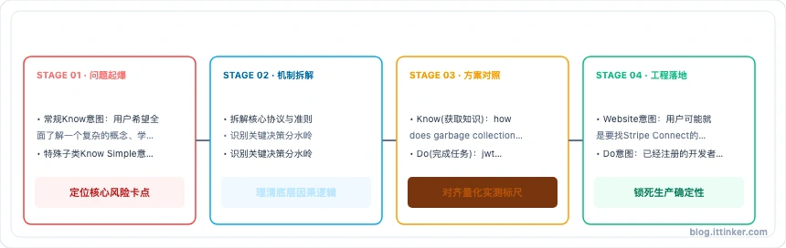
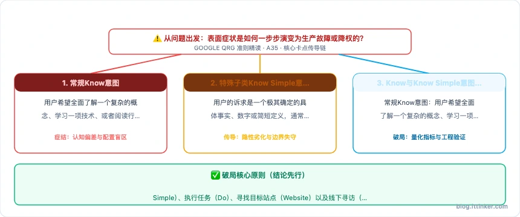
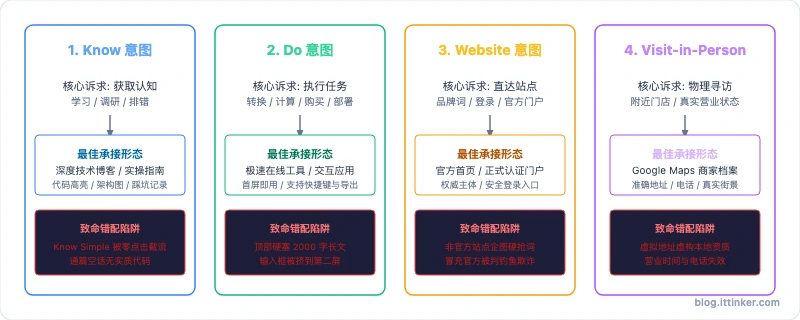
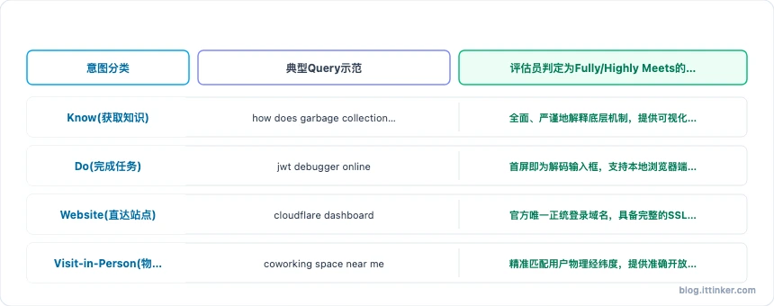
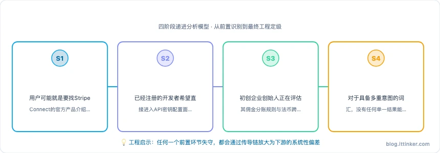
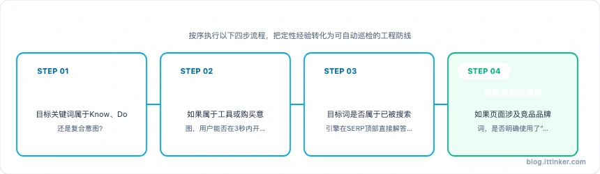

# Know、Do、Website、Visit-in-Person：搜索意图应该怎么分？QRG 12.7 用户意图全模型 | 读懂 Google Search 基础认知 系列 035

> 🌐 **在线阅读与互动版**：[Know、Do、Website、Visit-in-Person：搜索意图应该怎么分？QRG 12.7 用户意图全模型 | 读懂 Google Search 基础认知 系列 035](https://blog.ittinker.com/posts/know-do-website-visit-in-person-搜索意图应该怎么分/)
> 📚 **所属专栏**：[《读懂 Google Search：110篇搜索质量与SEO实战指南》](../README.md)

---

### 📌 结论先行（TL;DR）
**Google 将全球用户的搜索诉求高度归纳为四大基准意图：**获取知识（Know/Know Simple）**、**执行任务（Do）**、**寻找目标站点（Website）** 以及 **线下寻访（Visit-in-Person）**。**

1. QRG 12.7 明确指出，不同意图对应着截然不同的页面交付形态。
2. 很多独立开发者最大的失误，就是把明明属于“Do（在线完成任务）”的工具需求，机械写成了 3000 字的“Know（概念科普）”长文，导致搜索用户一进页面就疯狂寻找输入框，最终因为被文字淹没而立刻跳出。

在建立了多义词解释的分流意识之后（[A34](/posts/同一个关键词为什么可能有完全不同的意思/)），我们必须面对一个更具实操价值的分类学问题：

**当用户敲下键盘时，他在心理上究竟希望发生什么？**

他是想安安静静地阅读一篇技术架构分析？还是想要立刻下载一个 CLI 命令行工具？抑或仅仅是忘了某个站点的完整网址，拿 Google 当浏览器地址栏用？

在 Google 质量指南 QRG 第 12.7 节中，官方建立了一套行之有效、沿用至今的意图分类总模型。理解这套分类法，是设计 SaaS 落地页、技术博客与工具界面的底层依据。

---

## 1. 拆解 QRG 12.7：四大核心意图类型定义

QRG 第 12.7 节《Understanding User Intent》对四大意图作出了严谨界定：

> *"User intent can be classified into four primary categories:*
> - *1. **Know Query**: Users want to know information about a topic.*
> - *2. **Do Query**: Users want to act, make a purchase, download, or interact with a page.*
> - *3. **Website Query**: Users want to find a specific website or webpage they already have in mind.*
> - *4. **Visit-in-Person Query**: Users want to find information about a physical location or business to visit."*

我们分别剖析每个意图背后的判定标准：

### 1. Know 与 Know Simple 意图（QRG 12.7.1）
- **常规 Know 意图**：用户希望全面了解一个复杂的概念、学习一项技术、或者阅读行业调研。
  - *典型例子*：`how does postgresql vacuum work`、`kubernetes pod lifecycle`。
  - *承接形态*：深度技术博客、包含架构图的权威文档、经过实测的代码排障教程。
- **特殊子类 Know Simple 意图**：用户的诉求是一个极其确定的具体事实、数字或简短定义，通常能在手机屏幕上一两句话显示完全。
  - *典型例子*：`python latest stable version`、`usd to jpy rate`、`how tall is eiffel tower`。
  - *算法特征*：此类查询绝大多数已被 Google 的 **Featured Snippets（精选摘要）**、**Knowledge Panel（知识图谱）** 或 **AI Overviews** 在 SERP 顶部直接截流消化，用户往往“零点击（Zero-Click）”即走。

### 2. Do 意图（QRG 12.7.2）
用户意图非常功利：他们要立刻完成一项具体的数字交互、购买商品、下载软件或操作在线工具。
- *典型例子*：`json to yaml converter`、`buy cloudflare domain`、`download ffmpeg mac`。
- *承接形态*：即开即用的单功能 Web 应用、极简的下载按钮、流畅的购买收银台。页面不需要繁琐的前言，越早露出交互界面，Needs Met 得分越高。

### 3. Website 导航意图（QRG 12.7.3）
用户脑子里已经有了一个非常确定的特定站点或目标页面，但他懒得在浏览器地址栏敲全 URL，或者忘记了具体的二级域名路径。
- *典型例子*：`stripe dashboard login`、`github pricing`、`supabase docs`。
- *评级铁律*：针对明确的 Website Query，**只有该品牌的官方目标页面才能拿到 Fully Meets**。第三方写的“Stripe 登录步骤教程”，在此类词下属于毫无价值的干扰项。

### 4. Visit-in-Person 意图（QRG 12.7.4）
用户正在寻找现实生活中的物理实体位置，并打算亲自前往。
- *典型例子*：`coffee shop near me`、`apple store opening hours`、`atm open now`。
- *承接形态*：带有实时营业状态、Google 地图定位、联系电话与停车指引的 Google Business Profile 资料卡。

---

## 2. 四大搜索意图与最佳承接形态拓扑图

我们可以用以下矢量图清晰梳理四大意图的落地路径与核心交付物：

---

## 3. 四大意图类型深度特征对照表

以下表格系统总结了各类意图的衡量标尺与实战策略：

| 意图分类 | 典型 Query 示范 | 评估员判定为 Fully / Highly Meets 的条件 | 独立开发者的致命错配陷阱 |
|---|---|---|---|
| **Know (获取知识)** | `how does garbage collection work in v8` | 全面、严谨地解释底层机制，提供可视化生命周期图，指出高并发内存泄漏的最佳排查路径。 | 试图把一个明确事实的 Know Simple 词（如某个软件发布日期）硬写成 2000 字长文，被 Google 摘要直接打碎。 |
| **Do (完成任务)** | `jwt debugger online` | 首屏即为解码输入框，支持本地浏览器端加解密（保护隐私），无任何干扰性弹窗，点击即格式化。 | 误将 Do 当作 Know：在输入框上方强行堆砌 1500 字《什么是 JWT 原理》，让急需验证 Token 的工程师无法忍受。 |
| **Website (直达站点)** | `cloudflare dashboard` | 官方唯一正统登录域名，具备完整的 SSL 证书与安全重定向。 | 非官方自建站点试图通过长尾词去拦截主品牌词，由于缺乏官方权威度，Needs Met 评分被死死按在 Fails to Meet。 |
| **Visit-in-Person (物理寻访)** | `coworking space near me` | 精准匹配用户物理经纬度，提供准确开放时间、Wi-Fi 速度评价及真实工位工卡办理指引。 | 线上远程服务提供商企图假冒线下服务，导致被举报信息不实，连带引发 Google 商家封禁。 |

---

## 4. QRG 12.7.5：多重意图查询（Queries with Multiple Intents）的平衡艺术

在真实世界中，大量的查询词并不是单一维度的，而是包含了**多重复合意图（Multiple Intents）**。

例如搜索：**`stripe connect`**
1. **Website 意图**：用户可能就是要找 Stripe Connect 的官方产品介绍页；
2. **Do 意图**：已经注册的开发者希望直接进入 API 密钥配置面板，开启支付路由；
3. **Know 意图**：初创企业创始人正在评估其佣金分账规则与法币跨境合规限制。

### Google 评估员的裁决逻辑
对于具备多重意图的词汇，**没有任何单一结果能够独吞所有满意度**。
- 如果你的页面是一个权威的官方入口（Website），它能满足 50% 的导航用户；
- 如果你的博客是一篇深度的《Stripe Connect 平台分账与多商户踩坑实操代码》，你正好切中了那 30% 想要了解实施细节的开发者（Know / Do 复合意图）。

出海独立开发者的破局点，正是去承接官方文档“说得不够细、没有讲清楚的边缘场景”。

---

## 5. 出海产品意图校准的三步排错法

如果你发现自己的落地页跳出率极高、转化率低迷，请按照以下三步执行意图校准：

### 第一步：排查“意图错位（Intent Mismatch）”
检查页面首屏：输入框在不在？下载按钮显不显眼？
如果目标词包含 `generator`、`tool`、`calculator`、`converter`，页面必须是纯正的 **Do 意图产品**。坚决将所有的长篇文字介绍、SEO 百科挪到底部折叠区域，把首屏 100% 的视距留给工具本身。

### 第二步：过滤不可防御的“Know Simple 词”
如果你的内容团队还在花时间写诸如《What is Docker Version》、《HTTP Status 404 Definition》这类只有一句标准答案的词，请立即停止。
这类词的搜索结果第一屏早已被 Google 的知识面板和 AI 答案垄断，独立站点不可能从中获得有价值的商业点击。

### 第三步：打造复合意图的“即学即用（Learn-and-Do）”双重体验
对于技术类 SaaS 或开源工具，最强大的形态是 **Know + Do 复合体**：
- 上半部分直截了当给出可复制的配置命令（满足 Do 意图）；
- 下半部分提供深入的架构原理解析与常见报错排查矩阵（满足 Know 意图）。用户无需在多个 Tab 之间反复横跳，页面就能同时收割两波需求。

---

## 6. 独立开发者搜索意图校准清单

在发布任何新工具或商业文章前，完成以下自检：

- [ ] **意图属性定性**：目标关键词属于 Know、Do 还是复合意图？
- [ ] **首屏交互优先（针对 Do 词）**：如果属于工具或购买意图，用户能否在 3 秒内开始操作，而无需向下滚动页面？
- [ ] **避开零点击红海**：目标词是否属于已被搜索引擎在 SERP 顶部直接解答的“Know Simple”短事实？
- [ ] **导航意图防侵权**：如果页面涉及竞品品牌词，是否明确使用了“Review / Alternative / Guide”等修饰词，而非伪装成官方门户？
- [ ] **承接形态契合度**：在 Google 搜索该词，排名前三的页面形态是计算器、视频、长文还是问答？你的页面形态是否符合主流用户预期？

---

## 下一篇预告

彻底搞懂了用户的四大意图（Know, Do, Website, Visit-in-Person）之后，我们还需要建立一个更具前瞻性的产品视角：

**Google 现在的搜索结果页（SERP），本身就已经演变成了一个极其复杂的“操作系统级产品界面”。**

Result Block、Web Result、Special Content Result、Featured Snippets、Knowledge Panel 以及最新的 AI Overviews……

用户在很多时候甚至根本不需要点击进入你的网站，就已经在 Google 自己的界面上完成了任务！作为出海开发者，我们该如何在这个全新的“界面生态”中生存并获取高价值增量？

下一篇，我们将深入拆解 QRG 12.8：**[Google 搜索结果本身也是一种“产品界面”：Web Result、Block 与零点击博弈（A36）](/posts/google-搜索结果本身也是一种-产品界面/)**。

---

_这是「读懂 Google Search」系列第 35 篇，系统拆解 Google 官方质量指南，帮你建立长期抗算法波动的出海 SEO 护城河。_

---

## 读懂 Google Search 专栏导航

> 📚 **专栏收录**：本文为 [《读懂 Google Search：110篇搜索质量与SEO实战指南》](/posts/google-search-guide/) 第 **A35** 篇。

* **专栏主页**：[《读懂 Google Search：110篇搜索质量与SEO实战指南》全景地图与路线图](/posts/google-search-guide/)
