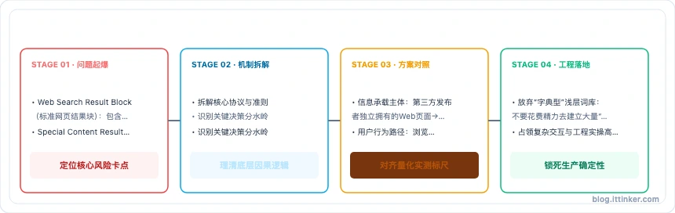
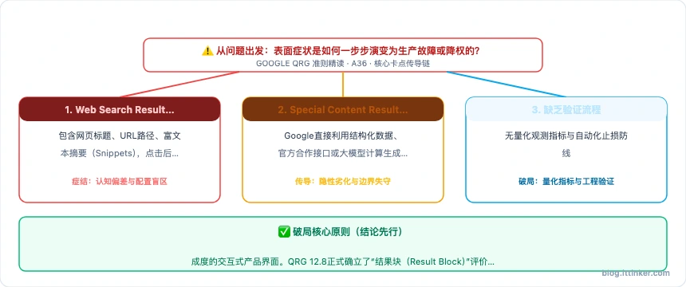
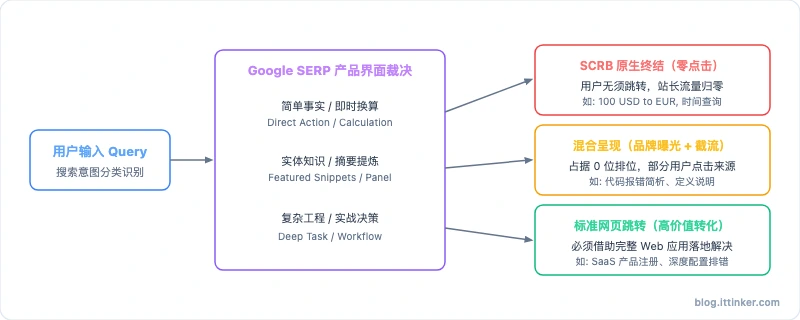
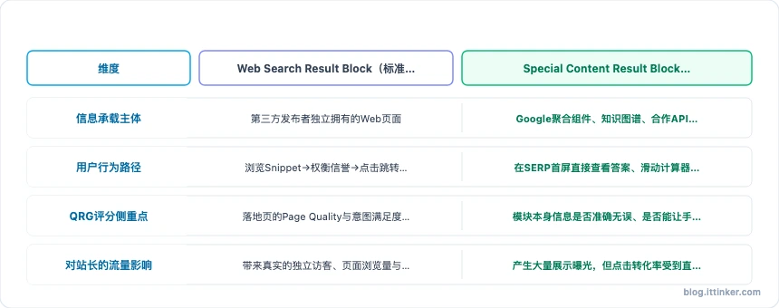
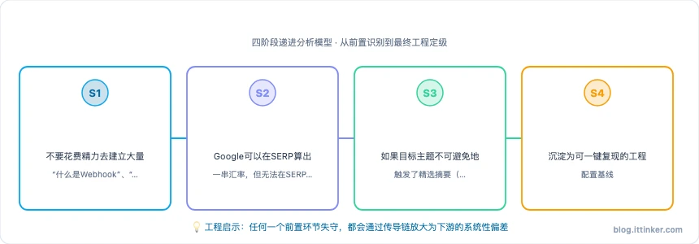
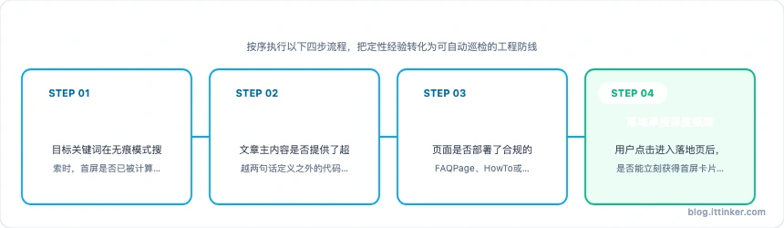

# “Needs Met 到底在评什么”？需求满足度（NM）核心打分逻辑 | 读懂 Google Search 基础认知 系列 036

> 🌐 **在线阅读与互动版**：[“Needs Met 到底在评什么”？需求满足度（NM）核心打分逻辑 | 读懂 Google Search 基础认知 系列 036](https://blog.ittinker.com/posts/google-搜索结果本身也是一种-产品界面/)
> 📚 **所属专栏**：[《读懂 Google Search：110篇搜索质量与SEO实战指南》](../README.md)

---

### 📌 结论先行（TL;DR）
> **Google 搜索结果页（SERP）早已脱离纯粹的“网页目录索引”，进化为一个高集成度的交互式产品界面。**
> **在传统 SEO 观念中，很多人把 Google 当作一个“把访客送到目标网站的传送门”。站长只要做好标题和描述，等待用户点击蓝色链接跳入自己的落地页即可。**
> **QRG 第 12.8 节揭示了完全不同的底层事实：**Google 自身就是一个聚合应用，SERP 是它直接面向用户交付价值的操作界面。** 用户很多时候根本不需要离开 Google，任务已经在搜索框下方直接终结。**
>
> - QRG 12.8 正式确立了“结果块（Result Block）”评价框架，把内容划分为标准网页结果与特殊内容结果块（SCRB）。
> - 面对搜索引擎在首屏直接截留答案的“零点击”趋势，站长必须停止生产纯定义类浅层内容，转而在深度交互工具、实操链路以及专有数据等无法被首屏直接解构的场景下构建护城河。

---

### 🚨 2026 → 2024 官方最新风向预警：Google 对Google SERP 界面与零点击搜索（Zero-click & AI Overview）的演进的策略演进

#### 🕒 2026 → 2024 Google 官方对Google SERP 界面与零点击搜索（Zero-click & AI Overview）的演进的策略演进

- **2026 · AI Overview 引用源遴选机制透明化**
  Google AI Overview（前 SGE）全面普及。只有那些拥有高权威度、结构化清晰且具备独占数据的优质页面，才能成为大模型首屏提炼的核心引用源，获取高质量精准引流。

- **2025 · 零点击搜索（Zero-click）占比突破历史峰值**
  超过 60% 的基础事实搜索在 SERP 界面直接完成消耗，倒逼独立开发者必须彻底告别搬砖类浅层内容，转向强交互、长留存的深水区产品。

- **2024 · QRG 第 13 章对 SERP 结果块与界面形态的评估规范**
  指南将传统网页链接与图谱卡片、直接答案块置于同一评测体系，要求评估员客观审视不同结果载体对用户任务交付的效率差异。

---

## 1. 拆解 QRG 12.8：结果块（Result Block）的三大形态

QRG 第 12.8 节《Rating Result Blocks: Web Results and Special Content Result Blocks》明确规定了评估员面对的 SERP 组成构件：

> *"A result block is a section of a search results page that can be evaluated as a unit. It can be a Web Search Result, or it can be a Special Content Result Block (SCRB)... Some Special Content Result Blocks are designed to show results directly on the search engine results page, so that users do not need to click to another webpage to get the information they are looking for."*

官方将搜索结果单元划分为两大核心类型：

1. **Web Search Result Block（标准网页结果块）**：包含网页标题、URL 路径、富文本摘要（Snippets），点击后跳转至第三方站点的传统形态。
2. **Special Content Result Block (SCRB，特殊内容结果块)**：Google 直接利用结构化数据、官方合作接口或大模型计算生成的就地交互模块。典型代表包括货币转换计算器、天气预报板、航班状态追踪、知识面板（Knowledge Panel）、精选摘要（Featured Snippets）以及当下的 AI Overviews。

这种形态划分彻底改变了评估规则：**评估员不仅给跳转页面打分，更在直接评估 SCRB 块是否已经完全化解了用户的当下诉求。**

---

## 2. SERP 产品界面的流量分流机制

以下矢量架构图展示了用户输入 Query 后，Google 产品界面内部的分流处理流程：

---

## 3. Web Result 与 SCRB 的多维对比

评估员在判定不同模块质量时，依据的标准存在明显分野：

| 维度 | Web Search Result Block（标准网页结果） | Special Content Result Block (SCRB) |
|---|---|---|
| **信息承载主体** | 第三方发布者独立拥有的 Web 页面 | Google 聚合组件、知识图谱、合作 API 或大模型抽取 |
| **用户行为路径** | 浏览 Snippet → 权衡信誉 → 点击跳转落地页 | 在 SERP 首屏直接查看答案、滑动计算器或展开摘要卡片 |
| **QRG 评分侧重点** | 落地页的 Page Quality 与意图满足度（Needs Met） | 模块本身信息是否准确无误、是否能让手机端用户省去跳转 |
| **对站长的流量影响** | 带来真实的独立访客、页面浏览量与转化可能 | 产生大量展示曝光，但点击转化率受到直接压制（零点击） |
| **典型被替代风险** | 纯信息搬运、词汇解释、基础公式计算 | 高度安全：复杂的私有业务逻辑、在线 IDE、协同应用 |

---

## 4. 零点击博弈下独立开发者的突围路径

根据行业数据机构 SparkToro 持续追踪的统计，全球超过 60% 的移动端 Google 搜索以“零点击（Zero-Click Search）”收尾。用户拿到了答案，而最初提供数据的站点一无所获。

面对将 SERP 打造为“全能终端”的 Google，技术创作者和独立站长应当采取三条防御策略：

### 放弃“字典型”浅层词库
不要花费精力去建立大量“什么是 Webhook”、“JSON 格式说明”这类两句话就能解释明白的名词解释页面。这类 Query 会被 Google 的 SCRB 或 AI Overviews 完整吞并。在首屏已经能看全定义的场景下，用户没有动机展开外部网页。

### 占领复杂交互与工程实操高地
Google 可以在 SERP 算出一串汇率，但无法在 SERP 帮用户把本地 Docker 容器编排起来，也无法替用户完成复杂 JWT 鉴权与 Stripe 订阅调试。将内容深度推进至**“工程实操”、“自动化配置模板下载”、“长链路排错案例”**，迫使真实需求必须落在完整的 Web 界面中才能交付。

### 将精选摘要当作品牌漏斗入口
如果目标主题不可避免地触发了精选摘要（Featured Snippets），确保在正文首段提炼结构化清单给 Google 抓取的同时，在正文第二屏提供无法通过简单卡片概括的独家数据、可视化图表或可下载源码，把单向的“答题被偷”转化为“品牌信任引流”。

---

## 5. 独立开发者 SERP 适应性自查清单

在规划出海产品内容矩阵与着陆页时，建议对照以下项目展开校验：

- [ ] **搜索现场推演**：目标关键词在无痕模式搜索时，首屏是否已被计算器、知识面板或 AI 摘要填满？
- [ ] **避免纯名词卡片**：文章主内容是否提供了超越两句话定义之外的代码实测或架构选型方案？
- [ ] **结构化标记合规**：页面是否部署了合规的 `FAQPage`、`HowTo` 或 `SoftwareApplication` Schema 标记？
- [ ] **落地承接深度核验**：用户点击进入落地页后，是否能立刻获得首屏卡片无法提供的深层工具或全套配置？
- [ ] **品牌词排他性固化**：搜寻自身产品或独立开发者名号时，官方主站与 GitHub 开源库是否稳居首屏顶部？

---

## 下一篇预告

既然 Google 搜索结果是一套以解决用户问题为导向的交互界面，那么系统内部用什么标尺来量化“一个结果究竟帮到了用户多大忙”？

下一篇，我们将进入 QRG 最具实战分量的第二大支柱：**[“文章写得再好为什么就是没排名”？脱离需求的孤芳自赏：Needs Met 到底在评什么？从‘页面好不好’到‘对当前 Query 有多大用’（A37）](/posts/needs-met-到底在评什么/)**。

---

_这是「读懂 Google Search」系列第 36 篇，系统拆解 Google 官方质量指南，帮你建立长期抗算法波动的出海 SEO 护城河。_

---

## 读懂 Google Search 专栏导航

> 📚 **专栏收录**：本文为 [《读懂 Google Search：110篇搜索质量与SEO实战指南》](/posts/google-search-guide/) 第 **A36** 篇。

* **专栏主页**：[《读懂 Google Search：110篇搜索质量与SEO实战指南》全景地图与路线图](/posts/google-search-guide/)
