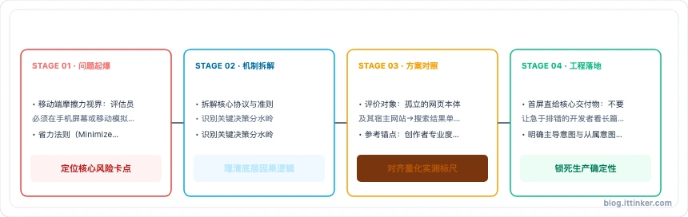
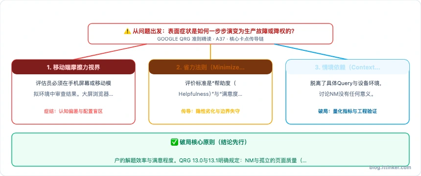
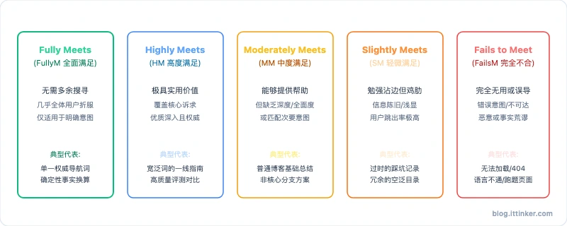
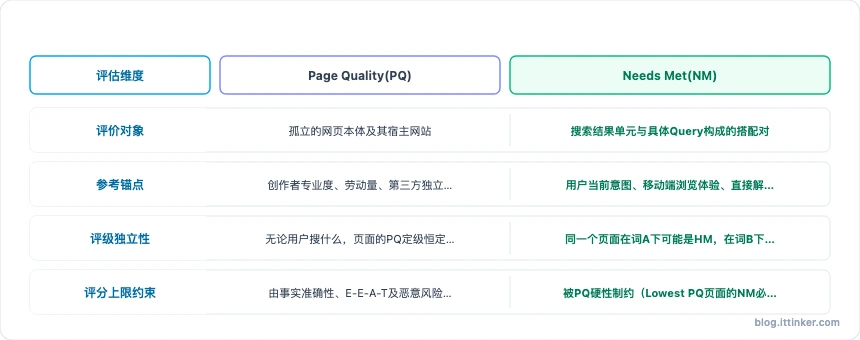
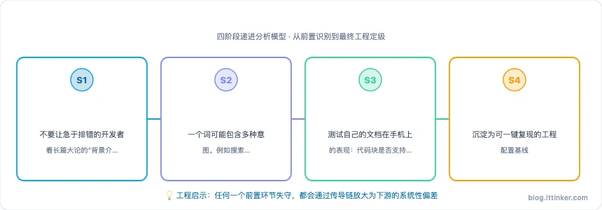
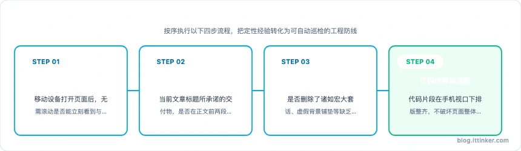

# “文章写得再好为什么就是没排名”？脱离需求的孤芳自赏：Needs Met 到底在评什么？从‘页面好不好’到‘对当前 Query 有多大用’ | 读懂 Google Search 基础认知 系列 037

> 🌐 **在线阅读与互动版**：[“文章写得再好为什么就是没排名”？脱离需求的孤芳自赏：Needs Met 到底在评什么？从‘页面好不好’到‘对当前 Query 有多大用’ | 读懂 Google Search 基础认知 系列 037](https://blog.ittinker.com/posts/needs-met-到底在评什么/)
> 📚 **所属专栏**：[《读懂 Google Search：110篇搜索质量与SEO实战指南》](../README.md)

---

### 📌 结论先行（TL;DR）
> **Needs Met（需求满足度，简称 NM）衡量的是搜索结果针对特定 Query 及移动端用户的解题效率与满意程度。**
> **许多技术站长经历过这样的困惑：自己花了数周时间写出一篇上万字的架构剖析，代码严密、无广告打扰、站外声誉良好，在 Page Quality 维度绝对属于 High。但在某些核心长尾词下，排名却落后于一个只有 300 字、甚至略显粗糙的单功能脚本页面。**
> **造成这种反差的根源，在于混淆了 Google 搜索评测的两套独立坐标系。QRG 将评估员的工作划分为两大支柱：**Page Quality 评价页面本身的工艺水准，Needs Met 则评价结果对当前搜索词的救场能力。**
>
> - QRG 13.0 与 13.1 明确规定：NM 与孤立的页面质量（Page Quality）完全解耦，它始终绑定具体搜索词、用户所处地理位置以及移动设备场景。
> - **即便页面由顶尖专家撰写、排版无可挑剔**：只要偏离了搜索词背后的核心意图，评级就会被严厉压低。

---

### 🚨 2026 → 2024 官方最新风向预警：Google 对Google Needs Met（需求满足度）评级体系的演进的策略演进

#### 🕒 2026 → 2024 Google 官方对Google Needs Met（需求满足度）评级体系的演进的策略演进

- **2026 · Needs Met 成为排名算法的主导驱动轮**
  算法彻底拉开内容内在质量（PQ）与外在意图满足度（NM）的判定逻辑。一个内容极佳但跑题的页面被断然否决，而一个精简但一击即中解决用户燃眉之急的页面高居榜首。

- **2025 · 端到端满意度信号实时闭环反馈**
  借助 Chrome 真实停留与再次搜索行为，Google 动态核准并修正各个结果的实际 Needs Met 分数，任何表面华丽但让用户无功而返的页面都会遭遇惩罚。

- **2024 · QRG 第 14 章 Needs Met 评分标尺的建立**
  规范确立了从 Fully Meets（完美全包）、Highly Meets（高度满足）到 Fails to Meet（完全未满足）的五档阶梯标尺，成为衡量搜索有用性的最高裁决者。

---

## 1. 拆解 QRG 13.0：移动设备优先的解题视角

QRG 第 13.0 节《Needs Met Rating and User Needs》开门见山确立了 NM 评级的核心观察口径：

> *"Needs Met rating tasks ask you to focus on mobile user needs and think about how helpful and satisfying the result is for the mobile user... Mobile users are often on the go, using small screens, and may have limited time or bandwidth. A result that is helpful and satisfying should minimize the effort required to find what they need."*

这段定义的关键点包括：

1. **移动端摩擦力视界**：评估员必须在手机屏幕或移动模拟环境中审查结果。大屏浏览器上看起来舒适的排版，如果让移动端用户滚动三屏才看到正文，在 NM 评分中会受到严重惩戒。
2. **省力法则（Minimize Effort）**：评价标准是“帮助度（Helpfulness）”与“满意度（Satisfaction）”。用户从输入词条到获得满意解答所耗费的点击、翻页、缩放与思考成本越低，得分越高。
3. **情境依赖（Context Dependence）**：脱离了具体 Query 与设备环境，讨论 NM 没有任何意义。

---

## 2. QRG 13.1：Needs Met 五级阶梯评分标尺

QRG 第 13.1 节构建了一套清晰的五级判定阶梯，并在相邻档位之间允许评估员打出中间分（如 Highly Meets+）：

---

## 3. Page Quality 与 Needs Met 的核心差异

为了彻底戒断“好文章必然排首页”的思维定势，必须理清两个标尺的底层逻辑差异：

| 评估维度 | Page Quality (PQ) | Needs Met (NM) |
|---|---|---|
| **评价对象** | 孤立的网页本体及其宿主网站 | 搜索结果单元与具体 Query 构成的搭配对 |
| **参考锚点** | 创作者专业度、劳动量、第三方独立声誉、安全底线 | 用户当前意图、移动端浏览体验、直接解题速度 |
| **评级独立性** | 无论用户搜什么，页面的 PQ 定级恒定不变 | 同一个页面在词 A 下可能是 HM，在词 B 下直接判定为 FailsM |
| **评分上限约束** | 由事实准确性、E-E-A-T 及恶意风险决定上限 | 被 PQ 硬性制约（Lowest PQ 页面的 NM 必须评为 FailsM） |
| **开发者优化动作** | 完善作者信息、提升原创深度、清理恶意弹窗、积累站外引用 | 匹配搜索意图、压缩首屏信息路径、精准命名 Title、提供直接答案 |

---

## 4. 落地实操：用 NM 标尺反推产品着陆页

明确了 NM 的评定规则后，独立开发者在设计产品首页或技术文档时，应当遵循三项原则：

### 首屏直给核心交付物
不要让急于排错的开发者看长篇大论的“背景介绍”与“行业展望”。如果目标关键词是排错或配置命令，正文第一屏必须直接贴出经过验证的命令块与关键参数说明，把用户的滑动与查找阻力降到最低。

### 明确主导意图与从属意图
一个词可能包含多种意图。例如搜索 `tailwindcss`，主导意图是访问官网或查看快速入门（Website / Know）。你的博客若想拿下 Highly Meets，就不能只写简单的介绍，而应当提供官方文档未覆盖的工程场景（如多主题切换实装、与现代前端构建工具联调的避坑脚本），为核心意图提供增量价值。

### 严防移动端交互灾难
测试自己的文档在手机上的表现：代码块是否支持横向滑动？表格是否严重变形？字体是否需要手动放大？一旦移动端呈现混乱，评估员就会依据 QRG 13.0 直接下调 NM 评级。

---

## 5. 独立开发者 Needs Met 诊断清单

在追踪核心页面排名异动时，可以依序核对以下要点：

- [ ] **手机端首屏触达率**：移动设备打开页面后，无需滚动是否能立刻看到与 Query 强相关的核心答案？
- [ ] **意图强绑定核验**：当前文章标题所承诺的交付物，是否在正文前两段得到兑现？
- [ ] **冗余背景剔除**：是否删除了诸如宏大套话、虚假背景铺垫等缺乏信息密度的垫话？
- [ ] **代码块移动适配**：代码片段在手机视口下排版整齐，不破坏页面整体宽度与行内可读性？
- [ ] **站内下一步路径明晰**：当用户吸收完基础方案后，是否能自然点击进一步查看深度配置？

---

## 下一篇预告

在 Needs Met 的五级阶梯中，最高的一档叫做 **Fully Meets**。

不少站长以为只要把文章写到极致，就能拿到这顶皇冠。然而 QRG 给 Fully Meets 设立的门槛极其严苛，在很多场景下它甚至根本不可能出现。

下一篇，我们将探讨：**[“所有词都想拿 Fully Meets”？不自量力的虚妄目标：为什么苛刻条件与宽泛词天然不存在‘完美解’？（A38）](/posts/什么结果才配得上-fully-meets/)**。

---

_这是「读懂 Google Search」系列第 37 篇，系统拆解 Google 官方质量指南，帮你建立长期抗算法波动的出海 SEO 护城河。_

---

## 读懂 Google Search 专栏导航

> 📚 **专栏收录**：本文为 [《读懂 Google Search：110篇搜索质量与SEO实战指南》](/posts/google-search-guide/) 第 **A37** 篇。

* **专栏主页**：[《读懂 Google Search：110篇搜索质量与SEO实战指南》全景地图与路线图](/posts/google-search-guide/)
