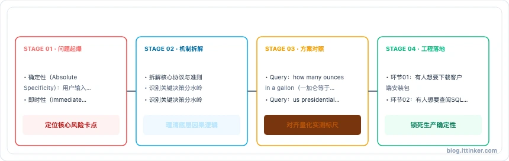
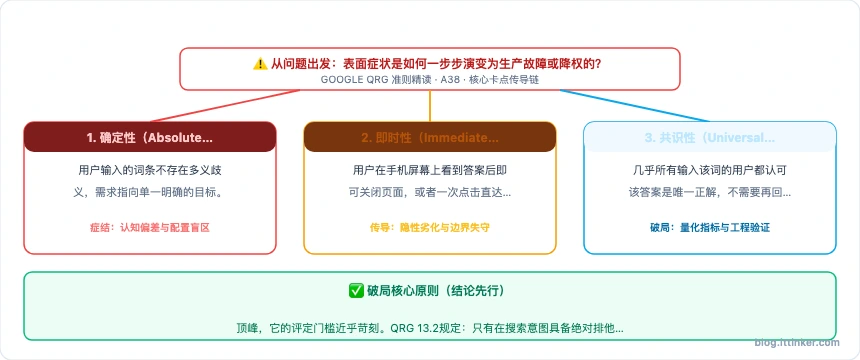
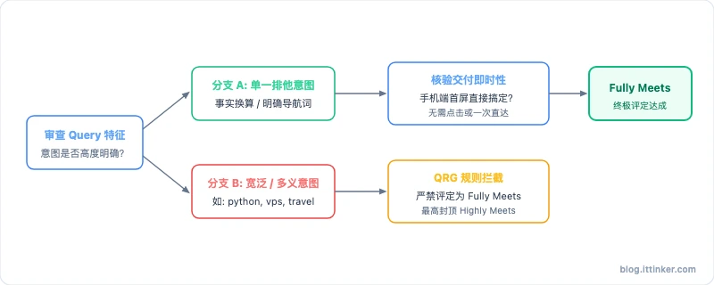
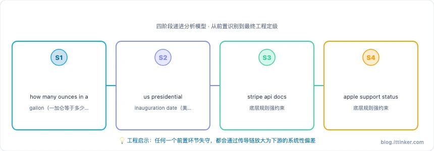
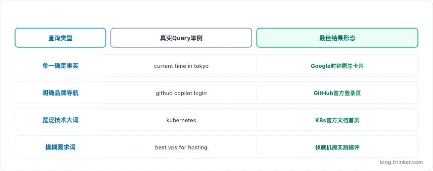
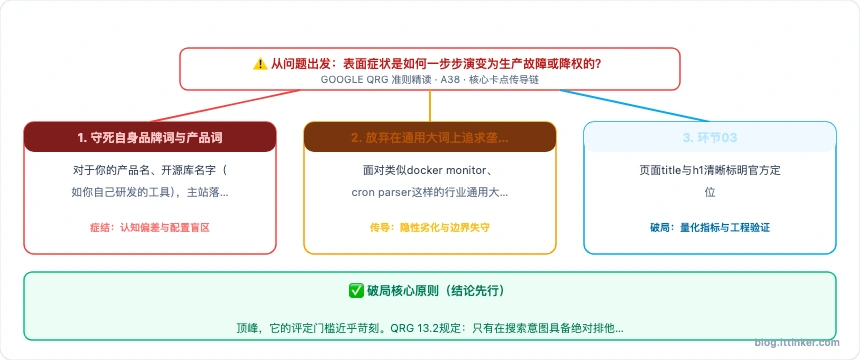
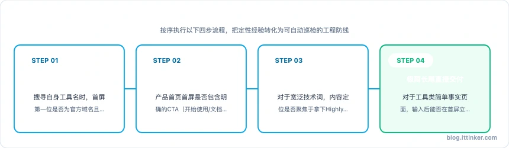

# “绝大多数页面的上限”？Highly Meets 核心特征与落地指南 | 读懂 Google Search 基础认知 系列 038

> 🌐 **在线阅读与互动版**：[“绝大多数页面的上限”？Highly Meets 核心特征与落地指南 | 读懂 Google Search 基础认知 系列 038](https://blog.ittinker.com/posts/什么结果才配得上-fully-meets/)
> 📚 **所属专栏**：[《读懂 Google Search：110篇搜索质量与SEO实战指南》](../README.md)

---

### 📌 结论先行（TL;DR）
> **Fully Meets（FullyM，完全满足）是 Google 需求满足度（Needs Met）标尺的顶峰，它的评定门槛近乎苛刻。**
> **在很多站长的设想中，只要自己的技术教程足够详实、文档覆盖了每一个参数，就应该拿到最高分 Fully Meets。**
> **然而翻开 QRG 13.2 会发现，Google 评估体系对 Fully Meets 的发放极其吝啬。它并非用来奖励“文笔极佳的深度长文”，而是专门为**“意图极其明确、答案毫无争议且能瞬间交付”**的特定场景量身定制的终极评级。**
>
> - **QRG 13.2 规定**：只有在搜索意图具备绝对排他性、且该结果让绝大多数移动端用户省去任何多余翻找的前提下，才能打出 FullyM。
> - **面对意图发散的宽泛词**：QRG 严禁评估员给出 FullyM。
> - **独立开发者无需在泛词上妄想垄断**：而应将自身品牌词打造成毫无争议的 FullyM 标杆。

---

### 🚨 2026 → 2024 官方最新风向预警：Google 对Google Fully Meets 最高满足度评级的苛刻门槛与演进的策略演进

#### 🕒 2026 → 2024 Google 官方对Google Fully Meets 最高满足度评级的苛刻门槛与演进的策略演进

- **2026 · Fully Meets 评级的极端稀缺性机制**
  Google 明确：Fully Meets 只属于那些目标明确且用户毫无歧义的查询（如搜具体品牌官网、搜精确汇率公式）。在 90% 以上的商业与通用搜索中，追求 Fully Meets 纯属盲目妄想。

- **2025 · 宽泛词的多样化满足体系（Broad Query Ecosystem）**
  针对宽泛探索词，算法转向构建多角度、多维度的 Highly Meets 矩阵，任何试图用单一页面‘统领全行业’的自大架构均遭遇拆解分流。

- **2024 · QRG 14.1 节对 Fully Meets 苛刻限制条件的铁律规范**
  指南用大量反面案例警醒评估员：除非几乎 100% 的用户看到该结果后都立刻停手且极其满意，否则绝不允许滥发 Fully Meets 评级。

---

## 1. 拆解 QRG 13.2：Fully Meets 的严苛判卷门槛

QRG 第 13.2 节《Fully Meets (FullyM)》给出了定性基准：

> *"A rating of Fully Meets (FullyM) should be given if a result or SCRB is completely satisfying and immediately answers the query. All or almost all mobile users would be satisfied and would not need to look at other results to satisfy their need... The Fully Meets rating is reserved for results that are the 'complete and satisfying' answer, so that users do not need to look at other results."*

要配得上这个评级，必须同时满足三个硬性条件：

1. **确定性（Absolute Specificity）**：用户输入的词条不存在多义歧义，需求指向单一明确的目标。
2. **即时性（Immediate Gratification）**：用户在手机屏幕上看到答案后即可关闭页面，或者一次点击直达目标功能点。
3. **共识性（Universal Consensus）**：几乎所有输入该词的用户都认可该答案是唯一正解，不需要再回退到 SERP 寻找补充。

QRG 特别强调：**一旦用户还需要滑动浏览第二段、或者还需要返回搜索结果查看其他网页，该结果就必须从 Fully Meets 降档至 Highly Meets。**

---

## 2. Fully Meets 的准入判定决策树

以下矢量架构图展示了评估员面对一个搜索词与落地页时，如何推演判定是否配得上 Fully Meets：

---

## 3. 唯二通行的经典 Fully Meets 场景

根据 QRG 13.2.1 与 13.2.2 的官方实例，能够合法获得 Fully Meets 的场景仅有两类：

### 场景一：明确单一事实查询（Know Simple）
当用户查询客观公认的简单数据时，Google 的原生结果卡片（SCRB）或权威维基条目能够直接给出答案：
- **Query**: `how many ounces in a gallon`（一加仑等于多少盎司）
  - **结果**: Google 计算器直接给出 `128`。
  - **评级**: **Fully Meets**。没有任何用户在看到 128 后还需要点击其他网页。
- **Query**: `us presidential inauguration date`（美国总统就职典礼日期）
  - **结果**: 权威知识卡片直接展示 `January 20`。
  - **评级**: **Fully Meets**。

### 场景二：清晰明确的导航型查询（Website Intent）
当用户明确想要进入某个具体机构、产品或平台的入口时，该主体的官方对应页面是唯一正解：
- **Query**: `stripe api docs`
  - **结果**: Stripe 官方文档首页 `docs.stripe.com`。
  - **评级**: **Fully Meets**。任何第三方写的教程哪怕再精彩，用户的第一意图也是看官方规范。
- **Query**: `apple support status`
  - **结果**: Apple 官方系统运行状态看板。
  - **评级**: **Fully Meets**。

---

## 4. 宽泛词的“无解之境”：为什么泛词绝无 Fully Meets？

QRG 第 13.2.1 节设下一条铁律：

> *"Broad or ambiguous queries should not have a Fully Meets rating because there is no one result that will satisfy all or almost all users."*

例如当用户在搜索框输入 `PostgreSQL` 时：
- 有人想要下载客户端安装包；
- 有人想要查阅 SQL 语法手册；
- 有人想要看 PG 与 MySQL 的性能测试对比；
- 有人仅仅是刚听说这个词，想知道它是什么。

在这种情况下，即便 PostgreSQL 官方网站 `postgresql.org` 权重极高，评估员也**只能打出 Highly Meets，绝不能评为 Fully Meets**。因为对于想看中立评测、性能压测或实战踩坑的用户而言，官方主页并不能全面满足其诉求。

| 查询类型 | 真实 Query 举例 | 最佳结果形态 | 评级上限 | 降级根源 |
|---|---|---|---|---|
| **单一确定事实** | `current time in tokyo` | Google 时钟原生卡片 | **Fully Meets** | 无歧义、无后续搜寻需要 |
| **明确品牌导航** | `github copilot login` | GitHub 官方登录页 | **Fully Meets** | 核心诉求唯一直达 |
| **宽泛技术大词** | `kubernetes` | K8s 官方文档首页 | **Highly Meets** | 意图多样，存在教程与生态需求 |
| **模糊需求词** | `best vps for hosting` | 权威机房实测横评 | **Highly Meets** | 主观偏好各异，无唯一标准答案 |
| **多义词** | `apple` | 苹果公司官网 / 水果维基 | **Highly Meets** | 词义分流，需覆盖不同人群 |

---

## 5. 独立开发者在 Fully Meets 战场的防御法则

搞清楚 Fully Meets 的评判底线后，独立开发者的 SEO 投入策略应当做出相应调整：

### 守死自身品牌词与产品词
对于你的产品名、开源库名字（如你自己研发的工具），主站落地页与文档库必须做到绝对的 Fully Meets：
- 页面 `title` 与 `h1` 清晰标明官方定位；
- 首屏提供无障碍的直接入口（一键下载、注册或文档入口）；
- 配置规范的组织架构与软件 Schema 标记，让 Google 能够轻松生成精准的 Sitelinks。

### 放弃在通用大词上追求垄断
面对类似 `docker monitor`、`cron parser` 这样的行业通用大词，不要试图打造一个企图解答一切的“巨无霸页面”去冲刺 Fully Meets。正确的打法是针对特定垂直场景（如“轻量级多机 Docker 状态监控实录”），提供官方文档所缺失的高密度实战代码与一手踩坑实测，稳健锁定 **Highly Meets**。

---

## 6. 独立开发者 Fully Meets 落地自查清单

在审视自有站点的页面布局时，逐项核对以下准则：

- [ ] **品牌导航零跳转阻力**：搜寻自身工具名时，首屏第一位是否为官方域名且无危险重定向？
- [ ] **品牌词首屏直达功能**：产品首页首屏是否包含明确的 CTA（开始使用/文档链接），避免让用户多层翻找？
- [ ] **泛词预期理性校准**：对于宽泛技术词，内容定位是否聚焦于拿下 Highly Meets 的深度实操，而非泛泛而谈？
- [ ] **极简长尾直接交付**：对于工具类简单事实页面，输入后能否在首屏立即展示计算结果或配置输出？
- [ ] **消除歧义命名干扰**：自己的产品命名是否与现存知名名词发生严重重叠？如有重叠，是否在 Meta 描述中强化了技术品类修饰？

---

## 下一篇预告

既然在绝大多数搜索场景中，宽泛词与复合需求词根本不可能产生 Fully Meets，那么首页排名的真正厮杀，就集中在次一级的主战场：**Highly Meets、Moderately Meets 与 Slightly Meets**。

一篇高质量的技术指南，为什么有时只能拿到 Moderately？评估员根据什么细节在“高度有用”与“勉强能用”之间切下一刀？

下一篇，我们将探讨：**[“中段排名的量化标尺到底在哪”？毫厘之间的位次之争：Highly、Moderately、Slightly Meets 的真实分界线（A39）](/posts/highly-moderately-slightly-meets-的边界怎么判断/)**。

---

_这是「读懂 Google Search」系列第 38 篇，系统拆解 Google 官方质量指南，帮你建立长期抗算法波动的出海 SEO 护城河。_

---

## 读懂 Google Search 专栏导航

> 📚 **专栏收录**：本文为 [《读懂 Google Search：110篇搜索质量与SEO实战指南》](/posts/google-search-guide/) 第 **A38** 篇。

* **专栏主页**：[《读懂 Google Search：110篇搜索质量与SEO实战指南》全景地图与路线图](/posts/google-search-guide/)
