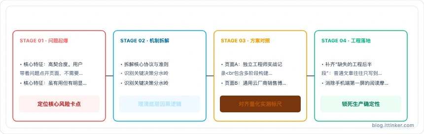
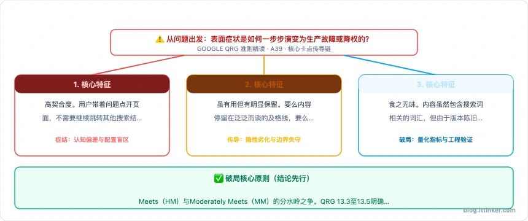
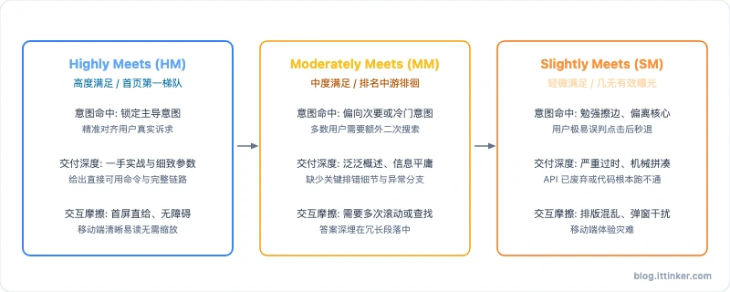
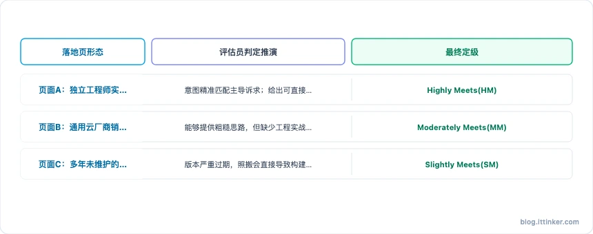
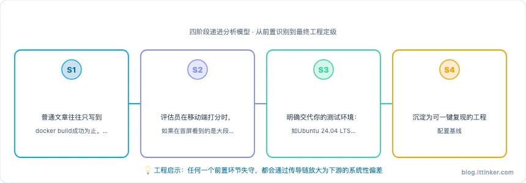
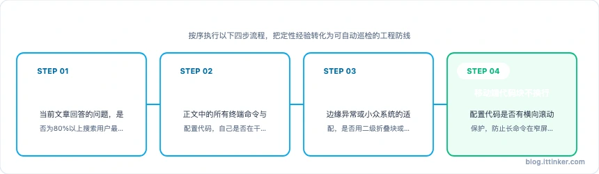

# Highly、Moderately、Slightly Meets 的边界怎么判断？SERP 中段评价的量化标尺 | 读懂 Google Search 基础认知 系列 039

> 🌐 **在线阅读与互动版**：[Highly、Moderately、Slightly Meets 的边界怎么判断？SERP 中段评价的量化标尺 | 读懂 Google Search 基础认知 系列 039](https://blog.ittinker.com/posts/highly-moderately-slightly-meets-的边界怎么判断/)
> 📚 **所属专栏**：[《读懂 Google Search：110篇搜索质量与SEO实战指南》](../README.md)

---

### 📌 结论先行（TL;DR）
**在排除极端案例后，Google 搜索结果页绝大多数席位的排位博弈，实质是 Highly Meets（HM）与 Moderately Meets（MM）的分水岭之争。**

1. QRG 13.3 至 13.5 明确划分了三者界限：HM 要求结果精准击中主导意图、具备高度实用性且移动端阅读摩擦极小；
2. MM 往往受困于命中次要意图、内容深度平庸或要求用户多次翻找；
3. SM 则落入边缘沾边、陈旧或信息稀薄的食之无味区间。

很多站长在复盘自己的文章时感到委屈：“我的教程明明把配置步骤写出来了，为什么排名死活卡在第二页，始终挤不进前三？”

答案就藏在 QRG 对中段评级的量化细则中。在 Google 的评估体系里，“能用（Useful）”与“让人满意（Satisfying）”存在着巨大的鸿沟。评卷员在判定一个页面是 Highly 还是 Moderately 时，依据的是一套极其严谨的判定基准。

---

## 1. 拆解 QRG 13.3 ~ 13.5：中段评级标准定义

QRG 在第 13.3、13.4 与 13.5 节中，逐级定义了中段三大评级的核心特征：

### Highly Meets (QRG 13.3)
> *"A rating of Highly Meets (HM) should be given to results that are very helpful, high quality, authoritative, entertaining, or timely... Highly Meets results fit the query well and all or most users would be satisfied by them. These results should have a good 'fit' between the query and the result."*
- **核心特征**：高契合度。用户带着问题点开页面，不需要继续跳转其他搜索结果，主导意图得到全面解答。

### Moderately Meets (QRG 13.4)
> *"A rating of Moderately Meets (MM) should be given to results that are helpful for many or some users, or for a secondary interpretation of the query. Moderately Meets results may fit the query well, but not be comprehensive, or they may be comprehensive for a minor aspect of the query."*
- **核心特征**：虽有用但有明显保留。要么内容停留在泛泛而谈的及格线，要么只解答了冷门次要分支，未能直接给主导需求痛快一击。

### Slightly Meets (QRG 13.5)
> *"A rating of Slightly Meets (SM) should be given to results that are helpful for fewer users, or only tangential to the query... They may be out of date, too specific, too broad, or have low Page Quality."*
- **核心特征**：食之无味。内容虽然包含搜索词相关的词汇，但由于版本陈旧、行文空洞或严重偏题，绝大多数移动端用户扫两眼就会按返回键。

---

## 2. HM、MM 与 SM 判定光谱与三大裁决维度

以下矢量架构图展示了评估员裁决中段评级时的三维判定模型：

---

## 3. 技术实战场景复盘：三个档位的真实交锋

以一个典型的出海技术查询为例：**Query: `deploy nextjs to vps docker`**。

用户的主导意图是：寻找一套行之有效、在独立 Linux 服务器上用 Docker 容器化打包并部署 Next.js 生产镜像的完整指南。

| 落地页形态 | 评估员判定推演 | 最终定级 | 排名表现预测 |
|---|---|---|---|
| **页面 A：独立工程师实战记录** 包含多阶段构建 `Dockerfile`、Node 生产瘦身配置、`docker-compose.yml` 端口映射实测，并注明 Next.js 独立输出模式 `standalone` 的配置坑位。 | 意图精准匹配主导诉求；给出可直接执行的源码与踩坑说明；移动端阅读友好。大部分开发者照着做能跑通。 | **Highly Meets (HM)** | 稳居 Google 首页前三位 |
| **页面 B：通用云厂商销售博客** 标题写着 Docker 部署 Next.js，但前三屏都在介绍自家云主机规格，正文仅有 4 行非常简陋的通用 Docker 命令，没有提到 Next.js 镜像体积优化与环境变量传递。 | 能够提供粗糙思路，但缺少工程实战深度。用户看完了依然不知道为什么打包出来的镜像高达 1.5GB，必须返回重新搜索。 | **Moderately Meets (MM)** | 徘徊在首页末尾或第二页 |
| **页面 C：多年未维护的抓取站** 使用 Next.js 9 时期的旧版配置，包含大量已废弃的命令参数，正文混杂大量低俗广告与侵入式弹窗。 | 版本严重过期，照搬会直接导致构建报错；排版体验糟糕，缺乏实用价值。 | **Slightly Meets (SM)** | 沉底至第三页以后，几无流量 |

---

## 4. 从 MM 跃升至 HM 的三步重构策略

如果你的核心文章目前陷入“有少量展示却缺少点击，排在 10 到 20 名之间”的困境，说明它被算法定格在了 Moderately Meets 区间。通过以下三步重构可以实现向 Highly Meets 的跨越：

### 补齐“缺失的工程后半段”
普通文章往往只写到 `docker build` 成功为止。而 Highly 级别的页面会继续深入用户在真实生产环境中必然遇到的后续挑战：**反向代理如何配置 SSL 证书？容器退出后如何自动拉起？多阶段构建如何利用缓存加速？** 把半程攻略升级为全链路方案。

### 消除手机端第一屏的阅读摩擦
评估员在移动端打分时，如果在首屏看到的是大段空泛的情怀独白，评分会直接下调。在 H1 标题下方直接插入**“环境要求矩阵”、“核心一键脚本”或“核心排错结论”**，让移动端访客在首屏直接获得确定性价值。

### 标明测试基准与环境边界
明确交代你的测试环境：如 `Ubuntu 24.04 LTS`、`Docker 27.0`、`Next.js 16.0`。真实的环境标注不仅为文章提供强烈的信誉支撑，更帮助评估员判定该内容与用户当前搜索时间点的强时效匹配。

---

## 5. 独立开发者 SERP 中段跃升自查清单

在对存量文章进行改版升级时，依序校验以下改进点：

- [ ] **主导意图校准**：当前文章回答的问题，是否为 80% 以上搜索用户最关心的核心卡点？
- [ ] **参数可运行性测试**：正文中的所有终端命令与配置代码，自己是否在干净的虚拟机或容器中从头跑通？
- [ ] **次要分支清晰隔离**：边缘异常或小众系统的适配，是否用二级折叠块或独立小节收纳，避免稀释主流程？
- [ ] **移动端代码块不换行**：配置代码是否有横向滚动保护，防止长命令在窄屏下折行导致复制执行报错？
- [ ] **独家踩坑实录体现**：是否至少包含了一处只有亲手部署过才会遭遇的报错排查案例？

---

## 下一篇预告

在中段三档的下方，存在着一条谁也不想触碰的红色底线：**Fails to Meet**。

许多开发者认为，只有充满木马、病毒或者诈骗的网站才会被打入 Fails to Meet。然而在 QRG 13.6 的严格规定下，即便是权威专家写的认真文章，也可能因为几个隐蔽的技术或意图疏漏，被直接判定为彻底不及格。

下一篇，我们将探讨：**[一个页面为什么会 Fails to Meet？七大典型翻车诱因与避坑指南（A40）](/posts/一个页面为什么会-fails-to-meet/)**。

---

_这是「读懂 Google Search」系列第 39 篇，系统拆解 Google 官方质量指南，帮你建立长期抗算法波动的出海 SEO 护城河。_

---

## 读懂 Google Search 专栏导航

> 📚 **专栏收录**：本文为 [《读懂 Google Search：110篇搜索质量与SEO实战指南》](/posts/google-search-guide/) 第 **A39** 篇。

* **专栏主页**：[《读懂 Google Search：110篇搜索质量与SEO实战指南》全景地图与路线图](/posts/google-search-guide/)
