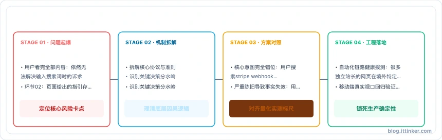
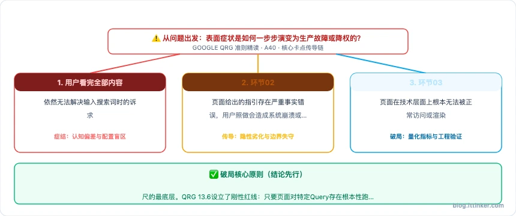
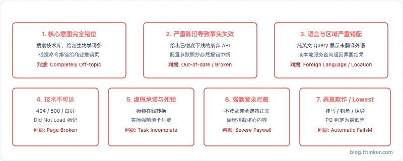
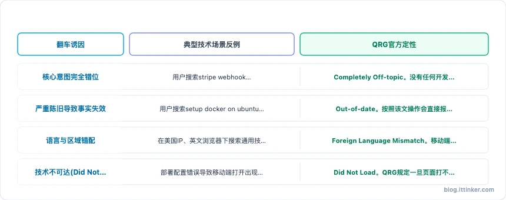
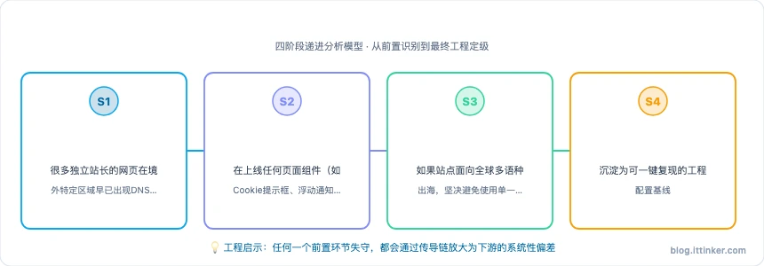
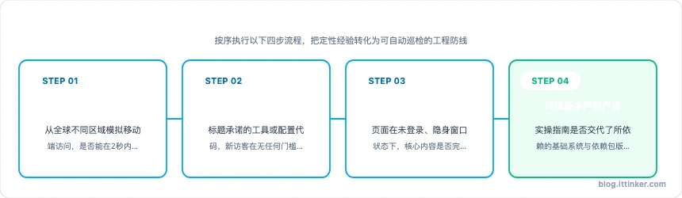

# “满怀希望上线却一无所获”？七步踏空的惨痛教训：一个页面为什么会沦为 Fails to Meet 的弃儿？ | 读懂 Google Search 基础认知 系列 040

> 🌐 **在线阅读与互动版**：[“满怀希望上线却一无所获”？七步踏空的惨痛教训：一个页面为什么会沦为 Fails to Meet 的弃儿？ | 读懂 Google Search 基础认知 系列 040](https://blog.ittinker.com/posts/一个页面为什么会-fails-to-meet/)
> 📚 **所属专栏**：[《读懂 Google Search：110篇搜索质量与SEO实战指南》](../README.md)

---

### 📌 结论先行（TL;DR）
> **Fails to Meet（FailsM，完全不满足）是 Google 需求满足度（Needs Met）标尺的最底层。**
> **在很多出海站长的潜意识里，只有充斥博彩广告、挂马钓鱼的黑产垃圾站，才会被打入 Fails to Meet 的冷宫。**
> **这是一个极具危险性的误区。QRG 13.6 明确强调，Fails to Meet 的核心判定依据是“该结果对当前搜索词背后的用户有没有用”。一个来自 Stanford 或维基百科的高权重页面，只要答非所问或者技术不可用，在特定 Query 下同样会被评估员无情打出 Fails to Meet。**
>
> - **QRG 13.6 设立了刚性红线**：只要页面对特定 Query 存在根本性跑题、关键事实过时失效、语言错配、页面无法加载、或承诺的功能根本无法交付，评估员必须直接打出 FailsM。
> - **即使主站权重再高**：一旦被判定为 FailsM，该页面在对应搜索词下的排名将被算法彻底抹除。

---

### 🚨 2026 → 2024 官方最新风向预警：Google 对Google 对完全未满足意图（Fails to Meet）页面的判定与清算的策略演进

#### 🕒 2026 → 2024 Google 官方对Google 对完全未满足意图（Fails to Meet）页面的判定与清算的策略演进

- **2026 · 即时回退（Quick Bounce）直接触发 Fails to Meet 惩戒**
  当大量真实用户落地后数秒内即回退并点击竞争对手结果时，NavBoost 系统自动将该页面在当前 Query 下标记为 Fails to Meet 并执行急速降权。

- **2025 · 七大典型翻车诱因算法化识别**
  针对死链、虚假承诺（Clickbait）、与意图完全风马牛不相及、内容不可读、恶意弹窗遮挡等典型翻车形态，Google 部署自动化拦截门禁，防止劣质结果污染 SERP。

- **2024 · QRG 14.5 节对 Fails to Meet 判定标准的官方定性**
  指南明确规定：凡是无法对当前查询提供任何有益帮助、甚至因误导而让用户徒劳浪费时间的页面，一律毫不留情地打入 Fails to Meet 废品站。

---

## 1. 拆解 QRG 13.6：Fails to Meet 的官方界定

QRG 第 13.6 节《Fails to Meet (FailsM)》给出了详细的定性规则：

> *"A rating of Fails to Meet (FailsM) should be given to results that are not helpful or satisfying for almost all users. The result is completely off-topic, out-of-date, de-contextualized, offensive, harmful, untrustworthy, unhelpful, or does not address the query at all... A result should receive a rating of Fails to Meet if it does not fulfill the user need."*

根据官方指南指引，满足以下任意一种情况，即构成 Fails to Meet 的充分条件：
- 用户看完全部内容，依然无法解决输入搜索词时的诉求；
- 页面给出的指引存在严重事实错误，用户照做会造成系统崩溃或财务损失；
- 页面在技术层面上根本无法被正常访问或渲染。

---

## 2. Fails to Meet 七大典型翻车诱因全景图

以下矢量架构图展示了评估员在排查 Fails to Meet 时的七大拦截关卡：

---

## 3. 七大翻车诱因的实战剖析与避坑对策

| 翻车诱因 | 典型技术场景反例 | QRG 官方定性 | 独立开发者的整改方案 |
|---|---|---|---|
| **1. 核心意图完全错位** | 用户搜索 `stripe webhook signature verification`，结果落地到一个通篇推销独立站建站 SaaS 方案的广告聚合页。 | **Completely Off-topic**。没有任何开发者能从推销页里拿到签名验证的示例代码。 | 落地页 H1 与正文主干必须绝对服从标题承诺，严禁为了蹭词挂羊头卖狗肉。 |
| **2. 严重陈旧导致事实失效** | 用户搜索 `setup docker on ubuntu`，页面还在教授 `apt-get install docker.io` 的陈旧源，忽略了官方必须配置新 GPG 密钥环的变更。 | **Out-of-date**。按照该文操作会直接报错失败，带来巨大调试成本。 | 在文章顶部明确标注验证通过的发行版与软件版本号；废弃命令及时注明已淘汰。 |
| **3. 语言与区域错配** | 在美国 IP、英文浏览器下搜索通用技术词，页面因为服务端探测误判，强制输出日文或中文且无法一键切回英文。 | **Foreign Language Mismatch**。移动端用户无法看懂，满足度为零。 | 配置标准的 `hreflang` 标签，默认基于 Accept-Language 头优雅降级，切忌粗暴根据 CDN 节点跳转。 |
| **4. 技术不可达 (Did Not Load)** | 部署配置错误导致移动端打开出现 502 Bad Gateway，或者 Cloudflare 开启了过于严苛的防爬模式，直接拦截正常访客。 | **Did Not Load**。QRG 规定一旦页面打不开，评估员停止看后续，直接打 FailsM。 | 建立全球多机房拨测监控，确保移动端真实 UA 能够在 2 秒内拿到 200 响应。 |
| **5. 虚假承诺与死锁** | 标题写着“在线免登录 SQL 美化工具”，进去后点击“Format SQL”按钮，弹窗强制要求绑定信用卡。 | **Inability to Complete Task**。承诺的功能无法达成，构成用户欺骗。 | 工具类页面必须保证核心基础功能随时可用，高级付费特性通过次级操作清晰引导。 |
| **6. 强制登录死锁** | 用户点击排错攻略，刚滑两行就弹出占满屏幕的登录遮罩层，且点击外部无法关闭。 | **De-contextualized / Blocked**。核心主内容被强制隐藏，无法交付。 | 核心技术答案在非登录状态下完全可见，将登录设计为保存记录或高级收藏的自愿行为。 |
| **7. 恶意欺诈或 Lowest PQ** | 冒充知名开源软件官网，页面包含伪装的下载按钮，实际下载捆绑恶意推广软件的安装包。 | **Lowest PQ 连带触发**。根据 QRG 规则，Lowest PQ 页面的 NM 强制为 FailsM。 | 坚守安全底线，全站杜绝任何误导性点击组件与欺诈性质的灰色变现代码。 |

---

## 4. 独立开发者技术基建防御指南

为了彻底隔绝 Fails to Meet 评级的误伤，建议在技术基础设施层面落实三道防线：

### 自动化链路健康拨测
很多独立站长的网页在境外特定区域早已出现 DNS 解析失败或 SSL 证书过期，自己却毫不知情。使用开源监控工具或自动化脚本，配置针对全站关键文章的周期性 HTTP 状态巡检。一旦出现非 200 响应，立即告警修复。

### 移动端真实视口回归验证
在上线任何页面组件（如 Cookie 提示框、浮动通知栏）时，务必在真实 iPhone 与 Android 机型上进行缩放测试。很多在桌面端表现优雅的悬浮弹窗，在移动端会因为 CSS `z-index` 或 `position: fixed` 计算错误，直接把整个正文遮挡得严严实实，导致评估员直接判定为无法阅读。

### 规范多语言路由隔离
如果站点面向全球多语种出海，坚决避免使用单一 URL 根据用户 Cookie 动态渲染不同语言文本。必须采用清晰的子路径架构（如 `/en/`、`/ja/`、`/de/`），并让每套语言页面具备独立的规范链接（Canonical URL）。

---

## 5. 独立开发者 Fails to Meet 避坑自查清单

在审查自有站点的高风险页面时，对照以下清单逐项排查：

- [ ] **HTTP 响应绝对健康**：从全球不同区域模拟移动端访问，是否能在 2 秒内稳定拿到 HTTP 200？
- [ ] **核心承诺无需付费死锁**：标题承诺的工具或配置代码，新访客在无任何门槛下能否直接复制或使用？
- [ ] **正文免登录可读**：页面在未登录、隐身窗口状态下，核心内容是否完整呈现且无全局遮罩？
- [ ] **环境版本声明严谨**：实操指南是否交代了所依赖的基础系统与依赖包版本，规避废弃命令误导？
- [ ] **多语言路由无冲突**：英文版本落地页中，是否杜绝了混杂未经翻译的本地化残留文本？

---

## 下一篇预告

既然知道了 Fails to Meet 的七大诱因，我们就必须直面很多资深站长最无法接受的一个现实矛盾：

**“我的文章明明没有触犯任何一条 Fails to Meet 红线，作者是资深架构师，内容详尽原创，Page Quality 绝对能拿 High，为什么在很多核心词下面，排位依然惨不忍睹？”**

因为：**Page Quality 很高，并不代表 Needs Met 很高。** 它们是两个正交独立的坐标轴。

下一篇，我们将探讨：**[“内容质量满分为什么排名垫底”？困扰无数站长的世纪难题：深度解开 PQ（页面质量）与 NM（需求满足）的双轴错位之谜（A41）](/posts/page-quality-很高-为什么-needs-met-仍然可能很低/)**。

---

_这是「读懂 Google Search」系列第 40 篇，系统拆解 Google 官方质量指南，帮你建立长期抗算法波动的出海 SEO 护城河。_

---

## 读懂 Google Search 专栏导航

> 📚 **专栏收录**：本文为 [《读懂 Google Search：110篇搜索质量与SEO实战指南》](/posts/google-search-guide/) 第 **A40** 篇。

* **专栏主页**：[《读懂 Google Search：110篇搜索质量与SEO实战指南》全景地图与路线图](/posts/google-search-guide/)
