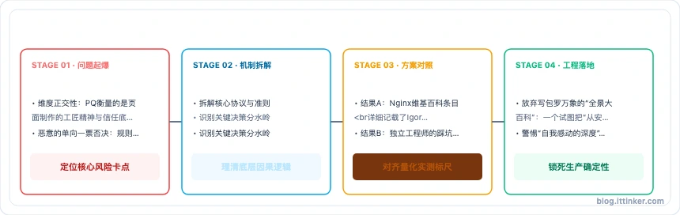
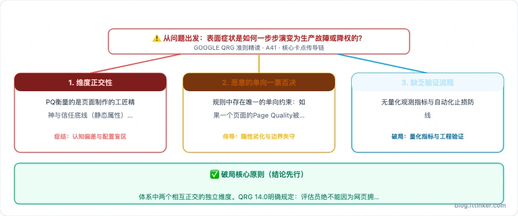
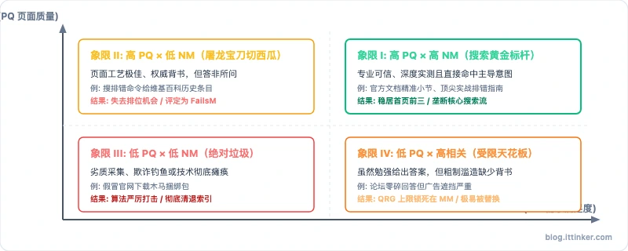
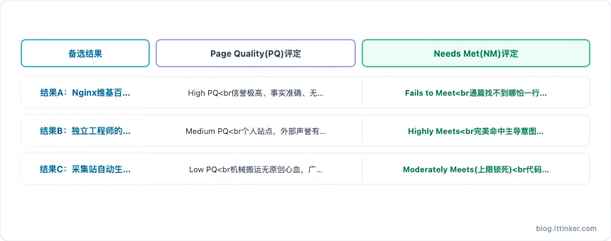
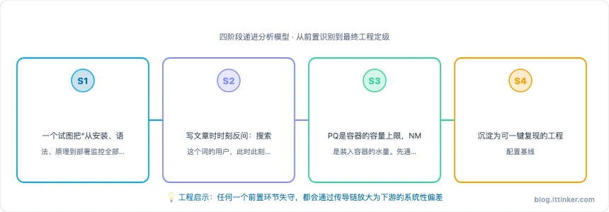
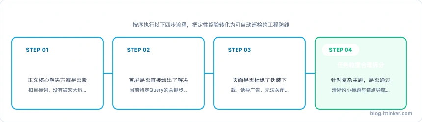

# “内容质量满分为什么排名垫底”？困扰无数站长的世纪难题：深度解开 PQ（页面质量）与 NM（需求满足）的双轴错位之谜 | 读懂 Google Search 基础认知 系列 041

> 🌐 **在线阅读与互动版**：[“内容质量满分为什么排名垫底”？困扰无数站长的世纪难题：深度解开 PQ（页面质量）与 NM（需求满足）的双轴错位之谜 | 读懂 Google Search 基础认知 系列 041](https://blog.ittinker.com/posts/page-quality-很高-为什么-needs-met-仍然可能很低/)
> 📚 **所属专栏**：[《读懂 Google Search：110篇搜索质量与SEO实战指南》](../README.md)

---

### 📌 结论先行（TL;DR）
> **Page Quality（页面质量）与 Needs Met（需求满足度）是 Google 搜索算法评估体系中两个相互正交的独立维度。**
> **在技术站长群体中，最常见的一种执念是“内容为王”。很多人把大量时间花在精雕细琢单篇长文上：补充详尽的历史背景、绘制复杂的拓扑总图、引用十几篇权威文献，最终产出一篇无可挑剔的“高品质页面”。**
> **然而放到真实的 Google 搜索结果中，这篇万字雄文在许多精准搜索词下，排名却被一个只有五行配置代码的小页面远远甩在身后。**
> **这种看似反常的现象，正是 QRG 第 14 节要彻底廓清的底层机理：**“好网页”与“好答案”，从来不是一回事。**
>
> - **QRG 14.0 明确规定**：评估员绝不能因为网页拥有顶尖的信誉（High PQ）就默认它对当前 Query 有用。
> - 一篇出自名校教授之手、结构严谨的代码论文，如果在具体命令排错场景下答非所问，评级同样会被直接打入 Fails to Meet。

---

### 🚨 2026 → 2024 官方最新风向预警：Google 对Google 双轴评分模型（PQ × Needs Met）对排名的协同决策的策略演进

#### 🕒 2026 → 2024 Google 官方对Google 双轴评分模型（PQ × Needs Met）对排名的协同决策的策略演进

- **2026 · 双轴加权机制公式化（Dual-axis Multiplicative Scoring）**
  Google 正式明确：PQ（内在实力）与 NM（需求适配）是互相乘积的关系。哪怕你拥有哈佛教授撰写的 Highest 级万字长文，如果用户只是想要一个 5 秒即开即用的转换小工具，该页面的综合排名得分依然为零。

- **2025 · 错位页面的自然分流与纠偏**
  算法加大对‘高大上但答非所问’内容的识别力度，引导站长将顶级工程能力倾注在最贴合具体查询场景的交付物上，拒绝孤芳自赏式的闭门造车。

- **2024 · QRG 15.0 节对 PQ 与 Needs Met 双轴协同的官方图解**
  规范确立了著名的双轴象限图，告诫所有评估员和站长：高质量不能掩盖无用性，实用性也必须建立在起码的安全信任之上。

---

## 1. 拆解 QRG 14.0：独立滑块与单向制约法则

QRG 第 14.0 节《The Relationship between Page Quality and Needs Met》以极具警示性的语气写道：

> *"The Page Quality rating slider and the Needs Met rating slider are independent. You should not assume that a High Page Quality rating automatically implies a high Needs Met rating, or vice versa... However, there is one important exception: Lowest Page Quality pages should always be rated Fails to Meet."*

这一章节确立了评定搜索排名的两大铁律：

### 维度正交性
PQ 衡量的是页面制作的工匠精神与信任底线（静态属性）；NM 衡量的是该页面对特定搜索者的解题精准度（动态匹配）。两者在评分界面上是两个完全独立的滑动条，评估员必须分开裁决。

### 恶意的单向一票否决
规则中存在唯一的单向约束：**如果一个页面的 Page Quality 被定为 Lowest（存在恶意欺诈、挂马或严重误导），无论它表面上与搜索词看起来多么相关，Needs Met 必须被一票否决打入 Fails to Meet。** 但反过来，即便 PQ 达到最高等级 Highest，只要意图错位，NM 也可能被判定为 Fails to Meet。

---

## 2. PQ × NM 双轴四象限评估矩阵

以下矢量架构图展示了两个维度的正交关系及不同象限的算法命运：

---

## 3. 真实技术场景推演：维基百科为何排不过小博客？

为了具体体会双轴模型的运行，看一个真实的查询案例：

**Query: `nginx 502 bad gateway upstream prematurely closed connection fix`**

搜索该词的用户，通常是一名正面对着线上服务器告警、焦头烂额排查故障的运维或后端工程师。

| 备选结果 | Page Quality (PQ) 评定 | Needs Met (NM) 评定 | 综合算法表现 |
|---|---|---|---|
| **结果 A：Nginx 维基百科条目** 详细记载了 Igor Sysoev 的研发历程、事件驱动架构模型、历代版本发布表。 | **High PQ** 信誉极高、事实准确、无任何广告。 | **Fails to Meet** 通篇找不到哪怕一行与 `upstream prematurely closed` 相关的超时配置调优方案。 | 无论维基百科权重多高，在该词下绝无排上首页的可能。 |
| **结果 B：独立工程师的踩坑备忘** 一个上线三个月的小站，记录了自己在配置 PHP-FPM 与 Gunicorn 时遇到缓冲区溢出的排查过程，给出了 `proxy_buffer_size 128k;` 的配置修改片段与日志抓取验证。 | **Medium PQ** 个人站点，外部声誉有限，但排版干净。 | **Highly Meets** 完美命中主导意图，直指故障根源，命令复制即用。 | 算法给予极高排位加权，稳压各类大厂泛泛而谈的公关文。 |
| **结果 C：采集站自动生成的聚合页** 直接抓取了 StackOverflow 上的该问题问答，但排版错乱，页面充斥三个遮罩弹窗。 | **Low PQ** 机械搬运无原创心血，广告侵入性强。 | **Moderately Meets (上限锁死)** 代码虽能参考，但受制于 Low PQ，评估员最高只能评到 MM，绝不允许评为 HM。 | 流量极度脆弱，核心算法一更新立即被清退。 |

---

## 4. 独立开发者的战略纠偏：从“造大舰”到“发精准导弹”

搞懂 PQ 与 NM 的独立性后，出海独立开发者的内容生产策略需要做出关键校准：

### 放弃写包罗万象的“全景大百科”
一个试图把“从安装、语法、原理到部署监控全部讲完”的超级长页，在泛词竞争中抢不过官方文档，在细分词竞争中又因为信息密度被稀释而败给精准单页。将长文拆解为以具体“任务/错误/配置”为单元的独立专题。

### 警惕“自我感动的深度”
写文章时时刻反问：**搜索这个词的用户，此时此刻最渴望在手机屏幕上看到的第一句话是什么？** 如果前 500 字都在铺垫历史，你的深度在评估员眼里就是严重的“交互阻力”，会直接拉低 NM 分数。

### 守住 PQ 底线，释放 NM 最大势能
PQ 是容器的容量上限，NM 是装入容器的水量。先通过规范的 About 页面、清晰的作者署名、干净无弹窗的阅读体验确立 Medium 到 High 的 PQ 底座，再通过高精度意图契合将 NM 推满至 Highly Meets。

---

## 5. 独立开发者 PQ-NM 双轴核验清单

在发布或重构核心技术页面时，对照以下清单逐项排查：

- [ ] **意图强相关过滤**：正文核心解决方案是否紧扣目标词，没有被宏大历史或无关背景稀释？
- [ ] **首屏有效交付率**：首屏是否直接给出了解决当前特定 Query 的关键步骤？
- [ ] **排除 Lowest PQ 隐患**：页面是否杜绝了伪装下载、诱导广告、无法关闭的遮罩等红线？
- [ ] **任务粒度合理拆分**：针对复杂主题，是否通过清晰的小标题与锚点导航让用户精准定位？
- [ ] **代码与测试验证**：针对具体排错指南，代码参数是否与真实运行环境严谨对齐？

---

## 下一篇预告

既然知道了页面质量与需求满足度是两根独立的杠杆，那么在某些特定搜索场景下，Google 还会引入非常规的特殊判定规则。

比如：当用户搜外语时、当页面因为网络抖动打不开时、或者当内容涉及敏感信息时，评估员会如何执行特殊操作？

下一篇，我们将进入 QRG 第 15 节：**[“语言不通或网页打不开怎么判”？边缘场景的致命扣分：QRG 特殊搜索场景与技术死链深度审校（A42）](/posts/语言-无法加载和敏感结果为什么要单独处理/)**。

---

_这是「读懂 Google Search」系列第 41 篇，系统拆解 Google 官方质量指南，帮你建立长期抗算法波动的出海 SEO 护城河。_

---

## 读懂 Google Search 专栏导航

> 📚 **专栏收录**：本文为 [《读懂 Google Search：110篇搜索质量与SEO实战指南》](/posts/google-search-guide/) 第 **A41** 篇。

* **专栏主页**：[《读懂 Google Search：110篇搜索质量与SEO实战指南》全景地图与路线图](/posts/google-search-guide/)
