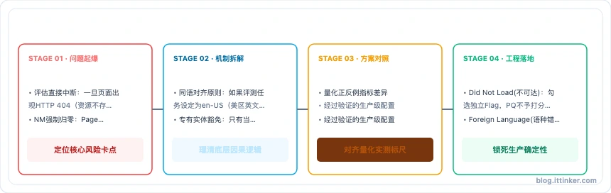
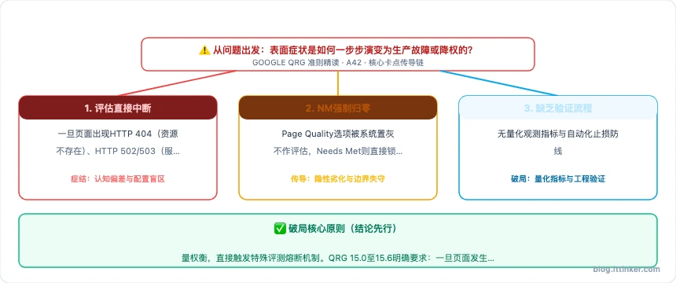
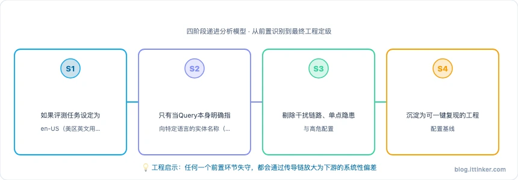
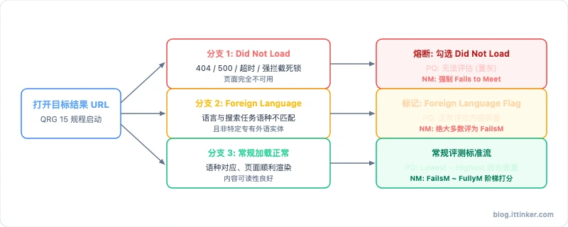
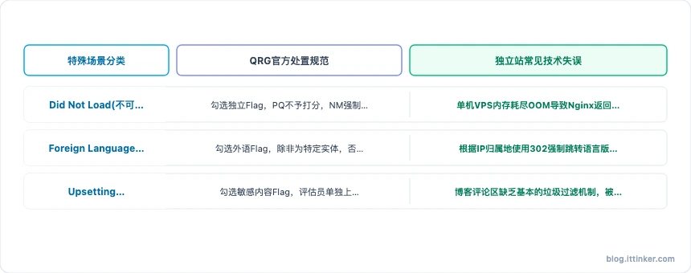
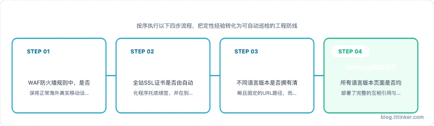

# 语言、无法加载和敏感结果为什么要单独处理？QRG 特殊搜索场景深度审校 | 读懂 Google Search 基础认知 系列 042

> 🌐 **在线阅读与互动版**：[语言、无法加载和敏感结果为什么要单独处理？QRG 特殊搜索场景深度审校 | 读懂 Google Search 基础认知 系列 042](https://blog.ittinker.com/posts/语言-无法加载和敏感结果为什么要单独处理/)
> 📚 **所属专栏**：[《读懂 Google Search：110篇搜索质量与SEO实战指南》](../README.md)

---

### 📌 结论先行（TL;DR）
**在处理跨语种检索、网络故障或违规风险等边缘场景时，Google 会中断常规的质量权衡，直接触发特殊评测熔断机制。**

1. QRG 15.0 至 15.6 明确要求：一旦页面发生技术不可达（Did Not Load），Needs Met 必须零容忍定为 Fails to Meet；
2. 当英文查询返回未翻译的外语页面时，同样面临全量降格。
3. 出海团队必须在网络可用性与 Hreflang 规范化上构筑底线，防止非内容性系统硬伤摧毁整体权重。

在常规评测流程中，评估员会仔细衡量创作者资质、主内容深度以及站外独立声誉。但在 QRG 第 15 节中，Google 列出了几种能够“瞬间中止正常评估”的特殊搜索场景。

很多面向海外市场的出海独立站，内容虽然用纯正英文撰写，却常常因为 CDN 节点防护误杀、服务端地理 IP 粗暴重定向，或者偶发的服务器停机，被评估员直接打上特殊标记。这种标记在搜索系统中往往伴随着致命的断崖式降权。





---

## 1. 拆解 QRG 15.1：Did Not Load（无法加载）的一票否决权

QRG 第 15.1 节对页面可用性设立了绝对红线：

> *"If a page does not load, you cannot evaluate Page Quality... For Needs Met, a result that did not load should receive a rating of Fails to Meet. Please use the Did Not Load flag only when the page truly does not load, such as 404 error, domain expired, or blank page."*

这意味着：
- **评估直接中断**：一旦页面出现 HTTP 404（资源不存在）、HTTP 502/503（服务不可用）、DNS 解析失败或纯白屏，评估员无需继续审查作者或历史信誉，立即勾选 `Did Not Load` 复选框；
- **NM 强制归零**：Page Quality 选项被系统置灰不作评估，Needs Met 则直接锁定在最低档 **Fails to Meet**。

对于出海独立站而言，最隐蔽的陷阱是“在站长本地打开正常，但在海外评估员节点触发 Cloudflare 阻断或白屏”。一旦评估员遭遇验证码拦截或死锁，结果同样会被判定为 Did Not Load。





---

## 2. QRG 15.2 ~ 15.3：多语言错配与 Foreign Language 规则

随着全球多语言流量的增长，QRG 第 15.2 与 15.3 节详细规范了语言维度的判卷标准：

> *"Results in the language of the task should be evaluated normally. Results in a foreign language should generally be rated Fails to Meet, unless the query itself indicates the user wants a foreign language result or the query is in that foreign language."*

官方判卷逻辑可以归纳为两项硬性原则：

1. **同语对齐原则**：如果评测任务设定为 en-US（美区英文用户），用户输入通用英文技术词（如 `docker compose file format`），结果却跳转到一个纯德文或纯日文页面，即便该页面在德国或日本属于顶尖技术博文，针对当前任务的 Needs Met 依然必须评为 **Fails to Meet**。
2. **专有实体豁免**：只有当 Query 本身明确指向特定语言的实体名称（例如查询特定日文开源项目、法语地名或小语种歌曲名），外语页面才被允许打出高分。





---

## 3. 特殊搜索场景的流转分支与判定机制

以下矢量架构图展示了评估员面对异常页面时的流转处理分支：





---

## 4. 特殊搜索场景的典型诱因与工程解法

| 特殊场景分类 | QRG 官方处置规范 | 独立站常见技术失误 | 生产级工程规范解法 |
|---|---|---|---|
| **Did Not Load (不可达)** | 勾选独立 Flag，PQ 不予打分，NM 强制定为 **Fails to Meet**。 | 单机 VPS 内存耗尽 OOM 导致 Nginx 返回 502；或者 SSL 证书过期未自动续签导致浏览器告警拦截。 | 部署自动化证书续期与健康探针，配置反向代理健康检查与优雅重试。 |
| **Foreign Language (语种错配)** | 勾选外语 Flag，除非为特定实体，否则 NM 强制判定为 **Fails to Meet**。 | 根据 IP 归属地使用 302 强制跳转语言版本，导致 Googlebot 爬虫只能索引单一语言，国外访客解析紊乱。 | 严禁基于 IP 暴力重定向；在 HTML 头部配置完整的 `hreflang` 标签矩阵（如 `<link rel="alternate" hreflang="en" ...>`）。 |
| **Upsetting / Offensive (有害敏感)** | 勾选敏感内容 Flag，评估员单独上报，全网算法安全过滤器介入。 | 博客评论区缺乏基本的垃圾过滤机制，被黑产注入违规博彩广告或恶意脚本代码。 | 为评论区添加内容安全审查过滤网，对用户生成内容（UGC）严格添加 `rel="ugc nofollow"` 属性。 |





---

## 5. 多语言独立站的基建实操守则

为了确保海外评测员与 Googlebot 在任何地域都能顺畅阅读，独立开发者应在工程层落实三项规程：

### 消除基于地理 IP 的破坏性 302
很多站长喜欢写代码：“检测到 IP 来自美国就跳转 `/en`，来自日本就跳转 `/ja`”。这种做法极为危险。Googlebot 的抓取节点主要分布在美国，一旦采用强制跳转，其他语种的页面对爬虫而言直接不可达，造成死链或索引冲突。正确的做法是提供醒目的多语言切换器，并通过 HTML 标签告知搜索引擎各版本的对应关系。

### 规范配置 Hreflang 与 Self-Canonical
对于多语言站点的每个页面，确保 `<head>` 中包含清晰的自指与互指声明：
```html
<link rel="canonical" href="https://example.com/en/docker-guide" />
<link rel="alternate" hreflang="en" href="https://example.com/en/docker-guide" />
<link rel="alternate" hreflang="ja" href="https://example.com/ja/docker-guide" />
<link rel="alternate" hreflang="x-default" href="https://example.com/en/docker-guide" />
```
这样评估员在不同语言任务下，算法能自动分发相匹配的语言版本，避免被误判为 Foreign Language。

### 监控真实海外节点的加载耗时
使用全球多机房拨测平台，定期模拟海外真实移动端环境探测首字节时间（TTFB）。如果由于跨国链路阻断导致海外加载经常超过 5 秒甚至超时，必须果断接入 Cloudflare 等全球加速网络。


---

## 6. 独立开发者特殊场景防御自查清单

在推进网站出海或上线多语言版本时，依序核查以下技术点：

- [ ] **海外访问白名单排查**：WAF 防火墙规则中，是否误将正常海外真实移动设备判定为恶意爬虫进行验证码阻断？
- [ ] **SSL 自动续订巡检**：全站 SSL 证书是否由自动化程序托底续签，并在到期前 30 天配置告警监控？
- [ ] **语种路径物理隔离**：不同语言版本是否拥有清晰且固定的 URL 路径，而非通过前端动态覆盖？
- [ ] **Hreflang 双向对齐**：所有语言版本页面是否均部署了完整的互相引用与 `x-default` 回退标签？
- [ ] **UGC 违规拦截到位**：如果开放了用户评论或论坛发帖，是否存在过滤机制阻断恶意链接的注入？





---

## 下一篇预告

排除了语言障碍与加载崩溃这些基础硬伤后，回到正常的搜索排名竞争中，我们会发现一个更有趣的现象：

当用户输入一个包含复杂意图的技术词时，排在首页前五名的往往不是五篇同质化的博客，而是包含了**官方文档、开源 GitHub 库、踩坑实录博客、视频演示与 Reddit 社区讨论**等截然不同的形态。

Google 是如何理解一个词背后的多元形态的？独立开发者该如何在混排形态中找到属于自己的生态位？

下一篇，我们将探讨：**[一个 Query 可以同时需要很多种“好答案”：多样性生态与 SERP 混排法则（A43）](/posts/一个-query-可以同时需要很多种-好答案/)**。

---

_这是「读懂 Google Search」系列第 42 篇，系统拆解 Google 官方质量指南，帮你建立长期抗算法波动的出海 SEO 护城河。_


---

## 读懂 Google Search 专栏导航

> 📚 **专栏收录**：本文为 [《读懂 Google Search：110篇搜索质量与SEO实战指南》](/posts/google-search-guide/) 第 **A42** 篇。

* **专栏主页**：[《读懂 Google Search：110篇搜索质量与SEO实战指南》全景地图与路线图](/posts/google-search-guide/)
