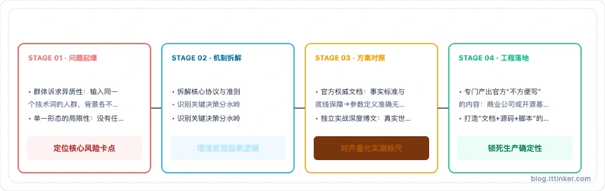
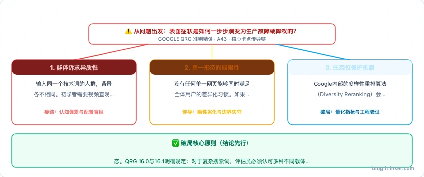
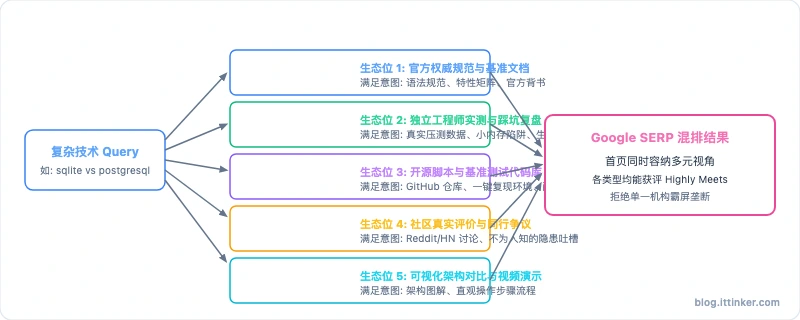
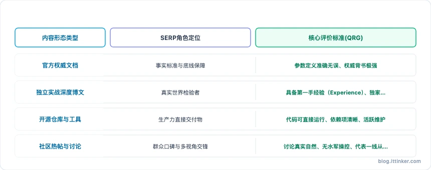
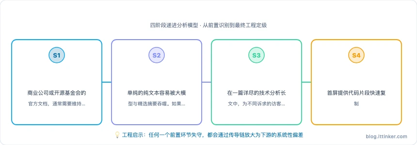
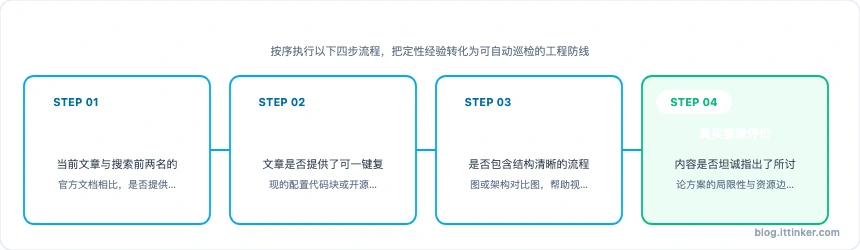

# “屏幕小就随便做”？Mobile First 评估的移动端生死线 | 读懂 Google Search 基础认知 系列 043

> 🌐 **在线阅读与互动版**：[“屏幕小就随便做”？Mobile First 评估的移动端生死线 | 读懂 Google Search 基础认知 系列 043](https://blog.ittinker.com/posts/一个-query-可以同时需要很多种-好答案/)
> 📚 **所属专栏**：[《读懂 Google Search：110篇搜索质量与SEO实战指南》](../README.md)

---

### 📌 结论先行（TL;DR）
> **Google 搜索并非在寻找单一的最优答案，而是在组织一个覆盖多元意图的内容生态。**
> **在很多站长初入 SEO 领域时，容易产生一种线性思维：认为排在第一名的页面一定是全网最全面的内容，自己只要把第一名的内容扩写两倍，就能取而代之。**
> **当仔细观察 Google 的实际首页排位时会发现：前五名很少出现同质化的文章。通常第一位是官方手册，第二位是 GitHub 开源仓库，第三位是独立开发者的长文排错复盘，第四位是 Reddit 社区热帖，第五位则是一段 YouTube 视频演示。**
> **这种形态混排是 Google 算法与 QRG 评估体系有意为之的架构设计。**
>
> - QRG 16.0 与 16.1 明确规定：对于复杂搜索词，评估员必须认可多种不同载体与视角的合理性。
> - SERP 首页本质上是官方规范、独立博主实战踩坑、开源工具脚本以及社区口碑讨论的加权混排。
> - 独立开发者无需在官方文档的优势领域正面硬碰，而应精准抢占实测对比与填坑脚本等差异化生态位。

---

### 🚨 2026 → 2024 官方最新风向预警：Google 对Google SERP 多样性（Diversity）与去重算法的演进的策略演进

#### 🕒 2026 → 2024 Google 官方对Google SERP 多样性（Diversity）与去重算法的演进的策略演进

- **2026 · 生态多样性强制配额系统（Ecosystem Diversity Quota）**
  Google SERP 不再允许前十名全被同一家机构、同一种观点或同一种产品形态垄断。系统强制混排官方文档、第三方测评、独立社区讨论与视频演示，确保用户享有全景知情权。

- **2025 · 同质化观点聚类与挤出效应**
  内容与排名前列高度雷同的‘模仿者页面’遭遇算法聚类折叠，迫使站长必须从反向视角、极限评测或利基场景切入，才能在混排生态中立足。

- **2024 · QRG 17.0 节关于 SERP 多样性价值与多视角评级的官方定调**
  规范强调：一个优秀的搜索引擎，必须展现人类知识与实践的不同侧面，任何把 SERP 当作单一标准答案黑板的狭隘优化终将被算法生态清洗。

---

## 1. 拆解 QRG 16.0：多元有用结果（Many Types of Helpful Results）

QRG 第 16.0 节明确指出：

> *"Many queries have more than one helpful result. For many queries, there are several different interpretations or aspects of the query that can be satisfied by different types of results. A diverse set of results is often best: users may want to read an overview, buy a product, watch a video, or interact with a tool."*

官方在此确立了搜索满足度的“多样性法则”：

1. **群体诉求异质性**：输入同一个技术词的人群，背景各不相同。初学者需要视频直观演示，架构师需要白皮书规范，急于上线的工程师则需要可直接复制的脚本；
2. **单一形态的局限性**：没有任何单一网页能够同时满足全体用户的差异化习惯。如果 SERP 全是千篇一律的长篇大论，搜索体验就陷入了单调；
3. **生态位保护机制**：Google 内部的多样性重排算法（Diversity Reranking）会主动抑制同类型域名的垄断，把展现席位分配给不同属性的内容载体。

---

## 2. 单一 Query 触发的多元内容形态生态图

以下矢量架构图展示了一个复杂技术 Query 如何在 SERP 界面中分化为多种不同生态位：

---

## 3. 五大多元内容形态与竞争策略对比

评估员在审阅不同类型的结果时，其考核侧重完全不同：

| 内容形态类型 | SERP 角色定位 | 核心评价标准 (QRG) | 独立开发者的突围机会 |
|---|---|---|---|
| **1. 官方权威文档** | 事实标准与底线保障 | 参数定义准确无误、权威背书极强 | **避其锋芒**。切勿抄写官方已有的 API 说明。 |
| **2. 独立实战深度博文** | 真实世界检验者 | 具备第一手经验（Experience）、独家数据与踩坑复盘 | **黄金主战场**。撰写官方不便展开的极端场景、性能瓶颈突破。 |
| **3. 开源仓库与工具** | 生产力直接交付物 | 代码可直接运行、依赖项清晰、活跃维护 | **配套出击**。在文章中嵌入由自己维护的 GitHub 模板仓库。 |
| **4. 社区热帖与讨论** | 群众口碑与多视角交锋 | 讨论真实自然、无水军操控、代表一线从业者声音 | **长尾引流**。在 Reddit 等技术板块真诚回答真实工程卡点并留下引用。 |
| **5. 图解与视频流** | 空间感知与动作拆解 | 信息架构清晰、关键步骤无跳跃漏缺 | **辅助加分**。在博客中内联高质量矢量图解，提升阅读留存。 |

---

## 4. 独立站抢占差异化生态位的实操法则

理解了 SERP 多样性机制，独立开发者可以采取三项动作在竞争激烈的关键词下切出一席之地：

### 专门产出官方“不方便写”的内容
商业公司或开源基金会的官方文档，通常需要维持严谨、中立甚至略带公关色彩的口吻。官方通常不会直白地写出“在低于 1GB 内存的服务器上启动该软件极易发生死锁”、“与某知名商业插件联用时存在严重性能衰减”。

这些官方文档刻意避开的生产卡点，正是独立开发者最强大的护城河。基于真实测试环境的客观批评与解决方案，在 QRG 评估体系中属于极其珍贵的 High Quality 增量价值。

### 打造“文档 + 源码 + 脚本”的复合形态
单纯的纯文本容易被大模型与精选摘要吞噬。如果你的博客文章不仅分析了原理，还内嵌了一个托管在 GitHub 上的开源自动化部署脚本（例如一键初始化安全环境），你的落地页就同时跨越了“深度博文”与“实用工具”两个生态位，在 Needs Met 判定中极具抗跌性。

### 尊重不同受众的“快速出口”
在一篇详尽的技术分析长文中，为不同诉求的访客设计清晰的视觉出口：
- 急于排错的读者，首屏提供代码片段快速复制；
- 想要评估选型的读者，提供结构化的 Markdown 性能对比表格；
- 想要深度研读的读者，再展开后续的原理剖析与排错日志。

---

## 5. 独立开发者 SERP 多样性定位自查清单

在规划新内容或评估现有页面表现时，对照以下清单核对：

- [ ] **生态位差异化核验**：当前文章与搜索前两名的官方文档相比，是否提供了不可替代的实测数据或避坑经验？
- [ ] **可交付代码附带**：文章是否提供了可一键复现的配置代码块或开源 GitHub 链接？
- [ ] **视觉图解辅助**：是否包含结构清晰的流程图或架构对比图，帮助视觉导向型用户迅速理清脉络？
- [ ] **真实客观评价**：内容是否坦诚指出了所讨论方案的局限性与资源边界，而非盲目吹捧？
- [ ] **多层级阅读体验**：首屏结论、中间代码、结尾扩展是否界限分明，满足不同深度访客的快速索取？

---

## 下一篇预告

既然 Google 鼓励多种形态的内容共同满足一个 Query，那么紧接着就会面临一个非常尖锐的工程抉择：

**落地页的内容到底要做到多具体、多细碎，才能最完美地匹配一个搜索词？**

是应该像维基百科那样，在一个页面里把所有子分支讲透？还是应该像 programmatic SEO 那样，为每一个极其细小的参数甚至城市名，批量生成上千个独立小页面？

下一篇，我们将探讨：**[“页面到底要做到多细才算对准需求”？粒度错配的无效建站：对齐 Query 粒度与 Programmatic SEO 边界（A44）](/posts/页面到底要做到多具体-才能匹配一个-query/)**。

---

_这是「读懂 Google Search」系列第 43 篇，系统拆解 Google 官方质量指南，帮你建立长期抗算法波动的出海 SEO 护城河。_

---

## 读懂 Google Search 专栏导航

> 📚 **专栏收录**：本文为 [《读懂 Google Search：110篇搜索质量与SEO实战指南》](/posts/google-search-guide/) 第 **A43** 篇。

* **专栏主页**：[《读懂 Google Search：110篇搜索质量与SEO实战指南》全景地图与路线图](/posts/google-search-guide/)
