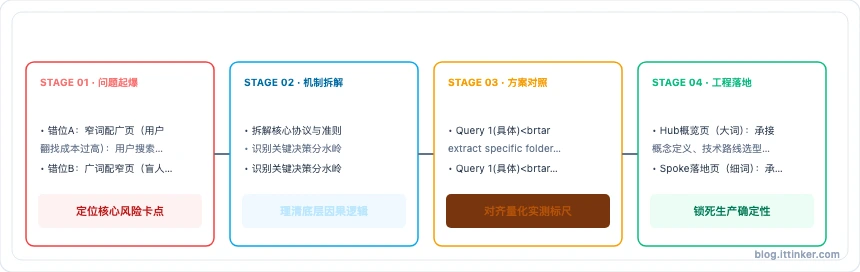
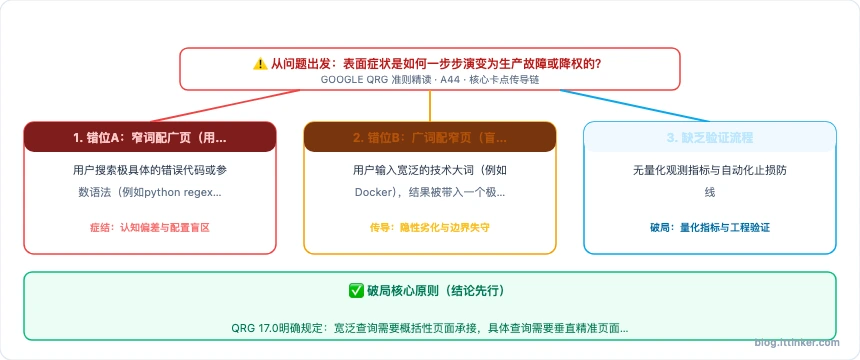
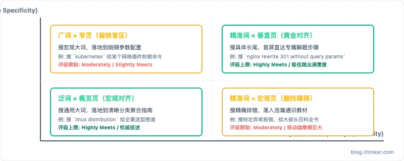
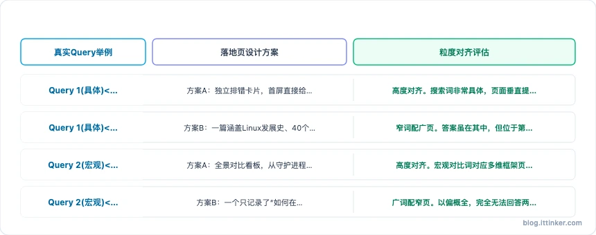
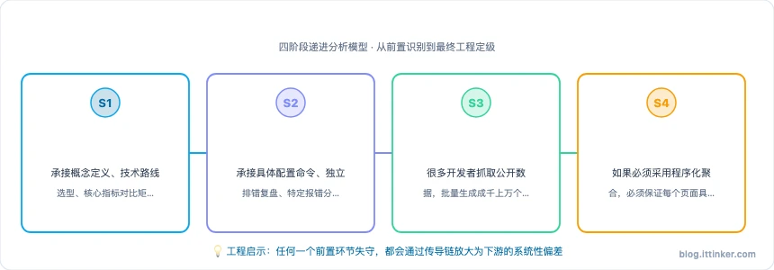
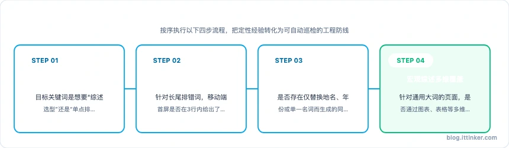

# “页面到底要做到多细才算对准需求”？粒度错配的无效建站：对齐 Query 粒度与 Programmatic SEO 边界 | 读懂 Google Search 基础认知 系列 044

> 🌐 **在线阅读与互动版**：[“页面到底要做到多细才算对准需求”？粒度错配的无效建站：对齐 Query 粒度与 Programmatic SEO 边界 | 读懂 Google Search 基础认知 系列 044](https://blog.ittinker.com/posts/页面到底要做到多具体-才能匹配一个-query/)
> 📚 **所属专栏**：[《读懂 Google Search：110篇搜索质量与SEO实战指南》](../README.md)

---

### 📌 结论先行（TL;DR）
> **落地页的内容颗粒度（Specificity）必须与搜索词的信息粒度保持严密对齐。**
> **在内容架构设计中，出海独立开发者经常在两种极端策略之间反复摇摆：**
> **一种是“贪大求全”，试图在一篇超级长文里讲完所有概念，企图用一个 URL 拿下数十个搜索词；另一种则是近年流行的“极端程序化 SEO（programmatic SEO）”，通过数据库脚本拼装模板，批量生成数千个只替换了城市名或参数名的轻度换皮页面。**
> **这两种极端做法在 QRG 17.0 的量化标尺面前，都极易遭遇评级滑铁卢。**
>
> - **QRG 17.0 明确规定**：宽泛查询需要概括性页面承接，具体查询需要垂直精准页面解答。
> - **用万字全景长文承接长尾精准排错**：会让用户陷入繁重的翻找阻力；
> - 而为无意义的微小参数批量生成换皮页面（极端 pSEO），则会直接触发薄弱内容（Thin Content）惩罚。

---

### 🚨 2026 → 2024 官方最新风向预警：Google 对Google 对搜索粒度对齐（Granularity Alignment）的算法判定的策略演进

#### 🕒 2026 → 2024 Google 官方对Google 对搜索粒度对齐（Granularity Alignment）的算法判定的策略演进

- **2026 · 意图颗粒度精准匹配模型（Intent Granularity Matching）**
  Google 对用户搜索词的抽象层级进行分级响应。宏观词给全景概览，微观词给具体参数代码。粗暴用一个万能模板强行承接微观意图的泛化页面被精准识别并降权。

- **2025 · 程序化颗粒度（pSEO Granularity）滥用防火墙**
  算法打击那些过度拆分长尾词、制造出数万个彼此只有几个数字不同却毫无实质意义的极细碎页面，重申粒度必须建立在真实信息增量之上。

- **2024 · QRG 18.0 节关于搜索具体度（Specificity）与页面交付深度的界定**
  指引指导评估员根据查询词的具体程度判定页面是否给得太少（Too Broad）或给得太偏（Too Narrow），指明了内容颗粒度与长尾架构的最佳平衡点。

---

## 1. 拆解 QRG 17.0：粒度对齐原则（Matching Specificity）

QRG 第 17.0 节《Specificity of Queries and Landing Pages》直接给出了定级公式：

> *"The specificity of the query and the landing page should match. A broad query usually requires a broad landing page. A specific query usually requires a specific landing page... A broad result for a specific query is usually Moderately Meets or Slightly Meets, because users have to work too hard to find the specific information. A specific result for a broad query can also be Moderately Meets or Slightly Meets, because it satisfies only a small part of what the user might be looking for."*

官方在此清晰界定了两种“粒度错位”引发的评分惩罚：

### 错位 A：窄词配广页（用户翻找成本过高）
用户搜索极具体的错误代码或参数语法（例如 `python regex match email without plus`），结果被带入一篇两万字的《Python 正则表达式全景精通指南》。用户必须在手机屏幕上不断滑动、或者依赖站内查找，甚至答案被深埋在折叠代码块里。评估员会认定“用户必须付出过多劳力才能拿到答案”，评级直接压制在 **Moderately Meets 或 Slightly Meets**。

### 错位 B：广词配窄页（盲人摸象式供给）
用户输入宽泛的技术大词（例如 `Docker`），结果被带入一个极其垂直的技术小节《如何在 Alpine 镜像中卸载 curl》。对于绝大多数搜索该词的人群而言，他们需要的是 Docker 的核心概念、生态概况或官网入口。该页面只回答了极其微小的子分支，评级同样只能拿到 **Moderately Meets 甚至更低**。

---

## 2. Query 与落地页颗粒度匹配象限模型

以下矢量架构图展示了搜索词粒度与落地页深度对齐的判定模型：

---

## 3. 粒度对齐与失配的真实案例对比

| 真实 Query 举例 | 落地页设计方案 | 粒度对齐评估 | QRG 定级与表现预测 |
|---|---|---|---|
| **Query 1 (具体)** `tar extract specific folder linux` | **方案 A**：独立排错卡片，首屏直接给出 `tar -xzvf archive.tar.gz path/to/folder` 示范与参数拆解。 | **高度对齐**。搜索词非常具体，页面垂直提供精准命令，无需多余滚屏。 | **Highly Meets**。用户秒解诉求，直接关闭页面。 |
| **Query 1 (具体)** `tar extract specific folder linux` | **方案 B**：一篇涵盖 Linux 发展史、40 个常用系统命令的《Linux 运维完全手册》。 | **窄词配广页**。答案虽在其中，但位于第 18 个小节，用户翻找成本极高。 | **Moderately Meets**。移动端体验被判定为重度摩擦。 |
| **Query 2 (宏观)** `docker vs podman` | **方案 A**：全景对比看板，从守护进程架构、Rootless 权限、系统资源开销到命令行兼容性逐项列表对比。 | **高度对齐**。宏观对比词对应多维框架页面，满足综合评估意图。 | **Highly Meets**。契合绝大多数技术决策者的心智。 |
| **Query 2 (宏观)** `docker vs podman` | **方案 B**：一个只记录了“如何在 Podman 中运行 Nginx 容器并映射 80 端口”的具体命令页。 | **广词配窄页**。以偏概全，完全无法回答两个容器引擎的核心技术哲学差异。 | **Slightly Meets**。绝大多数用户点击后迅速后退。 |

---

## 4. 程序化 SEO（pSEO）的死穴与健康解法

理解了粒度对齐原则，就能清晰看透许多依靠脚本自动生成页面的 pSEO 项目被算法集体抹杀的原因：

### 批量换皮页面的原罪：伪细分与 Thin Content
很多开发者抓取公开数据，批量生成成千上万个页面：如 `best vps for <1000个微型城市>`。对于这些微小地域，内容除了把城市名字用变量替换一次，正文里的推荐机房、测速延迟没有任何真实区别。在 QRG 评估员眼中，这种页面不仅粒度虚假细化，更因为缺乏真正的原创劳动，直接被判定为 **Lowest Page Quality + Fails to Meet**。

### 健康的程序化生产：必须具备“私有数据实体”
如果必须采用程序化聚合，必须保证每个页面具备独立的、排他的、无法通用的高价值数据。例如做不同开源库的性能对比，每个页面必须包含**针对该特定库真实压测生成的基准指标、特定版本依赖树以及真实报错日志**。只有当每一个细分 URL 都有独立的数据灵魂时，粒度对齐才具有合法性。

### 采用 Hub-and-Spoke（中心辐射拓扑）
对于大中型技术站点，最稳妥的架构是将大词与细词解耦：
- **Hub 概览页（大词）**：承接概念定义、技术路线选型、核心指标对比矩阵；
- **Spoke 落地页（细词）**：承接具体配置命令、独立排错复盘、特定报错分析；
- 两者之间通过清晰的内部链接互相打通，让宽泛流量与精准长尾各得其所。

---

## 5. 独立开发者颗粒度对齐自查清单

在架构自己的技术文档与文章分类时，对照以下清单核对：

- [ ] **搜索意图粒度定性**：目标关键词是想要“综述选型”还是“单点排错”？
- [ ] **首屏有效信息浓度**：针对长尾排错词，移动端首屏是否在 3 行内给出了核心配置，避免漫长背景铺垫？
- [ ] **避免伪细碎换皮**：是否存在仅替换地名、年份或单一名词而生成的同质化模板页面？
- [ ] **宏观综述多维覆盖**：针对通用大词的页面，是否通过图表、表格等多维载体涵盖了主要分支？
- [ ] **锚点精准直达**：如果文章确实篇幅较长，是否配置了带唯一 URL Hash 锚点的目录导航？

---

## 下一篇预告

确立了内容形态与颗粒度对齐后，还有一个往往被很多站长玩弄于股掌、却又频繁翻车的关键考量：**内容的时效性（Freshness）**。

很多站长为了假装内容很新，写定时脚本每天把文章的发布日期改成当天，或者在标题里机械加上 `[2026 最新]`。这种改日期的把戏在 Google 质量系统面前真的管用吗？什么时候 Freshness 是决定排名的生死线，什么时候它又毫无意义？

下一篇，我们将探讨：**[“每个月改一下文章发布日期就能保鲜”？自作聪明的保鲜伪造：Freshness 时效性意图与‘改日期欺诈’的必然终局（A45）](/posts/什么时候-freshness-是搜索质量的一部分/)**。

---

_这是「读懂 Google Search」系列第 44 篇，系统拆解 Google 官方质量指南，帮你建立长期抗算法波动的出海 SEO 护城河。_

---

## 读懂 Google Search 专栏导航

> 📚 **专栏收录**：本文为 [《读懂 Google Search：110篇搜索质量与SEO实战指南》](/posts/google-search-guide/) 第 **A44** 篇。

* **专栏主页**：[《读懂 Google Search：110篇搜索质量与SEO实战指南》全景地图与路线图](/posts/google-search-guide/)
