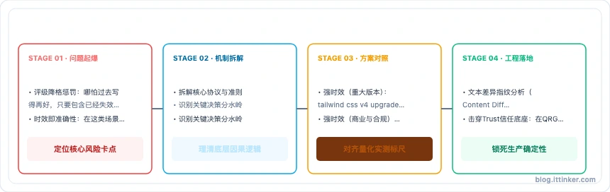
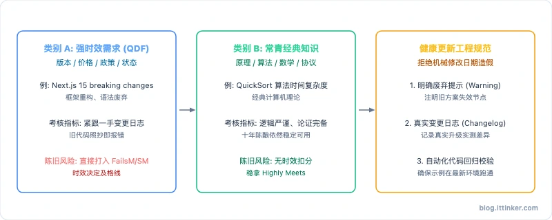
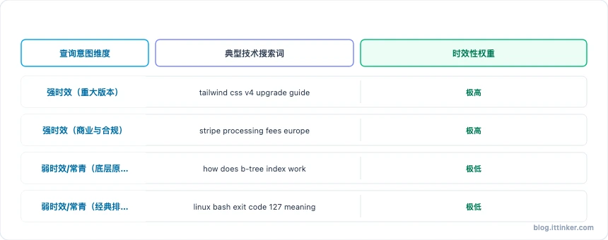
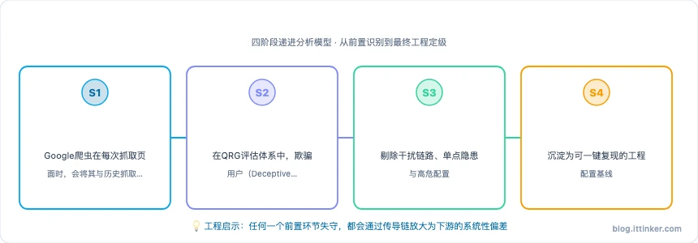
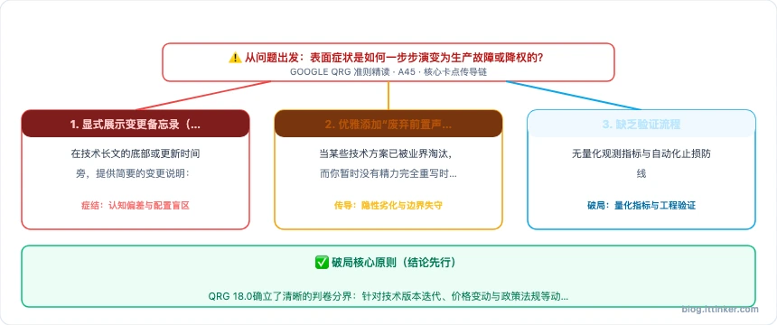
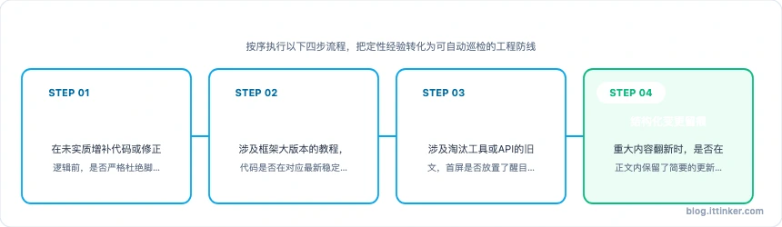

# “图片没有文字怎么拿分”？非文本页面在 Google 眼中的评级标准 | 读懂 Google Search 基础认知 系列 045

> 🌐 **在线阅读与互动版**：[“图片没有文字怎么拿分”？非文本页面在 Google 眼中的评级标准 | 读懂 Google Search 基础认知 系列 045](https://blog.ittinker.com/posts/什么时候-freshness-是搜索质量的一部分/)
> 📚 **所属专栏**：[《读懂 Google Search：110篇搜索质量与SEO实战指南》](../README.md)

---

### 📌 结论先行（TL;DR）
> **时效性（Freshness）是否影响搜索排名，完全取决于 Query 背后的时间敏感度。**
> **在出海内容运营圈子里，流传着一个知名的投机秘籍：“每天写个 cron 脚本，把博客文章的发布时间自动刷新成当天，在标题后面追加 `[2026 Updated]`，就能长期骗取 Google 的新鲜度加权。”**
> **这种把戏不仅低估了 Google 搜索算法的内容版本指纹追踪能力，更彻底误读了 QRG 评估体系对“新鲜度（Freshness）”的本质界定。**
>
> - QRG 18.0 确立了清晰的判卷分界：针对技术版本迭代、价格变动与政策法规等动态领域，陈旧内容在 Needs Met 维度会被直接降级处理；
> - 但在算法原理与计算机底层通识等常青领域，十年陈酿的优质内容依然能够稳拿高分。
> - 试图通过定时脚本篡改修改日期的“伪更新”手段，会被系统判定为欺诈并遭遇降权。





---


### 🚨 2026 → 2024 官方最新风向预警：Google 对Google 时效性算法（QDF）与打击虚假日期（Date Manipulation）的演进的策略演进

#### 🕒 2026 → 2024 Google 官方对Google 时效性算法（QDF）与打击虚假日期（Date Manipulation）的演进的策略演进

- **2026 · 实质内容版本比对引擎（Content Diff Tracking）常态化**
  Google 核心抓取管线直接对比页面历史快照。凡是仅在元数据中修改 `updated_at` 时间戳而未对正文进行实质性事实校准与数据补充的‘伪保鲜’页面，直接打入欺骗性行为清单。

- **2025 · QDF 算法与长青内容（Evergreen）深度剥离**
  算法对时效敏感词（如突发新闻、2026 最新汇率、框架版本发布）施加秒级保鲜考核，而对基础原理等长青内容看重长期积淀，阻断盲目乱改日期的跟风站长。

- **2024 · QRG 19.0 节对内容时效性（Freshness）真实价值的官方界定**
  条款明确区分了‘真正有价值的维护更新’与‘为了蹭算法热度的欺诈性改时间’，为站长指明了健康维护数字资产的长效之道。


---


## 1. 拆解 QRG 18.0：何时需要 Freshness？

QRG 第 18.0 节《Needs Met Rating and Freshness》给出了详尽的原则阐述：

> *"For some queries, freshness is important for satisfying user intent. Freshness is a key factor when the query is about breaking news, recurring events, current information, or topics that change frequently... However, for many queries, older content is still helpful and accurate. You should not assume that newer is always better. For queries with an evergreen intent, a well-researched older article may be better than a rushed new one."*

评估员在审查 Freshness 时，必须遵循两套截然不同的判据：

### 强时效意图（QDF 场景，Query Deserves Freshness）
如果搜索词涉及经常变动的信息——例如软件版本重大更新、云服务资费调整、支付网关 API 变动、国际税法合规：
- **评级降格惩罚**：哪怕过去写得再好，只要包含已经失效的旧命令，评级必须从 Highly 降档至 **Moderately、Slightly 甚至 Fails to Meet**；
- **时效即准确性**：在这类场景中，过时意味着“事实错误与误导”。

### 常青知识意图（Evergreen 场景）
如果搜索词涉及基础原理与通用概念——例如二叉树遍历算法、TCP 握手协议、高并发线程安全设计模式：
- **经久不衰**：只要事实严谨无误，发布于 2018 年与发布于 2026 年在评估员眼里毫无高下之分；
- **无需盲目刷新**：评估员严禁仅因为文章年份较早就扣除 Page Quality 分数。


---

## 2. 时效性需求矩阵与维护流转模型

以下矢量架构图展示了不同搜索意图对时效性的敏感度，以及健康的增量维护工作流：





---

## 3. 强时效 vs 常青意图的实战对照表

| 查询意图维度 | 典型技术搜索词 | 时效性权重 | QRG 评定依据与降级标准 | 站长维护应对动作 |
|---|---|---|---|---|
| **强时效（重大版本）** | `tailwind css v4 upgrade guide` | **极高** | 用户专为解决新版兼容性而来，如果拿 v3 配置充数，评级直接锁定在 **FailsM**。 | 密切跟踪 Release Note，在新版发布后第一时间跑通迁移流程并写出差异表。 |
| **强时效（商业与合规）** | `stripe processing fees europe` | **极高** | 费率与法规具有法律效力，过期信息可能造成商户财务损失，触发 YMYL 强惩戒。 | 页面显式标注生效日期，设置自动化告警追踪官网费率页面变动。 |
| **弱时效 / 常青（底层原理）** | `how does b-tree index work` | **极低** | 基础数据结构与算法原理四十年未变，无须频繁翻新。 | 集中精力优化图解直观度与工程实现代码，无需在标题上硬刷年份。 |
| **弱时效 / 常青（经典排错）** | `linux bash exit code 127 meaning` | **极低** | POSIX 退出码规范固定，只要解释清晰，老文章长期统治首页。 | 确保格式整洁、首屏直接交代退出码定义与常见诱因。 |





---

## 4. 揭露“改日期造假”的算法识破机理与惩罚

很多黑帽 SEO 使用脚本定时更新 HTML 源码中的 `<time>` 标签或 Schema `dateModified` 属性，却不碰正文的一个字。这种伎俩为什么会引火烧身？

### 文本差异指纹分析（Content Diff Analysis）
Google 爬虫在每次抓取页面时，会将其与历史抓取的快照进行 SimHash 或文本指纹比对。如果系统的 `dateModified` 时间戳被修改了，但主要内容区（MC）的核心文本、代码块完全没有实质性增量，算法会将该页面归类为“时间戳伪造（Date Spoofing）”。

### 击穿 Trust 信任底座
在 QRG 评估体系中，欺骗用户（Deceptive Intent）是触发 Lowest Page Quality 的红线。当评估员看到文章标榜“2026 年最新修订”，正文却赫然写着用 `pip install` 已经无法下载的 Python 2 依赖包时，评估员不仅会把 Needs Met 打入 Fails to Meet，更会直接将该网页的 PQ 定为 **Lowest**。全站其他页面也会因此承受连带的信誉降权。





---

## 5. 出海独立站的健康内容维护工程实践

与其投机取巧，不如建立可持续的内容维护机制：

### 显式展示变更备忘录（Changelog）
在技术长文的底部或更新时间旁，提供简要的变更说明：
```markdown
> **版本演进记录**：
> - 2026-10: 验证通过 Next.js 16.0，全面适配 React 19 编译器与异步 Request APIs。
> - 2025-04: 针对 Next.js 15.2 进行多阶段 Docker 构建实测。
```
真实的演进日志是创作者持续投入人类劳动（Effort）的铁证，在评估员眼中属于极高权重的加分项。

### 优雅添加“废弃前置声明”
当某些技术方案已被业界淘汰，而你暂时没有精力完全重写时，切忌装聋作哑。在文章开头插入明显的注意框：
```markdown
> ⚠️ **重要提示**：本指南基于 Ubuntu 20.04 编写。若你在 Ubuntu 24.04+ 环境下部署，请参考针对新版 netplan 规范的最新教程。
```
这种负责任的声明展示了高度的诚信（Trustworthiness），保护页面不会被评估员判定为恶意误导。





---

## 6. 独立开发者内容时效性自查清单

在审查站点存量技术资产时，对照以下清单核对：

- [ ] **拒绝无意义改期**：在未实质增补代码或修正逻辑前，是否严格杜绝脚本自动刷更新时间？
- [ ] **强时效页面环境复测**：涉及框架大版本的教程，代码是否在对应最新稳定版中重新跑通？
- [ ] **废弃命令显式标注**：涉及淘汰工具或 API 的旧文，首屏是否放置了醒目的过时警告？
- [ ] **结构化变更留痕**：重大内容翻新时，是否在正文内保留了简要的更新纪要？
- [ ] **常青内容专注精修**：针对计算机基础通识，是否把重心放在提升图解清晰度与深度上，而非纠结日期？





---

## 下一篇预告

到此为止，我们完成了 Google 质量指南关于 **Needs Met（意图满足）** 与 **特殊场景判卷** 的全部拆解。

然而，用户的搜索行为从来不是精准无误的。在移动端九宫格或全键盘输入时，用户经常会敲下大量包含拼写错误、错别字或模糊缩写的 Query。

Google 是如何纠正用户的拼写错误的？当用户拼错关键词时，搜索引擎会在多大程度上自动“脑补”？对于独立开发者而言，我们该如何为自己的品牌命名，避免被 Google 当作拼写错误强行“纠正”到大厂竞品身上？

下一篇，我们将进入 QRG 第 19 节：**[“用户拼错词是灾难还是机遇”？容错背后的流量密码：从 Typo 自动纠错到品牌命名 SEO 防御（A46）](/posts/拼错关键词-google-到底应该纠正到什么程度/)**。

---

_这是「读懂 Google Search」系列第 45 篇，系统拆解 Google 官方质量指南，帮你建立长期抗算法波动的出海 SEO 护城河。_


---

## 读懂 Google Search 专栏导航

> 📚 **专栏收录**：本文为 [《读懂 Google Search：110篇搜索质量与SEO实战指南》](/posts/google-search-guide/) 第 **A45** 篇。

* **专栏主页**：[《读懂 Google Search：110篇搜索质量与SEO实战指南》全景地图与路线图](/posts/google-search-guide/)
