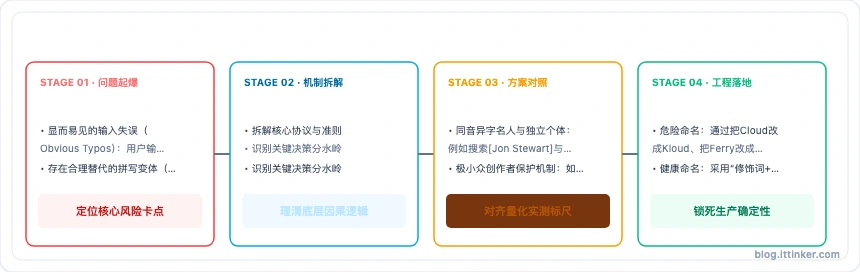
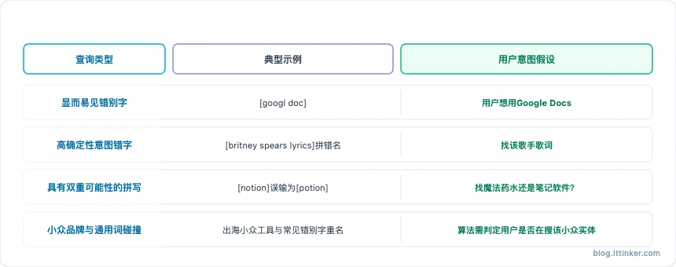
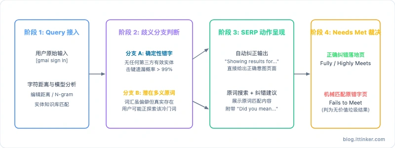
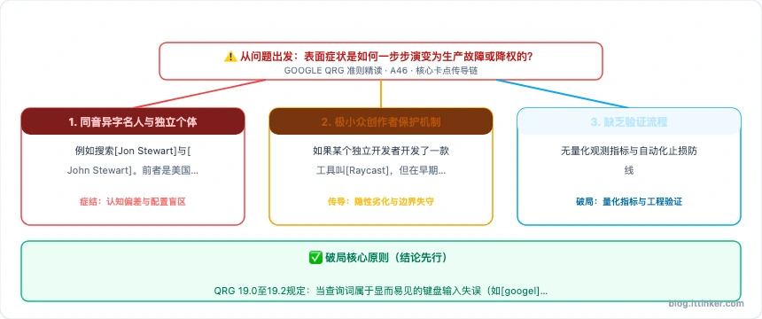
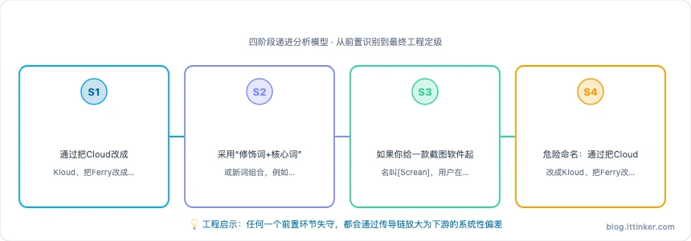
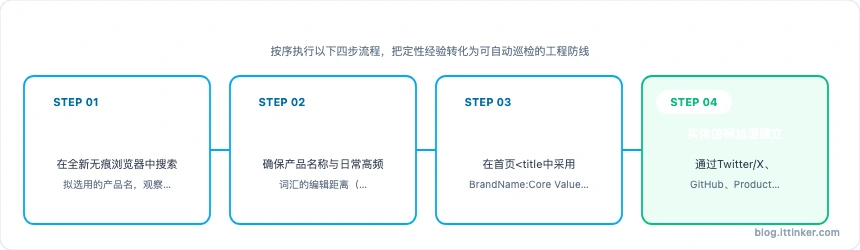

# “用户拼错词是灾难还是机遇”？容错背后的流量密码：从 Typo 自动纠错到品牌命名 SEO 防御 | 读懂 Google Search 基础认知 系列 046

> 🌐 **在线阅读与互动版**：[“用户拼错词是灾难还是机遇”？容错背后的流量密码：从 Typo 自动纠错到品牌命名 SEO 防御 | 读懂 Google Search 基础认知 系列 046](https://blog.ittinker.com/posts/拼错关键词-google-到底应该纠正到什么程度/)
> 📚 **所属专栏**：[《读懂 Google Search：110篇搜索质量与SEO实战指南》](../README.md)

---

### 📌 结论先行（TL;DR）
> **Google 对拼写错误的处理遵循“意图确定性”与“用户真实需求”双重标尺。**
> **在移动设备普及的今天，键盘误触与拼写失误（Typo）几乎发生在每一次搜索会话中。用户敲下 [amazn]、[youtbe] 或某个打错字母的专业术语时，搜索引擎如果死板地返回“未找到包含 amazn 的结果”，搜索体验就会瞬间坍塌。**
> **然而，纠错并非越激进越好。如果用户本就想搜一个叫 [Figma] 的新设计工具，算法却自作聪明地当成词汇拼错并强行纠正为 [Cinema]，就会剥夺用户的探索权利。**
> **在 Google 的质量评估体系中，评估员如何判定一个“带有错别字的查询”？QRG 第 19 节给出了极为详尽的判卷标准。**
>
> - **QRG 19.0 至 19.2 规定**：当查询词属于显而易见的键盘输入失误（如 [googel]、[iphne]）时，算法会直接呈现纠错后的目标结果，直接满足用户意图的页面才能获得 High 或 Fully Meets；
> - 针对原拼写错词的死板匹配反而会被判定为 Fails to Meet。
> - **但如果拼写变体可能对应冷门实体**：系统会保留原词检索开关。
> - 出海团队切不可通过故意堆砌错别字搞投机 SEO，而给产品起名时也应避开与主流强势词高频撞车的命名陷阱。

---

### 🚨 2026 → 2024 官方最新风向预警：Google 对Google 拼写容错（Did You Mean）与品牌实体识别的演进的策略演进

#### 🕒 2026 → 2024 Google 官方对Google 拼写容错（Did You Mean）与品牌实体识别的演进的策略演进

- **2026 · 多模态容错与模糊音节语义映射（Phonetic & Semantic Error Correction）**
  现代 Google 纠错系统不仅修复拼写，更能理解键盘物理距离与跨语种发音变异。试图靠‘注册拼写错误域名劫持流量’的古老黑帽打法被彻底封死。

- **2025 · 品牌实体独占性防御（Brand Entity Disambiguation）**
  针对与通用高频单词拼写相近的初创品牌，算法根据全网实体热度动态建立导航白名单，保护出海创新产品不被通用词纠错吞没。

- **2024 · QRG 20.0 节对用户拼写输入错误与意图推测的处置标准**
  指引确立了评估员处理拼写错误时遵循的常识原则：优先帮助用户找到他们心目中真正想要的内容，而非字面死扣错字。

---

## 1. QRG 19.0 与 19.1：显式失误与多义拼写的界线

QRG 19.0 标题为《Misspelled and Mistyped Queries and Results》，核心原则非常清晰：

> *"Users often make spelling or typing mistakes when entering queries. If the query has an obvious misspelling, raters should evaluate the results based on what the user actually intended to search for."*

评估员在看到带有拼写瑕疵的 Query 时，必须先完成两道意图定性：

1. **显而易见的输入失误（Obvious Typos）**：用户输入的字符组合在任何自然语言、现有品牌或实体中都没有合理含义，只是击键偏移。例如 [wether forecast] 或 [facbook login]。此时用户意图完全收敛于正确拼写。
2. **存在合理替代的拼写变体（Plausible Alternate Meanings）**：用户输入的字符虽然像某个热门词的拼错版，但它本身确实是一个罕见的独立单词、冷门品牌或特定人名。例如 [apple] 与 [aple]（后者可能是一家特定的专利公司或缩写）。

根据 QRG 19.1 的细则，评估员对这两种情况的打分逻辑截然不同：

| 查询类型 | 典型示例 | 用户意图假设 | 纠错后结果的评级 | 原始原词结果的评级 |
| :--- | :--- | :--- | :--- | :--- |
| **显而易见错别字** | `[googl doc]` | 用户想用 Google Docs | **Fully Meets / Highly Meets** | **Fails to Meet**（无用原词匹配） |
| **高确定性意图错字** | `[britney spears lyrics]` 拼错名 | 找该歌手歌词 | **Highly Meets** | **FailsM / LowM**（死板字面匹配） |
| **具有双重可能性的拼写** | `[notion]` 误输为 `[potion]` | 找魔法药水还是笔记软件？ | **Moderately Meets**（需保留多样性） | **Highly Meets**（原词本身具有独立意义） |
| **小众品牌与通用词碰撞** | 出海小众工具与常见错别字重名 | 算法需判定用户是否在搜该小众实体 | 依主次意图判定 | 视品牌知名度与语境而定 |

---

## 2. 拼写纠错决策机制与 Needs Met 判定流

Google 排序系统与评估员在判定用户输入拼写时的逻辑流如下所示：

---

## 3. QRG 19.2：人名与实体查询（Name Queries）的纠错尺度

在第 19.2 节中，QRG 重点强调了实体人名查询的特殊性：

> *"For name queries, the spelling of the name is critical. Sometimes a small difference in spelling refers to completely different people, places, or entities. Raters must be careful to determine whether the user made a typo or was searching for a less famous person with that exact spelling."*

在评估员手册中，处理人名与专有实体存在两条刚性约束：

1. **同音异字名人与独立个体**：
   例如搜索 `[Jon Stewart]` 与 `[John Stewart]`。前者是美国著名脱口秀主持人，后者可能是某所大学的教授或普通专业人士。
   若算法完全扼杀 `[John Stewart]` 的真实人物搜索结果，强行推脱口秀主持人的主页，那么对于找教授的用户而言，该结果同样未满足意图。
2. **极小众创作者保护机制**：
   如果某个独立开发者开发了一款工具叫 `[Raycast]`，但在早期用户搜索 `[ray cast]` 或手滑打成 `[raycats]` 时，早期算法可能会将用户引向图形学“光线投射算法”或猫咪图片。随着实体信号（知识图谱、品牌曝光）的建立，系统才会建立从 typo 到该工具实体的映射。

---

## 4. 出海开发者命名与 SEO 实战防坑策略

许多出海团队在产品上线初期抱怨：“用户搜我们的品牌名，Google 总在顶部显示 *Showing results for [某个英文大词]*，我们的官网被挤到了最底下，这是为什么？”

根源正是 QRG 19.0 所揭示的意图概率剪枝逻辑。系统判定你的品牌名字符串属于那个大词的高频错别字，且没有足够证据表明你的品牌是一个真实独立实体。

为避免在品牌命名阶段埋下 SEO 隐患，需要恪守以下命名与防御准则：

### 4.1 避开高频常见词的单字母变体
如果你给一款截图软件起名叫 `[Screan]`，用户在 Google 搜索它时，算法会以接近 100% 的置信度认定用户打错了 `[Screen]`，从而触发自动纠错。用户必须手动点击“Search instead for Screan”才能看到你的站点。这种摩擦会摧毁你的自然转化率。

### 4.2 复合造词优于纯拼错造词
- **危险命名**：通过把 `Cloud` 改成 `Kloud`、把 `Ferry` 改成 `Feri`。除非已有数百万美元品牌预算去砸出声量，否则早期必然承受漫长的“Did you mean”惩罚。
- **健康命名**：采用“修饰词 + 核心词”或新词组合，例如 `Supabase`、`Linear`、`Raycast`、`PostHog`。这些词在自然语言词典中没有强烈的“拼写修复压制”。

### 4.3 警惕远古 Typo 垃圾站（Typo pSEO）的覆灭
早年黑帽 SEO 会通过收集成千上万个常见词的打错拼写，自动生成海量落地页去截流流量。而在现代 QRG 标准下，QRG 19.1 明确规定：对于显而易见的错别字查询，返回刻意包含该错字、但内容空洞的页面，直接评为 **Fails to Meet** 兼 **Lowest Quality**。这种做法在今天的算法环境不仅拿不到排名，还会导致全站触发垃圾内容算法拦截。

---

## 5. 独立开发者品牌与搜索意图自查清单

在确定产品品牌、编写元数据与排查品牌词曝光时，可对照以下清单逐项验证：

- [ ] **拼写冲突测试**：在全新无痕浏览器中搜索拟选用的产品名，观察 Google 是否出现“Did you mean”或直接跳出其他巨头实体的结果。
- [ ] **自然语言编辑距离排查**：确保产品名称与日常高频词汇的编辑距离（Levenshtein Distance）不等于 1，杜绝误触判定。
- [ ] **品牌落地页 Title 明确度**：在首页 `<title>` 中采用 `BrandName: Core Value Proposition`，而不是孤立放置一个容易被当成错字的单形词。
- [ ] **实体信标加速建立**：通过 Twitter/X、GitHub、Product Hunt、LinkedIn 建立同名官方账号，让 Google 知识图谱以最快速度抓取该专有名词实体。
- [ ] **严禁反向迎合错别字**：站内文章与文档切勿为了抓取错误流量而故意保留大量错别字，保持专业词汇的准确拼写才能维持 High PQ。

---

## 下一篇预告

用户在搜索框里输入一个错别字，Google 需要猜测其真实目标；但如果用户直接在搜索框里粘贴了一串完整的网址（如 `example.com/pricing`），这代表了指向明确的导航意图。

然而，QRG 第 20 节却给出了一个出人意料的结论：**在 URL Queries 场景下，搜索结果即使展示了目标域名的页面，也依然可能被判定为 Non-Fully Meets 甚至完全失败**。

下一篇 [“直接搜我的域名为什么都排不上”？导航搜索的暗礁密布：导航意图背后的死链、重定向与版本陷阱（A47）](/posts/用户直接搜-url-时-为什么也不一定-fully-meets/) 将带你深入死链、301 串流与版本错位背后的技术暗礁。

---

## 读懂 Google Search 专栏导航

> 📚 **专栏收录**：本文为 [《读懂 Google Search：110篇搜索质量与SEO实战指南》](/posts/google-search-guide/) 第 **A46** 篇。

* **专栏主页**：[《读懂 Google Search：110篇搜索质量与SEO实战指南》全景地图与路线图](/posts/google-search-guide/)
