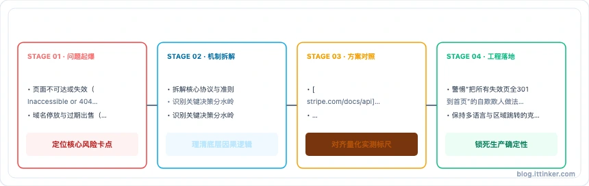
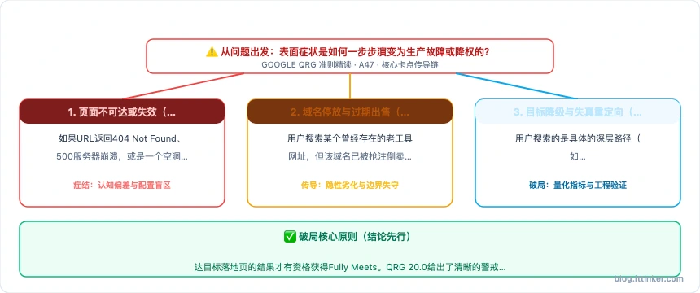
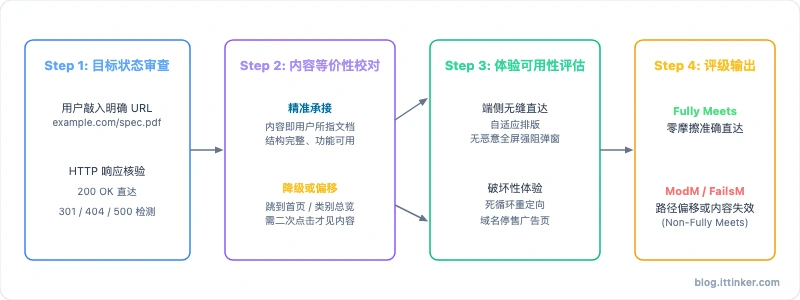
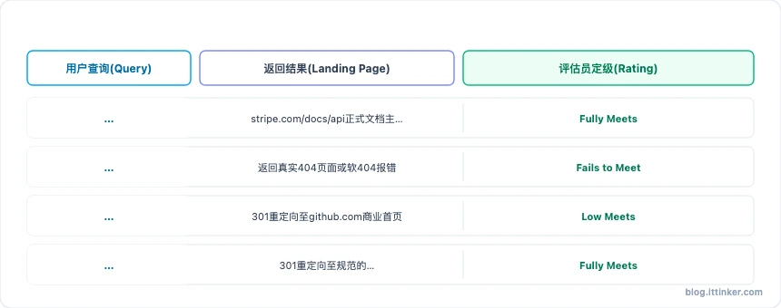
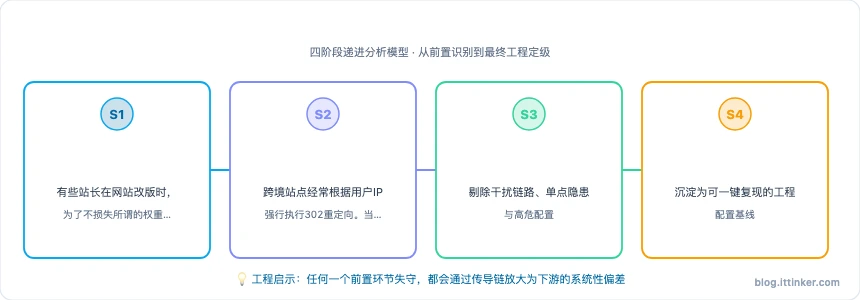
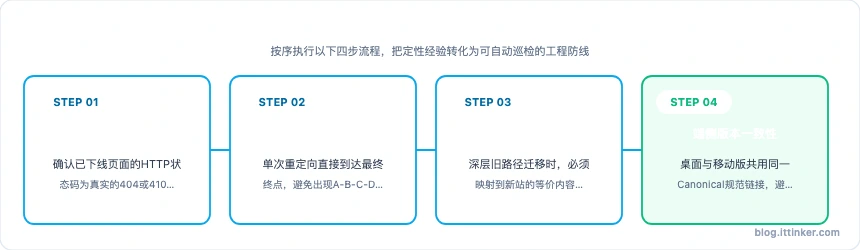

# “为什么搜新闻总能排前面”？时效性与 Freshness 机制深度拆解 | 读懂 Google Search 基础认知 系列 047

> 🌐 **在线阅读与互动版**：[“为什么搜新闻总能排前面”？时效性与 Freshness 机制深度拆解 | 读懂 Google Search 基础认知 系列 047](https://blog.ittinker.com/posts/用户直接搜-url-时-为什么也不一定-fully-meets/)
> 📚 **所属专栏**：[《读懂 Google Search：110篇搜索质量与SEO实战指南》](../README.md)

---

### 📌 结论先行（TL;DR）
> **用户在搜索框直接输入完整网址（URL Query）属于纯粹的导航意图，通常只有直达目标落地页的结果才有资格获得 Fully Meets。**
> **许多站长误以为：“只要用户在搜索框里搜的是我网站的具体网址（比如 `mytool.io/docs/quick-start`），Google 就必然会把我的页面评为最高的 Fully Meets，这还有什么好评估的？”**
> **现实恰恰相反。在 QRG 20.0 中，Google 专门用一个独立章节《Non-Fully Meets Results for URL Queries》讨论 URL 查询评级落空的各类异常状况。当用户输入一个具体地址时，他们期待的是一键直达目标内容，任何加载失败、路径偏移或内容降级，都会直接触发扣分。**
>
> - **QRG 20.0 给出了清晰的警戒线**：如果目标 URL 呈现 404 死链、停放域名、被粗暴 301 踢回无关首页、或者强制跳转到了完全错位的语言/设备版本，评估员必须给出 Non-Fully Meets 甚至 Fails to Meet 评级。
> - 出海建站在做子路径调整、域名迁移与多语言分流时，必须保证 HTTP 状态码真实准确，维持“语义等价”与“路径直达”。





---


### 🚨 2026 → 2024 官方最新风向预警：Google 对Google 导航意图（Website Query）精准匹配与重定向规则的策略演进

#### 🕒 2026 → 2024 Google 官方对Google 导航意图（Website Query）精准匹配与重定向规则的策略演进

- **2026 · 品牌官方首选域自动化锚定（Canonical Domain Anchoring）**
  Google 算法通过全网实体一致性扫描，确保当用户明确搜品牌名或根域名时，官方主页必定高居榜首。任何试图通过仿冒、镜像或站群截流品牌导航词的页面遭遇降权秒杀。

- **2025 · 重定向链条与子目录跳板惩罚**
  针对站长搞错 301/302 重定向、或者将域名搜索导向劣质子目录垃圾页面的架构失误，算法自动施加导航失败（Navigation Failed）阻断。

- **2024 · QRG 21.0 节对 Website Query / Navigational Intent 的铁律规范**
  规范明确：当且仅当用户以绝对明确的意图寻找特定网站时，该官方主页才配享有 Fully Meets 的独占地位，其他竞品严禁在此类意图下搅浑水。


---


## 1. 拆解 QRG 20.0：URL 查询落空的典型判定

QRG 20.0 开宗明义地界定了 URL Query 的打分红线：

> *"When a user enters a URL query, the intent is almost always to find that specific URL or page. If the result leads to the exact page requested, it should be rated Fully Meets. However, there are several situations where a result for a URL query does NOT fully meet the user's need."*

评估员在审查 URL 查询结果时，必须逐一核验落地页的可用性与等价性：

1. **页面不可达或失效（Inaccessible or 404 Pages）**：
   如果 URL 返回 404 Not Found、500 服务器崩溃，或是一个空洞的自定义报错页（Soft 404），该结果无法满足任何需求，直接判定为 **Fails to Meet (FailsM)**。
2. **域名停放与过期出售（Domain Parking / For Sale）**：
   用户搜索某个曾经存在的老工具网址，但该域名已被抢注倒卖，落地页满屏是“This domain may be for sale”或广告诱导链接。此类结果直接评为 **Fails to Meet** 兼 **Lowest PQ**。
3. **目标降级与失真重定向（Degraded Redirection）**：
   用户搜索的是具体的深层路径（如 `example.com/tutorials/react-hooks`），但该 URL 被站点粗暴 301 重定向到了整站主页 `example.com/`。用户并未拿到目标教程，必须重新手动站内搜索，此结果最多只能评为 **Moderately Meets (ModM)** 甚至 **Low Meets**。
4. **移动端/语言版本错位（Mismatched Versions）**：
   移动端用户搜索移动版适配 URL，却被强制跳转至需要横向缩放的旧版桌面端；或者搜索特定英语技术文档，却因粗糙的 Geo-IP 拦截强行弹窗锁死在机器翻译的乱码页。此类体验同样不能拿到 Fully Meets。





---

## 2. URL 查询评估逻辑与分流裁决

评估员在判断一个 URL Query 时，遵循以下四阶漏斗：





---

## 3. 真实 SERP 场景对比矩阵

通过对比真实场景，可以更清晰地理解评估员的打分边界：

| 用户查询 (Query) | 返回结果 (Landing Page) | 评估员定级 (Rating) | 判定成因与失误剖析 |
| :--- | :--- | :--- | :--- |
| `[stripe.com/docs/api]` | `stripe.com/docs/api` 正式文档主页 | **Fully Meets** | 目标页面完好无损，内容完全对应输入期望。 |
| `[nytimes.com/archived-story-1998]` | 返回真实 404 页面或软 404 报错 | **Fails to Meet** | 用户希望阅读该特定历史文章，结果未提供有效信息。 |
| `[docs.github.com/en/actions]` | 301 重定向至 `github.com` 商业首页 | **Low Meets** | 粗暴回跳首页破坏了深层意图，迫使用户重新检索。 |
| `[example.com/login]` | 301 重定向至规范的 `example.com/auth/login` | **Fully Meets** | 语义等价且业务路径直达，满足了用户登录需求。 |
| `[tool.io/download/mac]` | 因 IP 限制强制弹窗拦截无法下载 | **Low to FailsM** | 访问受阻，用户核心操作被阻断。 |





---

## 4. 出海站长技术整改：根治导航意图受损的工程规范

在实际工程运维中，以下几个常见架构失误最容易导致 URL 查询落空：

### 4.1 警惕“把所有失效页全 301 到首页”的自欺欺人做法
有些站长在网站改版时，为了不损失所谓的权重，直接在 Nginx 或 Cloudflare Rules 里写上一行：
```nginx
# 严重错误配置：切勿将所有 404 盲目 301 到首页
error_page 404 =301 /;
```
Google 官方文档明确指出：**将不存在的特定内页重定向到首页，会被算法识别为 Soft 404**。在评估员眼里，用户搜一个具体文章网址却看到首页大图，根本算不上 Fully Meets。正确的做法是：有等价新页面的做 1:1 精确 301，确实下线的页面返回标准 404/410，并提供优雅的站内导航和搜索条。

### 4.2 保持多语言与区域跳转的克制
跨境站点经常根据用户 IP 强行执行 302 重定向。当海外用户或评估员尝试访问美区英文文档时，系统如果因探测到代理节点而将其强制重定向至日文或西文主页，就会彻底破坏该 URL 的导航满足度。语言分流应当采用顶部横幅建议（Banner Prompt），切勿暴力拦截 HTTP 响应。





---

## 5. 独立开发者 URL 与重定向健康度自查清单

在更新站点路由与维护历史链接时，可执行以下技术排查：

- [ ] **HTTP 状态码纯洁性**：确认已下线页面的 HTTP 状态码为真实的 `404` 或 `410`，杜绝返回 `200` 状态码但页面写着“Not Found”的软死链。
- [ ] **重定向链（Redirect Chain）压平**：单次重定向直接到达最终终点，避免出现 `A -> B -> C -> D` 的多次折返跳。
- [ ] **1:1 语义映射重定向**：深层旧路径迁移时，必须映射到新站的等价内容页，杜绝批量粗暴导向主页。
- [ ] **端侧版本一致性**：桌面与移动版共用同一 Canonical 规范链接，避免移动端访问特定文档时发生跳回桌面首页的降级。
- [ ] **停放域名彻底剥离**：废弃的旧域名及时停止在主站 DNS 解析记录中关联，防止垃圾停放页污染品牌搜索结果。





---

## 下一篇预告

用户输入具体网址时，目标通常是唯一确定的；但在商业世界中，绝大多数搜索请求呈现完全不同的形态：用户输入一个产品词，比如 [mechanical keyboard] 或 [video editing software]。

这时，直接展示一个单独的产品详情页并配上“立即购买”按钮，能拿到 Fully Meets 吗？

QRG 第 21 节对此给出了否定答案。下一篇 [“急着替用户下购买决定”？出海导购站的致命硬伤：产品搜索天然需要比较，QRG 商业意图下的研究型页面设计（A48）](/posts/产品搜索为什么天然需要-比较-和-研究/) 将带你拆解商业意图背后的决策漏斗与 SERP 布局逻辑。


---

## 读懂 Google Search 专栏导航

> 📚 **专栏收录**：本文为 [《读懂 Google Search：110篇搜索质量与SEO实战指南》](/posts/google-search-guide/) 第 **A47** 篇。

* **专栏主页**：[《读懂 Google Search：110篇搜索质量与SEO实战指南》全景地图与路线图](/posts/google-search-guide/)
