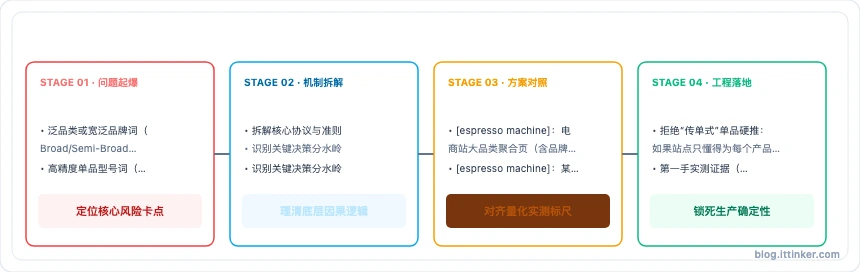
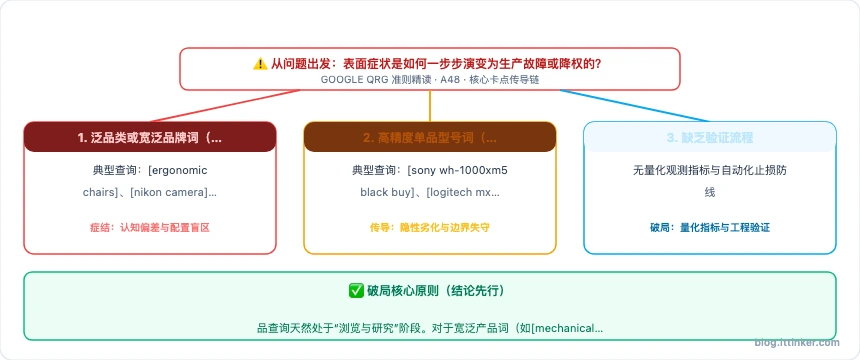
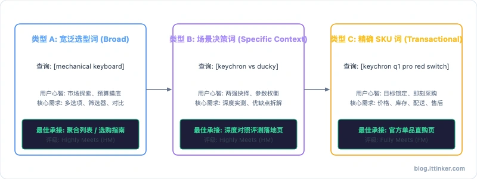
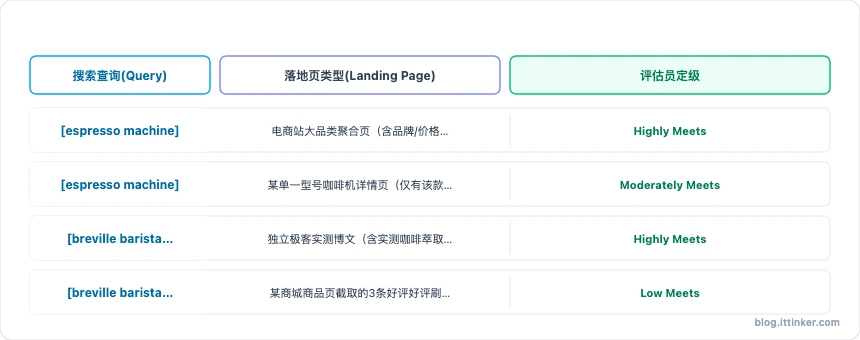
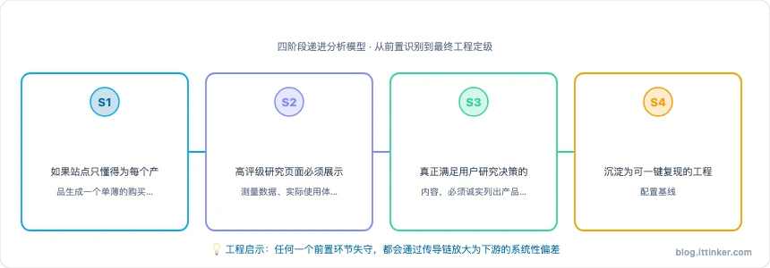
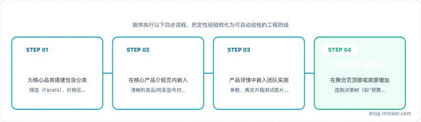

# “社区灌水能不能做 SEO”？UGC 论坛与用户生成内容的质量管控 | 读懂 Google Search 基础认知 系列 048

> 🌐 **在线阅读与互动版**：[“社区灌水能不能做 SEO”？UGC 论坛与用户生成内容的质量管控 | 读懂 Google Search 基础认知 系列 048](https://blog.ittinker.com/posts/产品搜索为什么天然需要-比较-和-研究/)
> 📚 **所属专栏**：[《读懂 Google Search：110篇搜索质量与SEO实战指南》](../README.md)

---

### 📌 结论先行（TL;DR）
> **QRG 21.0 确立了商业产品搜索（Product Queries）的核心评估准则：大部分产品查询天然处于“浏览与研究”阶段。**
> **出海电商和软件团队常犯一个直觉错误：为了提升转化率，恨不得在每一个搜索关键词的落地页顶部放上巨幅价格标签和“Buy Now”大按钮。**
> **然而，当我们在 Google 搜索 [best standing desk] 或 [crm for small business] 时，排在首页的往往是详尽的横向对比评测、聚合选型清单，而不是某款特定桌子的结账详情页。**
> **这一现象背后的核心依据，正是 QRG 第 21 节《Product Queries: Importance of Browsing and Researching》。**
>
> - 对于宽泛产品词（如 [mechanical keyboard] 或 [running shoes]），提供单一商品的落地页最多只能被评为 Moderately Meets；
> - 只有提供多型号聚合列表、参数横向对比或清晰筛选器的页面，才能达到 Highly Meets。
> - 只有当用户输入了极度精准的单一 SKU 规格词时，单品直购页才具备 Fully Meets 资格。
> - **独立站想要拿下品类大词**：必须构建具备深度的选型聚合页与横向测评内容。

---

### 🚨 2026 → 2024 官方最新风向预警：Google 对Google 商业意图与产品评论体系（Product Reviews System）演进的策略演进

#### 🕒 2026 → 2024 Google 官方对Google 商业意图与产品评论体系（Product Reviews System）演进的策略演进

- **2026 · 独立客观测评量化审核（Product Review Algorithm Enforcement）**
  Google 算法全面清退通篇只给自家产品或联盟营销佣金最高产品吹彩虹屁的‘伪测评站’，严厉考核是否给出了真实竞品客观对比、缺点评析与第一手测试环境参数。

- **2025 · 导购陷阱与买量诱导拦截**
  在用户处于‘比较研究阶段（Commercial Investigation）’时，强行弹出购买遮罩或强推单一结账通道的页面，直接触发意图不匹配扣分。

- **2024 · QRG 22.0 节对商业比较意图（Commercial Research）的深度剖析**
  条款要求评估员将自己置于谨慎消费者的视角：一个真正高品质的导购页面，必须提供全面、平衡且有据可查的信息，协助用户自主做出最明智的购买决策。

---

## 1. 拆解 QRG 21.0：浏览（Browsing）与研究（Researching）原则

QRG 21.0 详细界定了评估员在审视产品类查询时的认知逻辑：

> *"For many product queries, users want to browse and research, not just see a single product or immediately buy. A page that offers many choices, allows users to compare different models, or provides detailed specifications and user reviews is often much more satisfying than a page with only one product."*

Google 把产品查询划分为两种完全不同的意图深度：

1. **泛品类或宽泛品牌词（Broad / Semi-Broad Product Queries）**：
   - 典型查询：`[ergonomic chairs]`、`[nikon camera]`、`[email marketing tool]`。
   - 真实心理：用户知道自己需要解决某类问题，但尚未确定具体型号、价格带和配置取舍。他们需要了解市场上有哪些主流玩家、各型号的核心差异以及真实用户评价。
   - 评级定性：**单个商品落地页（Single Product Page）属于受限体验，评级通常封顶在 Moderately Meets**；而提供多品类筛选聚合页（Category / List Page）或多款横向测评文章，能拿到 **Highly Meets**。
2. **高精度单品型号词（Specific / SKU-level Product Queries）**：
   - 典型查询：`[sony wh-1000xm5 black buy]`、`[logitech mx master 3s specs]`。
   - 真实心理：决策链条已基本收敛，用户明确指定了具体的硬件型号或购买动作。
   - 评级定性：此时呈现官方单品页、现货购买通道或该型号精准参数，才能拿到 **Fully Meets** 或 **Highly Meets**。

---

## 2. 产品意图光谱与 SERP 承接流

产品查询从泛意图到精细意图的漏斗流转与评估员打分逻辑如下图所示：

---

## 3. 落地页承接形态与 Needs Met 对照表

理解评估员在不同产品落地页上的评级落差，是电商与 SaaS 页面架构设计的核心课：

| 搜索查询 (Query) | 落地页类型 (Landing Page) | 评估员定级 | 判级依据分析 |
| :--- | :--- | :--- | :--- |
| `[espresso machine]` | 电商站大品类聚合页（含品牌/价格/泵压多维筛选） | **Highly Meets** | 提供了丰富的比较空间，极大降低了用户探索研究的信息搜寻成本。 |
| `[espresso machine]` | 某单一型号咖啡机详情页（仅有该款加购按钮） | **Moderately Meets** | 剥夺了用户浏览其他品牌的机会，只满足了极小一部分碰巧要买该款的用户。 |
| `[breville barista touch review]` | 独立极客实测博文（含实测咖啡萃取视频与客观缺陷分析） | **Highly Meets** | 满足了用户深入研究特定产品的意图，内容具备高原创价值与高 E-E-A-T。 |
| `[breville barista touch review]` | 某商城商品页截取的 3 条好评好评刷单文本 | **Low Meets** | 缺乏实质评测深度，存在商业偏袒，未满足深度研究诉求。 |
| `[buy breville barista touch]` | 包含现货、明码标价、保修条款的授权零售商品页 | **Fully Meets** | 明确的交易购买意图，落地页直接达成转化终点。 |

---

## 4. Google Product Reviews System 与 QRG 21.0 的深度共振

Google 近年持续迭代的 **Product Reviews System（现整合为 Reviews System）**，其算法评分依据完全承袭了 QRG 21.0 的核心逻辑：

1. **拒绝“传单式”单品硬推**：如果站点只懂得为每个产品生成一个单薄的购买页，并在标题里把所有宽泛品类词塞一遍，这类页面在现代 SERP 中几乎无法存活。
2. **第一手实测证据（First-hand Evidence）**：高评级研究页面必须展示测量数据、实际使用体验、与竞品的量化对比参数，而不是照抄厂商宣传彩页。
3. **不仅说好，还要说差（Balanced Perspective）**：真正满足用户研究决策的内容，必须诚实列出产品的适用人群（Who is this for）与不适用场景（Who should avoid this）。

---

## 5. 出海电商与 SaaS 独立站结构优化清单

想要让站点在产品词搜索中获得更高级别的满足度判定，可落实以下页面架构方案：

- [ ] **品类聚合页建设（Category Hubs）**：为核心品类搭建包含分类筛选（Facets）、价格区间过滤与排序功能的汇总页，杜绝直接用单品页硬扛大词。
- [ ] **横向对比矩阵（Comparison Matrix）**：在核心产品介绍页内嵌入清晰的竞品/同系型号对照表格，直接标明芯片、续航、支持协议等核心参数。
- [ ] **真实用户实测凭据（Real Verification）**：产品详情中嵌入团队实测参数、真实开箱测试图片或视频，杜绝纯白底渲染图。
- [ ] **明晰的选购逻辑指引**：在聚合页顶部或底部增加选购决策树（如“预算 500 美元以下首选 A，专业工作室首选 B”）。
- [ ] **完整的结构化数据（Product & AggregateRating Schema）**：正确配置商品价格、库存状态（InStock）与真实评价聚合标记，让 Google 能够直接抽取 Rich Snippet。

---

## 下一篇预告

产品搜索讲究“货比三家”的全局视野；而在另一类高频搜索场景中，**用户的物理现实位置**却直接拥有了一票否决权：

当你在纽约搜 [emergency plumber] 或 [best coffee] 时，哪怕加州的一家修车店评分高达 5.0，展示给你也是毫无意义的彻底失败。

QRG 第 22 节系统规定了 Local Intent 的评估法度。下一篇 [“三行短答怎么打发深度研究”？长周期决策的流量洼地：复杂探索型查询（Complex Research）的交付心法（A49）](/posts/local-intent-用户位置什么时候决定答案/) 将带你拆解地理位置如何改写搜索排序规则。

---

## 读懂 Google Search 专栏导航

> 📚 **专栏收录**：本文为 [《读懂 Google Search：110篇搜索质量与SEO实战指南》](/posts/google-search-guide/) 第 **A48** 篇。

* **专栏主页**：[《读懂 Google Search：110篇搜索质量与SEO实战指南》全景地图与路线图](/posts/google-search-guide/)
