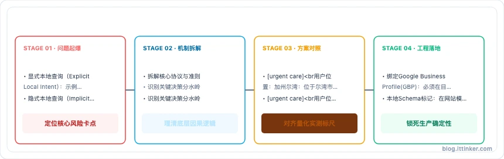
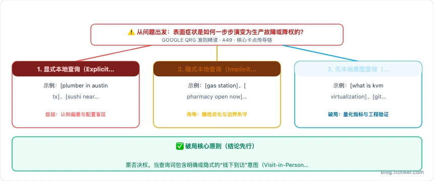
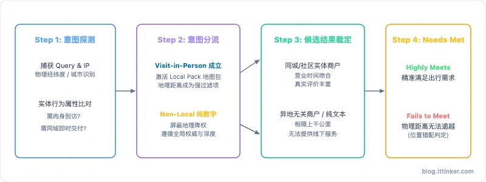
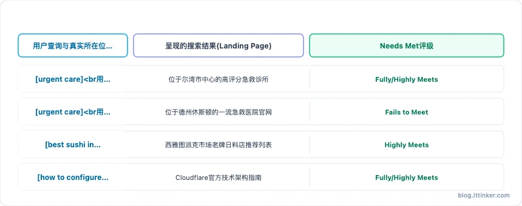
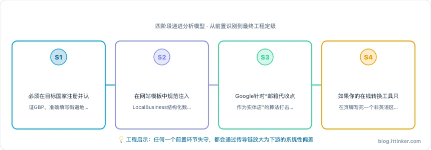
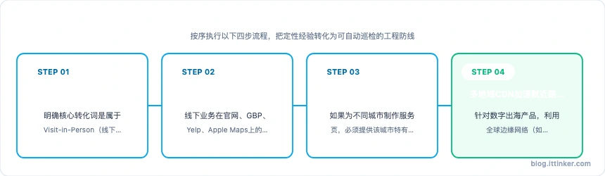

# “同行在抄我也能抄”？Scraped Content 搬运降权红线 | 读懂 Google Search 基础认知 系列 049

> 🌐 **在线阅读与互动版**：[“同行在抄我也能抄”？Scraped Content 搬运降权红线 | 读懂 Google Search 基础认知 系列 049](https://blog.ittinker.com/posts/local-intent-用户位置什么时候决定答案/)
> 📚 **所属专栏**：[《读懂 Google Search：110篇搜索质量与SEO实战指南》](../README.md)

---

### 📌 结论先行（TL;DR）
> **根据 QRG 22.0 与 22.1，用户的物理位置（User Location）在特定场景下拥有一票否决权。**
> **同一个搜索词，由一个身在伦敦的用户和一个身在东京的用户敲入，返回的结果可能天差地别。**
> **如果你在伦敦敲下 [thai food]，Google 会立刻展示苏活区或考文特花园的街角餐馆；但如果你敲下 [docker compose restart policy]，无论你在世界的哪个角落，Google 呈现给你的都是官方 Docker 文档与 Stack Overflow 讨论。**
> **搜索系统在何时必须倾斜地理位置？评估员如何给“带有本地色彩”的结果打分？QRG 第 22 节给出了清晰的评定法则。**
>
> - 当查询词包含明确或隐式的“线下到访”意图（Visit-in-Person Intent，如餐馆、诊所、汽车维修）时，离用户可达范围过远的结果直接沦为 Fails to Meet。
> - **相反**：面向纯软件、开源工具或云服务等数字产品，算法会全面剥离地理权重，转向全球专业度（Global E-E-A-T）与技术权威。
> - **出海团队切忌混淆这两类资产**：实体出海必须深耕 Google Business Profile 与本地信标；
> - 数字 SaaS 则应防止误设地理边界导致全球流量折损。

---

### 🚨 2026 → 2024 官方最新风向预警：Google 对Google 针对深度研究与长链路搜索的满意度评估演进的策略演进

#### 🕒 2026 → 2024 Google 官方对Google 针对深度研究与长链路搜索的满意度评估演进的策略演进

- **2026 · 多层级信息流架构加分机制（Progressive Information Disclosure）**
  针对‘如何架构高并发分布式系统’、‘跨国企业税务合规’等复杂长周期研究词，Google 算法大幅赋权具备结构化目录、前置要点、深层推演与配套参考资源的长文，浅显的短平快回答被边缘化。

- **2025 · 长停留探索链路支持（Deep Research Session Retention）**
  算法追踪用户在页面上的深度阅读轨迹与长文内代码复制行为，以此作为高质量研究交付的核心凭证，抵抗生成式碎片回答的侵蚀。

- **2024 · QRG 23.0 节对复杂研究型查询（Complex Know Intent）的评级指南**
  指引提醒评估员：面对复杂问题，绝不可贪图快速通读，必须深入检查页面是否具备足够的学术或工程纵深，能否承接起一个专业探索者的终极求索。

---

## 1. 拆解 QRG 22.0 与 22.1：本地意图的三级光谱

QRG 22.0 标题为《Queries with Local Intent and Non-Local Intent》，22.1 则进一步聚焦《Visit-in-Person Intent Queries》。Google 将地理关联度分为三类：

1. **显式本地查询（Explicit Local Intent）**：
   - 示例：`[plumber in austin tx]`、`[sushi near shinjuku]`。
   - 特征：用户在查询词中已明确指定了地理锚点。即使用户当前在巴黎，他们也可能是在为即将在奥斯汀举办的活动联系水管工。评估员必须以**词内指定的地理位置**作为评判基准。
2. **隐式本地查询（Implicit Visit-in-Person Intent）**：
   - 示例：`[gas station]`、`[pharmacy open now]`、`[hardware store]`。
   - 特征：词内未提及任何城市名，但常识表明用户需要肉身前往（Visit in person）。评估员必须以**用户当前物理位置（User Location）**为圆心，半径 5–15 英里之外的结果通常无法达成 Highly Meets。
3. **无本地意图查询（Non-Local Intent）**：
   - 示例：`[what is kvm virtualization]`、`[git rebase vs merge]`、`[convert png to webp]`。
   - 特征：信息的消费与交付完全在线上完成，与物理距离毫不相干。如果搜索引擎强行展示本地某家小电脑培训机构的网页，反而会被判定为噪声。

---

## 2. 地理意图路由与 SERP 分发决策流

评估员审视查询与地理位置权重的决策路径如下图所示：

---

## 3. 本地与非本地查询打分判定表

在 QRG 22.0 与 22.1 的示例矩阵中，评估员严格依据以下标准判定：

| 用户查询与真实所在位置 | 呈现的搜索结果 (Landing Page) | Needs Met 评级 | 评估员判定逻辑解读 |
| :--- | :--- | :--- | :--- |
| `[urgent care]` 用户位置：加州尔湾 | 位于尔湾市中心的高评分急救诊所 | **Fully / Highly Meets** | 极强的即时线下就医需求，距离近且当前正在营业。 |
| `[urgent care]` 用户位置：加州尔湾 | 位于德州休斯顿的一流急救医院官网 | **Fails to Meet** | 哪怕休斯顿医院全球闻名，对于尔湾突发急症的用户毫无实用价值。 |
| `[best sushi in seattle]` 用户位置：英国伦敦 | 西雅图派克市场老牌日料店推荐列表 | **Highly Meets** | 显式地理词。虽然用户身处英国，但意图明确指向西雅图本地消费。 |
| `[how to configure nginx ssl]` 用户位置：新加坡 | Cloudflare 官方技术架构指南 | **Fully / Highly Meets** | 纯技术认知型查询，完全无视物理距离，以权威度与可用性为准。 |
| `[bookstore]` 用户位置：芝加哥 | 仅支持线上邮寄下单的海外二手书平台 | **Low Meets** | 隐式本地意图（找书店通常伴随逛店期待），线上商城只能部分满足。 |

---

## 4. 出海企业双轨制 SEO 战略

出海团队在制定站点与技术架构时，必须厘清自己属于“实体落地业务”还是“纯数字云端业务”：

### 4.1 实体出海（跨境餐饮、海外仓、线下门店、展厅）
- **绑定 Google Business Profile (GBP)**：必须在目标国家注册并认证 GBP，准确填写街道地址、当地座机电话（NAP 一致性）、营业时间与服务区域。
- **本地 Schema 标记**：在网站模板中规范注入 `LocalBusiness` 结构化数据，明确标示 `geo.latitude`、`geo.longitude` 与 `openingHoursSpecification`。
- **杜绝虚假地址刷单**：Google 针对“邮箱代收点作为实体店”的算法打击极为严苛，一旦被评估员或系统判定为虚假地址，整站将直接被移出 Local Pack。

### 4.2 数字产品出海（SaaS、开发者工具、API 服务）
- **切忌在首页机械绑定单一国家地址**：如果你的在线转换工具只在页脚写死一个非英语区地址且未加解释，可能在部分区域触发算法误判。保持全球 CDN 加速与通用的国际化联系通道即可。
- **区分本地化法务信息与业务交付**：隐私政策（Privacy Policy）或公司实体介绍中陈列注册地是透明度规范（High PQ 要求），但这与 Local Intent 互不干扰，不应将全站内容限制在特定地域。

---

## 5. 出海本地化与地理意图自查清单

在优化面向特定国家或全球市场的站点时，对照以下清单核对：

- [ ] **意图属性定性**：明确核心转化词是属于 Visit-in-Person（线下到访），还是纯线上软件交付。
- [ ] **NAP（Name, Address, Phone）严格一致**：线下业务在官网、GBP、Yelp、Apple Maps 上的名称、地址和电话字字对齐。
- [ ] **本地落地页（City Pages）拒绝机翻复制**：如果为不同城市制作服务页，必须提供该城市特有的服务案例、当地团队照片与定价，切勿千篇一律替换地名。
- [ ] **多地域 CDN 加速就近路由**：针对数字出海产品，利用全球边缘网络（如 Cloudflare / AWS CloudFront）确保各地域首屏加载时间在 1 秒以内。
- [ ] **本地货币与时区智能呈现**：电商与商业服务提供根据用户地理位置切换货币单位与客服可用时区提示，提升落地满足度。

---

## 下一篇预告

地理位置解决了“用户在哪里”的问题；而在多语言跨国搜索中，另一个更为棘手的问题随之而来：**语言匹配**。

在德国搜索某个技术词，如果 Google 推出了英文结果，评估员会直接判不及格吗？跨国独立站做多语言出海，是用半生不熟的机翻页面去占坑，还是保留精美的高质量英文原版？

QRG 第 23 节对语言版本与非英语区域作出了极其细致的评判。下一篇 [“苹果是水果还是手机”？多义词面前的站队智慧：面对模糊搜索词（Ambiguous Query），独立站点如何选准侧翼？（A50）](/posts/非英语市场出现英文结果-到底算不算好结果/) 将为你系统揭晓。

---

## 读懂 Google Search 专栏导航

> 📚 **专栏收录**：本文为 [《读懂 Google Search：110篇搜索质量与SEO实战指南》](/posts/google-search-guide/) 第 **A49** 篇。

* **专栏主页**：[《读懂 Google Search：110篇搜索质量与SEO实战指南》全景地图与路线图](/posts/google-search-guide/)
