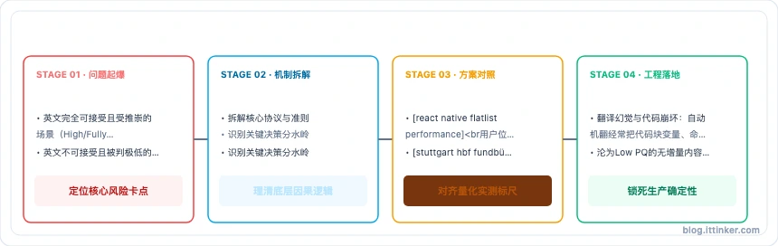
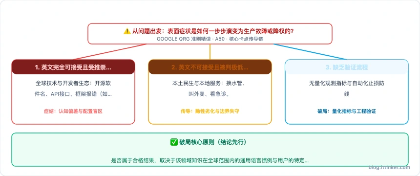
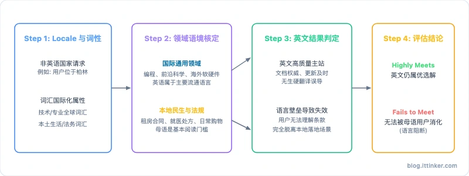
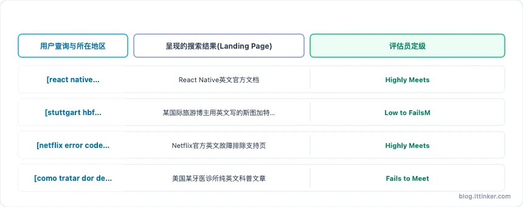
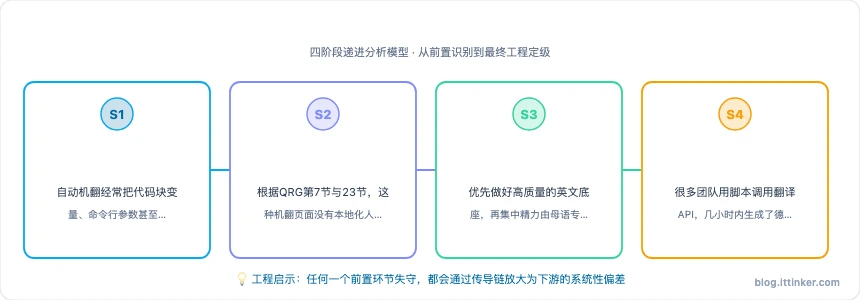
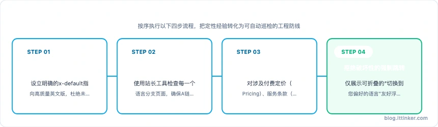

# 非英语市场出现英文结果，到底算不算好结果？多语言出海与 Hreflang 实战指南 | 读懂 Google Search 基础认知 系列 050

> 🌐 **在线阅读与互动版**：[非英语市场出现英文结果，到底算不算好结果？多语言出海与 Hreflang 实战指南 | 读懂 Google Search 基础认知 系列 050](https://blog.ittinker.com/posts/非英语市场出现英文结果-到底算不算好结果/)
> 📚 **所属专栏**：[《读懂 Google Search：110篇搜索质量与SEO实战指南》](../README.md)

---

### 📌 结论先行（TL;DR）
**根据 QRG 23.0 与 23.1，非英语国家（Non-English Locales）出现英文搜索结果是否属于合格结果，取决于**该领域知识在全球范围内的通用语言惯例**与**用户的特定语言需求**。**

1. 对于前沿编程技术、跨国品牌、好莱坞流行文化或国际学术议题，哪怕用户在德国或日本搜索，高质量英文结果依然可以获得 Highly Meets。
2. 但若涉及当地法律、医疗就诊、民生税务等强母语场景，英文结果将被一票否决为 Fails to Meet。
3. 出海独立站切忌用生硬机翻批量制造多语言垃圾页，规范配置 hreflang 并保障各语言版本的内容深度才是出海正途。

跨国独立站做全球化拓展时，经常面临一个战略抉择：

是先把英文主站做到极致，还是用翻译脚本一口气生成西语、德语、法语、日语等 20 个语言分站？如果德国用户在本地搜索一个技术词，Google 搜出了我们的英文原版文档，评估员会判我们“语言错配”给个差评吗？

在 QRG 第 23 节中，Google 用《Rating English Language Results in Non-English Locales》给出了兼具包容性与严密性的裁定标准。





---

## 1. 拆解 QRG 23.0 与 23.1：语言可接受度的分级尺度

QRG 23.0 深入分析了非英语国家的语言生态：

> *"In many non-English locales, English is widely understood or even expected for certain types of queries. However, for queries about local services, health, or everyday life, users expect results in the local language."*

评估员在审查非英语 Locale（例如 `de-DE` 德国、`ja-JP` 日本、`pt-BR` 巴西）时，根据查询的主题特性执行分流判定：

1. **英文完全可接受且受推崇的场景（High / Fully Acceptable）**：
   - **全球技术与开发者生态**：开源软件名、API 接口、框架报错（如 `[kubernetes ingress controller example]`、`[rust borrow checker error]`）。全球工程师普遍习惯阅读一手英文文档。
   - **国际商业品牌与学术论文**：海外大牌官网、顶尖科学文献。
   - **全球流行文化与影视娱乐**：欧美知名乐队、国际赛事官方资讯。
   在上述场景中，英文页面完全能拿到 **Highly Meets**。
2. **英文不可接受且被判极低的场景（Unacceptable / Fails to Meet）**：
   - **本土民生与本地服务**：换水管、叫外卖、看急诊。
   - **本土法律、合规与税收**：德国报税规则、日本年金制度。
   - **日常通用常识（基础教育、菜谱、生活百科）**：用户在母语环境下搜索“如何做苹果派”，返回英文食谱会造成极高的阅读门槛，通常评为 **Fails to Meet** 或 **Low Meets**。





---

## 2. 多语言搜索意图判定与分流流转

非英语 Locale 搜索请求的语言匹配流转逻辑如下图所示：





---

## 3. 非英语市场中英文结果的打分对照表

以下是 QRG 23.0 体系下的标准案例对照：

| 用户查询与所在地区 | 呈现的搜索结果 (Landing Page) | 评估员定级 | 评级依据剖析 |
| :--- | :--- | :--- | :--- |
| `[react native flatlist performance]`<br>用户位置：日本东京 | React Native 英文官方文档 | **Highly Meets** | 国际通用技术查询，开发者社群默认能消化英文文档，甚至更信任原版。 |
| `[stuttgart hbf fundbüro]`（斯图加特总站失物招领）<br>用户位置：德国斯图加特 | 某国际旅游博主用英文写的斯图加特游记 | **Low to FailsM** | 极度明确的本地便民意图，德铁官方德语失物申报系统才是唯一正解。 |
| `[netflix error code ui-800-3]`<br>用户位置：巴西圣保罗 | Netflix 官方英文故障排除支持页 | **Highly Meets** | 标准错误代码，英文方案提供权威步骤，能有效解决故障。 |
| `[como tratar dor de dente à noite]`（深夜牙疼怎么处理）<br>用户位置：巴西圣保罗 | 美国某牙医诊所纯英文科普文章 | **Fails to Meet** | YMYL 健康紧急意图，葡语用户突发剧痛无法仔细阅读专业医学英文。 |





---

## 4. 多语言出海独立站的致命陷阱与 Hreflang 工程规范

结合上述原则，出海团队在做多语言国际化时，需要避开两大技术雷区：

### 4.1 警惕“AI 批量机翻生成 50 种语言站群”
很多团队用脚本调用翻译 API，几小时内生成了德语、法语、意语等几十个子目录。然而：
1. **翻译幻觉与代码崩坏**：自动机翻经常把代码块变量、命令行参数甚至 Markdown 语法一起翻译，导致落地页功能全面失效。
2. **沦为 Low PQ 的无增量内容**：根据 QRG 第 7 节与 23 节，这种机翻页面没有本地化人工审核，充斥语法硬伤，既无法获得母语用户的 Trust，又浪费了宝贵的主域抓取预算。
3. **策略建议**：优先做好高质量的英文底座，再集中精力由母语专业人员逐一开拓重点高价值市场（如日文、德文）。

### 4.2 严密部署 Hreflang 避免区域串流
多语言架构必须采用标准的 `<link rel="alternate" hreflang="..." />` 标签，并确保双向引用（Bidirectional Linking）：

```html
<!-- 在英文版页面 https://example.com/en/docs/pricing 中插入 -->
<link rel="alternate" hreflang="en" href="https://example.com/en/docs/pricing" />
<link rel="alternate" hreflang="de" href="https://example.com/de/docs/pricing" />
<link rel="alternate" hreflang="ja" href="https://example.com/ja/docs/pricing" />
<link rel="alternate" hreflang="x-default" href="https://example.com/en/docs/pricing" />
```

其中 `x-default` 是兜底信标，负责将未明确匹配语言区域的用户（如中东或北欧访问者）平滑引导至默认的高质量英文版。





---

## 5. 多语言独立站出海落地自查清单

在发布多语言版本前，依循以下步骤进行技术校验：

- [ ] **优先保留英文原版兜底**：设立明确的 `x-default` 指向高质量英文版，杜绝未覆盖语言的用户撞入空白或破损分支。
- [ ] **Hreflang 双向回链验证**：使用站长工具检查每一个语言分支页面，确保 A 链向 B 时，B 同样包含回链 A 的对应 alternate 标记。
- [ ] **母语人工润色核心页面**：对涉及付费定价（Pricing）、服务条款（Terms）和核心落地页（Landing），必须经由懂当地语言的专业人员核验，杜绝机翻硬伤。
- [ ] **拒绝破坏性的强制跳转**：仅展示可折叠的“切换到您偏好的语言”友好浮条，不要仅凭 IP 就粗暴执行 302 跨语言拦截。
- [ ] **代码与技术标识免翻保护**：在翻译流水线中对 `<code>`、`<pre>`、专有名词与参数严格添加 `translate="no"` 属性。





---

## 下一篇预告

在多语言国际化中，我们探讨了权威英文与本地语言的边界；而在信息检索的另一个极端，用户经常搜索诸如 [what is inertia]、[define semantic search] 这样的名词概念。

面对此类查询，维基百科（Wikipedia）或牛津词典（Oxford Dictionary）给出一两句精准释义，就是终极满分答案吗？

QRG 第 24 节专门用一整节探讨了词典与百科类结果在不同场景下的天壤之别。下一篇 [词典和百科为什么有时是最佳答案，有时完全不够？定义型查询与深度意图的分野（A51）](/posts/词典和百科为什么有时是最佳答案-有时完全不够/) 将带你理清定义型意图与深度实操的边界。


---

## 读懂 Google Search 专栏导航

> 📚 **专栏收录**：本文为 [《读懂 Google Search：110篇搜索质量与SEO实战指南》](/posts/google-search-guide/) 第 **A50** 篇。

* **专栏主页**：[《读懂 Google Search：110篇搜索质量与SEO实战指南》全景地图与路线图](/posts/google-search-guide/)
